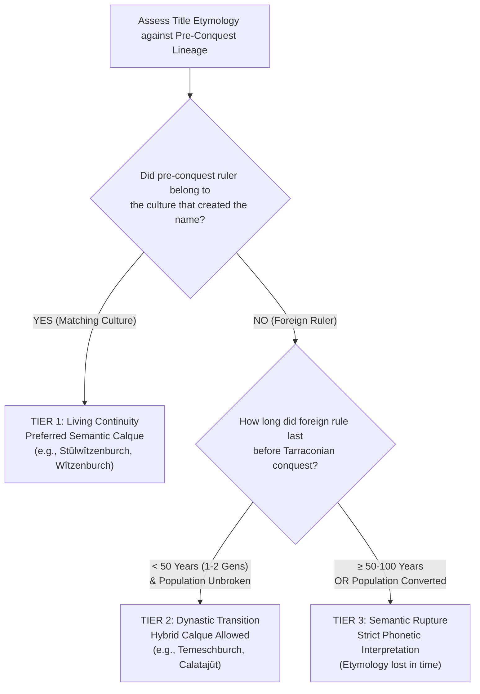
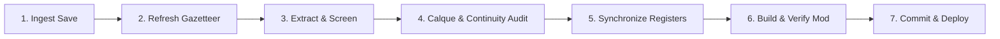

# The Tarraconian Roman Empire: Imperial Chancellery & Toponymic System

[](https://www.crusaderkings.com/)
[](file:///mnt/windows/Users/siarg/Documents/Paradox%20Interactive/Crusader%20Kings%20III/save%20games/chatenois_867_01_01.ck3)
[]()
[]()

Welcome to the central repository for the **Tarraconian Chancellery** project—an alternate-history worldbuilding, onomastic reconstruction, and modding suite for **Crusader Kings III**. 

This repository maintains the master gazetteers, linguistic sound laws, historical audit pipelines, and game localization files governing the titles, dynasties, and cultures of the restored **Roman Empire** (*Dat Rômische Keiserrîch*).

---

## 1. Project Overview & Historical Setting

### 1.1 The Alternate-History Horizon (867–1154)
The campaign diverges from real-world history on **1 January 867 AD**. 

The ruling **Chatenois** dynasty (originating from the Moselle-Franconian nobility of Metz and Lorraine) diverged **Lothringian** (`ID 249`) from Franconian in 877. Pushing southward across Gaul into the Mediterranean, they established dominion over the Spanish March (*Hispania Tarraconensis* — Barcelona, Tarragona, Urgell, and Lleida).

On **31 August 989**, the dynasty formally hybridized **Lothringian** with native **Catalan** (`ID 82`) to form **Tarraconian** (`ID 316` / *Tarracono-Lothringian*):
* **Lothringian Heritage (Central Germanic):** Preserved 11th/12th-century Rhine-Moselle Franconian High German phonology, unshifted consonants, and traditional Franconian baptismal names (*Wernhard*, *Adémar*, *Guntram*, *Sieghard*).
* **Catalan Heritage (Courtly Occitano-Romance):** Adopted courtly ethos, Mediterranean maritime mercantilism, Iberian stone architecture, and an imperial administrative magistracy (*Veguerîe / Magistrat*).

### 1.2 The Restored Roman Hegemony (*Dat Rômische Keiserrîch*)
Under **Kaiser Adémar "the Great"** (`ID 62400`) and **Augustus Wernhard "the Bear"** (`ID 67256089`), the dynasty united the Western Crown of the **Holy Roman Empire** (`e_hre`) with the Eastern Crown of the **Byzantine Empire** (`e_byzantium`), restoring the unified **Roman Empire** (`h_roman_empire` / Hegemony tier `ID 0`).

As of **27 December 1154**, the realm encompasses:
* **930 counties** in the Tarraconian cultural family (915 standard Tarraconian, 13 Croato-Tarraconian, 2 Ungwârer).
* **1,972 directly controlled counties** (72.2% of all 2,732 de jure counties across 35 empires and 160 kingdoms), spanning continuously from Iceland and Ireland to Scandinavia, Anatolia, the Levant, Egypt, the Steppes, Central Asia, and the borders of China and India.

### 1.3 The Tarraconian Language & Daughter Tongues
Tarraconian is linguistically structured like an alternate-history "reverse Middle English" (Germanic grammar and phonology fused with an Occitano-Romance administrative superstrate):
* **Imperial Tarraconian (`ID 316`):** West Central German (Rhine-Moselle Franconian) sound system written with Catalan-Aragonese scribal conventions. Long vowels carry circumflexes (**`â, ê, î, ô, û`**), word-final obstruents strictly devoice per *Auslautverhärtung* (**`-burch`**, **`-berch`**, **`-stat`**, **`-lant`**), and affricates are written **`z-`** initially and **`-tz`** medially/finally.
* **Croato-Tarraconian (`ID 345`, formed 1057):** Dinaric-Adriatic dialect blending South Slavic precision with Franconian grammar.
* **Ungwârer (`ID 367`, formed 1093):** Carpathian-Steppe daughter language that shifted to Old Hungarian (`language_magyar`) while retaining Central Germanic heritage and Franconian onomastics on the Upper Hungarian frontier.

---

## 2. Repository Architecture & Sitemap

| Master Document / Directory | Path | Purpose & Scope |
| :--- | :--- | :--- |
| **Imperial De Jure Gazetteer** | [hre_de_jure_and_archdioceses_1059.md](file:///home/siarzhuk/code/personal/tarraconian_hre/hre_de_jure_and_archdioceses_1059.md) | The master ledger of all 47 empires, 213 kingdoms, 970 duchies, and 3,476 counties worldwide, tracking imperial control percentages and historical attestations. |
| **Tarraconian Titles Gazetteer** | [tarraconian_titles_1059.md](file:///home/siarzhuk/code/personal/tarraconian_hre/tarraconian_titles_1059.md) | Exhaustive register of official Tarraconian names, adjectives, and IPA transcriptions for all landed titles and archdioceses. |
| **Linguistics & Sound-Shift Guide** | [tarraconian_linguistics_guide.md](file:///home/siarzhuk/code/personal/tarraconian_hre/tarraconian_linguistics_guide.md) | Complete reference for Tarraconian phonology, IPA values, vowel quantity laws, consonant shifts, and orthographic constraints. |
| **Descriptive Title Calques Guide** | [tarraconian_descriptive_title_calques.md](file:///home/siarzhuk/code/personal/tarraconian_hre/tarraconian_descriptive_title_calques.md) | Master Morpheme Translation Matrix (forts, churches, waters, oronyms, colors, Sinosphere, Steppe, Boreal, Africa, India) across 14 audited culture groups. |
| **Sinosphere 1154 Audit** | [sinosphere_titles_and_characters_1154.md](file:///home/siarzhuk/code/personal/tarraconian_hre/sinosphere_titles_and_characters_1154.md) | Comprehensive audit of all 39 kingdoms and 620 counties in the East Asian Sinosphere (279 in Roman Empire in 1154), mapping Chinese characters (汉字), development, and sovereign status. |
| **Sinosphere Phonetics Guide** | [sinosphere_phonetics_and_transcription_guide_1154.md](file:///home/siarzhuk/code/personal/tarraconian_hre/sinosphere_phonetics_and_transcription_guide_1154.md) | Authoritative reference for 12th-century Late Middle Chinese, Goryeo Early Middle Korean, Late Heian Japanese, Lý Sino-Vietnamese, Khitan, and Jurchen phonology, with Tarraconian adaptation rules and audited phonetic transliteration registers. |
| **Sinosphere Kanji Matrix** | [sinosphere_kanji_tarraconian_toponyms.md](file:///home/siarzhuk/code/personal/tarraconian_hre/sinosphere_kanji_tarraconian_toponyms.md) | Exhaustive 641-kanji toponymic lexicon mapping Sinitic, Japanese, and Korean characters to Tarraconian morphemes across 10 thematic categories. |
| **Master Audit & Screening Plan** | [title_historical_accuracy_audit_plan.md](file:///home/siarzhuk/code/personal/tarraconian_hre/title_historical_accuracy_audit_plan.md) | 3-tier classification system for screening out modern/colonial vanilla anachronisms (e.g. *Ostsiedlung*, Soviet names, 12th-c. Crusader castles). |
| **Procedure 2 Calque Register** | [tarraconian_procedure2_title_audit.md](file:///home/siarzhuk/code/personal/tarraconian_hre/tarraconian_procedure2_title_audit.md) | Master audit register implementing Procedure 2, classifying titles by Toponym Adoption Pattern (Preferred Calque, Hybrid, Phonetic). |
| **Audit Discrepancy Register** | [audit_discrepancy_register.md](file:///home/siarzhuk/code/personal/tarraconian_hre/audit_discrepancy_register.md) | Exhaustive log of all 209+ flagged anachronistic titles, resolving them to pre-867 antiquity seats or ancient hydronyms. |
| **Dynastic Realignment Register** | [dynastic_realignment_register.md](file:///home/siarzhuk/code/personal/tarraconian_hre/dynastic_realignment_register.md) | Enforces the Toponym-First Principle, realigning cadet branches and dynamic hybrid cultures to resolved historical seats. |
| **Mod In-Game Files** | `tarraconian_chancellery/` | The active CK3 mod: scripted effects (`common/scripted_effects/`) and localization files (`localization/english/`). |
| **Pipeline Scripts** | `scripts/` | Python and shell automation toolchain for save extraction, lineage tracing, gazetteer synchronization, and mod building. |

---

## 3. Administrative Continuity & Calquing Appropriateness Protocols

To prevent anachronistic "armchair etymology" and ensure that toponymic translations reflect authentic medieval chancellery practices (modeled after the historical German-Hungarian onomastic framework in Pannonia, the Zips, and Transylvania), the Chancellery enforces two mandatory screening procedures before approving a semantic calque.

### 3.1 Procedure 1: Sinospheric Administrative & Script Continuity Protocol
The logographic semantic calques defined in [tarraconian_descriptive_title_calques.md](file:///home/siarzhuk/code/personal/tarraconian_hre/tarraconian_descriptive_title_calques.md) rely entirely on the fact that imperial scribes received cadastres, tax registers, and land rolls written in **Chinese characters** (*Hánzì / Hanja / Kanji / Chữ Hán*).

* **The Core Rule:** Only apply Sinospheric logographic calques to titles in provinces that maintained **unbroken, continuous administrative usage of Chinese characters** up to the moment of Tarraconian annexation.
* **The Southeast Asian / Peripheral Failure Case:**
  * In historical East Asia, northern Vietnam (*Đại Việt / Giao Chỉ*) operated within the Sinosphere using *Chữ Hán*.
  * However, if during the campaign Vietnam or peripheral frontier marches were overrun and held by non-Sinographic powers (e.g., Champa, the Khmer Empire, Pagan/Burmese, or Tai realms), the administrative apparatus shifted away from Han characters to **Indic/Brahmic scripts** (Old Cham, Old Khmer) and Sanskrit/Pali Buddhist-Hindu royal terminology.
  * When Tarraconian magistrates subsequently annex such a province, the archives delivered to the *Gubernator* are written in Cham, Khmer, or Mon-Burmese scripts—**not** in Chinese characters.
  * In such cases of broken script continuity, logographic calquing is **strictly illicit**. The toponym must be received and adapted under the intermediary power's phonetic conventions or renamed through local physical inquest.
* **Audit Step:** In `titles_data.json` and save sovereign histories, verify whether the reigning realm prior to Tarraconian conquest belonged to a recognized Sinographic culture (Chinese, Korean, Japanese, or uninterrupted Vietnamese). If ruled by non-Sinographic Southeast Asian or Steppe nomad polities lacking Han bureaucracy, prefer phonetic interpretation.

### 3.2 Procedure 2: Sovereign Cultural Lineage & Etymological Transparency Protocol
In historical onomastics, descriptive toponyms undergo **lexicalization / desemanticization** (de-motivation):
1. **Living Meaning:** While ruled by speakers of the naming culture, a toponym is an active descriptive phrase (*"The White Fortress"*, *"Job's Castle"*, *"The Green Mountain"*).
2. **Cultural Rupture:** Once conquered by a foreign culture that does not speak or write the naming language, the name becomes an **opaque phonetic token**—a proper noun whose literal meaning is forgotten by the local court.
3. **Annexation by a Third Power:** When the Tarraconian Empire arrives generations later, it negotiates with an administration that *itself has no knowledge of what the name originally meant*. Scribes cannot translate what is no longer semantically alive.

To distinguish between living etymologies suitable for calquing and etymologies lost in time, the Chancellery evaluates the **ruling culture lineage** and **county population culture** prior to conquest:



#### The Three Continuity Tiers:
| Continuity Tier | Condition in CK3 Sovereign History | Chancellery Outcome in `tarraconian_titles_1059.md` | Historical Precedent |
| :--- | :--- | :--- | :--- |
| **Tier 1: High Living Continuity** | • Province was conquered directly from a ruler belonging to the etymological culture group, **OR**<br>• The county population (*county_culture*) remained unbroken in that culture group. | **Preferred Semantic Calque**<br>The meaning was actively understood in oral reports and local chancelleries (*Stûlwîtzenburch*, *Wîtzenburch*, *Îsenburch*). | Austrian bailiffs translating living Hungarian border warden titles (*Felsőőr* $\rightarrow$ *Oberwart*). |
| **Tier 2: Transitional Dynastic Rule** | • Ruler was foreign, but foreign reign lasted $< 50$ years (1–2 generations), **AND** local county culture had not yet converted. | **Hybrid Calque Allowed**<br>The indigenous scribal class still functions under the foreign lord; both forms are recorded (*Temeschburch*, *Abanîeburch*). | Anglo-Saxon clerks preserving native toponyms under early Norman lords in the *Domesday Book*. |
| **Tier 3: Complete Semantic Rupture** | • Province was held by an alien culture for $\ge 50–100$ years, **AND/OR**<br>• The local population converted away from the etymological culture before Tarraconian conquest. | **Strict Phonetic Nativization**<br>The etymology is "lost in time." Tarraconian scribes transcribe the phonetic form current in the displaced chancellery. | Spanish Reconquista treating *Calatayud* and *Guadalquivir* as immutable phonetic tokens rather than translating them. |

---

## 4. Expansion Operational Playbook (Step-by-Step Guide)

Whenever the campaign timeline advances or the Roman Empire annexes new lands, follow this standardized 7-step checklist to ingest the save game, audit titles, synchronize gazetteers, and build mod assets:



### Step 1: Ingest the New Save Game
Ensure the new `.ck3` save file is accessible:
```bash
# Example save path in WSL / Linux host:
export ACTIVE_SAVE="/mnt/windows/Users/siarg/Documents/Paradox Interactive/Crusader Kings III/save games/chatenois_867_01_01.ck3"
```

### Step 2: Refresh the Imperial De Jure Gazetteer
Run the gazetteer updater to detect newly annexed counties, update realm percentages, and record control shifts:
```bash
python3 scripts/update_hre_gazetteer.py --scope empire --save-file "$ACTIVE_SAVE"
# Or via Docker:
./scripts/run_update_gazetteer_docker.sh --scope empire
```

### Step 3: Run the Multi-Phase Extraction & Screening Pipeline
Extract save data, analyze lineages, and screen for vanilla anachronisms:
```bash
# Phase 1: Save data extraction (titles, characters, dynasties, cultures)
python3 scripts/extract_save_phase1.py --save-game "$ACTIVE_SAVE"

# Phase 2: Sovereign history & territorial trajectories
python3 scripts/extract_phase2_lineage.py

# Phase 3: Antiquity screening & 3-tier classification
python3 scripts/screen_phase3_titles.py

# Phase 4: Resolution & downstream dynastic realignment
python3 scripts/resolve_phase4_titles.py
```

### Step 4: Toponym Resolution & Calquing Appropriateness Screening
1. Review newly flagged titles in [audit_discrepancy_register.md](file:///home/siarzhuk/code/personal/tarraconian_hre/audit_discrepancy_register.md).
2. **Apply Continuity Protocols (§ 3.1 & § 3.2):**
   * If the title is in the Sinosphere, verify unbroken Han character administration (**Procedure 1**).
   * For descriptive compounds, run the automated Procedure 2 pipeline to evaluate sovereign culture duration and population continuity (**Procedure 2**):
     ```bash
     python3 scripts/audit_procedure2_calques.py
     ```
   * If living continuity is established (Tier 1/2), consult [tarraconian_descriptive_title_calques.md](file:///home/siarzhuk/code/personal/tarraconian_hre/tarraconian_descriptive_title_calques.md) and review the compiled register [tarraconian_procedure2_title_audit.md](file:///home/siarzhuk/code/personal/tarraconian_hre/tarraconian_procedure2_title_audit.md).
3. Review newly generated cadet houses and dynamic cultures in [dynastic_realignment_register.md](file:///home/siarzhuk/code/personal/tarraconian_hre/dynastic_realignment_register.md) to ensure strict adherence to the Toponym-First Principle.

### Step 5: Update Master Gazetteers & Synchronize
1. Update [tarraconian_titles_1059.md](file:///home/siarzhuk/code/personal/tarraconian_hre/tarraconian_titles_1059.md) with newly resolved titles, calques, adjectives, and IPA transcriptions (or apply audited Procedure 2 updates with `python3 scripts/apply_procedure2_title_updates.py`).
2. Synchronize all title entries between the HRE gazetteer and Tarraconian titles:
   ```bash
   python3 scripts/sync_hre_gazetteer.py
   ```

### Step 6: Recompile Mod Assets & Run Verification
Rebuild the mod's scripted effects triggers and English localization dictionaries, then run the strict asset validator:
```bash
# Rebuild mod scripts and localization files
python3 scripts/build_mod.py

# Verify mod asset integrity (must return 0 errors)
python3 scripts/verify_mod_assets.py
```
*Verification must confirm:*
* 100% localization key coverage for all scripted effects triggers.
* 100% title adjective coverage.
* Zero orphan effects triggers.
* 100% synchrony between [hre_de_jure_and_archdioceses_1059.md](file:///home/siarzhuk/code/personal/tarraconian_hre/hre_de_jure_and_archdioceses_1059.md) and [tarraconian_titles_1059.md](file:///home/siarzhuk/code/personal/tarraconian_hre/tarraconian_titles_1059.md).

### Step 7: Commit & Deploy
Stage all modified registers, databases, and mod files, review diffs, and commit:
```bash
git add hre_de_jure_and_archdioceses_1059.md \
        tarraconian_titles_1059.md \
        tarraconian_descriptive_title_calques.md \
        audit_discrepancy_register.md \
        dynastic_realignment_register.md \
        tarraconian_chancellery/ \
        README.md
git commit -m "Imperial expansion: Incorporate newly annexed territories into master registers"
```

---

## 5. Development & Mod Packaging Guidelines

* **Target Mod Folder:** `tarraconian_chancellery/`
* **Scripted Effects Trigger:** `tarraconian_chancellery/common/scripted_effects/tarr_chancellery_title_list_effects.txt` (dynamically renames provinces when held by Tarraconian culture rulers).
* **Localization File:** `tarraconian_chancellery/localization/english/tarraconian_titles_l_english.yml` (UTF-8 with BOM).
* **Automated Mod Synchronization:** Always use `scripts/build_mod.py` to regenerate mod files from the master markdown files; never edit `tarr_chancellery_title_list_effects.txt` or `tarraconian_titles_l_english.yml` manually.
