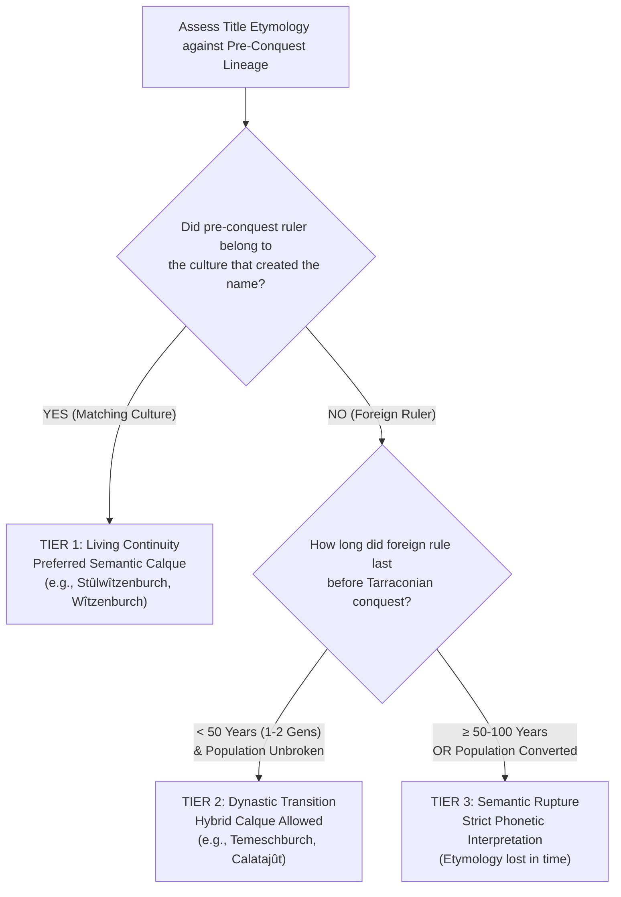
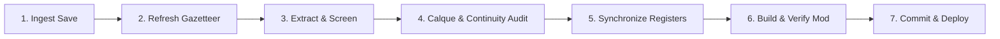

# The Tarraconian Roman Empire: Imperial Chancellery & Toponymic System

[](https://www.crusaderkings.com/)
[]()
[]()
[]()

Welcome to the central repository for the **Tarraconian Chancellery** project—an alternate-history worldbuilding, onomastic reconstruction, and modding suite for **Crusader Kings III**. 

This repository maintains the master gazetteers, linguistic sound laws, the **v2 7-stage barony naming pipeline**, and game localization/web atlas files governing the titles, dynasties, and cultures of the restored **Roman Empire** (*Dat Rômische Keiserrîch*).

---

## 1. Project Overview & Historical Setting

### 1.1 The Alternate-History Horizon (867–1194)
The campaign diverges from real-world history on **1 January 867 AD**. 

The ruling **Chatenois** dynasty (originating from the Moselle-Franconian nobility of Metz and Lorraine) diverged **Lothringian** (`ID 249`) from Franconian in 877. Pushing southward across Gaul into the Mediterranean, they established dominion over the Spanish March (*Hispania Tarraconensis* — Barcelona, Tarragona, Urgell, and Lleida).

On **31 August 989**, the dynasty formally hybridized **Lothringian** with native **Catalan** (`ID 82`) to form **Tarraconian** (`ID 316` / *Tarracono-Lothringian*):
* **Lothringian Heritage (Central Germanic):** Preserved 11th/12th-century Rhine-Moselle Franconian High German phonology, unshifted consonants, and traditional Franconian baptismal names (*Wernhard*, *Adémar*, *Guntram*, *Sieghard*).
* **Catalan Heritage (Courtly Occitano-Romance):** Adopted courtly ethos, Mediterranean maritime mercantilism, Iberian stone architecture, and an imperial administrative magistracy (*Veguerîe / Magistrat*).

### 1.2 The Restored Roman Hegemony (*Dat Rômische Keiserrîch*)
Under **Kaiser Adémar "the Great"** (`ID 62400`), **Augustus Wernhard "the Bear"** (`ID 67256089`), and **Pope Lambert II**, the dynasty united the Western Crown of the **Holy Roman Empire** (`e_hre`) with the Eastern Crown of the **Byzantine Empire** (`e_byzantium`), restoring the unified **Roman Empire** (`h_roman_empire` / Hegemony tier `ID 0`).

As of **28 July 1194**, the global map scope encompasses:
* **47 De Jure Empires**, **213 De Jure Kingdoms**, **970 De Jure Duchies**, and **3,476 De Jure Counties** (**2,644 Roman Empire counties**, **76.1% control**).
* **11,297 Barony Holdings (`b_*`)**: **10,239 save-occupied holdings** (`4,360` castles, `2,978` churches, `2,901` cities) plus **1,058 unoccupied territorial reserves**, resolved by the **v2 Barony Naming Pipeline** (`scripts/pipeline_stage0_occupancy.py` → `scripts/pipeline_stage6_disambiguation.py`).

### 1.3 The Tarraconian Language & Daughter Tongues
Tarraconian is linguistically structured like an alternate-history "reverse Middle English" (Germanic grammar and phonology fused with an Occitano-Romance administrative superstrate):
* **Imperial Tarraconian (`ID 316`):** West Central German (Rhine-Moselle Franconian) sound system written with Catalan-Aragonese scribal conventions. Long vowels carry circumflexes (**`â, ê, î, ô, û`**), word-final obstruents strictly devoice per *Auslautverhärtung* (**`-burch`**, **`-berch`**, **`-stat`**, **`-lant`**), and affricates are written **`z-`** initially and **`-tz`** medially/finally.
* **Alpine-Tarraconian (`ID 337`, formed 1042):** Gallo-Italic Alpine march register (`û -> [yː]`, final nasalization `-n -> [ŋ]`).
* **Croato-Tarraconian (`ID 345`, formed 1057):** Dinaric-Adriatic dialect blending South Slavic labiodental onset (`w- -> [v]`) with Franconian morphology.
* **Ungwârer (`ID 367`, formed 1094):** Carpathian-Steppe daughter language preserving circumflex length directly onto Old Hungarian long vowels on the Upper Hungarian frontier.

---

## 2. Repository Architecture & Sitemap

| Master Document / Directory | Path | Purpose & Scope |
| :--- | :--- | :--- |
| **Imperial De Jure Gazetteer** | [hre_de_jure_and_archdioceses_1059.md](hre_de_jure_and_archdioceses_1059.md) | The master ledger of all 47 empires, 213 kingdoms, 970 duchies, and 3,476 counties worldwide as of `1194.7.28`, tracking imperial control percentages and archdioceses. |
| **Tarraconian Titles Gazetteer** | [tarraconian_titles_1059.md](tarraconian_titles_1059.md) | Exhaustive register of upper-tier Tarraconian names, adjectives, and IPA transcriptions across landed titles (`e_*`, `k_*`, `d_*`, `c_*`) and archdioceses. |
| **Barony v2 Pipeline Spec** | [barony_tarraconian_naming_pipeline.md](barony_tarraconian_naming_pipeline.md) | Architecture and stage-by-stage specification for all **11,297 barony holdings** (`Stage 0` occupancy → `Stage 6` bottom-up disambiguation & web/localisation export). |
| **Linguistics & Sound-Shift Guide** | [tarraconian_linguistics_guide.md](tarraconian_linguistics_guide.md) | Complete reference for Tarraconian phonology, IPA values, vowel quantity laws, consonant shifts, daughter dialects, and orthographic constraints. |
| **Descriptive Title Calques Guide** | [tarraconian_descriptive_title_calques.md](tarraconian_descriptive_title_calques.md) | Master Morpheme Translation Matrix (forts, churches, waters, oronyms, colors, Sinosphere, Steppe, Boreal, Africa, India) backing `data/multilingual_morpheme_calque_lexicon.json`. |
| **Personal Name Register** | [tarraconian_onomasticon_and_name_register.md](tarraconian_onomasticon_and_name_register.md) | Master onomastic concordance and `name_list_franconian` register backing `data/global_onomasticon_adaptation.json`. |
| **Sinosphere Corpus & Gazetteer** | [sinosphere_titles_and_characters_1154.md](sinosphere_titles_and_characters_1154.md) | Comprehensive audit of Sinosphere kingdoms and counties, mapping Chinese characters (汉字), development, and sovereign status. |
| **Sinosphere Phonetics Guide** | [sinosphere_phonetics_and_transcription_guide_1154.md](sinosphere_phonetics_and_transcription_guide_1154.md) | Authoritative reference for 12th-century Late Middle Chinese, Goryeo Early Middle Korean, Late Heian Japanese, Lý Sino-Vietnamese, Khitan, and Jurchen phonology. |
| **Sinosphere Kanji Matrix** | [sinosphere_kanji_tarraconian_toponyms.md](sinosphere_kanji_tarraconian_toponyms.md) | Upper-tier 641-kanji toponymic lexicon (`data/sinosphere_kanji_tarraconian.json`), extended by `scripts/sino_barony_kanji_ext.py` (`1,390` merged CJK entries) for baronies. |
| **Master Audit & Screening Plan** | [title_historical_accuracy_audit_plan.md](title_historical_accuracy_audit_plan.md) | Methodology for screening out post-867 colonial/modern vanilla anachronisms. |
| **Procedure 2 Calque Register** | [tarraconian_procedure2_title_audit.md](tarraconian_procedure2_title_audit.md) | Upper-tier audit register implementing Procedure 2, classifying titles by Toponym Adoption Pattern (Preferred Calque, Hybrid, Phonetic). |
| **Audit Discrepancy Register** | [audit_discrepancy_register.md](audit_discrepancy_register.md) | Upper-tier discrepancy log (`1171` baseline) resolving flagged anachronistic counties to pre-867 seats or ancient hydronyms. |
| **Dynastic Realignment Register** | [dynastic_realignment_register.md](dynastic_realignment_register.md) | Enforces the Toponym-First Principle, realigning cadet branches and dynamic hybrid cultures to resolved historical seats. |
| **Mod In-Game Files** | `tarraconian_chancellery/` | The active CK3 mod: scripted effects (`common/scripted_effects/`) and localization files (`localization/english/`). |
| **Web Atlas & Pipeline** | `web/`, `docs/`, `scripts/` | Vector GeoJSON atlas (`docs/` for GitHub Pages), heraldic `Signa Imperii` generator, saint shrine data, and v2 barony pipeline scripts (`pipeline_stage0..6`). |

---

## 3. Administrative Continuity & Calquing Appropriateness Protocols

To prevent anachronistic "armchair etymology" and ensure that toponymic translations reflect authentic medieval chancellery practices (modeled after the historical German-Hungarian onomastic framework in Pannonia, the Zips, and Transylvania), the Chancellery enforces two mandatory screening procedures before approving a semantic calque.

### 3.1 Procedure 1: Sinospheric Administrative & Script Continuity Protocol
The logographic semantic calques defined in [tarraconian_descriptive_title_calques.md](tarraconian_descriptive_title_calques.md) rely entirely on the fact that imperial scribes received cadastres, tax registers, and land rolls written in **Chinese characters** (*Hánzì / Hanja / Kanji / Chữ Hán*).

* **The Core Rule:** Only apply Sinospheric logographic calques to titles in provinces that maintained **unbroken, continuous administrative usage of Chinese characters** up to the moment of Tarraconian annexation.
* **The Southeast Asian / Peripheral Failure Case:**
  * In historical East Asia, northern Vietnam (*Đại Việt / Giao Chỉ*) operated within the Sinosphere using *Chữ Hán*.
  * However, if during the campaign Vietnam or peripheral frontier marches were overrun and held by non-Sinographic powers (e.g., Champa, the Khmer Empire, Pagan/Burmese, or Tai realms), the administrative apparatus shifted away from Han characters to **Indic/Brahmic scripts** (Old Cham, Old Khmer) and Sanskrit/Pali Buddhist-Hindu royal terminology.
  * When Tarraconian magistrates subsequently annex such a province, the archives delivered to the *Gubernator* are written in Cham, Khmer, or Mon-Burmese scripts—**not** in Chinese characters.
  * In such cases of broken script continuity, logographic calquing is **strictly illicit**. The toponym must be received and adapted under the intermediary power's phonetic conventions or renamed through local physical inquest.
* **Audit Step:** In `titles_data.json` and save sovereign histories, verify whether the reigning realm prior to Tarraconian conquest belonged to a recognized Sinographic culture (Chinese, Korean, Japanese, or uninterrupted Vietnamese). If ruled by non-Sinographic Southeast Asian or Steppe nomad polities lacking Han bureaucracy, prefer phonetic interpretation.

### 3.2 Procedure 2: Sovereign Cultural Lineage & Etymological Transparency Protocol
In historical onomastics, descriptive toponyms undergo **lexicalization / desemanticization** (de-motivation):
1. **Living Meaning:** While ruled by speakers of the naming culture, a toponym is an active descriptive phrase (*"The White Fortress"*, *"Job's Castle"*, *"The Green Mountain"*).
2. **Cultural Rupture:** Once conquered by a foreign culture that does not speak or write the naming language, the name becomes an **opaque phonetic token**—a proper noun whose literal meaning is forgotten by the local court.
3. **Annexation by a Third Power:** When the Tarraconian Empire arrives generations later, it negotiates with an administration that *itself has no knowledge of what the name originally meant*. Scribes cannot translate what is no longer semantically alive.

To distinguish between living etymologies suitable for calquing and etymologies lost in time, the Chancellery evaluates the **ruling culture lineage** and **county population culture** prior to conquest:



#### The Three Continuity Tiers:
| Continuity Tier | Condition in CK3 Sovereign History | Chancellery Outcome in `tarraconian_titles_1059.md` | Historical Precedent |
| :--- | :--- | :--- | :--- |
| **Tier 1: High Living Continuity** | • Province was conquered directly from a ruler belonging to the etymological culture group, **OR**<br>• The county population (*county_culture*) remained unbroken in that culture group. | **Preferred Semantic Calque**<br>The meaning was actively understood in oral reports and local chancelleries (*Stûlwîtzenburch*, *Wîtzenburch*, *Îsenburch*). | Austrian bailiffs translating living Hungarian border warden titles (*Felsőőr* $\rightarrow$ *Oberwart*). |
| **Tier 2: Transitional Dynastic Rule** | • Ruler was foreign, but foreign reign lasted $< 50$ years (1–2 generations), **AND** local county culture had not yet converted. | **Hybrid Calque Allowed**<br>The indigenous scribal class still functions under the foreign lord; both forms are recorded (*Temeschburch*, *Abanîeburch*). | Anglo-Saxon clerks preserving native toponyms under early Norman lords in the *Domesday Book*. |
| **Tier 3: Complete Semantic Rupture** | • Province was held by an alien culture for $\ge 50–100$ years, **AND/OR**<br>• The local population converted away from the etymological culture before Tarraconian conquest. | **Strict Phonetic Nativization**<br>The etymology is "lost in time." Tarraconian scribes transcribe the phonetic form current in the displaced chancellery. | Spanish Reconquista treating *Calatayud* and *Guadalquivir* as immutable phonetic tokens rather than translating them. |

---

## 4. Expansion Operational Playbook (Step-by-Step Guide)

Whenever the campaign timeline advances or the Roman Empire annexes new lands, follow this standardized 7-step checklist to ingest the save game, audit titles, synchronize gazetteers, and build mod assets:



### Step 1: Ingest the New Save Game
Ensure the new `.ck3` save file is accessible:
```bash
# Example save path in WSL / Linux host:
export ACTIVE_SAVE="$HOME/Documents/Paradox Interactive/Crusader Kings III/save games/chatenois_867_01_01.ck3"  # or Windows / WSL path
```

### Step 2: Refresh the Imperial De Jure Gazetteer
Run the gazetteer updater to detect newly annexed counties, update realm percentages, and record control shifts:
```bash
python3 scripts/update_hre_gazetteer.py --scope empire --save-file "$ACTIVE_SAVE"
# Or via Docker:
./scripts/run_update_gazetteer_docker.sh --scope empire
```

### Step 3: Run the Multi-Phase Extraction & Screening Pipeline
Extract save data, analyze lineages, and screen for vanilla anachronisms:
```bash
# Phase 1: Save data extraction (titles, characters, dynasties, cultures)
python3 scripts/extract_save_phase1.py --save-game "$ACTIVE_SAVE"

# Phase 2: Sovereign history & territorial trajectories
python3 scripts/extract_phase2_lineage.py

# Phase 3: Antiquity screening & 3-tier classification
python3 scripts/screen_phase3_titles.py

# Phase 4: Resolution & downstream dynastic realignment
python3 scripts/resolve_phase4_titles.py
```

### Step 4: Toponym Resolution & Calquing Appropriateness Screening
1. Review newly flagged titles in [audit_discrepancy_register.md](audit_discrepancy_register.md).
2. **Apply Continuity Protocols (§ 3.1 & § 3.2):**
   * If the title is in the Sinosphere, verify unbroken Han character administration (**Procedure 1**).
   * For descriptive compounds, run the automated Procedure 2 pipeline to evaluate sovereign culture duration and population continuity (**Procedure 2**):
     ```bash
     python3 scripts/audit_procedure2_calques.py
     ```
   * If living continuity is established (Tier 1/2), consult [tarraconian_descriptive_title_calques.md](tarraconian_descriptive_title_calques.md) and review the compiled register [tarraconian_procedure2_title_audit.md](tarraconian_procedure2_title_audit.md).
3. Review newly generated cadet houses and dynamic cultures in [dynastic_realignment_register.md](dynastic_realignment_register.md) to ensure strict adherence to the Toponym-First Principle.

### Step 5: Update Master Gazetteers & Synchronize
1. Update [tarraconian_titles_1059.md](tarraconian_titles_1059.md) with newly resolved titles, calques, adjectives, and IPA transcriptions (or apply audited Procedure 2 updates with `python3 scripts/apply_procedure2_title_updates.py`).
2. Synchronize all title entries between the HRE gazetteer and Tarraconian titles:
   ```bash
   python3 scripts/sync_hre_gazetteer.py
   ```

### Step 6: Recompile Mod Assets & Run Verification
Rebuild the mod's scripted effects triggers and English localization dictionaries, then run the strict asset validator:
```bash
# Rebuild mod scripts and localization files
python3 scripts/build_mod.py

# Verify mod asset integrity (must return 0 errors)
python3 scripts/verify_mod_assets.py
```
*Verification must confirm:*
* 100% localization key coverage for all scripted effects triggers.
* 100% title adjective coverage.
* Zero orphan effects triggers.
* 100% synchrony between [hre_de_jure_and_archdioceses_1059.md](hre_de_jure_and_archdioceses_1059.md) and [tarraconian_titles_1059.md](tarraconian_titles_1059.md).

### Step 7: Commit & Deploy
Stage all modified registers, databases, and mod files, review diffs, and commit:
```bash
git add hre_de_jure_and_archdioceses_1059.md \
        tarraconian_titles_1059.md \
        tarraconian_descriptive_title_calques.md \
        audit_discrepancy_register.md \
        dynastic_realignment_register.md \
        tarraconian_chancellery/ \
        README.md
git commit -m "Imperial expansion: Incorporate newly annexed territories into master registers"
```

---

## 5. Development & Mod Packaging Guidelines

* **Target Mod Folder:** `tarraconian_chancellery/`
* **Scripted Effects Trigger:** `tarraconian_chancellery/common/scripted_effects/tarr_chancellery_title_list_effects.txt` (dynamically renames provinces when held by Tarraconian culture rulers).
* **Localization File:** `tarraconian_chancellery/localization/english/tarraconian_titles_l_english.yml` (UTF-8 with BOM).
* **Automated Mod Synchronization:** Always use `scripts/build_mod.py` to regenerate mod files from the master markdown files; never edit `tarr_chancellery_title_list_effects.txt` or `tarraconian_titles_l_english.yml` manually.

---

## 6. Cartographic Atlas (Web Application)

An interactive, high-resolution vector cartographic atlas of the Tarraconian world conquest is hosted on GitHub Pages:
* **Live Deployment:** [https://skachano.github.io/tarraconian_hre/](https://skachano.github.io/tarraconian_hre/)

### Features
* Vector rendering of all **3,476 counties** and **11,297 barony holdings** directly extracted from CK3 map data.
* Live **v2 Barony Pipeline** integration across all `10,239` occupied holdings (holding-type views, 3-stratum toponymic profiles, coinage-era rulers, physical/event context, saint shrine callouts, and `Signa Imperii` heraldry).
* Instant autocomplete search across Tarraconian Chancellery toponyms, canonical names, Hanzi glyphs, saint shrines, and title keys.
* Full hierarchical breadcrumb lineage (Empire $\rightarrow$ Kingdom $\rightarrow$ Duchy $\rightarrow$ County $\rightarrow$ Baronies).
* De Jure rank filtering and slide-out Inspector Drawer with historical resolution notes and Sinosphere Hanzi calque analysis.
* Dedicated **Imperial Linguistics & Toponymic Guide** modal with phonotactics, the v2 Historical Audit taxonomy, and an interactive 641-character upper-tier Hanzi lexicon.

### Building the Barony Pipeline (v2) & Web App
```bash
python3 scripts/pipeline_stage0_occupancy.py
python3 scripts/pipeline_stage1_routing.py
python3 scripts/pipeline_stage2_variant_selection.py
python3 scripts/pipeline_stage3_synthesis.py
python3 scripts/pipeline_stage4_calque_mediation.py
python3 scripts/pipeline_stage5_sound_laws.py
python3 scripts/pipeline_stage6_disambiguation.py --apply-to-geojson
python3 scripts/build_webapp.py
```

### Automated GitHub Pages Deployment
Continuous deployment is managed through GitHub Actions (`.github/workflows/deploy-pages.yml`):
* **Automatic Triggers:** Every push to `main` and on-demand manual runs via `workflow_dispatch`.
* **CI Validation:** Validates schema and data integrity with `pytest` prior to deployment.
* **Packaging:** Automatically generates production bundles into `docs/` with `.nojekyll` and `404.html` routing fallback.
* **Hosting:** Deployed via official `actions/deploy-pages`.

### Running the Web Atlas in Docker
```bash
./scripts/run_webapp_docker.sh
# Open http://localhost:8080 in your browser
```

### Running the Test Suite in Docker
The test suite includes asset & data integrity tests (`pytest`) and end-to-end headless browser interaction tests (`Playwright`):
```bash
./scripts/run_tests_docker.sh
```

---

## 7. Legal & Fan-Content Notice

* **Game IP:** Crusader Kings III is a registered trademark of Paradox Interactive AB.
* **Disclaimer:** This project is an unofficial fan-made alternate-history mod and onomastic atlas. It is non-commercial and is neither affiliated with nor endorsed by Paradox Interactive AB.
* **License:** Code and documentation in this repository are distributed under the [MIT License](LICENSE).
