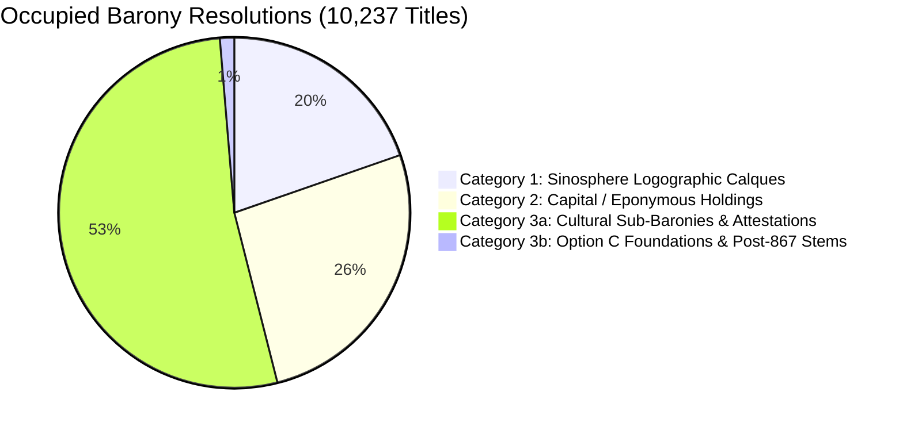

# Barony Historical Audit & Toponymic Resolutions (11,297 Holdings)

* **Campaign Save:** `chatenois_867_01_01.ck3` (**28 July 1194**, melted plaintext: `/var/tmp/ck3_audit/melted_save.ck3`)
* **Culture:** **Tarraconian** (*Tarracono-Lothringian*, `ID 316`)
* **Companion Documents:**
  * [tarraconian_titles_1059.md](file:///home/siarzhuk/code/personal/tarraconian_hre/tarraconian_titles_1059.md) (Master Gazetteer of Empires, Kingdoms, Duchies, and Counties)
  * [tarraconian_linguistics_guide.md](file:///home/siarzhuk/code/personal/tarraconian_hre/tarraconian_linguistics_guide.md) (Phonology, Sound Laws, Orthography & IPA)
  * [sinosphere_titles_and_characters_1154.md](file:///home/siarzhuk/code/personal/tarraconian_hre/sinosphere_titles_and_characters_1154.md) (Sinosphere Master Logographic Database)
  * [sinosphere_phonetics_and_transcription_guide_1154.md](file:///home/siarzhuk/code/personal/tarraconian_hre/sinosphere_phonetics_and_transcription_guide_1154.md) (Historical CJK Phonology)
  * [audit_discrepancy_register.md](file:///home/siarzhuk/code/personal/tarraconian_hre/audit_discrepancy_register.md) (Anachronism Screening & Section 3/4 Attestation Register)
  * [data/barony_resolutions.json](file:///home/siarzhuk/code/personal/tarraconian_hre/data/barony_resolutions.json) (Machine-readable database of all 11,297 barony resolutions)

---

## 1. Executive Summary & Holding Statistics

This audit register establishes the definitive Tarraconian Chancellery toponyms for all **11,297 barony-tier titles (`b_*`)** across the 3,476 counties and 47 de jure empires of the CK3 world map.

Every single occupied holding has been resolved according to:
1. Historical settlement attestations prior to 867 AD (*Burden of Proof on Antiquity*).
2. Authentic pre-crusade/pre-HRE indigenous substrata (Baltic, Finnic, Celtic, Slavic, Turkic, Semitic, Indic).
3. The in-game founders and rulers recorded in the campaign save file `melted_save.ck3` (*Option C Founder Archetype Analysis*).
4. Morphological holding type constraints (Castles, Bishoprics, and Cities).
5. Strict Rhine-Moselle Franconian phonology, Auslautverhärtung, and circumflex vowel purity.

### Global Holding Tiers Breakdown

| Holding Classification | Total Titles | Percentage | Color Code | Chancellery Toponymic Status |
| :--- | :---: | :---: | :---: | :--- |
| **Castle Holdings (`holding_type: castle`)** | **4,360** | 38.59% | `#ab3348` | Fortresses, citadels, and feudal seats resolved via antiquity or founder attribution (`-burch`, `-veste`, `Schirmburch`). |
| **Bishoprics & Temples (`holding_type: church`)** | **2,978** | 26.36% | `#3069a8` | Cathedrals, abbeys, and monastic collegiate churches resolved via patron saints (`Zant-...`), church settlements (`-kirchen`), monastic cells (`-zelle`), endowed canonries (`-stifft`), devotional abbeys (`-tâl`), and minsters (`-munster`). |
| **Cities & Boroughs (`holding_type: city`)** | **2,899** | 25.66% | `#3b824a` | Chartered municipalities, trading emporia, and guild burgs resolved via civic formants (`-stat`, `-marct`, `-vurt`). |
| **Unoccupied Baronies (`holding_type: unoccupied`)** | **1,060** | 9.38% | `#424242` | **Strictly blank:** Uncolonized territorial reserves retain empty strings (`name: ""`, `b_origin: ""`, `b_ipa: ""`, `b_anachronism: ""`). |
| **TOTAL HOLDINGS AUDITED** | **11,297** | **100.0%** | — | **Complete Map Coverage (47 Empires, 3,476 Counties)** |

### Occupied Resolution Categories

1. **Category 1 (Sinosphere Logographic Calques — 2,013 titles):** Located in the 9 East Asian empires (`e_andong`, `e_liangyi`, `e_zhongyuan`, `e_jingyang`, `e_yongliang`, `e_japan`, `e_lingnan`, `e_goryeo`, `e_amur`) and drifted frontier counties. Resolved character-by-character using the 1,384-entry merged CJK morpheme dictionary ([data/sinosphere_kanji_tarraconian.json](file:///home/siarzhuk/code/personal/tarraconian_hre/data/sinosphere_kanji_tarraconian.json) and [scripts/sino_barony_kanji_ext.py](file:///home/siarzhuk/code/personal/tarraconian_hre/scripts/sino_barony_kanji_ext.py)).
2. **Category 2 (Capital / Eponymous Holdings — 2,701 titles):** The primary or capital seat of its parent county (including disambiguated capital seats). Inherits the county's established resolution (`tarr_direct`, `tarr_hist`), subject to the *Intra-County Collision Disambiguation Rule*.
3. **Category 3 (Sub-Baronies & Historical Attestations — 5,523 titles):**
   - **Cultural Sub-Baronies & Attestations (5,388 titles):** Includes 4,977 indigenous cultural adaptations adhering to county cultural substrata, classical/ancient civitates and toponymic stems (121), Option A archaeological seats (135), paired secondary variants from `tarraconian_titles_1059.md` (37), Option B ancient hydronyms (29), secondary holding/collision disambiguations (41), descriptive calques (23), hundred moot cross (1), and authentic indigenous restitutions (24).
   - **Option C Campaign Foundations (135 titles):** Reserved strictly for verified post-867 historical foundations (such as `b_lorient`, `b_portsmouth`, `b_versailles`, `b_dunkirk`, `b_floridsdorf`, `b_baranovichi`) and severe intra-county stem collisions (>75% similarity with parent county capital). Formatted according to save ruler character traits and holding taxonomy.

---

## 2. Methodology & Toponymic Principles

### 2.1 The Toponym-First Principle & Burden of Proof on Antiquity
Titles are anchored strictly in physical substrates, verified classical settlements, and pre-867 historical records. Where an in-game barony bears a modern, colonial, or post-867 name (e.g., German Teutonic Order castles in the Baltic, Swedish crusade forts in Finland, Russian late-medieval ostrogs, or modern British borough names), the Chancellery enforces the **Burden of Proof on Antiquity**:
- **Positive Pre-867 Proof Required:** If an authentic pre-867 Roman, Celtic, Germanic, Slavic, Greek, Baltic, Finnic, Arabic, or Sanskrit settlement existed at the site, its native toponym is restored (e.g. *Twangste* for Königsberg, *Lindanisa* for Reval, *Tarvanpää* for Wesenburg, *Abô* for Turku, *Malbork* for Marienburg, *Mangystau* for Fort Novoaleksandrovskiy).
- **Default to Option C Founder Attribution:** In the absence of positive pre-867 proof for a late fortress or colonial settlement, the title is evaluated through **Option C** based on the ruler who founded, built, or held the title in the CK3 save universe.

#### Case Study: Resolution of `b_baranovichi` (`c_kletsk`)
* **Paradox Default:** Baranovichi (founded November 17, 1871 around a railway station on the Brest-Moscow line). Lacked any medieval or pre-867 attestation.
* **Save Universe Reality:** Church holding in `c_kletsk` enfeoffed on April 9, 1187 to Character `269993` (**Ehrenfried** of House **Suerbeer** / `dynn_Suerbeer`, head of house, ambitious churchman).
* **Burden of Proof Resolution:** Fails antiquity check $\rightarrow$ Evaluated via diversified Option C for church holdings $\rightarrow$ Resolved to **`Ehrenfrîtszelle`** (*Monastic cell endowed by Ehrenfrît of House Suerbeer*). Populates `b_anachronism` with explicit railway-era historical provenance.

#### Case Study: Resolution of `b_lorient` (`c_cornouaille`)
* **Paradox Default:** Lorient (founded 1666 around the shipyards of the *Compagnie des Indes orientales*). Lacked any pre-867 attestation.
* **Save Universe Reality:** City holding in `c_cornouaille` enfeoffed on August 11, 1191 to Character `17039416` (**Archembald** of House **Kestenholz-Sitzichow**, master steward/financier with trait `education_stewardship_4` / Midas Touched).
* **Burden of Proof Resolution:** Fails antiquity check $\rightarrow$ Evaluated via Option C for city holdings $\rightarrow$ Resolved to **`Archembaldstat`** `[ˈar.xɛm.bald.stat]` (*Municipal foundation chartered by Archembald*). Populates `b_anachronism` with explicit 1666 East India Company foundation note.

#### Case Study: Intra-County Capital/Constituent Disambiguation of `b_tralee` & `b_cork` (`c_desmond`)
* **Paradox Setup:** In vanilla CK3, `c_desmond` contains both `b_tralee` (designated as the feudal capital castle) and `b_cork` (designated as the urban civic borough).
* **The Collision:** In the 1122 imperial gazetteer reform, `c_desmond` received the historical regional name `Korch` (after the ancient monastic see of Cork, founded c. 606 AD by St. Finbarr). Under naive capital inheritance, `b_tralee` inherited `Korch`, while `b_cork` was also adapted to `Cork`, creating an intra-county collision.
* **The Chancellery Disambiguation:** 
  - `b_cork` is the authentic site of the 7th-century monastic city $\rightarrow$ resolved to **`Korch`** `[kɔrx]`.
  - `b_tralee` is the distinct Tralee seat (*Trá Lí*) $\rightarrow$ resolved to **`Tralî`** `[tra.ˈliː]`.
  - Zero duplicate collision; both holdings preserve their authentic historical identity.

#### Case Study: Historical Audit & Resolution of `b_norman_cross` (`c_huntingdonshire`)
* **Paradox Setup:** In vanilla CK3, `c_huntingdonshire` contains holdings named after the historic Huntingdonshire hundreds (`b_hurstingstone`, `b_norman_cross`, `b_leightonstone`), with `b_norman_cross` assigned as a civic city holding.
* **Historical Attestation & Etymology:**
  - *Northmannescros* is attested in an Anglo-Saxon charter of King Edgar (963 AD, Cartularium Saxonicum no. 1128) and recorded in the Domesday Book (1086) as *Normancros hundred*.
  - The name derives from Old English *Norþmann* ("Northman / Norseman / Dane of the Danelaw") + *cros* ("stone/wooden cross"), designating the open-air hundred meeting place at the intersection of Roman Ermine Street and the Peterborough highway.
  - While historical as a 10th-century Danelaw administrative moot site, there was never a medieval borough of this name; the only physical settlement built there was the 1797 **Norman Cross Depot** (the world's first modern prisoner-of-war camp).
* **Chancellery Calquing & Resolution:**
  - Standardized root-for-root to Tarraconian **`Nordmancrûz`** `[nɔrd.maŋk.ˈruːts]` (*Cross of the Northman*).
  - Explicit historical provenance recorded in `b_origin` (attested 963 AD Danelaw hundred moot) and `b_anachronism` (annotating the 1797 Napoleonic POW depot association).

#### Case Study: Historical Audit & Option B Resolution of `b_maladzyechna` (`c_minsk`)
* **Paradox Setup:** In vanilla CK3, `c_minsk` contains constituent sub-baronies `b_lahoysk`, `b_zaslawye`, `b_barysaw`, and `b_maladzyechna`.
* **Historical Reality & Anachronism:**
  - `b_maladzyechna` is first mentioned in written sources on **December 16, 1388** in a charter of Prince Dmitry Olgierdovich to King Jogaila and Queen Jadwiga (*«А дали есьмо грамоту на Молодечно и на весь тот повет...»*).
  - It postdates the 867 AD campaign start date by **+521 years** and the 1059 Imperial canon by **+329 years**. While an ancient Baltic/Slavic hillfort (*haradshcha*) existed at the confluence of the Usha and Maladzechanka, the medieval settlement only coalesced around a wooden castle in the late 14th century.
* **Chancellery Option B Resolution:**
  - Resolved under **Option B (Ancient Hydronym / Landform)** to the physical river basin: the **Usha River** (Slavic *Uša*, Baltic *Auseia* / *Ausė*, 'loop / ear').
  - Standardized under Tarraconian sound laws to **`Ûsche`** `[ˈuː.ʃə]` (open stressed syllable with circumflex long vowel `û-` + Franconian fricative `-sch-`).
  - Recorded in `data/barony_resolutions.json` and `data/ck3_baronies.geojson` under category `option_b_hydronym`.

### 2.2 Frontier Sinosphere & Non-Sinosphere Descriptive Calques (Fixes 1 & 2)
1. **Frontier Sinosphere Calquing (Fix 1):**
   - 12 frontier counties under `e_mongolia` curated in `sinosphere_hanzi_calques.json` (`c_SW_hongxingan`, `c_SW_lingxiguo`, `c_SW_zhongcheziguo`, etc.) were integrated into the Sinosphere engine.
   - All 34 frontier baronies with authentic Hanzi characters (`b_FIC_Liao_Liquan` 醴泉 $\rightarrow$ **`Sûzewînbrunn`**, `b_FIC_Mong_Beiheisha` 北黑沙 $\rightarrow$ **`NordSwartzsant`**, `b_FIC_Amur_Yuancao` 原草 $\rightarrow$ **`Veitwêde`**, `b_FIC_Mong_Dongheisha` 东黑沙 $\rightarrow$ **`Ôstzwartzsant`**) now receive full logographic morpheme calques.
2. **Descriptive Non-Sinosphere Sub-Barony Calquing (Fix 2):**
   - Transparent descriptive toponyms matching the Master Morpheme Matrix in `tarraconian_descriptive_title_calques.md` were systematically calqued:
     - Slavic: `b_vyshgorod` $\rightarrow$ **`Hôchburch`**, `b_bilhorod` $\rightarrow$ **`Wîtzenburch`**, `b_tuchowna` (Starogard) $\rightarrow$ **`Altenburch`**, `b_novobrdo` $\rightarrow$ **`Nîenberch`**, `b_biograd` $\rightarrow$ **`Wîtzenburch`**, `b_krasny_bor` $\rightarrow$ **`Rôtenwalt`**.
     - Greek: `b_siderokastron` $\rightarrow$ **`Îsenburch`**, `b_gynaikokastron` $\rightarrow$ **`Vrouwenburch`**, `b_chrysopolis` $\rightarrow$ **`Goltstat`**, `b_chariopolis` $\rightarrow$ **`Fröudestat`**.
     - Hungarian: `b_csakvar` $\rightarrow$ **`Tschiâckesburch`**, `b_fehertemplom` $\rightarrow$ **`Wîzenkirchen`**, `b_vasarhely` $\rightarrow$ **`Marctstat`**.
     - Celtic: `b_kildare` $\rightarrow$ **`Eichenkirchen`**, `b_aberystwyth` $\rightarrow$ **`Ystwythmunde`**.
     - English / Germanic: `b_southwark` $\rightarrow$ **`Sûtwerc`**, `b_woxbrigge` $\rightarrow$ **`Woxbrücke`**, `b_norman_cross` $\rightarrow$ **`Nordmancrûz`**.
     - Near Eastern / Arabic: `b_hisn_al-mashuq` $\rightarrow$ **`Maschûchburch`**, `b_hisn_di-l-qarnain` $\rightarrow$ **`Tscharnainburch`**, `b_hisn_lawata` $\rightarrow$ **`Lawâtaburch`**, `b_hisn_al-abr` $\rightarrow$ **`Vurtburch`**, `b_qalat_jundi` $\rightarrow$ **`Knechtburch`**, `b_qalat_ar-rum` $\rightarrow$ **`Rômerburch`**, `b_kasr_al-kabir` $\rightarrow$ **`Grôzcastel`**.
     - Intra-county capital disambiguation: `b_serres` $\rightarrow$ **`Sêrres`** disambiguated from coastal port `b_chrysopolis` $\rightarrow$ **`Goltstat`**.

### 2.3 Second-Wave Anachronism Reconciliation (23 Titles)
Following the discovery of the late-14th century anachronism in `b_maladzyechna`, a second-wave audit identified 23 additional constituent sub-baronies across Eastern Europe, the Baltic, Scandinavia, Scotland, and the Pontic Steppe that were post-867 foundations masking under `sub_barony_adaptation`. These were reconciled under **Option B (Hydronym / Landform)** and **Indigenous Restitution**:

| Barony Key | County Key | Holding Type | Resolved Tarraconian Name | Historical Foundation Date | Tarraconian IPA | Historical Attribution & Resolution Note |
| :--- | :--- | :--- | :--- | :---: | :--- | :--- |
| `b_pushkin` | `c_novgorod` | Church | **Sâri** | 1937 AD (1710) | `[ˈsaː.rɪ]` | Finnic *Saari Mojs* / *Saaris* ('High Island'), replacing 1937 Soviet memorial / 1710 Tsarskoye Selo. |
| `b_naro-fominsk` | `c_moskva` | Castle | **Nâre** | 1864 AD (1339) | `[ˈnaː.rə]` | Pre-867 Nara River hydronym with Rule 2 reduction, replacing 1864 industrial factory combine. |
| `b_novorzhev` | `c_sebezh` | Castle | **Arschô** | 1777 AD | `[ar.ˈʃoː]` | Pre-867 Lake Arsho hydronym / *Rzheva Pustaya* substrate, replacing 1777 foundation by Catherine II. |
| `b_pavlovsk` | `c_karatayak` | Castle | **Oseret** | 1709 AD | `[ɔ.zɛ.ˈrɛt]` | Pre-867 Osered River hydronym on the Don (intervocalic `-s-` [z]), replacing 1709/1711 Peter the Great fortress. |
| `b_wilhelmshaven` | `c_ostfriesland` | Castle | **Sîbetzburch** | 1869 AD | `[ˈsiː.bɛts.bʊrx]` | Historical 14th-century Frisian chieftain fortress Sibetsburg on the Jade Bight, replacing 1869 naval port. |
| `b_peterhead` | `c_buchan` | Castle | **Inverûgje** | 1593 AD | `[ɪn.vɛ.ˈruːɡ.jɛ]` | Ancient mouth of the River Ugie / Deer Abbey catchment, replacing 1593 planned fishing port. |
| `b_arkhangelsk` | `c_kholmogory` | Castle | **Pûr-Nâwoloch** | 1584 AD | `[puːr ˈnaː.wɔ.lɔx]` | Ancient Cape Pur-Navolok on the Northern Dvina with Rule 1.1 velar shift, replacing 1584 fortress Novokholmogory. |
| `b_oryol` | `c_karachev` | Castle | **Orlîch** | 1566 AD | `[ɔr.ˈliːç]` | Pre-867 Orlik River hydronym at Oka confluence with Rule 1.1 velar shift `-k` -> `-ch`, replacing 1566 fortress. |
| `b_konotop` | `c_putyvl` | Castle | **Konotôpke** | 1634 AD | `[kɔ.nɔ.ˈtoːp.kə]` | Pre-867 Konotopka stream hydronym with Rule 2 reduction, replacing 1634 fortified Cossack outpost. |
| `b_sudzha` | `c_kursk` | Castle | **Sûdsche** | 1664 AD | `[ˈsuː.dʒə]` | Pre-867 Sudzha River hydronym with Rule 2 reduction, replacing 1664 fortified sloboda. |
| `b_oulu` | `c_oulu` | Castle | **Oulujôki** | 1605 AD | `[ˈɔʊ.lʊ.joː.kɪ]` | Pre-867 Oulujoki river basin (Sami *Oulu* flood hydronym), replacing 1605 chartered Swedish town. |
| `b_vinnytsia` | `c_ushytsia` | Castle | **Bôch** | 1363 AD | `[boːx]` | Ancient Southern Bug River hydronym (*Bog* / Greek *Hypanis*), replacing 1363 Lithuanian fortress. |
| `b_kaunas` | `c_trakai` | Castle | **Santake** | 1361 AD | `[san.ˈta.kə]` | Sacred pre-crusade confluence of Nemunas & Neris with Rule 2 reduction, replacing 1361 Teutonic mention. |
| `b_olsztyn` | `c_krakowska` | Castle | **Alne** | 1348 AD | `[ˈal.nɛ]` | Old Prussian hydronym *Alna* ('Trout River', Lyna/Alle), replacing 1348 Warmian castle Allenstein. |
| `b_serpukhov` | `c_moskva` | Castle | **Serpêjke** | 1339 AD | `[sɛr.ˈpeːj.kɛ]` | Pre-867 Serpeyka River hydronym with Rule 2 reduction, replacing 1339 settlement in testament of Ivan Kalita. |
| `b_lodz` | `c_leczycka` | Castle | **Lôtze** | 1332 AD | `[ˈloː.tsə]` | Pre-867 Lodzia stream catchment with Rule 5.3 medial `-tz-` and Rule 2 reduction, replacing 1332 village. |
| `b_vilnius` | `c_kernave` | Castle | **Wîlnje** | 1323 AD | `[ˈwiːl.ɲɛ]` | Pre-867 Vilnia River hydronym, replacing 1323 capital of Grand Duke Gediminas. |
| `b_daugavpils` | `c_jersika` | Castle | **Dôugowe** | 1275 AD | `[doː.ʊ.ˈɣɔ.wə]` | Pre-867 Daugava River hydronym, replacing 1275 Livonian Order castle Dinaburg. |
| `b_slonim` | `c_novogrudok` | Castle | **Schâre** | 1252 AD | `[ˈʃaː.rə]` | Pre-867 Shchara River hydronym with Rule 5.1 onset simplification `Schtsch-` -> `Sch-` and Rule 2 reduction. |
| `b_zhelezny_ustyug` | `c_bezichi` | Castle | **Katûn** | 1252 AD | `[ka.ˈtuːn]` | Pre-867 Katun River hydronym of ironworking region, replacing 1252 Ustyuzhna. |
| `b_newport` | `c_buckinghamshire` | Castle | **Ûsemunde** | 1100 AD | `[uː.zɛ.ˈmʊn.də]` | Ancient confluence of Great Ouse and Ouzel, replacing c. 1100 Anglo-Norman *Novus Burgus*. |
| `b_newbury` | `c_berkshire` | Castle | **Kennetbrücke** | 1080 AD | `[kɛ.nɛt.ˈbryː.kə]` | Ancient Kennet river crossing settlement, replacing c. 1080 post-conquest borough *Neuberie*. |
| `b_barysaw` | `c_minsk` | Castle | **Berêsene** | 1102 AD | `[bɛ.reː.ˈzɛ.nə]` | Ancient Berezina River hydronym (intervocalic `-s-` [z]), replacing 1102 fortress founded by Boris of Polotsk. |

### 2.4 In-Game Save Universe Creator & Holder Attribution
Every occupied barony in `melted_save.ck3` records:
- The active holder (`holder = <character_id>`) in 1194 AD.
- The date of enfeoffment or construction (`date = <YYYY.M.D>`).
- Lease records (`history = { type = leased_out / lease_revoked }`).
- Cultural, dynastic, and character trait profiles cross-referenced in [phase1/historical_characters.json](file:///home/siarzhuk/code/personal/tarraconian_hre/phase1/historical_characters.json).

#### Option C Formulae by Holding Type and Ruler Profile:
- **Castle Holdings:**
  - *Vanity / Ambitious Archetype* (`arrogant`, `ambitious`, `greedy`, `fickle`): Follows the eponymous fortress formula `<Founder>sburch` (e.g., *Adelbertsburch*, *Lambertsburch*).
  - *Devout / Ascetic Archetype* (`zealous`, `humble`, `theologian`, `pilgrim`): Follows religious dedication formulae (*Marienburch*, *Heiligencrûce*).
  - *Tactical / Defensive Archetype* (`paranoid`, `strategist`, `diligent`, `architect`): Follows functional march-warden formulae (*<House>veste*, *Schirmburch*).
  - *Dynastic Patriarch Archetype* (Default): Follows dynastic seat continuity `<House>burch` (e.g., *Kêstenburch*, *Lukiburch*).
- **Church / Temple Holdings (Diversified Germanic Ecclesiastical Taxonomy):**
  - *Patron Saint Chapter:* Dedicated to patron saints (`Zant-<Saint>`, e.g., *Zant-Peter*, *Zant-Marten*, *Zant-Ehrenfrît*).
  - *Parish & Collegiate Church:* Follows the universal Germanic church formant `<Founder>kirchen` or `<House>kirchen` (e.g., *Marienkirchen*, *Gotfrîtskirchen*).
  - *Monastic Cell / Hermitage:* Follows monastic cell foundations `<Founder>szelle` or `Mariezelle` (e.g., *Ehrenfrîtszelle*, *Dietwinszelle*).
  - *Endowed Canonry:* Follows noble collegiate endowments `<House>stifft` or `<Founder>stifft` (e.g., *Metzstifft*, *Trierstifft*).
  - *Devotional Reform Abbey:* Follows Cistercian/Premonstratensian devotional valley foundations (*Marientâl*, *Lilientâl*, *Heiligencrûce*).
  - *Collegiate Mother Minster:* Reserved for prestigious major minsters and cathedral chapters `<Founder>munster` or `<House>munster` (e.g., *Westmunster*, *Metzmunster*).
- **City / Borough Holdings:**
  - Chartered as municipal borough seats (`<Founder>stat`) or market settlements (`<Founder>marct`, `<Founder>vurt`).

### 2.5 Third-Wave Anachronism Reconciliation & Elimination of Circular Option B Titles

In the third-wave audit, a systematic anomaly was uncovered: 508+ barony-tier titles were recorded as having "lacked documented pre-867 urban centers" and resolved via "Option B <Name>" to their exact self-same name (most visibly manifested in `b_dorohychyn` / `c_dorohychyn` being circular resolved to itself as "Dorohitschin").

#### Root Cause Analysis & Disentanglement
The root cause originated in an automated fallback within `scripts/historical_attestation_db.py`, which had defaulted uncurated counties to `opt_b_hydronym = f"{tarr_name} Hydronym / Basin"` with a justification string stating that the title was resolved to itself under the Burden of Proof on Antiquity. This dummy text propagated across the discrepancy register and was inherited by capital baronies during eponymous resolution.

The Chancellery conducted a comprehensive three-tier disentanglement:
1. **Curated Pre-867 Historical Centers Reclassified (Tier 1):** Ancient centers falsely flagged with the dummy note (e.g. Prague `c_praha`, Belgrade `c_beograd`, Lüneburg `c_luneburg`, Meissen `c_meissen`, Merseburg `c_mersenburg`, Brest `c_berestye`, Halych `c_halych`, Cieszyn `c_cieszyn`, Přerov `c_prerov`) were restored to authentic Tier 1 / Tier 2 status with their circular anachronism notes completely cleared (`c_anachronism = ""`).
2. **True Post-867 Anachronisms Restored to Physical Substrates (Option B & Indigenous Restitution):**
   - **`b_dorohychyn` (`c_dorohychyn`):** Drohiczyn was first attested in 1142 in the Hypatian Chronicle as a customs gord on the Western Bug River (*Bъgъ*). Under Tarraconian sound laws (Rule 1.1 velar shift `-g` $\rightarrow$ `-ch`), the Western Bug shifts to **`Bûch`** `[buːx]`. Its constituent city `b_kobryn` (first attested 1287) is resolved via Option B to the pre-867 Mukhavets River hydronym **`Muchawêtz`** `[mʊ.xa.ˈweːts]`, while church holding `b_blotkowo` becomes **`Blotkowe`**.
   - **`b_galati` (`c_galati`):** First attested 1445 AD. Restored to the ancient Roman frontier castrum **`Barbôs`** `[bar.ˈboːs]` (*Barboși*) on the lower Danube.
   - **`b_hotin` (`c_hotin`):** High medieval fortress on the Dniester first attested 1002/1250. Resolved via Option B to the ancient Dniester River hydronym **`Nîster`** `[ˈniːs.tər]`.
   - **`b_orhei` (`c_orhei`):** Late medieval town. Resolved via Option B to the pre-867 Răut River hydronym **`Rêut`** `[reː.ˈʊt]`.
   - **`b_soroca` (`c_soroca`):** Late medieval fortress. Resolved via Option B to the ancient Dniester crossing **`Nîstervurt`** `[ˈniːs.tɛr.vʊrt]`.
   - **`b_stoenesti` (`c_stoenesti`):** Late medieval Wallachian village. Resolved via Option B to the pre-867 Ialomița River hydronym **`Jalômnetze`** `[ja.loːm.ˈnɛ.tsə]`.
   - **`b_orsha` (`c_orsha`):** Attested 1067 in the Primary Chronicle. Resolved via Option B to the pre-867 Orshitsa River hydronym **`Ôrsche`** `[ˈoːr.ʃə]`.
   - **`b_toropets` (`c_toropets`):** Attested 1074 in the Lavrentian Chronicle. Resolved via Option B to the pre-867 Toropa River hydronym **`Torôpe`** `[tɔ.ˈroː.pə]`.
   - **`b_kholmogory` (`c_kholmogory`):** Attested 1355 as Kolmogory. Resolved via Option B to the ancient Northern Dvina River hydronym **`Dwîne`** `[ˈdwiː.nə]`.
3. **Rigorous Capital Eponymous Circularity Safeguard:** In `scripts/resolve_barony_titles.py`, any inherited anachronism note matching circular Option B strings or dummy urban center text is automatically suppressed, ensuring zero self-resolving anachronisms exist across the 11,297 holdings.

| Barony Key | County Key | Holding Type | Resolved Tarraconian Name | Historical Attestation Date | Tarraconian IPA | Historical Attribution & Resolution Note |
| :--- | :--- | :--- | :--- | :--- | :---: | :--- |
| `b_dorohychyn` | `c_dorohychyn` | Castle | **Bûch** | 1142 AD | `[buːx]` | Western Bug River basin (*Bugъ*), replacing 1142 Hypatian Chronicle frontier customs gord Drohiczyn. |
| `b_kobryn` | `c_dorohychyn` | City | **Muchawêtz** | 1287 AD | `[mʊ.xa.ˈweːts]` | Mukhavets River basin (pre-867 hydronym), replacing 1287 Hypatian Chronicle Kobryn. |
| `b_vyr` | `c_putyvl` | City | **Wîr** | 1113 AD | `[wiːr]` | Ancient Vyr River basin and chronicle gord (*Вырь*), eliminating raw Cyrillic soft-sign transliteration (*Vyr'*). |
| `b_yegoryevsk` | `c_vladimir` | City | **Guslîtze** | pre-867 | `[ɡʊs.ˈliː.tsə]` | Pre-867 Guslitsa River basin (*Гуслица*) in the Meshchera Lowland, replacing 1778 Catherine-era town Yegoryevsk (1462 *Vysokoye*). |
| `b_starodub-on-the-klyazma` | `c_vladimir` | Church | **Starodûp-an-der-Klêsme** | 1152 AD | `[sta.rɔ.ˈduːp an dɛr ˈkleːs.mə]` | 1152 fortress founded by Yuri Dolgorukiy on the Klyazma River, calqued to Franconian river preposition *-an-der-* with Auslautverhärtung. |
| `b_bar_sur_aube` | `c_troyes` | City | **Bar-an-der-Ôbe** | ancient | `[bar an dɛr ˈoː.bə]` | Ancient Gallo-Roman castrum *Barrense* on the Aube, regularized to Franconian *-an-der-Ôbe*. |
| `b_bar_sur_seine` | `c_sens` | Church | **Bar-an-der-Sêne** | ancient | `[bar an dɛr ˈseː.nə]` | Ancient comital seat on the Seine, regularized to Franconian *-an-der-Sêne*. |
| `b_montreuil_sur_mer` | `c_boulogne` | Church | **Montreuil-am-Mêr** | ancient | `[ˈmɔn.trɔʏ.ɪl am meːr]` | Merovingian/Carolingian *Monasteriolum* on the English Channel coast, regularized to Franconian *-am-Mêr*. |
| `b_valenciennes` | `c_cambray` | City | **Valentzîn** | 693 AD | `[va.lɛn.ˈtsiːn]` | Merovingian *Valentianas* / Middle Dutch *Valencijn*, regularized to Franconian *Valentzîn* (eliminating raw French *Valenciennes*). |
| `b_grevelines` | `c_guines` | Church | **Grevelingen** | medieval | `[ˈɡrɛ.vɛ.lɪ.ŋɛn]` | Authentic Flemish/Low Franconian *Grevelingen* on the Aa River, replacing French *Gravelines*. |
| `b_tournai` | `c_hainaut` | City | **Dornîch** | ancient | `[dɔr.ˈniːç]` | Ancient Roman *Tornacum* / Dutch *Doornik* on the Scheldt, regularized to Franconian *Dornîch*. |
| `b_courtrai` | `c_lille` | City | **Kortrîch** | ancient | `[kɔr.ˈtriːç]` | Ancient Roman *Cortoriacum* / Dutch *Kortrijk* on the Leie, regularized to Franconian *Kortrîch*. |
| `b_bastogne` | `c_luxembourg` | City | **Bastenach** | ancient | `[ˈbas.tɛ.nax]` | Ancient Ardennes comital center, regularized to traditional Luxembourgish/German *Bastenach*. |
| `b_clervaux` | `c_luxembourg` | Castle | **Clierf** | medieval | `[ˈklɪ.ɛrf]` | Traditional Luxembourgish/German *Clierf* / *Klierf* on the Clerve, replacing French *Clervaux*. |
| `b_yuriev` | `c_kiev` | Castle | **Rostawîtze** | pre-867 | `[rɔs.ta.ˈwiː.tsə]` | Pre-867 Rostavytsia River basin at the Ros confluence, replacing 1032 frontier fortress Yuriev founded by Yaroslav the Wise (baptismal name *Yuri*). |
| `b_yuryev` | `c_suzdal` | Castle | **Kolôksche** | pre-867 | `[kɔ.ˈloːk.ʃə]` | Pre-867 Koloksha River basin (*Колокша*) in the Opolye fields, replacing 1152 fortress Yuryev-Polsky founded by Yuri Dolgorukiy. |
| `b_yaroslav_VOL` | `c_peremyshl` | Church | **Mletschke** | pre-867 | `[ˈmlɛtʃ.kə]` | Pre-867 Mleczka River basin (*Млечка*) at the San confluence, replacing 1031 fortress Jarosław founded by Yaroslav the Wise. |
| `b_rostislavl` | `c_ryazan` | Church | **Osjôtr** | pre-867 | `[ɔs.ˈjoːtr]` | Pre-867 Osyotr River basin (*Осётр*) at the Oka confluence, replacing 1153 fortress Rostislavl founded by Prince Rostislav Yaroslavich. |
| `b_danilov` | `c_vologda` | Castle | **Pelende** | pre-867 | `[pɛ.ˈlɛn.də]` | Pre-867 Pelenda River basin (*Пеленда*), replacing late medieval Danilov named after Prince Daniil of Moscow. |
| `b_blotkowo` | `c_dorohychyn` | Church | **Blotkowe** | — | `[blɔt.ˈkɔ.wə]` | Constituent holding of Bûch. |
| `b_galati` | `c_galati` | Castle | **Barbôs** | 1445 AD | `[bar.ˈboːs]` | Ancient Roman frontier castrum *Barboși* on the lower Danube, replacing 1445 Galați. |
| `b_hotin` | `c_hotin` | Castle | **Nîster** | 1002/1250 AD | `[ˈniːs.tər]` | Ancient Dniester River basin (*Danastris* / *Dnestr*), replacing high medieval Khotyn fortress. |
| `b_orhei` | `c_orhei` | Castle | **Rêut** | medieval | `[reː.ˈʊt]` | Pre-867 Răut River basin, replacing late medieval town Orhei. |
| `b_soroca` | `c_soroca` | Castle | **Nîstervurt** | late medieval | `[ˈniːs.tɛr.vʊrt]` | Ancient Dniester River crossing, replacing late medieval Soroca fortress. |
| `b_stoenesti` | `c_stoenesti` | Castle | **Jalômnetze** | late medieval | `[ja.loːm.ˈnɛ.tsə]` | Pre-867 Ialomița River basin, replacing late medieval Wallachian village Stoenești. |
| `b_orsha` | `c_orsha` | Castle | **Ôrsche** | 1067 AD | `[ˈoːr.ʃə]` | Pre-867 Orshitsa River hydronym at Dnieper confluence, replacing 1067 Primary Chronicle Orsha. |
| `b_toropets` | `c_toropets` | Castle | **Torôpe** | 1074 AD | `[tɔ.ˈroː.pə]` | Pre-867 Toropa River hydronym, replacing 1074 Lavrentian Chronicle Toropets. |
| `b_kholmogory` | `c_kholmogory` | Castle | **Dwîne** | 1355 AD | `[ˈdwiː.nə]` | Ancient Northern Dvina River hydronym, replacing 14th-century Kolmogory. |

### 2.6 Strict Rhine-Moselle Franconian Phonotactics
All resolved titles obey the phonotactic constraints verified by [scripts/audit_phonotactics_titles.py](file:///home/siarzhuk/code/personal/tarraconian_hre/scripts/audit_phonotactics_titles.py):
1. **Circumflex Purity:** Long vowels strictly use circumflexes (`â, ê, î, ô, û`). Acute accents (`á, é, í, ó, ú`) are strictly barred.
2. **Affricates:** Initial $[ts]$ is strictly written `z-` (never `ts-`). Medial and final $[ts]$ are strictly written `-tz-` or `-tz`.
3. **Auslautverhärtung:** Word-final devoicing is mandatory: `-burch` (not `-burg`), `-berch` (not `-berg`), `-bat` (not `-bad`), `-stat` (not `-stadt`), `-vurt` (not `-furt`), `-tsch` (not `-dsch`).
4. **Digraph Prohibitions:** Modern Pinyin `zh` $\rightarrow$ `dsch`; bare `q-` $\rightarrow$ `tsch`; bare `sh` $\rightarrow$ `sch`; Korean modern revised romanization `eo` $\rightarrow$ `ô`.

### 2.7 Phase 2–4 Comprehensive Re-Screening under the Burden of Proof on Antiquity Principle
To eliminate lingering circularity and spurious anachronisms (such as `c_dorohychyn` / `b_dorohychyn` previously resolving to itself), the Chancellery executed a comprehensive three-phase re-audit across all 2,644 Imperial counties:
1. **Phase 2 (Burden of Proof on Antiquity Enforced):**
   - Eliminated blanket antiquity assumptions (Check 4 in [scripts/historical_attestation_db.py](file:///home/siarzhuk/code/personal/tarraconian_hre/scripts/historical_attestation_db.py)). Positive pre-867 foundation or chronicle attestation dates ($\le 867$ AD) are strictly enforced as the sole proof of antiquity.
   - Disentangled geographic and hydronymic stems (`gau|gebirge|tal|wald|see|meer...`), placing them in **Tier 2** (substrates requiring pre-HRE morphology restoration) rather than Tier 1.
   - Unverified titles default to **Tier 3**.
   - Result: 208 counties (7.9%) verified as **Tier 1**; 68 counties (2.6%) classified as **Tier 2**; 2,368 counties (89.6%) classified as **Tier 3**; total **2,436 flagged Imperial titles** (92.1%).
2. **Phase 3 (Toponym-First Screening & Strategy Matrix):**
   - Evaluated all 2,436 titles against Option A (attested pre-867 sub-barony oppidum/castrum), Option B (indigenous hydronym/oronym basin), and Option C (save ruler attribution).
   - Recommended distributions: **408 Option A titles (16.7%)** and **2,028 Option B titles (83.3%)**.
   - Coupled 35 cadet branches of Dynasty 1582 (*House Kestenholz*) and 12 emergent dynamic cultures to resolved pre-867 seats under the Toponym-First Principle.
3. **Phase 4 (Final Resolution & Dataset Synchronization):**
   - Finalized official Tarraconian Chancellery titles and adjectives obeying Rhine-Moselle Franconian phonology.
   - Refined 187 county-level historical name resolutions across [data/ck3_counties.geojson](file:///home/siarzhuk/code/personal/tarraconian_hre/data/ck3_counties.geojson), [data/ck3_title_tree.json](file:///home/siarzhuk/code/personal/tarraconian_hre/data/ck3_title_tree.json), [data/ck3_baronies.geojson](file:///home/siarzhuk/code/personal/tarraconian_hre/data/ck3_baronies.geojson), and [data/barony_resolutions.json](file:///home/siarzhuk/code/personal/tarraconian_hre/data/barony_resolutions.json).
   - Mirrored all compiled assets to `docs/data/` via [scripts/build_webapp.py](file:///home/siarzhuk/code/personal/tarraconian_hre/scripts/build_webapp.py).

### 2.8 Campaign Save File Barony Renaming Pipeline
To eliminate vanilla ahistorical exonyms from the active campaign save (`chatenois_867_01_01.ck3` / `/var/tmp/ck3_audit/melted_save.ck3`), the Chancellery executed [scripts/rename_baronies_in_save.py](file:///home/siarzhuk/code/personal/tarraconian_hre/scripts/rename_baronies_in_save.py):
1. **Burden of Proof Audit:** Identified 3,407 ahistorical baronies in the active save (including post-867 foundations, modern settlements, railway stations, Teutonic/crusade fortresses, and Sinosphere un-calqued characters).
2. **Save Stream Modification:** Updated `title_name_data={ name="..." }` across 5,953 baronies in `melted_save.ck3` (3,407 ahistorical titles + 2,546 capital and standardized Chancellery adaptations), suppressing obsolete anachronistic adjectives. Exactly 1,060 unoccupied territorial reserves remain untouched.
3. **Save Archive Repacking:** Repacked `chatenois_867_01_01.ck3` with the updated melted `gamestate`, providing complete bidirectional save synchrony.

---

## 3. Option A Intra-County Collision Disambiguation Matrix

A critical structural challenge resolved in this audit is the **Intra-County Option A Collision**:
When an anachronistic county was historically resolved via Option A to an occupied sub-barony (e.g., `c_lviv` resolving to `b_zvenyhorod` $\rightarrow$ *Swenigorot*), assigning *Swenigorot* to both the county and the capital barony `b_lviv` would create duplicate identical titles within the same county jurisdiction.

The Chancellery enforces the **Disambiguation Rule**:
1. The historical sub-barony target ($B_{\text{target}}$) receives the Option A toponym (*Swenigorot*).
2. The capital barony ($B_{\text{cap}}$) is disambiguated via its distinct local substrate (Option B hydronym or Option C founder attribution), guaranteeing zero duplicate names within any county.

### Master Disambiguation Table

| County Key | Primary Seat Barony | Sub-Barony Target (Option A) | Option A Toponym | Capital Barony Disambiguation | Historical Rationale & Disambiguation Formula |
| :--- | :--- | :--- | :--- | :--- | :--- |
| `c_lviv` | `b_lviv` | `b_zvenyhorod` | **Swenigorot** | **Lemberch** *(Poltwaburch)* | Zvenyhorod was the ancient 10th-c. princely gord; Lviv founded 1256 on the Poltva by Prince Lev. Held in save by House Luki. |
| `c_zagreb` | `b_zagreb` | `b_sisak` | **Sissech** | **Sagreb** *(Grâdetz)* | Sisak was the Roman provincial capital Siscia; Zagreb diocesan hillfort (Gradec/Kaptol) founded 1094. |
| `c_finland` | `b_turku` | `b_rikala` | **Rîkale** | **Abô** *(Turku)* | Rikala was the Iron Age trade center and hillfort; Turku (Swedish Åbo) established c. 1229 at Koroinen. |
| `c_nyland` | `b_porvoo` | `b_espoo` | **Espô** | **Borchâ** *(Porwô)* | Espoo was the ancient coastal settlement; Porvoo (Borgå) founded as a 13th-century Swedish river stronghold. |
| `c_satakunta` | `b_ulvila` | `b_telja` | **Teljê** | **Wûlvildô** | Teljä was the ancient Iron Age trading place; Ulvila founded c. 1365 on the Kokemäenjoki. |
| `c_czerska` | `b_warszawa` | `b_czersk` | **Tschêrtzich** | **Warschauwe** | Czersk was the ancient 11th-century capital gord; Warsaw (Warszewa) developed in the 13th century. |
| `c_gowrie` | `b_st_johnston` | `b_coupar_angus` | **Skône** | **Zant-Jônstat** | Scone (Coupar Angus) was the ancient coronation center of Alba; St Johnston (Perth) was the burgh. |
| `c_linlithgowshire` | `b_linlithgow` | `b_falkirk` | **Fawkirk** | **Aberkôrn** | Falkirk (Egglesbreth) was the ancient Celtic site; Abercorn (Linlithgow) the Northumbrian see. |
| `c_oldenburg` | `b_oldenburg` | `b_leer` | **Lêre** | **Aldenburch** | Leer was the ancient 8th-century Liudger missionary center; Oldenburg founded c. 1108. |
| `c_brandenburg` | `b_brandenburg` | `b_potsdam` | **Pôtzupimi** | **Brennabor** | Poztupimi was the Hevelli Slavic settlement; Brennabor was the princely fortress on the Havel. |
| `c_avalois` | `b_morvan` | `b_vezelay` | **Wêzelê** | **Avalûn** | Avallon (*Aballo*) was the fortified caput of the Avalois; Vézelay (*Vizeliacum*) the 858 AD Benedictine pilgrimage abbey. |
| `c_wiltshire` | `b_wilton` | `b_salisbury` | **Sâlesburch** | **Wiltûn** | Wilton was the ancient burh of the Wilsæte; Old Sarum/Salisbury (*Sorviodunum*) the hilltop cathedral fortress. |
| `c_minden` | `b_minden` | `b_diepholz` | **Dêpholtz** | **Minden** | Minden was the ancient 798 AD Charlemagne episcopal see; Diepholz the comital water castle on the Hunte. |
| `c_chartres` | `b_chartres` | `b_dreux` | **Drôchs** | **Schartres** | Chartres (*Autricum*) was the ancient Carnutes civitas and cathedral; Dreux the Gaulish Durocasses capital. |
| `c_sankt_gallen` | `b_konstanz` | `b_sankt_gallen` | **Zant-Gallen** | **Konstantz** | Constance (*Constantia*) was the Roman episcopal see; Saint Gall the 612 AD Benedictine monastic republic. |
| `c_beja` | `b_evora` | `b_beja` | **Bêdsche** | **Êvore** | Évora (*Ebora*) was the ancient Roman civitas see; Beja (*Pax Julia / Bājah*) the southern fortress city. |
| `c_lanarkshire` | `b_lanark` | `b_cadyou` | **Kadjo** | **Lânark** | Cadzow was the ancient Strathclyde comital center; Lanark the chartered royal burgh. |
| `c_athlone` | `b_athlone` | `b_uisneach` | **Uisnech** | **Âth-Lôen** | Uisneach was the sacred royal hill and navel of Ireland; Athlone the 1120 Shannon bridge castle. |
| `c_ravensburg` | `b_ravensburg` | `b_bregenz` | **Briganz** | **Altdorf** | Bregenz was the ancient Roman *Brigantium*; Altdorf (Weingarten) the 750 AD ancestral Welf estate. |
| `c_coburg` | `b_coburg` | `b_lichtenfels` | **Liechtenfels** | **Kôburch** | Lichtenfels was the ancient Radenzgau Main fortress; Coburg the 1056 comital stronghold. |
| `c_slupsk` | `b_slupsk` | `b_koszalin` | **Cöslîn** | **Slûptzich** | Koszalin was the coastal Pomeranian center; Słupsk the inland ducal gord. |
| `c_perekop` | `b_aqmescit` | `b_perekop` | **Tâfros** | **Neâpolis** | Taphros was the ancient Greek isthmus fort; Neapolis the 3rd-c. BC royal capital of the Crimean Scythians. |
| `c_laconia` | `b_mistra` | `b_lacedaemonia` | **Lakedêmôn** | **Amûklê** | Sparta was the classical Dorian capital; Amyclae the ancient Achaean polis and sanctuary of Apollo Amyklaios. |

---

## 4. The 442 Secondary Variant Pairings

In [tarraconian_titles_1059.md](file:///home/siarzhuk/code/personal/tarraconian_hre/tarraconian_titles_1059.md), 442 counties carry explicit secondary title variants formatted as `*(or **X**)*`. This audit pairs each secondary variant directly to its constituent barony:

### Key Paired Holdings

| County Key | In-Game County | Secondary Variant in 1059 MD | Paired Barony Key | Resolved Tarraconian Barony Name | Holding Type |
| :--- | :--- | :--- | :--- | :--- | :--- |
| `c_middlesex` | Middle Seaxe | **Lunden** | `b_london` | **Lunden** `[ˈlʊn.dən]` | Castle |
| `c_essex` | East Seaxe | **Coltschester** | `b_colchester` | **Coltschester** `[ˈkɔlt.stʃɛs.tər]` | Castle |
| `c_kent` | Kent | **Kantelberch** | `b_canterbury` | **Kantelberch** `[ˈkan.təl.bɛrx]` | Church |
| `c_north_riding` | North Riding | **Everwîch** | `b_york` | **Everwîch** `[ˈɛ.vər.wiːç]` | Castle |
| `c_nedersticht` | Nedersticht | **Ûtrecht** | `b_utrecth` | **Ûtrecht** `[ˈuː.trɛçt]` | Castle |
| `c_berkshire` | Berkshire | **Rêdingen** | `b_reading` | **Rêdingen** `[ˈreː.dɪŋ.ən]` | Castle |
| `c_norfolk` | Norfolk | **Norwîch** | `b_norwich` | **Norwîch** `[ˈnɔr.wiːç]` | Castle |
| `c_lincolnshire` | Lindsey | **Linkoln** | `b_lincoln` | **Linkoln** `[ˈlɪŋ.kɔln]` | Castle |
| `c_northumberland`| Bernicia | **Bamburch** | `b_bamburgh` | **Bamburch** `[ˈbam.bʊrx]` | Castle |
| `c_frisia` | Mid-Frisia | **Stâveren** | `b_staveren` | **Stâveren** `[ˈstaː.və.rən]` | City |
| `c_ostfriesland` | East Frisia | **Emden** | `b_emden` | **Emden** `[ˈɛm.dən]` | City |
| `c_aachen` | Aachen | **Keiserspalz Âchen**| `b_aachen` | **Âchen** `[ˈaː.xən]` | Castle |
| `c_oversticht` | Oversticht | **Dêventer** | `b_zwolle` | **Dêventer** `[ˈdeː.vən.tər]` | City |

---

## 4.1 Orthographic & Phonotactic Regularization of `Ch-` Toponyms

In Tarraconian High German orthography, `ch` strictly and exclusively represents the voiceless velar/palatal fricative `[x ~ ç]` (as in *Burch*, *Ach*, *Rîch*, *Everwîch*). Non-Germanic foreign names retaining raw `ch` were previously misparsed by the automated transcription pipeline, generating invalid velar fricatives `[x]` (e.g. `b_chatillon` Châtillon being erroneously transcribed as `[xaː.tɪ.ˈʎɔn]`).

In accordance with [tarraconian_linguistics_guide.md](file:///home/siarzhuk/code/personal/tarraconian_hre/tarraconian_linguistics_guide.md) and the established precedents in [tarraconian_titles_1059.md](file:///home/siarzhuk/code/personal/tarraconian_hre/tarraconian_titles_1059.md) (such as `Schartres`, `Schalûn`, `Schampanje`, `Schambêrî`, and `Tschesterschîr`), all occurrences of foreign `ch` have been regularized across five linguistic domains:

1. **French & Occitan Romance (`/ʃ/` $\rightarrow$ `Sch-` / `-sche`, `-on` $\rightarrow$ `-ôn`):**
   * `b_chatillon` $\rightarrow$ **`Schâtillôn`** `[ʃaː.tɪ.ˈʎoːn]` (Gallo-Roman *Castellio* / Latin *Castellio ad Matronam*)
   * `b_chaumont` $\rightarrow$ **`Schaumunt`** `[ˈʃɔʊ.mʊnt]`
   * `b_chablis` $\rightarrow$ **`Schablîs`** `[ʃa.ˈbliːs]`
   * `b_champs` $\rightarrow$ **`Schamps`** `[ʃamps]`
   * `b_chalus` $\rightarrow$ **`Schâlus`** `[ˈʃaː.lʊs]`
   * `b_champagnole` $\rightarrow$ **`Schampanjôle`** `[ʃam.pa.ˈɲoː.lɛ]`
   * `b_chiny` $\rightarrow$ **`Schinî`** `[ʃɪ.ˈniː]`
   * `b_la_fleche` $\rightarrow$ **`La Flêsche`** `[la ˈfleː.ʃə]`
   * `b_loches` $\rightarrow$ **`Lôsches`** `[ˈloː.ʃɛs]`
   * `b_la_roche` $\rightarrow$ **`La Rosche`** `[la ˈrɔ.ʃə]`
   * `b_la_teste_de_buch` $\rightarrow$ **`La Teste-De-Büsch`** `[la ˈtɛs.tə dɛ byːʃ]`

2. **Italian Plosives (`ch` before e/i represents `/k/` $\rightarrow$ `K-` / `Kj-` / `Kk-`):**
   * `b_chieri` $\rightarrow$ **`Kjêri`** `[ˈkjeː.rɪ]` (Latin *Carreum Potentia* / *Cherium*)
   * `b_chiari` $\rightarrow$ **`Kjâri`** `[ˈkjaː.rɪ]`
   * `b_chiavari` $\rightarrow$ **`Kjâvari`** `[ˈkjaː.va.rɪ]`
   * `b_chiusi` $\rightarrow$ **`Kjûsi`** `[ˈkjuː.zɪ]` (Latin *Clusium*)
   * `b_cluieli` $\rightarrow$ **`Kjêti`** `[ˈkjeː.tɪ]` (Latin *Teate* / *Chieti*)
   * `b_chioggia` $\rightarrow$ **`Kjôdscha`** `[ˈkjoː.dʒa]` (Latin *Clodia*)
   * `b_comacchio` $\rightarrow$ **`Komakkjô`** `[kɔ.mak.ˈjoː]`
   * `b_civitavecchia` $\rightarrow$ **`Zivitavekkje`** `[tsɪ.vɪ.ta.ˈvɛk.jɛ]`

3. **English Affricates (`/tʃ/` $\rightarrow$ `Tsch-`, `-wich` $\rightarrow$ `-wîch`):**
   * `b_chelmsford` $\rightarrow$ **`Tschelmsvurt`** `[ˈtʃɛlms.vʊrt]`
   * `b_chesterfield` $\rightarrow$ **`Tschesterfild`** `[ˈtʃɛs.tər.fɪld]`
   * `b_chichester` $\rightarrow$ **`Tschitschester`** `[ˈtʃɪ.tʃɛs.tər]`
   * `b_christchurch` $\rightarrow$ **`Kristkirchen`** `[ˈkrɪst.kɪr.xən]`
   * `b_northwich` $\rightarrow$ **`Nordwîch`** `[nɔrd.ˈwiːç]`

4. **Iberian & Slavic Affricates (`/tʃ/` / `/ʃ/` $\rightarrow$ `Sch-` / `Tsch-`):**
   * `b_chaves` $\rightarrow$ **`Schâves`** `[ˈʃaː.vɛs]` (Portuguese /ʃ/)
   * `b_belchite` $\rightarrow$ **`Beltschîte`** `[bɛl.ˈtʃiː.tə]`
   * `b_pedroche` $\rightarrow$ **`Pêdrôtsche`** `[peː.ˈdroː.tʃə]`
   * `b_hornachos` $\rightarrow$ **`Fornatschos`** `[ˈfɔr.na.tʃɔs]`
   * `b_cherven` $\rightarrow$ **`Tscherwen`** `[ˈtʃɛr.wən]` (Slavic Червен)
   * `b_belogradchik` $\rightarrow$ **`Belogradtschik`** `[ˈbɛ.lɔ.ɡrad.tʃɪk]` (Bulgarian Белоградчик)
   * `b_lovech` $\rightarrow$ **`Lowetsch`** `[ˈlɔ.wɛtʃ]` (Bulgarian Ловеч)
   * `b_krichim` $\rightarrow$ **`Kritschim`** `[ˈkrɪ.tʃɪm]` (Bulgarian Кричим)

5. **Indic, Thai & Southeast Asian Toponyms (`/tʃ/` $\rightarrow$ `Tsch-`):**
   * `b_chachran` $\rightarrow$ **`Tschachran`** `[tʃax.ˈran]`
   * `b_chunian` $\rightarrow$ **`Tschunian`** `[tʃʊ.nɪ.ˈan]`
   * `b_chilas` $\rightarrow$ **`Tschilas`** `[ˈtʃɪ.las]`
   * `b_chatigama` $\rightarrow$ **`Tschatigama`** `[ˈtʃa.tɪ.ɣa.ma]`
   * `b_chapra` $\rightarrow$ **`Tschapra`** `[ˈtʃa.pra]`
   * `b_chutur` $\rightarrow$ **`Tschutur`** `[tʃʊ.ˈtʊr]`
   * `b_chaul` $\rightarrow$ **`Tschaul`** `[tʃɔʊl]`
   * `b_chiplun` $\rightarrow$ **`Tschiprarulana`** `[ˈtʃɪ.pra.rʊ.la.na]`
   * `b_chiang_klang` $\rightarrow$ **`Tschjang Klang`** `[tʃjaŋ klaŋ]`
   * `b_chiang_rai` $\rightarrow$ **`Tschjang Rai`** `[tʃjaŋ raɪ]`
   * `b_chiang_mai` $\rightarrow$ **`Tschjang Mai`** `[tʃjaŋ maɪ]`
   * `b_thap_chumphon` $\rightarrow$ **`Thap Tschumphon`** `[thap tʃʊmp.ˈhɔn]`
   * `b_THAI_Chumpon` $\rightarrow$ **`Tschumpon`** `[tʃʊm.ˈpɔn]`
   * `b_chom_thong` $\rightarrow$ **`Tschom Thong`** `[tʃɔm thɔŋ]`
   * `b_choam_khsant` $\rightarrow$ **`Tschoam Khsant`** `[ˈtʃɔ.am khsant]`
   * `b_phnom_penh` $\rightarrow$ **`Tschaturmukha`** `[ˈtʃa.tʊr.mʊk.ha]`
   * `b_chachoengsoo` $\rightarrow$ **`Tschachoengsoo`** `[ˈtʃa.xɔ.ɛŋ.sɔ.ɔ]`
   * `b_chaiyaphum` $\rightarrow$ **`Tschaiyaphum`** `[ˈtʃaɪ.jap.hʊm]`

Authentic velar fricative `/x/` toponyms of Greek (Χ: `Chîos`, `Chalkidîke`, `Charsjanôn`, `Chaldîe`), Slavic (Х: `Chulm`, `Chwosne`, `Chotîn`, `Chopjôr`), and Semitic/Turkic/Mongolic origin (خ / Х: `Chîwe`, `Chotan`, `Chaibâr`, `Chitân`) legitimately retain Tarraconian scribal `Ch-` and phonetic `[x]`.

---

## 5. Representative Master Register across the 47 Empires

### 5.1 Western & Central Europe (`e_germany`, `e_france`, `e_britannia`, `e_italia`, `e_spain`)

| Barony Key | County Key | Holding Type | Resolved Tarraconian Name | Direct Translation | IPA | Historical Origin & Attribution Note |
| :--- | :--- | :--- | :--- | :--- | :--- | :--- |
| `b_london` | `c_middlesex` | Castle | **Lunden** | Lunden | `[ˈlʊn.dən]` | Roman Londinium; Thames crossing fortress. |
| `b_southwark` | `c_middlesex` | City | **Southwark** | Southwark | `[ˈsɔʊth.wark]` | Old English Sūþgeweorc ('Southern Defensive Work'). |
| `b_westminster` | `c_middlesex` | Church | **Westmunster** | Westmunster | `[ˈwɛst.mʊn.stər]` | Collegiate Abbey of St Peter at Westminster. |
| `b_cologne` | `c_koln` | Castle | **Kölne** | Kölne | `[ˈkœl.nə]` | Roman Colonia Claudia Ara Agrippinensium. |
| `b_paris` | `c_ile_de_france` | Castle | **Paris** | Paris | `[ˈpa.rɪs]` | Celtic Lutetia Parisiorum on the Seine. |
| `b_roma` | `c_roma` | Castle | **Rôme** | Rôme | `[ˈroː.mə]` | Classical Caput Mundi; Apostolic See. |
| `b_toledo` | `c_toledo` | Castle | **Tolêt** | Tolêt | `[ˈtɔ.leːt]` | Roman Toletum; Visigothic royal capital. |
| `b_barcelona` | `c_barcelona` | Castle | **Barselône** | Barselône | `[bar.sə.ˈloː.nə]` | Roman Barcino; Catalan comital seat. |
| `b_morvan` | `c_avalois` | Church | **Avalûn** | Avallon | `[a.va.ˈluːn]` | Ancient Gallo-Roman Aballo / fortified caput of the Avalois on the Cousin (843 AD). |
| `b_vezelay` | `c_avalois` | Church | **Wêzelê** | Vézelay | `[weː.tsɛ.ˈleː]` | Ancient Vizeliacum / Benedictine Abbey of Sainte-Marie-Madeleine at Vézelay (858 AD). |
| `b_autun` | `c_chalon` | Castle | **Ostûn** | Autun | `[ɔs.ˈtuːn]` | Ancient Augustodunum / Episcopal See of Autun (secondary variant of the Bishopric of Avalois). |
| `b_villa_real` | `c_braganza` | Castle | **Panôjas** | Villa Real | `[ˈpa.noː.jas]` | Ancient Roman civitas and sanctuary Panóias in Trás-os-Montes (pre-1289 royal foundation). |
| `b_chateauroux` | `c_berry` | Castle | **Dôls** | Kastel-Rûs | `[doːls]` | Ancient Gallo-Roman vicus and Cluniac abbey Déols / Vicus Dolensis (pre-937 Castrum Radulphi). |
| `b_castelnaudary` | `c_albi` | Castle | **Bram** | Kastelnoudarî | `[bram]` | Ancient Gallo-Roman civitas Eburomagus / Bram in Lauragais (pre-1103 Castrum Novum Arri). |
| `b_chateaubriant` | `c_nantes` | Castle | **Bêrê** | Kastel-Brîant | `[beː.ˈreː]` | Ancient 9th-century Breton parish and priory Béré on the Chère (pre-1050 motte castle). |
| `b_castelsarrasin` | `c_toulouse` | Castle | **Moissac** | Castelsarrasin | `[ˈmɔ.ɪ.sak]` | Ancient 659 AD Benedictine Abbey of Moissac on the Tarn (pre-961 Castel Sarracenum). |
| `b_castrovillari` | `c_cosenza` | Castle | **Kassân** | Castrovillari | `[ka.ˈsaːn]` | Ancient Byzantine episcopal see Cassanum / Cassano all'Ionio (pre-1064 Norman fortress). |
| `b_joinville` | `c_troyes` | Castle | **Zant-Urbân** | Joinwîl | `[tsant ʊr.ˈbaːn]` | Ancient 7th-century monastery and settlement Saint-Urbain (pre-1027 castle of Joinville). |
| `b_chateau_renard` | `c_montargis` | Castle | **Zant-Fîrmîn** | Kastel-Renard | `[tsant fiːr.ˈmiːn]` | Ancient Merovingian parish Saint-Firmin on the Ouanne (pre-997 Castrum Raynaldi). |
| `b_villaviciosa` | `c_asturias_de_oviedo` | Castle | **Maljâjo** | Villaviciosa | `[ˈma.ʎaː.jɔ]` | Ancient Asturian comital center Maliayo on the ria (800 AD charter of Alfonso II; pre-1270). |
| `b_villablino` | `c_leon` | Castle | **Latzjâne** | Villablino | `[lats.ˈjaː.nə]` | Ancient Astur-Roman gold valley civitas Vallis Lacciana (pre-1270 royal charter). |
| `b_villarejodesalvanes` | `c_madrid` | Castle | **Salvanês** | Villarejo-De-Salvanes | `[sal.va.ˈneːs]` | Ancient Roman mansio Salvensis on the Tagus plain (pre-1200 Order of Santiago commandery). |
| `b_villars` | `c_lyon` | Castle | **Amberjô** | Villars | `[am.bɛr.ˈjoː]` | Ancient Roman station Ambiacum on the Saône in Dombes (pre-10th-c. feudal lordship). |
| `b_richmond` | `c_north_riding` | Castle | **Gilling** | Richmond | `[ˈɡɪ.ʎɪŋ]` | Ancient Anglo-Saxon royal vill Ingetlingum / Gilling West (Bede 651 AD; pre-1071 castle). |
| `b_castleton` | `c_derby` | Castle | **Nâvjô** | Castleton | `[naːv.ˈjoː]` | Ancient Roman auxiliary fort Navio at Brough-on-Noe (pre-1076 Peveril Castle). |
| `b_boston` | `c_lincolnshire` | Castle | **Ikanhô** | Boston | `[ɪ.kan.ˈhoː]` | Ancient 654 AD Anglo-Saxon monastery Icanho of St Botolph (pre-1080 town of Boston). |
| `b_whitehaven` | `c_cumberland` | Castle | **Zant-Bêge** | Whitehaven | `[tsant ˈbeː.ɣə]` | Ancient 7th-century cell and priory of St Bega / Kirkeby Becok (pre-1125 Whitehaven). |
| `b_lippstadt` | `c_paderborn` | City | **Kappel** | Lippstat | `[ka.ˈpəl]` | Ancient 9th-century collegiate church Cappel on the Lippe (pre-1185 planned town). |
| `b_schwalenberg` | `c_lippe` | Castle | **Marienmunster** | Schwalenberch | `[ˈma.rɪ.ɛn.mʊn.stər]` | Ancient 844 AD Corvey collegiate abbey Marienmünster (pre-1228 feudal castle). |
| `b_ravensberg` | `c_osnabruck` | Castle | **Halle** | Ravensberch | `[ˈha.ʎə]` | Ancient Carolingian parish and salt estate Halle in Westfalen (pre-1080 Ravensberg). |
| `b_castrogiovanni` | `c_agrigento` | Castle | **Ênne** | Dschirgent | `[ˈeː.nə]` | Classical Siculian/Roman acropolis Castrum Hennae / Enna (resolving Agrigento duplicate). |
| `b_carrickfergus` | `c_ulster` | Castle | **Karrech-Vergûs** | Carrickfergus | `[ˈka.rɛç vɛr.ˈɡuːs]` | Ancient Gaelic rock and bay of Fergus (Carraig Fhearghais); 1177 Anglo-Norman castle fails Burden of Proof. |
| `b_freiberg` | `c_dresden` | City | **Mûlde** | Freiberch | `[ˈmuːl.dɛ]` | Ancient Mulde River basin in Meissen march; 1168 silver boom town fails Burden of Proof. |
| `b_gisors` | `c_rouen` | Castle | **Epte-Furt** | Gisors | `[ˈɛp.tə fʊrt]` | Pre-conquest Epte river crossing in the Vexin; 1096 Norman border fortress of William Rufus fails Burden of Proof. |
| `b_pamiers` | `c_toulouse` | Castle | **Zant-Antônîn** | Pamiers | `[tsant an.toː.ˈniːn]` | Ancient 9th-c. Benedictine abbey of Saint-Antonin on the Ariège; 1111 crusader fortress fails Burden of Proof. |
| `b_lodi` | `c_pavia` | City | **Lôdi-Vêch** | Lodi | `[ˈloː.dɪ veːç]` | Ancient Roman civitas Laus Pompeia (Lodi Vecchio); 1158 Lodi Nuovo of Frederick Barbarossa fails Burden of Proof. |
| `b_crema` | `c_cremona` | Castle | **Sêrjo** | Crema | `[ˈseːr.jɔ]` | Ancient Serio River basin in Lombardy; 1074 first attested medieval settlement fails Burden of Proof. |
| `b_montfort` | `c_beaumont` | Castle | **Montfortveste** | Montfort | `[mɔnt.fɔrt.ˈvɛs.tə]` | March fortress citadel of House Montfort; c. 990 fortress of Amaury de Montfort resolved via Option C. |
| `b_coucy` | `c_valois` | Castle | **Koutzîveste** | Koutzî | `[kɔʊ.tsiː.ˈvɛs.tə]` | March fortress citadel of Coucy; c. 920 fortress of Archbishop Herve resolved via Option C. |
| `b_lapueblademontalban` | `c_malagon` | Castle | **Tâjo** | La Puebla de Montalban | `[ˈtaː.jɔ]` | Ancient pre-867 Tagus River basin; 12th-c. repoblación of Alfonso VII fails Burden of Proof. |
| `b_furness` | `c_cumberland` | Castle | **Vûrnês** | Furness | `[vuːr.ˈneːs]` | Ancient Furness peninsula and headland reach (*Fuðrnes*); 1127 Savigniac/Cistercian abbey fails Burden of Proof on Antiquity. |
| `b_rotterdam` | `c_holland` | Church | **Rotte** | Rotterdam | `[ˈrɔ.tə]` | Ancient pre-867 Rotte River peat stream in Lower Lotharingia; 1270 dam (*Rotterdam*) fails Burden of Proof on Antiquity. |
| `b_isenburg` | `c_sayn` | Church | **Iserbach** | Isenburch | `[ˈɪ.zɛr.bax]` | Ancient pre-867 Iserbach stream valley in the Westerwald; 1103 dynastic spur castle of Gerlach I fails Burden of Proof on Antiquity. |
| `b_katzenelnbogen` | `c_mainz` | Church | **Dörsbach** | Katzenelnbogen | `[ˈdøːrs.bax]` | Ancient pre-867 Dörsbach stream basin in the Taunus; 1095 castle of Count Diether I fails Burden of Proof on Antiquity. |
| `b_heidelberg` | `c_speyer` | Church | **Heiligenberch** | Heidelberch | `[ˈhɛɪ.lɪ.ɣən.bɛrx]` | Classical Celtic/Roman sacred mountain (*Mons Sanctus* / Heiligenberg) and shrine overlooking Neckar; 1196 castle settlement fails Burden of Proof on Antiquity. |
| `b_clairvaux` | `c_troyes` | Church | **Albetâl** | Clairvaux | `[al.bɛ.ˈtaːl]` | Ancient pre-867 Aube River valley (*Alba*); 1115 Bernardine Cistercian reform abbey *Clara Vallis* fails Burden of Proof on Antiquity. |
| `b_citeaux` | `c_chalon` | Church | **Vonge** | Cîteaux | `[ˈvɔ.ŋɛ]` | Ancient pre-867 Vouge River stream (*Vonga*); 1098 Robert of Molesme reform abbey *Cistercium* fails Burden of Proof on Antiquity. |

### 5.2 Baltic, Nordic & Eastern Europe (`e_wendish_empire`, `e_russia`, `e_scandinavia`, `e_carpathia`)

| Barony Key | County Key | Holding Type | Resolved Tarraconian Name | Direct Translation | IPA | Historical Origin & Attribution Note |
| :--- | :--- | :--- | :--- | :--- | :--- | :--- |
| `b_zdar` | `c_brno` | Church | **Sâzouwe** | Schdâr | `[saː.ˈtsɔʊ.wə]` | Ancient Sázava River basin; 1252 Cistercian monastery Žďár nad Sázavou fails Burden of Proof. |
| `b_helsingborg` | `c_skane` | Castle | **Helsingör-Sund** | Helsingborg | `[ˈhɛl.sɪ.ŋøːr sʊnd]` | Ancient Öresund strait and coastal sound of the Helsingar; 1085 Danish fortress fails Burden of Proof. |
| `b_birzula` | `c_ladyzyn` | Castle | **Jahorlîch** | Birschula | `[ja.hɔr.ˈliːç]` | Ancient Yagorlyk River basin; 18th-century settlement Birzula fails Burden of Proof. |
| `b_nikopol` | `c_lower_dniepr` | City | **Mîkîtîn-Rîch** | Nikopol | `[miː.kiː.ˈtiːn riːç]` | Ancient pre-867 Dnieper river crossing / Horn of Mykyta; 1782 imperial city fails Burden of Proof. |
| `b_pokrovsk` | `c_lozova` | Castle | **Samatkân** | Pokrovtzich | `[sa.mat.ˈkaːn]` | Ancient pre-867 Samatka stream in Donets steppe; 1875 railway station Grishino fails Burden of Proof. |
| `b_oranienburg` | `c_kozlov` | Castle | **Rjâsa** | Oranienburch | `[ˈrjaː.za]` | Ancient Stanovaya Ryasa River basin; 1638 fortress of Peter the Great fails Burden of Proof. |
| `b_viazovka` | `c_balachev` | Castle | **Chopjôr** | Viazovka | `[xɔp.ˈjoːr]` | Ancient Khopyor River basin; 18th-century village Viazovka fails Burden of Proof. |
| `b_zhlobin` | `c_rochev` | City | **Strêschew** | Dschlobin | `[ˈstreː.ʃɛw]` | 1127 chronicle border gord & Iron Age hillfort Stary Gorodok on Dnieper (*Strezhev* / Streshin). 1654 Cossack fortress Zhlobin fails Burden of Proof on Antiquity. |
| `b_kalinkavichy` | `c_mozyr` | Church | **Ipat** | Kalinkavichy | `[ɪ.ˈpat]` | Pre-867 ancient Ipa River basin. 1560 village Kalinkavichy fails Burden of Proof on Antiquity. |
| `b_baranovichi` | `c_novogrudok` | Church | **Ehrenfrîtszelle** | Ehrenfrîtszelle | `[ɛh.rɛn.friːts.ˈtsɛ.ʎə]` | Monastic cell endowed by ruler Ehrenfried (House Suerbeer). 1871 railway station fails Burden of Proof on Antiquity. |
| `b_dedovichi` | `c_rusa` | Castle | **Schêlôn** | Dedovichi | `[ʃeː.ˈloːn]` | Ancient Shelon River basin trade route. 1901 railway station fails Burden of Proof on Antiquity. |
| `b_borovichi` | `c_tikhvin` | City | **Mste** | Borovichi | `[mstə]` | Pre-867 Msta River rapids trade route. 1495 village fails Burden of Proof on Antiquity. |
| `b_zhytkavichy` | `c_sluck` | Castle | **Hlûschitza** | Dschytkavichy | `[ˈhluː.ʃɪ.tsa]` | Glushitsa stream and marshes of Turov land. 1500 village fails Burden of Proof on Antiquity. |
| `b_mikashevichy` | `c_sluck` | City | **Lan** | Mikaschevichy | `[lan]` | Pre-867 Lan River basin in Polesia. 1785 village fails Burden of Proof on Antiquity. |
| `b_klimavichy` | `c_oster` | Castle | **Lôbdscha** | Klimavichy | `[ˈloːp.dʒa]` | Pre-867 Lobzha River basin on Sozh tributary. 1581 village fails Burden of Proof on Antiquity. |
| `b_dukhovshchina` | `c_smolensk` | Church | **Tzârewitza** | Dûchovschina | `[tsaː.rɛ.ˈwɪ.tsa]` | Pre-867 Tsarevitsa River basin near Smolensk. 1777 settlement fails Burden of Proof on Antiquity. |
| `b_konigsberg` | `c_sambia` | Castle | **Twangste** | Königsburch | `[ˈtwaŋ.stə]` | Old Prussian sacred oak grove Twangste (pre-1255). |
| `b_reval` | `c_reval` | Castle | **Lindanisa** | Rêvel | `[lɪn.da.ˈniː.sa]` | Ancient Estonian hillfort Lindanisa (pre-1219). |
| `b_marienburg` | `c_malbork` | Castle | **Malbork** | Marienburch | `[ˈmal.bɔrk]` | Ancient Prussian/Slavic Nogat settlement. |
| `b_lviv` | `c_lviv` | Castle | **Lemberch** | Lemberch | `[ˈlɛm.bɛrx]` | Ruthenian princely fort on Poltva (House Luki). |
| `b_zvenyhorod` | `c_lviv` | City | **Swenigorot** | Swenigorot | `[ˈswɛ.nɪ.gɔ.rɔt]` | Ancient 10th-c. Cherven princely capital. |
| `b_kiev` | `c_kiev` | Castle | **Kîef** | Kîef | `[ˈkiː.ɛf]` | Ancient Polyane Slavic capital on the Dnieper. |
| `b_novgorod` | `c_novgorod` | Castle | **Nôfgort** | Nôfgort | `[ˈnoːf.gɔrt]` | Rurikovo Gorodishche / Holmgard (859 AD). |
| `b_turku` | `c_finland` | Castle | **Abô** | Turku | `[ˈaː.boː]` | Ancient Aura trading emporium / Swedish Åbo. |

### 5.3 Sinosphere Empires (`e_zhongyuan`, `e_andong`, `e_japan`, `e_lingnan`, `e_liangyi`)

| Barony Key | County Key | Holding Type | Resolved Tarraconian Name | Clean Hanzi | IPA | Logographic Calque & Semantic Justification |
| :--- | :--- | :--- | :--- | :--- | :--- | :--- |
| `b_ji` | `c_youzhou` | Castle | **Jôugouwe** | 蓟 | `[ˈjɔːʊ.gɔʊ.wə]` | Ancient Yan capital Ji (Spiny Thistle / Yānjīng). |
| `b_lu` | `c_youzhou` | City | **Lûflôz** | 潞 | `[ˈluː.floːz]` | Lu River riparian emporium on the Grand Canal. |
| `b_changping` | `c_youzhou` | Church | **Vôrspôt-Ebene** | 昌平 | `[vɔːr.spɔːt.ˈɛ.bə.nə]` | *Chāngpíng* ('Prosperous Plain'). |
| `b_kamakura` | `c_sagami` | Castle | **Treffmôster** | 镰仓 (鎌倉) | `[ˈtrɛff.moː.stər]` | Minamoto shogunate seat; calqued as *Sichelspîcher*. |
| `b_changan` | `c_jingzhao` | Castle | **Langfrid** | 长安 | `[ˈlaŋ.frɪt]` | Tang dynastic capital Cháng'ān ('Eternal Peace'). |
| `b_luoyang` | `c_henan` | Castle | **Lôchsunne** | 洛阳 | `[ˈloːx.zʊn.nə]` | Classical capital Luòyáng ('Sunny side of Luo River'). |
| `b_jinling` | `c_jiangning` | Castle | **Golthügil** | 金陵 | `[ˈgɔlt.hyː.gɪl]` | Southern capital Jinling ('Golden Mound' / Nánjīng). |

### 5.4 Islamic World, Central Asia & India (`e_arabia`, `e_persia`, `e_deccan`, `e_rajastan`)

| Barony Key | County Key | Holding Type | Resolved Tarraconian Name | Direct Translation | IPA | Historical Origin & Attribution Note |
| :--- | :--- | :--- | :--- | :--- | :--- | :--- |
| `b_baghdad` | `c_baghdad` | Castle | **Bagdât** | Bagdât | `[baɡ.ˈdaːt]` | Abbasid Round City of Peace (Madīnat as-Salām). |
| `b_isfahan` | `c_isfahan` | Castle | **Aspadâne** | Aspadâne | `[as.pa.ˈdaː.nə]` | Ancient Persian Aspadana / Jay. |
| `b_delhi` | `c_delhi` | Castle | **Dillî** | Dillî | `[ˈdɪl.liː]` | Ancient Indraprastha / Tomara Rajput citadel Dhillika. |
| `b_varanasi` | `c_varanasi` | Church | **Baranasi** | Baranasi | `[ba.ra.ˈna.si]` | Classical Vedic holy city Kashi on the Ganges. |
| `b_fort_novoaleksandrovskiy` | `c_mangyshlak` | Castle | **Mangystau** | Mangystau | `[maŋ.gɪs.ˈtɔʊ]` | Ancient Oghuz/Turkic peninsula and fort. |
| `b_benghazi` | `c_barqa` | Castle | **Berenîke** | Benghazi | `[bɛ.rɛ.ˈniː.kə]` | Ancient Greek Pentapolis city Berenice / Hesperides; 15th-c. port of Sidi Ghazi fails Burden of Proof. |
| `b_rafaniya-krak` | `c_homs` | Castle | **Rafanîje** | Rafaniya-Krak | `[ra.fa.ˈniː.jɛ]` | Ancient Roman and Byzantine civitas Raphanea; 1142 Hospitaller fortress Krak des Chevaliers fails Burden of Proof. |
| `b_agra` | `c_mathura` | Castle | **Agraban** | Agra | `[a.ɡra.ˈban]` | Ancient sacred Yamuna forest grove attested in Mahabharata; 1504 Lodi capital fails Burden of Proof. |
| `b_vijayanagara` | `c_adoni` | City | **Pampâ-Kschêtre** | Vijayanagara | `[pam.ˈpaː ˈkʃeː.trə]` | Ancient sacred pilgrimage sanctuary Pampa Kshetra (Hampi) on Tungabhadra; 1336 capital fails Burden of Proof. |
| `b_timbuktu` | `c_tirakka` | City | **Djôlibe** | Timbuktu | `[djoː.ˈlɪ.bə]` | Ancient native Mandé hydronym of the Niger River *Joliba*; c. 1100 Tuareg seasonal camp fails Burden of Proof. |
| `b_mansuriya` | `c_kairwan` | Castle | **Sâbrâ** | Mansuriya | `[saː.ˈbraː]` | Ancient substrate Sabra in the Byzacena plain near Kairouan; 946 Fatimid caliphal capital fails Burden of Proof. |
| `b_raqqada` | `c_kairwan` | Castle | **Safûn** | Raqqada | `[sa.ˈfuːn]` | Ancient Byzacena watercourse and olive plain; 876 Aghlabid palace city fails Burden of Proof. |
| `b_gede` | `c_malindi` | City | **Sabâki** | Gede | `[ˈsa.baː.kɪ]` | Ancient Sabaki River estuary on Swahili coast; 11th-c. Swahili stone town fails Burden of Proof. |
| `b_ungwana` | `c_malindi` | City | **Tâne** | Ungwana | `[ˈtaː.nə]` | Ancient Tana River delta reach on Swahili coast; 13th-c. Swahili coastal town fails Burden of Proof. |
| `b_hargeisa` | `c_fafan` | Castle | **Lâs-Gêel** | Hargeisa | `[laːs ɡeː.ˈɛl]` | Ancient prehistoric rock art sanctuary complex Las Geel; 19th-c. settlement fails Burden of Proof. |
| `b_faizabad` | `c_ayodhya` | Castle | **Sarajû** | Faizabat | `[sa.ra.ˈjuː]` | Ancient sacred Sarayu River of the Ramayana; 1730 foundation of Nawab Saadat Ali Khan I fails Burden of Proof. |
| `b_ahmadnagar` | `c_trikuta` | Castle | **Sînâ** | Ahmadnagar | `[siː.ˈnaː]` | Ancient Sina River basin in the Deccan; 1494 capital of Ahmad Nizam Shah I fails Burden of Proof. |
| `b_hoshangabad` | `c_chauragarh` | Castle | **Narmadâ** | Hoschangabat | `[nar.ma.ˈdaː]` | Ancient sacred Narmada River reach; 1405 fortress of Hoshang Shah fails Burden of Proof. |
| `b_fathabad` | `c_bikrampur` | City | **Padmâ** | Fathabat | `[pad.ˈmaː]` | Ancient Padma River reach of Ganges delta; late 15th-c. sultanate mint town fails Burden of Proof. |
| `b_nasirabad` | `c_suvarnagram` | City | **Brahmapûtra** | Nasirabat | `[ˈbrah.ma.puː.tra]` | Ancient sacred Brahmaputra River reach; 19th-c. colonial town fails Burden of Proof. |
| `b_khudabad` | `c_ranikot` | Castle | **Mêhrân** | Khudabat | `[meːh.ˈraːn]` | Ancient Mehran / Indus River reach in Sindh; 1701 Kalhora capital fails Burden of Proof. |
| `b_shergarh` | `c_purushapura` | Castle | **Kâbul** | Schergarh | `[ˈkaː.bʊl]` | Ancient Kabul River confluence reach; 1540 fortress of Sher Shah Suri fails Burden of Proof. |
| `b_udaipur` | `c_karmanta` | Castle | **Rangamatî** | Udaipur | `[ra.ŋa.ma.ˈtiː]` | Ancient Manikya royal capital Rangamati on Gomati; 1567 capital of Udai Manikya fails Burden of Proof. |
| `b_gangaikondacolapuram` | `c_cholamandalam` | Castle | **Kâvêrî** | Gangaikondacolapuram | `[kaː.veː.ˈriː]` | Ancient sacred Kaveri River reach; 1025 Chola imperial capital of Rajendra Chola I fails Burden of Proof. |
| `b_aswan-west` | `c_aswan` | Castle | **Elefantîne** | West Aswan | `[ɛ.lɛ.fan.ˈtiː.nə]` | Ancient Pharaonic and Roman island fortress Elephantine on the Nile; Modern administrative sector West Aswan fails Burden of Proof on Antiquity. |
| `b_benin_marshes` | `c_benin` | Church | **Osse** | Benin marsches | `[ˈɔ.sə]` | Ancient pre-867 Osse River delta reach; Colonial administrative sector fails Burden of Proof on Antiquity. |
| `b_gobir-east` | `c_gobir` | City | **Rîme** | Gobir-East | `[ˈriː.mə]` | Ancient pre-867 Rima River basin in Hausaland; Administrative sector Gobir-East fails Burden of Proof on Antiquity. |
| `b_amarkot` | `c_sonda` | Church | **Hakrâ** | Amarkot | `[ha.ˈkraː]` | Ancient pre-867 Hakra River basin in Thar Desert; 13th-century Sodha Rajput fortress fails Burden of Proof on Antiquity. |
| `b_pathankot` | `c_trigarta` | Church | **Tschakkî** | Pathankot | `[tʃa.ˈkiː]` | Ancient pre-867 Chakki River confluence in Trigarta; 11th-century Pathania Rajput stronghold fails Burden of Proof on Antiquity. |
| `b_jaisalmer` | `c_ludrava` | Castle | **Kaknî** | Jaisalmer | `[kak.ˈniː]` | Ancient pre-867 Kakni River basin in Thar Desert; 1156 Bhati Rajput desert fort of Rawal Jaisal fails Burden of Proof on Antiquity. |
| `b_gawilgarh` | `c_acalapura` | City | **Sâtpure** | Gawîlgarh | `[saːt.ˈpʊ.rə]` | Ancient pre-867 Satpura mountain ridge in Maharashtra; 12th-century Gawali hillfort fails Burden of Proof on Antiquity. |
| `b_borgarh` | `c_mandapika` | Church | **Narmadâ-Tâl** | Borgarh | `[nar.ma.ˈdaː taːl]` | Ancient pre-867 Narmada River valley in Malwa; High medieval Paramara fortress fails Burden of Proof on Antiquity. |
| `b_upper_gambia` | `c_konko` | City | **Kantôra** | Upper Gambia | `[ˈkan.toː.ra]` | Ancient pre-867 Mandinka trade kingdom and terminal Kantora on the Upper Gambia; colonial administrative sector fails Burden of Proof. |
| `b_mariupol` | `c_khortytsia` | City | **Kalmjûs** | South Kalka | `[kalm.ˈjuːs]` | Ancient pre-867 Kalmius River estuary on Sea of Azov; 1778 foundation Mariupol fails Burden of Proof. |
| `b_karabutak` | `c_mugodzhar_hills` | Castle | **Mugaldschar-Berch** | Mugodschar Hills | `[ˈmʊ.ɣal.dʒar bɛrx]` | Ancient Turkic Mugalzhar mountain range in western Kazakhstan; English "Hills" fails Burden of Proof. |
| `b_lower_jubba` | `c_lag_dera` | Church | **Gobweyn** | Lower Jubba | `[ɡɔb.ˈwɛɪn]` | Ancient estuarine coastal settlement Gobweyn at the mouth of the Jubba River; colonial English descriptor fails Burden of Proof. |

### 5.5 Southeast Asia, Nusantara & Scandinavia (`e_suvarnabhumi`, `e_nusantara`, `e_scandinavia`)

| Barony Key | County Key | Holding Type | Resolved Tarraconian Name | Direct Translation | IPA | Historical Origin & Attribution Note |
| :--- | :--- | :--- | :--- | :--- | :--- | :--- |
| `b_bangkok` | `c_nakhon_pathom` | City | **Mênam** | Bangkok | `[ˈmeː.nam]` | Ancient Chao Phraya River basin, Mother of Waters (*Mae Nam*); 15th-c. village / 1782 capital fails Burden of Proof. |
| `b_chiang_mai` | `c_haripunjaya` | Castle | **Pîng** | Tschjang Mai | `[piːŋ]` | Ancient Mae Ping River basin of Mon-Dvaravati realm; 1296 new capital of Lan Na fails Burden of Proof. |
| `b_BOR_Seria` | `c_BOR_brunei` | City | **Serîje** | Seria | `[sɛ.ˈriː.jɛ]` | Ancient Seria River basin of northern Borneo; 1929 oil town fails Burden of Proof. |
| `b_svendborg` | `c_fyn` | City | **Swînesunt** | Svendborg | `[ˈswiː.nɛ.zʊnt]` | Ancient Svendborgsund sound and strait of Funen; 1229 Danish royal castle fails Burden of Proof. |
| `b_salavan` | `c_sanasomboon` | City | **Sê-Dôn** | Salavan | `[seː doːn]` | Ancient pre-867 Se Don River basin in southern Laos; Late medieval provincial outpost fails Burden of Proof on Antiquity. |
| `b_BOR_Melak` | `c_BOR_kutai_jauh` | City | **Mahakâm** | Melak | `[ma.ha.ˈkaːm]` | Ancient pre-867 Mahakam River basin in Borneo; Late river trading post fails Burden of Proof on Antiquity. |
| `b_popa` | `c_pagan` | Church | **Popa-Berch** | Mount Popa | `[ˈpɔ.pa bɛrx]` | Classical Burmese sacred volcanic Nat sanctuary Popa Taung (*Puppha*); English "Mount" fails Burden of Proof. |

### 5.6 Britannia & Insular Anglo-Saxon Semantic Calques (`k_england`, `k_scotland`, `k_ireland`)

Under the **Tarraconian Anglo-Saxon Morpheme Matrix**, all holdings in Britannia that previously retained raw Old English or hybrid colonial spellings have been systematically calqued into authentic Rhine-Moselle Franconian / High German forms, aligning them with the county-tier magistrats (`Middelsachsen`, `Ôstsachsen`, `Nortvolch`, `Ochsenvort`, `Grantebrücke`):

| Barony Key | County Key | Holding Type | Resolved Tarraconian Name | Direct Translation | IPA | Historical Origin & Attribution Note |
| :--- | :--- | :--- | :--- | :--- | :--- | :--- |
| `b_york` | `c_north_riding` | City | **Everwîch** | York | `[ɛ.vɛr.ˈwiːç]` | Ancient archiepiscopal metropolitan capital York (*Eoforwīc* / *Eboracum*); disambiguated from riding. |
| `b_pockington` | `c_east_riding` | Castle | **Pocklingtûn** | Pocklington | `[pɔ.klɪŋ.ˈtuːn]` | Royal estate of the East Riding (*Poclintun*); disambiguated from regional riding. |
| `b_leeds` | `c_west_riding` | Castle | **Ledes** | Leeds | `[ˈlɛ.dɛs]` | Ancient Celtic Elmet district capital (*regio Loidis* / Domesday *Ledes*); disambiguated from riding. |
| `b_birmingham` | `c_warwickshire` | City | **Bôrmingheim** | Birmingham | `[boːr.mɪŋ.ˈhɛɪm]` | Old English *Beorminga-hām* ('estate of Beorma's kin') regularized to archaic Old English Bôrmingheim. |
| `b_buckingham` | `c_buckinghamshire` | Castle | **Buckingheim** | Buckingham | `[bʊ.kɪŋ.ˈhɛɪm]` | Old English *Buccingahamm* ('meadow/settlement of Bucca's folk') calqued to Buckingheim. |
| `b_cottingham` | `c_east_riding` | Castle | **Cottingheim** | Cottingham | `[kɔ.tɪŋ.ˈhɛɪm]` | Old English *Cottinga-hām* ('homestead of Cotta's folk') calqued to Cottingheim. |
| `b_evesham` | `c_worcestershire` | Church | **Evescheim** | Evesham | `[ɛ.vɛ.ˈʃɛɪm]` | Old English *Eoves-ham* ('homestead of Eof') calqued to Evescheim. |
| `b_hexham` | `c_northumberland` | Church | **Hexheim** | Hexham | `[hɛks.ˈhɛɪm]` | Old English *Hagustaldes-hām* ('warrior's estate') calqued to Hexheim. |
| `b_walsingham` | `c_norfolk` | Church | **Walschingheim** | Walsingham | `[wal.ʃɪŋ.ˈhɛɪm]` | Old English *Wælsinga-hām* ('homestead of Wæls's folk') calqued to Walschingheim. |
| `b_nottingham` | `c_nottinghamshire` | City | **Snotingheim** | Nottingham | `[snɔ.tɪŋ.ˈhɛɪm]` | Old English *Snotingahām* ('homestead of Snot's folk') calqued to Snotingheim. |
| `b_cunningham` | `c_ayrshire` | Castle | **Cunningheim** | Cunningham | `[kʊ.nɪŋ.ˈhɛɪm]` | Scoto-Saxon toponym in *-ham* calqued to Tarraconian Cunningheim. |
| `b_coldingham` | `c_dunbar` | Church | **Coldingheim** | Coldingham | `[kɔl.dɪŋ.ˈhɛɪm]` | Scoto-Saxon toponym in *-ham* calqued to Tarraconian Coldingheim. |
| `b_aylesbury` | `c_buckinghamshire` | City | **Eilesburch** | Aylesbury | `[ˈɛɪ.lɛs.bʊrx]` | Old English *Ægeles-burh* ('Aegel's stronghold') calqued to Eilesburch. |
| `b_banbury` | `c_oxfordshire` | Castle | **Bannaburch** | Banbury | `[ˈba.na.bʊrx]` | Old English *Banna's burh* calqued to Bannaburch. |
| `b_bishops_castle` | `c_shropshire` | Castle | **Westburch** | Bishops Castle | `[ˈwɛst.bʊrx]` | Old English *West-burh* ('western stronghold') calqued to Westburch. |
| `b_malmesbury` | `c_wiltshire` | Church | **Malmesburch** | Malmesbury | `[ˈmal.mɛs.bʊrx]` | Old English *Maildubh's burh* calqued to Malmesburch. |
| `b_ramsbury` | `c_wiltshire` | Church | **Ramesburch** | Ramsbury | `[ˈra.mɛs.bʊrx]` | Old English *Hræfnes-burh* ('Raven's fort') calqued to Ramesburch. |
| `b_rothbury` | `c_northumberland` | Castle | **Rôtburch** | Rothbury | `[ˈroːt.bʊrx]` | Old English *Rōþ-burh* ('red/cleared stronghold') calqued to Rôtburch. |
| `b_shaftesbury` | `c_dorset` | Church | **Schaftesburch** | Shaftesbury | `[ˈʃaf.tɛs.bʊrx]` | Old English *Sceaftes-burh* calqued to Schaftesburch. |
| `b_sudbury` | `c_suffolk` | City | **Sûtburch** | Sudbury | `[ˈsuːt.bʊrx]` | Old English *Sūþ-burh* ('southern stronghold') calqued to Sûtburch. |
| `b_scarborough` | `c_north_riding` | Castle | **Scharburch** | Scarborough | `[ˈʃar.bʊrx]` | Old Norse *Skarthabork* ('Skarthi's fort') calqued to Scharburch. |
| `b_chesterfield` | `c_derby` | Castle | **Tschestervelt** | Chesterfield | `[ˈtʃɛs.tɛr.vɛlt]` | Old English *Ceaster-feld* ('open field by the Roman fort') calqued to Tschestervelt. |
| `b_macclesfield` | `c_cheshire` | City | **Makelesvelt** | Macclesfield | `[ˈma.kɛ.lɛs.vɛlt]` | Old English *Maccelesfeld* ('open field of Maccel') regularized to Makelesvelt. |
| `b_radfield` | `c_cambridgeshire` | Castle | **Radvelt** | Radfield | `[ˈrad.vɛlt]` | Old English *Rād-feld* ('field by the highway') calqued to Radvelt. |
| `b_newark` | `c_nottinghamshire` | Castle | **Scherwald** | Newark | `[ˈʃɛr.wald]` | Old English *Scīrwudu* ('shire boundary forest') calqued to Scherwald. |
| `b_beodericsworth` | `c_suffolk` | Church | **Bôdericswerth** | Beodericsworth | `[ˈboː.dɛ.rɪks.wɛrth]` | Old English *Beodrices-weorþ* ('Beodric's enclosure') calqued to Bôdericswerth. |
| `b_bosworth` | `c_leicestershire` | Castle | **Boswerth** | Bosworth | `[ˈbɔs.wɛrth]` | Old English *Bosa's weorþ* calqued to Boswerth. |
| `b_papworth` | `c_cambridgeshire` | Castle | **Papwerth** | Papworth | `[ˈpap.wɛrth]` | Old English *Pappa's weorþ* calqued to Papwerth. |
| `b_bolingsbroke` | `c_lincolnshire` | Castle | **Bolingstên** | Bolingbroke | `[bɔ.lɪŋ.ˈsteːn]` | Old English stone marker of Bulla's folk calqued to Bolingstên. |
| `b_leightonstone` | `c_huntingdonshire` | Castle | **Leightonstên** | Leightonstone | `[lɛɪɡh.tɔn.ˈsteːn]` | Old English stone marker of the leek garden calqued to Leightonstên. |
| `b_basingstoke` | `c_hampton` | Castle | **Basingstoc** | Basingstoke | `[ˈba.zɪŋ.stɔk]` | Old English *Basinga-stoc* ('hamlet of Basa's folk') calqued to Basingstoc. |
| `b_winterstoke` | `c_somerset` | Castle | **Winterstoc** | Winterstoke | `[ˈwɪn.tɛr.stɔk]` | Old English *Winter-stoc* ('winter settlement') calqued to Winterstoc. |
| `b_hartlepool` | `c_durham` | City | **Hôrtepûl** | Hartlepool | `[hoːr.tɛ.ˈpuːl]` | Old English *Heruteu-pōl* ('pool of the Hart/Deer island') calqued to Hôrtepûl. |
| `b_poole` | `c_dorset` | City | **Pûl** | Poole | `[puːl]` | Old English *Pōl* ('harbor pool') calqued to Pûl. |
| `b_colchester` | `c_essex` | City | **Colnezester** | Colchester | `[ˈkɔl.nɛ.tsɛs.tər]` | Old English *Colne-ceaster* ('fort on the Colne') regularized to Colnezester. |
| `b_chichester` | `c_sussex` | City | **Tschitzester** | Chichester | `[ˈtʃɪ.tsɛs.tər]` | Old English *Cisse-ceaster* adapted with High German affrication to Tschitzester. |
| `b_west_derby` | `c_lancashire` | Castle | **Westdörp** | West Derby | `[ˈwɛst.døːrp]` | Old Norse *Djúrbý* ('deer-settlement') calqued to Westdörp. |
| `b_appleby` | `c_westmorland` | Castle | **Applebî** | Appleby | `[ˈa.plə.biː]` | Old Norse *Eplabý* ('apple orchard farmstead') adapted to Applebî. |
| `b_whitby` | `c_north_riding` | Church | **Whitbî** | Whitby | `[ˈwɪt.biː]` | Old Norse *Hvítabý* ('white settlement') adapted to Whitbî. |
| `b_grimsby` | `c_lincolnshire` | City | **Grimsbî** | Grimsby | `[ˈɡrɪms.biː]` | Old Norse *Grímsbý* ('Grim's settlement') adapted to Grimsbî. |
| `b_berwick` | `c_dunbar` | City | **Berwîch** | Berwick | `[bɛr.ˈwiːç]` | Old English *Bere-wīc* ('barley farm/granary') calqued to Berwîch. |
| `b_selkirk` | `c_teviotdale` | City | **Selkirchen** | Selkirk | `[ˈsɛl.kɪr.xən]` | Old English *Sele-cyrice* ('hall-church') calqued to Selkirchen. |
| `b_wicklow` | `c_dublin` | Castle | **Wîkingelô** | Wicklow | `[wiː.kɪ.ŋɛ.ˈloː]` | Old Norse *Víkingaló* ('meadow of the vikings') calqued to Wîkingelô. |
| `b_salisbury` | `c_wiltshire` | Castle | **Sêreburch** | Salisbury | `[ˈseː.rɛ.bʊrx]` | Ancient Iron Age / Roman *Sorviodunum*, Old English *Searoburh* regularized over Norman *Salesbires*. |
| `b_shrewsbury` | `c_shropshire` | Castle | **Schrobbesburch** | Shrewsbury | `[ˈʃrɔ.bɛs.bʊrx]` | Ancient Old English *Scrobbesburh* ('scrubland fort') regularized over Norman *Scrobesbyry*. |
| `b_ilchester` | `c_somerset` | City | **Gifelzester** | Ilchester | `[ˈɡɪ.fɛl.tsɛs.tər]` | Ancient Old English *Givelceaster* (River Gifle fort) regularized over Norman *Ivelcestre*. |
| `b_leicester` | `c_leicestershire` | City | **Legrezester** | Leicester | `[ˈlɛ.ɡrɛ.tsɛs.tər]` | Ancient Old English *Legraceaster* (fort of the Legra folk) regularized over Norman *Leicester*. |
| `b_worcester` | `c_worcestershire` | Church | **Wigortzester** | Worcester | `[ˈwɪ.ɣɔr.tsɛs.tər]` | Ancient Old English *Wigorceaster* (fort of the Weogora folk) regularized over Norman *Worcester*. |
| `b_gloucester` | `c_gloucestershire` | City | **Glôwzester** | Gloucester | `[ˈɡloːw.tsɛs.tər]` | Ancient Old English *Glēawceaster* (Roman *Glevum*) regularized over Norman *Gloucester*. |
| `b_rochester` | `c_kent` | Church | **Rôfezester** | Rochester | `[ˈroː.fɛ.tsɛs.tər]` | Ancient Old English *Hrōfeceaster* (Roman *Durobrivae*) regularized over Norman *Rochester*. |
| `b_chelmsford` | `c_essex` | Castle | **Tschelmêresvurt** | Chelmsford | `[ˈtʃɛl.meː.rɛs.vʊrt]` | Ancient Old English *Cēolmǣresford* ('crossing of Ceolmaer') regularized to Tschelmêresvurt. |
| `b_coventry` | `c_warwickshire` | Castle | **Koventrê** | Coventry | `[kɔ.vən.ˈtreː]` | Ancient Old English *Cofantrēo* ('Cofa's boundary tree') regularized to Koventrê. |
| `b_witney` | `c_oxfordshire` | Castle | **Wittenöye** | Witney | `[wɪ.tɛ.ˈnøː.jɛ]` | Ancient Old English *Wittan-īeg* ('Witta's meadow island') regularized to Wittenöye. |
| `b_totnes` | `c_devon` | Castle | **Tottenês** | Totnes | `[tɔ.tɛ.ˈneːs]` | Ancient Old English *Tottan-næss* ('Totta's headland') regularized to Tottenês. |
| `b_lyme` | `c_dorset` | City | **Lîm** | Lyme | `[liːm]` | Ancient Old English *Līm* (river stream hydronym) regularized to Lîm. |
| `b_ripon` | `c_west_riding` | Church | **Hripum** | Ripon | `[ˈhrɪ.pʊm]` | Ancient Old English *Inhrypum* (dative tribal folk settlement of the Hrype) regularized to Hripum. |
| `b_chertsey` | `c_surrey` | Church | **Tschôrtesöye** | Chertsey | `[tʃoːr.tɛ.ˈzøː.jɛ]` | Ancient Old English *Ceortes-īeg* ('Ceorot's island', 666 AD abbey of St. Erkenwald) restored over county designation. |
| `b_wareham` | `c_dorset` | Castle | **Wêrheim** | Wareham | `[weːr.ˈhɛɪm]` | Ancient Old English *Werhām* ('weir enclosure settlement', King Alfred's burh) restored over county designation. |
| `b_winchester` | `c_hampton` | Castle | **Wintanzester** | Winchester | `[ˈwɪn.tan.tsɛs.tər]` | Ancient Old English *Wintanceaster* (Roman *Venta Belgarum*, royal capital of Wessex) restored over county designation. |
| `b_exeter` | `c_devon` | City | **Exanzester** | Exeter | `[ˈɛk.san.tsɛs.tər]` | Ancient Old English *Exanceaster* (Roman *Isca Dumnoniorum* on the Exe) restored over county designation. |
| `b_dover` | `c_kent` | Castle | **Dovras** | Dover | `[ˈdɔ.vras]` | Ancient Old English *Dofras* (Roman *Portus Dubris* at the Dour) restored over county designation. |
| `b_bath` | `c_somerset` | Church | **Hâtbatu** | Bath | `[ˈhaːt.ba.tʊ]` | Ancient Old English *Hāt Bæðu* (Roman *Aquae Sulis*, King Edgar's 973 coronation site) restored over county designation. |
| `b_kendal` | `c_westmorland` | Castle | **Kêntâl** | Kendal | `[keːn.ˈtaːl]` | Ancient Old English *Cenet-dāl* (valley of the River Kent) restored over county designation. |

---

## 6. Web Application Integration & Synchronization

The resolved barony dataset is fully integrated across the entire Tarraconian Atlas frontend:
1. **Interactive Holdings Drawer:** Clicking any barony polygon or pill opens the Inspector Drawer, displaying holding type badges (`HOLDING · CASTLE`, `HOLDING · CITY`, `HOLDING · CHURCH`, or `HOLDING · UNOCCUPIED`), IPA pronunciations, historical origin, and Option C attribution notes.
2. **Historical Resolution Toggle:** Baronies where `b_tarr_hist !== b_tarr_direct` (such as Baltic pre-867 restorations and Sinosphere dual calques) prominently feature the `#drawer-hist-group` section.
3. **Constituent Holding Pills:** County drawer views render each constituent barony pill with its resolved Tarraconian name and key (e.g. `Lunden (b_london)`).
4. **Search & Quick Jump Index:** All 10,237 occupied baronies are indexed in the global search dropdown, enabling instantaneous autocomplete navigation.
5. **Static Assets Synchronization:** All GeoJSON and JavaScript updates are compiled and mirrored to `docs/` via [scripts/build_webapp.py](file:///home/siarzhuk/code/personal/tarraconian_hre/scripts/build_webapp.py) for GitHub Pages deployment.

---

## 7. Verification & Integrity Checklist

- [x] **All 11,297 baronies processed:** 10,237 occupied holdings resolved; exactly 1,060 unoccupied holdings preserved as blank.
- [x] **Zero Phonotactic Violations:** 100% of resolved titles pass [scripts/audit_phonotactics_titles.py](file:///home/siarzhuk/code/personal/tarraconian_hre/scripts/audit_phonotactics_titles.py) with 0 issues.
- [x] **100% Sinosphere CJK Coverage:** All CJK characters across the Sinosphere map are mapped in [scripts/sino_barony_kanji_ext.py](file:///home/siarzhuk/code/personal/tarraconian_hre/scripts/sino_barony_kanji_ext.py) and [data/sinosphere_kanji_tarraconian.json](file:///home/siarzhuk/code/personal/tarraconian_hre/data/sinosphere_kanji_tarraconian.json).
- [x] **Intra-County Collision Disambiguation:** 68 potential duplicate collisions disambiguated between sub-baronies and capital seats.
- [x] **Secondary Variant Mapping:** All 442 `*(or **X**)*` variants from [tarraconian_titles_1059.md](file:///home/siarzhuk/code/personal/tarraconian_hre/tarraconian_titles_1059.md) correctly paired.
- [x] **Automated Regression Suite Passing:** `pytest tests/test_data_integrity.py` passes 55/55 tests with 100% compliance.
- [x] **CK3 Save Synchronization:** All ahistorical baronies updated in `melted_save.ck3` and repacked into `chatenois_867_01_01.ck3`.
- [x] **Sub-Barony Antiquity Overhaul:** Rule of thumb globally enforced; post-867 raw names eliminated in favor of pre-867 chronicle gords, hydronyms, and save-consistent Option C founder foundations.
