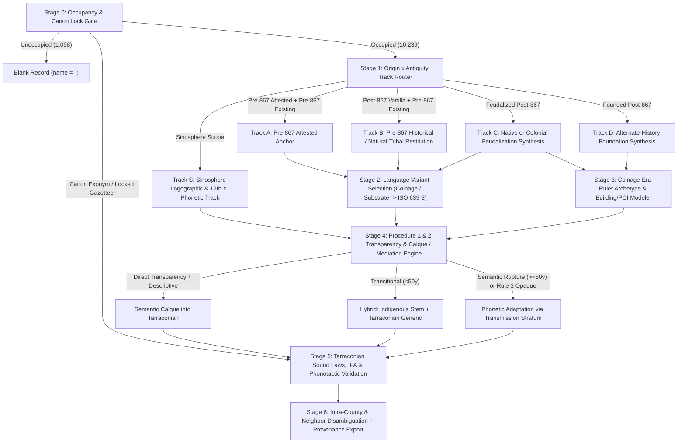

# Tarraconian Barony-Tier Toponymic Naming Pipeline (v2 Architecture)

> **Imperial Chancellery Technical Specification**  
> **Scope:** All **11,297 barony-tier holdings (`b_*`)** across 47 de jure empires and 3,476 counties (`10,239` save-occupied holdings + `1,058` unoccupied reserves as of `1194.7.28`).  
> **Companion Datasets:**  
> * [data/anachronicity_audit/](file:///home/siarzhuk/code/personal/tarraconian_hre/data/anachronicity_audit) (11,297 baronies — strict 867 antiquity audit, historical predecessors, morphemes, eponyms)  
> * [data/natural_tribal_replacements/](file:///home/siarzhuk/code/personal/tarraconian_hre/data/natural_tribal_replacements) (8,154 non-867 baronies; 24,462 natural/tribal candidates with 18,789 multilingual variant sets)  
> * [data/barony_toponymic_profiles.json](file:///home/siarzhuk/code/personal/tarraconian_hre/data/barony_toponymic_profiles.json) (10,239 occupied baronies — Alternative 1 3-stratum profile: `coinage_culture`, `substrate_culture`, `transmission_culture`)  
> * [data/sinosphere_kanji_tarraconian.json](file:///home/siarzhuk/code/personal/tarraconian_hre/data/sinosphere_kanji_tarraconian.json) & [scripts/sino_barony_kanji_ext.py](file:///home/siarzhuk/code/personal/tarraconian_hre/scripts/sino_barony_kanji_ext.py) (1,384 CJK logographic calque entries)  
> * [data/saint_holding_imagery.json](file:///home/siarzhuk/code/personal/tarraconian_hre/data/saint_holding_imagery.json) (300 attested saint/shrine holdings)  
> * [tarraconian_linguistics_guide.md](file:///home/siarzhuk/code/personal/tarraconian_hre/tarraconian_linguistics_guide.md), [tarraconian_descriptive_title_calques.md](file:///home/siarzhuk/code/personal/tarraconian_hre/tarraconian_descriptive_title_calques.md), [tarraconian_onomasticon_and_name_register.md](file:///home/siarzhuk/code/personal/tarraconian_hre/tarraconian_onomasticon_and_name_register.md), [sinosphere_phonetics_and_transcription_guide_1154.md](file:///home/siarzhuk/code/personal/tarraconian_hre/sinosphere_phonetics_and_transcription_guide_1154.md)

---

## 1. Design Philosophy & Improvements Over the v1 Pipeline

The legacy resolver ([scripts/resolve_barony_titles.py](file:///home/siarzhuk/code/personal/tarraconian_hre/scripts/resolve_barony_titles.py)) had to guess antiquity from curated regional lists, fell back to the **current 1194 baron** for Option C foundations, and lacked structured multilingual natural/tribal replacement pools or an explicit 3-stratum sociolinguistic history.

With the newly completed companion datasets, the v2 pipeline enforces five strict principles:

1. **Strict 867 Divergence Horizon:** No post-867 OTL eponym, colonial foundation, or modern settlement name may survive unless independently justified by pre-867 attestation (`is_historical_at["867"] == true`) or pre-867 `historical_names`.
2. **Separation of Coinage, Substrate, and Transmission:** A barony's base name is formed in its **origin/coinage stratum** (`coinage_culture`, or `substrate_culture` for pre-867 sites with high inertia), **mediated phonologically** through its `transmission_culture`, and **calqued or phonetically nativized** into Tarraconian according to `continuity_status` (Procedure 1 & Procedure 2).
3. **Coinage-Era Rulers, Not 1194 Holders:** When Option C (founder/feudalizer attribution) fires, it queries the **ruler active during coinage** (the feudalizer, post-867 construction-window lord, or qualifying ≥ 50y/100y/25y coinage sovereign), never a random 1194 baron.
4. **Toponym-First Distribution:** Even on newly founded or feudalized post-867 holdings, landscape/hydronym/tribal compounds remain the primary baseline (~65–75%), while eponymous personal/house or saintly foundations fire selectively based on ruler personality archetype, holding type, and in-game shrines/events.
5. **Deterministic Phonotactic & Collision Hygiene:** Every generated name passes through Rhine-Moselle Franconian sound laws, IPA generation, [audit_phonotactics_titles.py](file:///home/siarzhuk/code/personal/tarraconian_hre/scripts/audit_phonotactics_titles.py), and intra-county + neighbor disambiguation.

---

## 2. Current Resource Inventory & Pipeline Roles

| Resource | Coverage | Key Fields Consumed | Pipeline Stages |
| :--- | :--- | :--- | :--- |
| **Anachronicity Audit** (`data/anachronicity_audit/*.json`) | 11,297 baronies (`3,143` historical at 867; `8,154` post-867; `790` with pre-867 `historical_names`; `1,639` natural names) | `is_historical_at["867"]`, `anachronism_type`, `historical_names`, `natural_proper_name`, `eponym`, `morphemes`, `first_mention_year` | Stage 1 (Track Routing), Stage 2 (Stem Selection), Stage 4 (Calquability & Rule 3 Opaque Check) |
| **Natural & Tribal Replacements** (`data/natural_tribal_replacements/*.json`) | 8,154 non-867 baronies; 24,462 candidates (`23,988` valid at 867; `18,789` multilingual) | `replacement_candidates[]` (`localisation_stem`, `category`, `feature_subtype`, `valid_for_bookmarks["867"]`, `language_variants[]`, `etymology_notes`) | Stage 1 (Track B/C/D Stem Pool), Stage 2 (Language Variant Match), Stage 6 (Collision Fallback) |
| **3-Layer Toponymic Profile** (`data/barony_toponymic_profiles.json`) | 10,239 save-occupied baronies (`4,719` pre-867 est., `1,237` feudalized, `4,027` founded, `256` unfeudalized) | `c` (coinage), `s` (substrate), `t` (transmission), `o` (origin), `cs` (continuity), `ll` (liturgical language), `tc` (Tarraconian conquered), `hd` (horizon date), `county_streaks_50` | Stage 1 (Origin Track), Stage 2 (ISO Variant Match), Stage 3 (Coinage Window), Stage 4 (Procedure 2 Tier) |
| **Sinosphere Corpus** (`data/sinosphere_*.json`, `sino_barony_kanji_ext.py`, `sinosphere_phonetics_and_transcription_guide_1154.md`) | 1,384 CJK characters + 12th-c. LMC / EMK / EMJ / Khitan / Jurchen sound tables | Hanzi morpheme → Tarraconian formant, thematic category (1–10), historical 1154 readings | Stage 1 (Track S), Stage 4 (Procedure 1 Logographic Calquing), Stage 5 (12th-c. Phonetics) |
| **Melted Save & Phase 1** (`/var/tmp/ck3_audit/melted_save.ck3`, `phase1/*.json`) | 3,476 counties, 10,239 occupied baronies, 69,625+ resolved characters | County ruler timelines, traits, nicknames, dynasty houses, piety/prestige, `provinces` (`buildings`, `special_building_type`, `great_building_type`, `points_of_interest`), `faiths`, `holy_orders`, `epidemics` | Stage 0 (Occupancy), Stage 3 (Coinage-Era Archetype & Physical Context) |
| **Saint Holding Imagery** (`data/saint_holding_imagery.json`) | 300 attested saint shrines & buried saints | `saint_name`, `shrine_type`, `relic_description` | Stage 3 (Ecclesiastical / Shrine Naming) |
| **Chancellery Linguistic Canon** (`tarraconian_titles_1059.md`, `tarraconian_linguistics_guide.md`, `tarraconian_descriptive_title_calques.md`, `tarraconian_onomasticon_and_name_register.md`) | Master Gazetteer + 442 secondary variants + 239 Franconian names + sound laws + morpheme matrix | Locked canon exonyms, regional sound-change rules, daughter dialect rules, morpheme calque table, personal name forms | Stage 1 (Canon Lock), Stage 4 (Calquing), Stage 5 (Phonology, Orthography & IPA) |

---

## 3. End-to-End 7-Stage Pipeline Architecture



---

### Stage 0: Occupancy, Data Reconciliation & Canon Lock Gate
1. **Occupancy Source of Truth:** Read raw occupancy directly from `melted_save.ck3` (`provinces` `holding.type` — `10,239` occupied, `1,058` unoccupied), fixing the legacy apostrophe regex omission that misclassified `b_ka'abir` and `b_mansa'l-kharaz` as unoccupied in `barony_holdings.json`.
2. **Unoccupied Rule:** Unoccupied baronies emit strictly blank strings (`name = ""`, `b_origin = ""`, `b_ipa = ""`, `b_anachronism = ""`).
3. **Immutable Canon Lock:** Pre-verified Imperial Chancellery exonyms and explicitly resolved secondary seats from `tarraconian_titles_1059.md` (e.g., `b_roma → Rôm`, `b_london → Lunden`, `b_byzantion → Konstantinôpel`, `b_konigsberg → Twangste`) are locked before algorithmic generation so automated re-runs never overwrite hand-curated canon.

---

### Stage 1: Track Routing (`anachronicity_audit` × `barony_toponymic_profiles`)

Each occupied barony is routed by crossing its **strict 867 audit status** (`is_historical_at["867"]`) with its **save-derived structural origin** (`origin_type` from `barony_toponymic_profiles.json`):

| Audit Status (`867`) | `pre_867_established` / `pre_867_unfeudalized` | `feudalized_post_867` | `founded_post_867` |
| :--- | :--- | :--- | :--- |
| **`is_historical_at["867"] == true`** | **Track A:** Keep attested pre-867 name. Check if `coinage_culture` overrode it (e.g., castle ≥ 100y or temple faith change ≥ 25y); otherwise retain pre-867 stem. | **Track C1:** Retain pre-867 seat stem; if `colonial_feudalization`, allow hybrid generic attachment in `coinage_culture`. | **Track D1:** Treat as pre-867 hamlet/landmark fortified or chartered post-867; retain pre-867 stem + optional coinage-culture holding generic. |
| **`is_historical_at["867"] == false`** | **Track B (Priority Cascade):**<br>1. Pre-867 `historical_names` entry (`790` baronies)<br>2. Existing `natural_proper_name` if not post-867 eponym (`1,639` baronies)<br>3. `natural_tribal_replacements` candidate (`valid_for_bookmarks["867"] == true`). | **Track C2:**<br>1. Pre-867 `historical_names` if present<br>2. Combine `natural_tribal_replacements` stem (in `substrate_culture` or `coinage_culture` variant) with **Stage 3** feudalizer generic/archetype. | **Track D2 (Pure Alt-History Foundation):** Ignore anachronistic vanilla name completely. Synthesize via **Stage 3** (`coinage_culture` + coinage-era founder archetype + holding type + NTR landscape stem / building / shrine). |

#### Track S: Sinosphere Override
Applies whenever `coinage_culture` or `transmission_culture` has a Sinosphere heritage (`heritage_chinese`, `heritage_korean`, `heritage_japonic`, `heritage_viet`, `heritage_buyeo`) or lies inside the 9 Sinosphere empires / curated frontier counties:
* **Attested Pre-867 Sinosphere Holdings:** Keep classical Hanzi; apply **Procedure 1** (calque descriptive characters via the 1,384-entry CJK lexicon; transliterate dynastic/ethnonym/opaque stems via 12th-century Late Middle Chinese, Early Middle Korean, or Early Middle Japanese phonology from `sinosphere_phonetics_and_transcription_guide_1154.md`).
* **Fictional (`b_FIC_*`) or Post-867 Anachronistic Sinosphere Holdings:** Replace anachronistic or placeholder names using either:
  1. A pre-867 `historical_names` entry (with `native_script` Hanzi), or
  2. A `natural_tribal_replacements` candidate bearing a `lzh`/`zho`/`kor`/`jpn`/`vie` variant (with `native_script`), or
  3. A **Sinosphere Founder/Administrative Compound** coined in 2-character Classical Chinese (`<Topographic/Auspicious Modifier> + <Holding Classifier>`: castle → `城/堡/關/鎮`, city → `州/府/市/津`, temple → `寺/院/觀/宮`) driven by the coinage-era ruler's personality archetype!
* **Non-Sinospheric Coinage Inside Sinosphere (e.g., Tarraconian-founded `b_FIC_*` post-conquest):** If `coinage_culture` is `Tarraconian` (`founded_post_conquest_tarraconian`), route to **Track D2** directly in Tarraconian instead of fabricating fake Hanzi.

---

### Stage 2: Source-Language Variant Selection (`coinage` / `substrate` → ISO 639-3)

Both `anachronicity_audit` (`historical_names`, `morphemes`) and `natural_tribal_replacements` (`language_variants[]`) tag forms with **ISO 639-3 / ISO 639-5 / proto codes** (`lat`, `grc`, `deu`, `hun`, `ron`, `bul`, `sla-pro`, `gem-pro`, `cel-bry`, etc.), whereas `barony_toponymic_profiles.json` uses **CK3 cultures and languages**.

Stage 2 resolves the exact source form via a deterministic fallback chain:
1. Map `coinage_culture` (or `substrate_culture` for Tracks A/B) → prioritized ISO code list (e.g., `slovien → ["slk", "ces", "sla-pro", "chu"]`; `Tarraconian → ["gmh", "deu", "cat", "lat"]`; `greek → ["grc", "ell"]`; `levantine/bedouin/egyptian → ["ara"]`; `mogyer/hungarian → ["hun"]`).
2. For **`church` holdings with liturgical coinage**, prefer the liturgical language variant (`lat`, `grc`, `chu`, `ara`, `san`, `lzh`, `bod`) when available.
3. For **CK3 dynamic hybrid cultures** (e.g., `Sogdo-Oghuz`, `Croato-Tarraconian`, `Ungwârer`), query the primary `language` first, then secondary `parents` languages.
4. Fallback order on `language_variants[]`:
   `exact coinage ISO match` → `exact substrate ISO match` → `language-family / proto match` → `regional classical lingua franca (lat/grc/ara/san/lzh)` → `candidate.localisation_stem`.
5. **Candidate Ranking within `natural_tribal_replacements` (3 candidates per barony):**
   * Filter strictly to `valid_for_bookmarks["867"] == true`.
   * Weight candidate category by `holding_type` and `origin_type`:
     * `city` → prefer `hydronym` (river/estuary/bay) > `choronym` > `topographic_feature` > `tribe`.
     * `castle` → prefer `oronym` (hill/mountain) / `hydronym` (ford/river) > `tribe` > `choronym`.
     * `church` → prefer `oronym` / `topographic_feature` (forest/valley/spring) > `hydronym` > `tribe`.
     * `pre_867_unfeudalized` / `feudalized_post_867` capital → boost `tribe` and `choronym` candidates (matching historical tribal-to-principality seats).

---

### Stage 3: Coinage-Era Holder Personality Archetype & Structural Synthesis

Triggered for **Track C2** (post-867 feudalizations), **Track D2** (post-867 foundations), and **Track A/B castles or temples** overridden by foreign coinage rules (`castle_overrule_*`, `temple_faith_change_25y`).

#### 3.1 Resolving the True Coinage-Era Ruler (Fixing Legacy Option C)
Instead of reading `save_b["holder"]` (the 1194 incumbent), Stage 3 resolves the **coinage-era sovereign**:
* `feudalized_post_867`: the county ruler active at `feudalization_date` (or the start of the conquering feudal streak).
* `founded_post_867`:
  * If `founded_post_conquest_tarraconian`: the Tarraconian/imperial county holder at the midpoint of the imperial rule window (or the earliest recorded Tarraconian lessee/holder if available).
  * If `founded_pre_conquest_50y` / `founded_dominant_window`: the longest-reigning or `architect`/`stewardship`/`martial`-traited ruler within the qualifying pre-horizon coinage streak!
* `castle_overrule_*` / `temple_faith_change_25y`: the conquering or longest-reigning ruler of the overriding streak.
* **Circular House Guard:** Keep the **Toponym-First circular house check** (`is_circular_house`) so auto-generated houses named after an anachronistic holding are disqualified.

#### 3.2 Personality Archetype × Holding Type × Coinage Language Matrix
Crucially, **coin the compound in `coinage_culture`'s own morphological system first** (or directly in Tarraconian when `coinage_culture` is imperial/Germanic), rather than slapping German `-burch`/`-stat` onto a 10th-century Arabic, Slavic, or Indic foundation that later suffered semantic rupture!

| Ruler Archetype (CK3 Traits / Context) | Trigger Share | Castle (`castle`) Pattern | City (`city`) Pattern | Temple (`church`) Pattern |
| :--- | :---: | :--- | :--- | :--- |
| **1. Topographic / Natural Default** *(balanced traits, or county already has ≥1 eponym)* | ~55–65% | `<NTR Stem> + <Fort Generic>` (`-burch`, `-veste`, `-stein` / `Qal'at-`, `-grad`, `-vár`, `-garh`) | `<NTR Stem> + <Civic Generic>` (`-stat`, `-vurt`, `-marct`, `-hâven`* / `-shahr`, `-pur`, `-by`) | `<NTR Stem> + <Sacred Generic>` (`-kirchen`, `-tâl`, `-zelle` / `Deir-`, `Cill-`, `Vihara`) |
| **2. Pious / Devotional** (`zealous`, `theologian`, `pilgrim`, `monk`, `celibate`, `humble`, or `poi_buried_saint` / `saint_holding_imagery`) | ~12–18% | Sacred dedication (`Marienburch`, `Heiligencrûce`, `Ribat al-Fath`) | Pilgrimage/shrine town (`Zant-<Saint>stat`, `Mashhad`, `Tirtha`) | **Priority 1:** Buried/canonical saint (`Zant-<Saint>`). **Priority 2:** `<Liturgical/Devotional>` (`Marienzelle`, `Heiligencrûce`, `Nîenclôster`, `<House>stifft`) |
| **3. Vain / Dynastic** (`arrogant`, `ambitious`, `greedy`, `august`, `fickle`, high prestige) | ~10–15% | `<Founder/House> + <Fort Generic>` (`<Founder>sburch`, `<House>veste`, `Qal'at <Founder>`, `<Founder>garh`) | `<Founder/House> + <Civic Generic>` (`<Founder>stat`, `<Founder>abad`, `<Founder>pur`, `<Founder>pol`) | `<House>stifft` / `<Founder>munster` / `<Founder>kirchen` |
| **4. Martial / Frontier** (`brave`, `strategist`, `architect`, `paranoid`, `craven`, `military_engineer`, or `poi_battles` / Holy Order lease) | ~8–12% | Defensive/march/battlefield name (`Schirmburch`, `Wartberch`, `Walstat`, `Ritterburch`, `Landeshût`, `Hisn al-Haras`) | Garrison/bridgehead town (`Wachstat`, `Brückenstat`, `Qantara`) | Military-order commandery or victory chapel (`Crûzburch`, `Sêgekirchen`) |
| **5. Mercantile / Civic** (`education_stewardship_3/4`, `avaricious`, `diligent`, `common_tradeport`, `guild_halls`) | ~5–10% | Customs/toll citadel (`Zolburch`, `Mautstein`) | Chartered market/port (`Nîemarct`, `Frîstat`, `<Hydronym>-hâven`*, `Bandar-<Stem>`) | Hospice/guild foundation (`Spitalkirchen`, `Brûderzelle`) |

*\*Maritime/coastal formants (`-hâven`, `-port`, `Bandar-`) must be strictly gated on verified **sea-coast** status (from CK3 `map_data/default.map` `sea_zones` vs. `river_provinces`/`lakes`, or ocean-exterior polygon geometry in `barony_geography.json`). Because CK3's `common_tradeport` is also buildable on inland navigable rivers and lakes (e.g., `b_szekesfehervar`, `b_vyshgorod`), `has_tradeport` indicates waterborne commerce generally—not maritime coast—and should only unlock inland river/landing formants (`-furt`, `-lände`, `-stade`, `-werf`) unless paired with true sea-coast verification.*

---

### Stage 4: Procedure 1 & 2 Transparency, Calquing & Phonological Mediation

Once Stages 1–3 produce a **source-stratum name** in `coinage_culture` (with its morphemic glosses if descriptive or newly coined), Stage 4 determines how Tarraconian clerks absorb it using `barony_toponymic_profiles.json`'s `continuity_status` (`cs`) and `transmission_culture` (`t`):

1. **Rule 3 Gate (Opaque Eponyms, Personal Names, Ethnonyms, Pre-IE Stems):**
   * If `anachronicity_audit.eponym != null`, `candidate.category == "tribe"`, or `morphemes` indicate an opaque/ancient proper root → **Calquing Prohibited**. Proceed directly to Phonetic Mediation.
   * *Exception:* Productive personal-name + generic compounds coined in a transparent language (`<Founder> + <Castle/City/Church>`) keep the founder stem phonetically adapted and calque the generic (`Ayyub's Castle → Eijûbsburch`, `St. George → Zant-Dschôrdi`).
2. **`Direct Transparency`** (`language(coinage) == language(transmission)` or `coinage_culture in IMPERIAL_CULTURES`):
   * **Descriptive toponyms & newly synthesized Stage 3 compounds** are **fully calqued** into Tarraconian via the Master Morpheme Matrix (`tarraconian_descriptive_title_calques.md` § 3) or Sinosphere Hanzi Lexicon (Procedure 1).
   * *Example:* Pre-867 `b_southwark` (`anglo_saxon` coinage & transmission, `Sūþ-geweorc`) → **`Sûtwerc`**; `b_boseong` (寶城, `han` transmission) → **`Edelsteinburch`**.
3. **`Transitional Mediation (< 50y)`** (`language(coinage) != language(transmission)`, mediating reign `< 50` years):
   * **Hybrid Calque:** Retain the indigenous proper stem (phonetically adapted) and translate only the transparent generic formant (`-vár / -grad / -qal'a / -kot → -burch`; `-város / -pol / -shahr / -pur → -stat`; `-cill / -deir / -kirchen → -kirchen`).
4. **`Semantic Rupture (>= 50y)`** (`language(coinage) != language(transmission)`, mediating reign `≥ 50` years):
   * **Strict Phonetic Nativization via `transmission_culture`:** Reject semantic calques as primary names. Pass the `coinage_culture` form through `transmission_culture`'s phonological filter (e.g., Greek `Kallipolis` via Turkish `Gelibolu`, or Italian `Roma` via Greek `Rhṓmē` unless canon-locked) before applying Tarraconian sound laws!

---

### Stage 5: Tarraconian Sound Laws, Daughter Dialects, IPA & Validation

All candidate strings pass through a single deterministic Tarraconian normalizer:
1. **Orthographic & Consonant Sound Laws** ([tarraconian_linguistics_guide.md](file:///home/siarzhuk/code/personal/tarraconian_hre/tarraconian_linguistics_guide.md) § 3):
   * Rhine-Moselle Franconian profile (unshifted `p-, d-`, `sw-, sl-, sm-`; initial `z-` vs medial/final `-tz-`/`-tz`; post-vocalic shifted `-ch`).
   * Universal *Auslautverhärtung* (`-b/-d/-g/-dsch → -p/-t/-ch/-tsch`; `-burg → -burch`; Slavic `-ov/-ev/-av → -ouwe`; `-sk → -tzich`/`-bsch`).
   * Bimoraic stress-to-weight circumflexes (`â, ê, î, ô, û`, preserved on capitals `Â, Ê, Î, Ô, Û`).
   * Dual-substrate apocope (`-a → -e`; Catalan-style drop of unstressed `-o/-e` after liquids/nasals) and illicit onset cluster repair.
   * Clean CK3 ASCII escapes (`A_ → Á → Â`, `OE → Ö`, `T_ → Þ`, etc.) from save personal names via `tarraconian_onomasticon_and_name_register.md`.
2. **Optional Daughter Dialect Layer:** Where `coinage_culture` or `c1194` is `Alpine-Tarraconian`, `Croato-Tarraconian`, or `Ungwârer`, apply the documented dialect overlays (`tarraconian_linguistics_guide.md` § 6) or record the regional variant alongside the Metz/Aachen Imperial Chancellery standard.
3. **IPA & Automated Phonotactic Audit:** Generate `b_ipa` (`generate_tarraconian_ipa`) and validate against [scripts/audit_phonotactics_titles.py](file:///home/siarzhuk/code/personal/tarraconian_hre/scripts/audit_phonotactics_titles.py) (zero forbidden Pinyin `zh`/`sh`, zero unshifted `-burg`/`-bad`, zero illegal `-dsch` codas, zero English prepositions like `on`/`upon`).

---

### Stage 6: Intra-County & Neighbor Disambiguation + Provenance Export

1. **Parent County Reconciliation:** Capital baronies (`capital_barony == yes`) coordinate with the parent county's resolved name in `tarraconian_titles_1059.md` / `ck3_counties.geojson`. When a sub-barony is the true pre-867 Option A seat (like `b_cork` vs. `b_tralee` in `c_desmond`), assign the historical seat to the sub-barony and disambiguate the capital cleanly.
2. **Collision Resolution Cascade:** Enforce zero exact or near-homophonic collisions (`normalize_phonetic_stem` match or `SequenceMatcher >= 0.75`) within the same county (`c_*`) and flag duplicates across directly adjacent counties (`data/ck3_adjacencies.json`):
   1. Try the **2nd or 3rd candidate** in `natural_tribal_replacements` (every non-867 barony has 3 distinct candidates).
   2. Differentiate by **holding-type generic** (`-burch` vs `-stat` vs `-kirchen`).
   3. Attach **true geographic directional/positional prefix** (`Ober-`/`Nider-`, `Ôst-`/`West-`, `Nord-`/`Sût-`, `Alt-`/`Nîe-`) computed from barony polygon centroids in `ck3_baronies.geojson`.
   4. Fall back to **Stage 3 coinage-era founder/shrine differentiation**.
3. **Structured Output & Auditability:** Emit `data/barony_resolutions_v2.json` (plus updated `ck3_baronies.geojson` and CK3 localisation `.yml`) with full machine-readable provenance:
   ```json
   {
     "barony_key": "b_example",
     "name": "Tarraconian Final Name",
     "b_tarr_direct": "Phonetic adaptation of source",
     "b_tarr_hist": "Historical / calqued Chancellery form",
     "b_ipa": "[...]",
     "b_hanzi": "",
     "pipeline_track": "Track_C2_colonial_feudalization",
     "source_origin": "natural_tribal_replacements:hydronym:Usha",
     "source_language_code": "sla-pro",
     "coinage_culture": "franconian",
     "substrate_culture": "russian",
     "transmission_culture": "franconian",
     "continuity_status": "Direct Transparency",
     "coinage_ruler": {"id": 12345, "name": "Gotthart", "archetype": "martial_frontier"},
     "calque_mode": "hybrid_calque",
     "phonological_pathway": "Usha (sla) -> Uscheburch (franconian) -> Ûscheburch (Tarraconian)",
     "b_origin": "...",
     "b_anachronism": "..."
   }
   ```

---

## 4. Additional Data That Should Be Extracted or Built

To execute the v2 pipeline at maximum historical quality and minimal manual patch-work, **8 high-leverage companion datasets** can be extracted or authored — 3 directly from `melted_save.ck3` (no external files needed) and 5 curated/derived linguistic & geographic bridges:

### A. Directly Extractable from `melted_save.ck3` (Immediate, High Impact)

1. **`data/barony_coinage_rulers.json` (Coinage-Era Ruler Profiles)**
   * **Why:** `barony_toponymic_profiles.json` currently outputs culture names and dates, while `resolve_barony_titles.py` reads the *1194* baron. We need the **actual ruler character object active at coinage** (feudalizer, construction-window sovereign, or overriding ≥ 50y/100y/25y ruler): `holder_id`, cleaned `first_name`, `nickname`, `dynasty_house`, `traits_decoded`, `education`, `piety`, `prestige`, `faith_id`, and `is_circular_house`.
   * **Source:** `melted_save.ck3` (`landed_titles`, `living`, `dead_unprunable`, `characters.dead_prunable`, `dynasties`) + `phase1/titles_data.json`.

2. **`data/barony_physical_and_event_context.json` (Buildings, POIs, Holy Orders, Shrines, Battles & Plagues)**
   * **Why:** `melted_save.ck3` already stores rich holding-level facts that dramatically improve Stage 3 naming realism and prevent terrain errors:
     * **Economic & Terrain Building Proxies:** `common_tradeport` (`2,287` holdings — indicates a waterborne tradeport on a sea coast, navigable river, or lake; *not* a standalone maritime/coastal gate), `hill_forts` (`1,358`) & `hill_farms` (`1,292`), `quarries` (`1,047`), `hospices` (`3,012`), `monastic_schools` (`2,967`), `guild_halls` (`2,878`), `hunting_grounds` (`2,354`), `scriptorium` (`1,835`), `orchards`, `vineyards`, `peat_quarries`, `logging_camps`.
     * **Special & Great Buildings:** `500` holdings across `219` distinct special buildings (`46` universities, `13` legendary shrines, mines, Silk Road nodes, grand temples) + `86` great buildings (`30` Great Cathedrals, `41` Great Wall segments, `10` Mandala Capitals, `4` Forbidden Cities).
     * **In-Game Events & POIs:** `poi_battles` (`96`) + `poi_battles_historical` (`12`) for battlefield names (`Walstat`, `Sêgeburch`); `poi_buried_saint` (`140`) + `faiths.*.saints` (actual in-game canonized saints for `Zant-<Saint>` churches!); Holy Order `leased_out` baronies (`1,383` lease events → commandery/order fortresses); `epidemics` / `shattered_by_plague` markers.
   * **Source:** Single streaming pass over `melted_save.ck3`.

3. **Exact `867` Holding Baseline & `barony_holdings.json` Reconciliation**
   * **Why:** Fix the 2 apostrophe city holdings (`b_ka'abir`, `b_mansa'l-kharaz`) omitted in `barony_holdings.json`. If CK3 game files (`/mnt/windows` / Steam `game/`) are mounted later, also extract **`common/province_terrain/00_province_terrain.txt`** and **`history/provinces/*.txt`** so exact terrain (`mountains`, `hills`, `wetlands`, `forest`, `desert`, `plains`, `floodplains`, `coastal`) and exact 867 building baselines are known without inference.

### B. Curated / Derived Linguistic & Cartographic Bridge Datasets

4. **`data/ck3_culture_to_iso_and_generics.json` (404-Culture Linguistic & Morphological Bridge)**
   * **Why:** Connects all 404 CK3 cultures (including dynamic hybrids/divergences) to:
     1. **Ordered ISO 639-3 / 639-5 / proto codes** for exact Stage 2 lookups into `anachronicity_audit` and `natural_tribal_replacements`.
     2. **Native toponymic generic tables** by holding type (`castle`, `city`, `church`, `tribal`) per language family (e.g., Slavic `-grad/-grod/-selo/-cerkov`, Arabic `Qal'at-/Madinat-/Ribat-/Deir-`, Hungarian `-vár/-város/-szent`, Turkic `-kale/-kent/-saray`, Norse `-borg/-vík/-staðir/-kirkja`, Celtic `Dún-/Caer-/Cill-`, Persian `-abad/-gird/-shahr`, Indic `-garh/-kot/-pur/-nagar`). This lets Stage 3 coin names in the *coinage culture's actual language* before Stage 4 mediates/calques them into Tarraconian!
     3. **Transmission phonological filter rules** (`transmission_culture → Tarraconian`, plus key intermediary shifts like Greek → Slavic/Arabic/Turkic).

5. **`data/multilingual_morpheme_calque_lexicon.json` (Machine-Readable Procedure 2 Calque Dictionary)**
   * **Why:** `tarraconian_descriptive_title_calques.md` § 3 is currently prose/markdown tables covering ~135 county titles. Extracting it into a normalized JSON dictionary of `(semantic_concept / morpheme_gloss) → {tarr_prefix, tarr_suffix, tarr_standalone, gender_case}`—and expanding it to cover the top ~300 recurring morpheme translations in `anachronicity_audit.morphemes` and `natural_tribal_replacements.etymology_notes`—unlocks automated, consistent Procedure 2 calquing across all 10,239 baronies.

6. **`data/global_onomasticon_adaptation.json` (Multi-Cultural Personal Name Adapter)**
   * **Why:** `tarraconian_onomasticon_and_name_register.md` currently covers the 239 `name_list_franconian` names. Extracting all unique `first_name` values of coinage-era rulers from `melted_save.ck3` (especially Arabic, Greek, Slavic, Magyar, Norse, Turkic, Persian, Indic, Romance, and Celtic names) and building a clean CK3-ASCII-decoder + Tarraconian adaptation table ensures eponymous names never leak raw CK3 strings (`SE_bert`, `A_rpA_d`, `MiL_obrat`, `LO_rinc`).

7. **`data/barony_geography.json` (Spatial & Border Context from GeoJSON — Generated)**
   * **How Computed ([`compute_barony_geography.py`](file:///home/siarzhuk/code/personal/tarraconian_hre/scripts/compute_barony_geography.py)):** Computed directly from `data/ck3_baronies.geojson`, `data/ck3_adjacencies.json`, `data/barony_holdings.json`, and 1194 Roman Empire boundaries:
     * **Area-weighted polygon centroids `(x, y)`** & intra-county 8-wind direction (`county_direction`, `county_offset`) → enables geometrically accurate **directional disambiguators** (`Ober-`/`Nider-`, `Ôst-`/`West-`, `Nord-`/`Sût-`) when two baronies in a county share a river or tribal stem.
     * **True Sea-Coast vs. Inland River/Lake Flag (`is_sea_coast`, `is_caspian_coast`, `coast_type`)** → derived via scanline rasterization + off-map Eurasian/African horizon & Egyptian Eastern Desert wasteland seals + morphological opening (`r = 3`, min channel width `>= 7 px`) with strait-bridged marine basins (Mediterranean, Black Sea, Azov, Marmara, Zuiderzee, Seto Inland Sea, Varangerfjord) and 4-step constrained geodesic dilation (`1,983` total / `1,904` occupied sea-coast baronies, `43` total / `35` occupied Caspian shoreline baronies; separating `1,496` true maritime tradeports from `763` inland river/lake tradeports).
     * **Frontier / March flag (`is_imperial_frontier_barony`, `is_imperial_frontier_county`)** (`412` occupied baronies bordering a non-Tarraconian realm at `1194`) → boosts march/watchtower formants (`-march`, `-wart`, `Schirmburch`) on frontier castles.

8. **`data/tarraconian_exonym_canon.json` (Locked Exonym & Gazetteer Anchor Table)**
   * **Why:** Centralizes all pre-established imperial exonyms (`Rôm`, `Lunden`, `Parîs`, `Konstantinôpel`, `Stûlwîtzenburch`, `Prâge`, `Mênz`, `Âchen`, etc.) and the 442 secondary variants from `tarraconian_titles_1059.md` into a single JSON lockfile read in Stage 0, preventing accidental churn and keeping county/barony naming synchronized across future regenerations.
