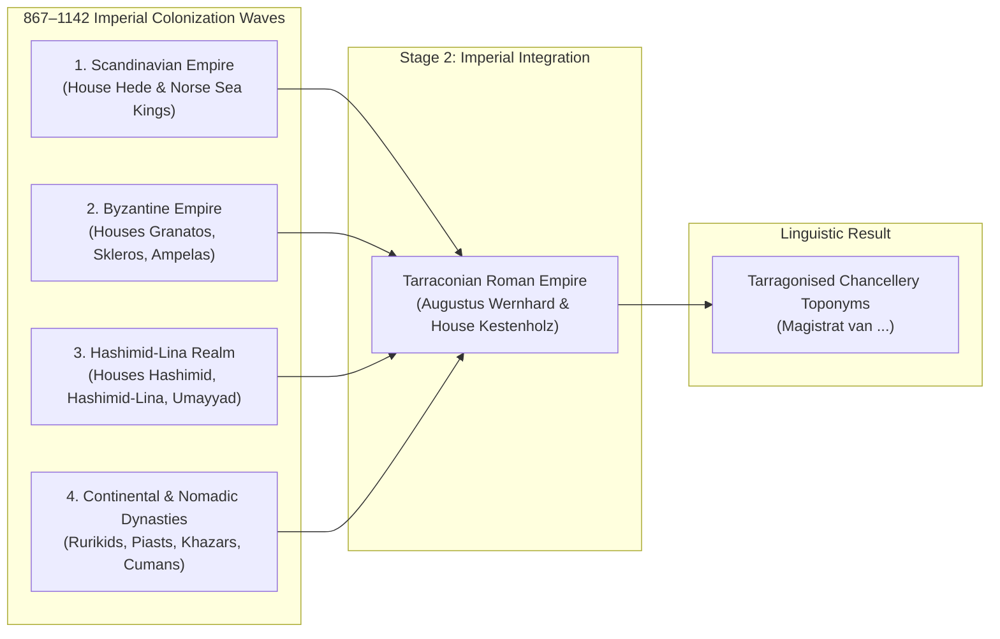

# Geopolitical Colonization & Imperial Trajectory Title Audit (867–1142)

* **Campaign Save:** `chatenois_867_01_01.ck3` (20 August 1142)
* **Audit Scope:** **209 Flagged Imperial Counties** across **50 De Jure Kingdoms**
* **Analytical Framework:** 867–1142 Sovereign Trajectory → Colonial Settlement Waves → Pre-Conquest Imperial Toponymy → Tarragonisation

---

## Executive Summary: The Multi-Layered Alternate History of the Save

In real-world historical toponymy, places in frontier zones preserve layers left by successive conquering and colonising civilisations: Celtic oppida were renamed by Roman legionaries, Saxon burgwards arose over Roman ruins, and Norse invaders stamped Danish/Norse names that were later Normanised or Anglicised.

Between **1 January 867** and **20 August 1142**, the campaign universe underwent radical alternate-history geopolitical shifts. Long before the **Tarraconian Holy Roman Empire** (`h_roman_empire`) expanded to its 1142 borders, foreign imperial powers actively conquered, fortified, settled, and colonised these territories:

### The Four Major Colonization Spheres in the Save:
1. **The Scandinavian Empire & Norse Sea Kings (44 Flagged Titles):**
   * In the mid-11th century (c. 1059), King/Emperor **Dan of House Hede** (`dynn_Hede`, Norwegian culture) led a massive expansion into the Pontic Steppe, conquering the Cuman and Khazar nomadlands (*Bakhmut*, *Kazanskaya*, *Odessa*, *Oleshye*, *Perekop*, *Cherkassy*, *Ladyzhyn*).
   * Concurrently, Norwegian jarls colonized the northern river systems of Bjarmaland and Opolye (*Lyubim*, *Ustyug*, *Vologda*, *Plyos*), while Danish and Norse Viking sea kings established coastal garrisons in Pomerania (*Rostock*, *Stettin*, *Kolobrzeg*, *Brandenburg*) and Finland (*Olavsborg*, *Porvoo*).
2. **The Byzantine Empire & Pontic Greek Aristocracy (33 Flagged Titles):**
   * Powerful Byzantine dynastic houses actively pushed frontier themes outward: **House Granatos** established themes along the Black Sea coast (*Kherson*, *Odessa*, *Perekop*) and Sahara (*Murzuk*).
   * **House Skleros** fortified the Danube and Balkan marchlands (*Mačva*, *Soli*, *Usora*), while **House Ampelas** and **House Euferbenos** pushed into the Moldavian and Carpathian frontiers (*Dorohoi*, *Suceava*, *Neamț*, *Barcaság*).
3. **The Hashimid-Lina & Islamic Imperial Wave (43 Flagged Titles):**
   * The extraordinary **House Hashimid** (Dynasty 1727, possessing the Sayyid bloodline) and its prominent cadet branch **Hashimid-Lina** intermarried with Byzantine, Armenian, and Lothringian nobilities, ruling Caspian and Caucasian capitals (*Astrakhan*, *Samander*) and holding enclaves as far west as the Low Countries (*Frisia* under *Theoktiste Hashimid-Lina*).
   * In Iberia and North Africa, the Umayyads, Banu Razin, Ibn Marwan, and Rustamids ruled long-standing urban fortresses (*Molina*, *Albarracín*, *Medellín*, *Alarcón*, *Algiers*, *Oran*).
4. **Continental Marcher, Slavic & Indigenous Steppe Dynasties (89 Flagged Titles):**
   * Western Slavic (Piast, Přemyslid), Hungarian (Árpád), and Early Imperial Carolingian/Rhenish lords founded marcher burgwards (*Kaiserswerth* under Count Kuno, *Plzenec* under Duke Hugo, *Swenigorot* under Prince Humbert).

---

## 1. The Scandinavian Empire & Norse Settlement Layer (44 Titles)

When Scandinavian conquerors established lordships across foreign lands, they applied traditional Old Norse/Old Norwegian toponymic suffixes: **`-borg`** (stronghold/fortress), **`-garðr`** / **`-gard`** (enclosed settlement/trading post), **`-vík`** / **`-vik`** (inlet/bay port), **`-staðir`** / **`-stad`** (stead/homestead), and **`-býr`** / **`-by`** (town).

Upon incorporation into the Tarraconian Holy Roman Empire, the Chancellery adapted these Scandinavian toponyms through **Rhine-Moselle Franconian and Middle High German sound laws**:
* `-borg` → **`-burch`** (e.g. *Dansborg* → *Dansburch*)
* `-gard` / `-garðr` → **`-gart`** (e.g. *Oleshgarðr* → *Oleschgart*)
* `-vík` / `-vik` → **`-wîk`** (e.g. *Hammarvík* → *Hammarwîk*)
* `-staðir` / `-stad` → **`-stat`** (e.g. *Úlfheðinsstaðir* → *Olfhedinstat*)
* `-by` / `-býr` → **`-bî`** (e.g. *Hauksbýr* → *Houksbî*)

| County Key | Vanilla / Save Name | De Jure Kingdom | In-Game Norse / Scandinavian Ruler(s) | Historical Scandinavian Candidate Name | Official Tarragonised Chancellery Title | Official Adjective | Historical Context in Save Game |
| :--- | :--- | :--- | :--- | :--- | :--- | :--- | :--- |
| `c_satfura` | **cn_tarr_c_satfura** | k_africa | Játvarðr (Unknown, norwegian, 1091.12.12) | *Játvarðsborg* | **Magistrat van Jatwardsburch** | *Jatwardsburcher* | African coastal outpost held by Norwegian adventurer Játvarðr (1091). |
| `c_lyubim` | **cn_tarr_hist_c_lyubim** | k_bjarmaland | Úlfheðinn (Hede, norwegian, 1033.11.3) | *Ingólfsborg* | **Magistrat van Ingolfsburch** | *Ingolfsburcher* | Founded by Norwegian Jarl Ingólfr of House Lyubim (1034) in Bjarmaland. |
| `c_ustyug` | **cn_tarr_hist_c_ustyug** | k_bjarmaland | Úlfheðinn (Hede, norwegian, 1032.11.3) | *Úlfheðinsstaðir* | **Magistrat van Olfhedinstat** | *Olfhedinstater* | River junction stead founded by Úlfheðinn of House Hede (1032). |
| `c_vologda` | **cn_tarr_c_vologda** | k_bjarmaland | Úlfheðinn (Hede, norwegian, 1033.11.3) | *Ögmundarvík* | **Magistrat van Ogmundswîk** | *Ogmundswîker* | Established by Jarl Ögmundr of House Vologda (1034) on the river Vologda. |
| `c_zatec` | **cn_tarr_c_zatec** | k_bohemia | Hrólfr (Kauping, norse, 996.2.3) | *Hrólfsborg* | **Magistrat van Rôlfsburch** | *Rôlfsburcher* | Bohemian trade outpost held by Hrólfr of House Kauping (996). |
| `c_aalborg` | **cn_tarr_c_aalborg** | k_denmark | Þrándr (SkjO_ldung, norse, 750.1.1) | *Þrándsborg* | **Magistrat van Trantsburch** | *Trantsburcher* | Limfjord haven held by Þrándr of House Skjöldung (750). |
| `c_sjaelland` | **cn_tarr_c_sjaelland** | k_denmark | Hrærekr (SkjO_ldung, norse, 700.1.1) | *Hræreksborg* | **Magistrat van Rôrîksburch** | *Rôrîksburcher* | Danish royal seat held by Hrærekr of House Skjöldung (700). |
| `c_reval` | **cn_tarr_hist_c_reval** | k_esthonia | Tuul (Virumaa, norwegian, 1050.10.23) | *Tuulsborg* | **Magistrat van Tuulsburch** | *Tuulsburcher* | Gulf of Finland coastal fortress held by Tuul of House Virumaa (1050). |
| `c_vidzeme` | **cn_tarr_c_vidzeme** | k_esthonia | Sirje (Saaremaa, swedish, 964.1.3) | *Sirjesborg* | **Magistrat van Sirjesburch** | *Sirjesburcher* | Livonian coastal hillfort held by Sirje of House Saaremaa (964). |
| `c_wiek` | **cn_tarr_hist_c_wiek** | k_esthonia | Tuul (Virumaa, norwegian, 1050.10.23) | *Virumaaborg* | **Magistrat van Wîrmaburch** | *Wîrmaburcher* | Estonian maritime district held by Tuul & Óttar of House Virumaa (1050). |
| `c_messukyla` | **cn_tarr_hist_c_messukyla** | k_finland | Hróðólfr (Hede, norwegian, 1011.7.13) | *Hallsteinsstaðir* | **Magistrat van Hallsteinstat** | *Hallsteinstater* | Tavastian homestead founded by Hallsteinn of House Nordhagen (1011). |
| `c_nyland` | **cn_tarr_hist_c_nyland** | k_finland | Hróðólfr (Hede, norwegian, 1011.7.13) | *Hauksbýr (Porvoo)* | **Magistrat van Houksbî** | *Houksbîer* | Coastal trading borough founded by Haukr of House Porvoo (1011). |
| `c_olavinlinna` | **cn_tarr_hist_c_olavinlinna** | k_finland | Hróðólfr (Hede, norwegian, 1014.12.13) | *Olavsborg* | **Magistrat van Olawsburch** | *Olawsburcher* | Lake Saimaa castle founded by Guðrøðr of House Olavsborg (1015). |
| `c_oulu` | **cn_tarr_c_oulu** | k_finland | Hróðólfr (Hede, norwegian, 999.9.8) | *Knútsgarðr* | **Magistrat van Knûtsgart** | *Knûtsgarter* | Bothnian trading post founded by Knútr of House Hede (999). |
| `c_pedersore` | **cn_tarr_hist_c_pedersore** | k_finland | Hróðólfr (Hede, norwegian, 999.9.8) | *Hróðólfsstaðir* | **Magistrat van Rôdolfstat** | *Rôdolfstater* | Ostrobothnian settlement founded by Hróðólfr of House Hede (999). |
| `c_orava` | **cn_tarr_c_orava** | k_hungary | Vlastislav (Bars, norwegian, 996.2.22) | *Barsborg* | **Magistrat van Barsburch** | *Barsburcher* | Carpathian fortress held by Vlastislav of House Bars (996). |
| `c_trakai` | **cn_tarr_hist_c_trakai** | k_lithuania | Úlfheðinn (Hede, norwegian, 1051.4.3) | *Úlfheðinsstaðir* | **Magistrat van Olfhedinstat** | *Olfhedinstater* | Lithuanian lake fortress held by Úlfheðinn of House Hede (1051). |
| `c_namur` | **cn_tarr_c_namur** | k_lotharingia | Bengt (Unknown, swedish, 1013.5.20) | *Bengtsborg* | **Magistrat van Bengtsburch** | *Bengtsburcher* | Meuse valley fortress briefly held by Swedish lord Bengt (1013). |
| `c_cheboksary` | **cn_tarr_hist_c_cheboksary** | k_mordvinia | Dan (Hede, norwegian, 1059.8.5) | *Dansborg an der Wolga* | **Magistrat van Dansburch an der Wolga** | *Dansburcher* | Middle Volga fortress held by King Dan of House Hede (1059). |
| `c_voronezh` | **cn_tarr_c_voronezh** | k_mordvinia | Dan (Hede, norwegian, 1084.9.27) | *Danstorp* | **Magistrat van Danstorp** | *Danstorper* | Voronezh river outpost held by King Dan of House Hede (1084). |
| `c_sebezh` | **cn_tarr_c_sebezh** | k_novgorod | Þorvarðr (Roden, norse, 860.1.2) | *Þorvarðsborg* | **Magistrat van Torwartsburch** | *Torwartsburcher* | Established by Þorvarðr of House Roden (860) on Lake Sebezh. |
| `c_plyos` | **cn_tarr_c_plyos** | k_opolye | Úlfheðinn (Hede, norwegian, 1050.11.3) | *Árnastaðir* | **Magistrat van Arensstat** | *Arensstater* | Volga river post established by Árni of House Hede-Vilikaya (1050). |
| `c_tula` | **cn_tarr_hist_c_tula** | k_opolye | Úlfheðinn (Hede, norwegian, 1041.10.3) | *Úlfheðinsborg* | **Magistrat van Olfhedinsburch** | *Olfhedinsburcher* | Opolye frontier fortress held by Úlfheðinn of House Hede (1041). |
| `c_brandenburg` | **cn_tarr_c_brandenburg** | k_pomerania | Balder (Hammer, danish, 952.8.15) | *Baldersborg* | **Magistrat van Baldersburch** | *Baldersburcher* | Havel fortress held by Danish sea king Balder of House Hammer (952). |
| `c_kolobrzeg` | **cn_tarr_c_kolobrzeg** | k_pomerania | Frirek (Bleik, norse, 880.9.7) | *Bleiksgarðr* | **Magistrat van Bleiksgart** | *Bleiksgarter* | Pomeranian salt-trading center held by Frirek of House Bleik (880). |
| `c_prenzlau` | **cn_tarr_c_prenzlau** | k_pomerania | Kolbeinn (Hammer, norse, 916.10.11) | *Kolbeinsstaðir* | **Magistrat van Kolbeinstat** | *Kolbeinstater* | Uckermark outpost held by Kolbeinn of House Hammer (916). |
| `c_rostock` | **cn_tarr_c_rostock** | k_pomerania | Holmger (Hammer, norse, 880.3.22) | *Hammarvík* | **Magistrat van Hammarwîk** | *Hammarwîker* | Warnow river mouth haven held by sea kings Holmger & Kolbeinn of House Hammer (880). |
| `c_slupsk` | **cn_tarr_hist_c_slupsk** | k_pomerania | HrÉrekr (Lúsakaupangr, norse, 886.1.8) | *Lúsakaupangr* | **Magistrat van Lûsenkôp** | *Lûsenkôper* | Baltic trade emporium held by Hrærekr of House Lúsakaupangr (886). |
| `c_stettin` | **cn_tarr_hist_c_stettin** | k_pomerania | Frirek (Bleik, norse, 880.9.7) | *Sigurðsborg* | **Magistrat van Sîgefritsburch** | *Sîgefritsburcher* | Oder mouth fortress held by Sigurðr of House Sigurdr (906). |
| `c_werle` | **cn_tarr_c_werle** | k_pomerania | Freydís (Werle, norse, 900.6.6) | *Freydísarborg* | **Magistrat van Freydîsburch** | *Freydîsburcher* | Slavic-Norse ringwall held by Freydís of House Werle (900). |
| `c_bakhmut` | **cn_tarr_hist_c_bakhmut** | k_pontic_steppe | Dan (Hede, norwegian, 1059.8.5) | *Bakhmutvík / Danstorp* | **Magistrat van Bakhmutswîk** | *Bakhmutswîker* | Fortified outpost on the Bakhmutka river under King Dan of House Hede (1059). |
| `c_cherkassy` | **cn_tarr_hist_c_cherkassy** | k_pontic_steppe | Dan (Hede, norwegian, 1059.8.5) | *Hedesborg an der Dnepr* | **Magistrat van Hêdesburch** | *Hêdesburcher* | Central Dnieper fortress held by King Dan of House Hede (1059). |
| `c_kazanskaya` | **cn_tarr_hist_c_kazanskaya** | k_pontic_steppe | Dan (Hede, norwegian, 1059.8.5) | *Dansborg an der Tanais* | **Magistrat van Dansburch an der Dôn** | *Dansburcher* | Scandinavian fortified garrison on the Middle Don (Tanais) established by King Dan (1059). |
| `c_ladyzyn` | **cn_tarr_hist_c_ladyzyn** | k_pontic_steppe | Dan (Hede, norwegian, 1059.8.5) | *Bôgsvík* | **Magistrat van Bôchswîk** | *Bôchswîker* | Southern Bug river garrison held by King Dan (1059). |
| `c_lozova` | **cn_tarr_c_lozova** | k_pontic_steppe | Dan (Hede, norwegian, 1059.8.5) | *Dansgarðr* | **Magistrat van Dansgart** | *Dansgarter* | Steppe marchland post held by King Dan (1059). |
| `c_millerovo` | **cn_tarr_hist_c_millerovo** | k_pontic_steppe | Dan (Hede, norwegian, 1069.12.5) | *Hedesgarðr* | **Magistrat van Hêdesgart** | *Hêdesgarter* | Don river tributary trading post held by King Dan (1069). |
| `c_odessa` | **cn_tarr_hist_c_odessa** | k_pontic_steppe | Dan (Hede, norwegian, 1059.8.5) | *Danmarkshafn / Dansvík* | **Magistrat van Danshâven** | *Danshâvener* | Black Sea coastal haven garrisoned under King Dan (1059) prior to Byzantine integration. |
| `c_oleshye` | **cn_tarr_hist_c_oleshye** | k_pontic_steppe | Dan (Hede, norwegian, 1059.8.5) | *Oleshgarðr* | **Magistrat van Oleschgart** | *Oleschgarter* | Norse trade post and river emporium at the mouth of the Dnieper under King Dan (1059). |
| `c_perekop` | **cn_tarr_hist_c_perekop** | k_pontic_steppe | Dan (Hede, norwegian, 1059.8.5) | *Grǫfgarðr (Taphrosborg)* | **Magistrat van Grawengart** | *Grawengarter* | Norse calque of the Isthmus trench (Old Norse grǫf 'ditch/trench') garrisoned under Dan (1059). |
| `c_uman` | **cn_tarr_c_uman** | k_pontic_steppe | Dan (Hede, norwegian, 1059.8.5) | *Danstaðir* | **Magistrat van Danstat** | *Danstater* | Agricultural stead established in Uman land by King Dan (1059). |
| `c_castelo_branco` | **cn_tarr_hist_c_castelo_branco** | k_portugal | Hæsteinn (HA_steining, norse, 897.11.30) | *Hæsteinsgarðr* | **Magistrat van Hêstinsgart** | *Hêstinsgarter* | Beira interior raid-fortress held by Hæsteinn of House Hæsteining (897). |
| `c_jahkamakke` | **cn_tarr_hist_c_jahkamakke** | k_sapmi | Njáll (Unknown, norse, 948.3.24) | *Njálsborg* | **Magistrat van Njâlsburch** | *Njâlsburcher* | Lapland trading post held by Njáll (948). |
| `c_coruna` | **cn_tarr_hist_c_coruna** | k_spanish_galicia | Hæsteinn (HA_steining, norse, 869.7.4) | *Hæsteinsborg (Faro)* | **Magistrat van Hêstinsburch** | *Hêstinsburcher* | Atlantic Galician fortress held by Norse Viking ruler Hæsteinn of House Hæsteining (869). |
| `c_dalabergslagen` | **cn_tarr_hist_c_dalabergslagen** | k_sweden | Þorbjǫrn (Hylling, norse, 760.1.1) | *Þorbjarnarborg* | **Magistrat van Torbernsburch** | *Torbernsburcher* | Ancient iron mountain settlement held by Þorbjǫrn of House Hylling (760). |

---

## 2. The Byzantine Empire & Pontic Greek Reconquest Layer (33 Titles)

Byzantine expansion along the Black Sea, Danube, Balkans, and Carpathians established imperial themes, fortified kastra, and trading ports. Byzantine toponyms favored: **`-polis`** / **`-oupolis`** (city of ...), **`-kastron`** / **`-kastro`** (fortress/castle), and **`-limen`** (haven/port).

Under Tarraconian Chancellery sound laws, these Hellenistic/Byzantine stems were adapted:
* `-polis` → **`-pôl`** or **`-burch`** (e.g. *Granatoupolis* → *Granatspôl* / *Granatsburch*)
* `-kastron` → **`-kaster`** or **`-kasteren`** (from Latin *castra*, e.g. *Sklerokastron* → *Sklerenkaster*)
* `-limen` → **`-hâven`** (e.g. *Kalos Limen* → *Schônenhâven*)

| County Key | Vanilla / Save Name | De Jure Kingdom | In-Game Byzantine / Greek Ruler(s) | Historical Byzantine Candidate Name | Official Tarragonised Chancellery Title | Official Adjective | Historical Context in Save Game |
| :--- | :--- | :--- | :--- | :--- | :--- | :--- | :--- |
| `c_satfura` | **cn_tarr_c_satfura** | k_africa | Tryphon (Granatos, Pontic, 1109.4.7) | *Granatoupolis Afrikana* | **Magistrat van Granatskaster** | *Granatskasterer* | African coastal theme held by Tryphon of House Granatos (Pontic, 1109). |
| `c_plzen` | **cn_tarr_c_plzen** | k_bohemia | Eirene (Ampelas, greek, 1029.11.12) | *Eirenoupolis (Εἰρηνούπολις)* | **Magistrat van Eîrênenspôl** | *Eîrênenspôler* | Přemyslid march held by noblewoman Eirene of House Ampelas (Greek, 1029). |
| `c_burgos` | **cn_tarr_c_burgos** | k_castille | Orestes (Karling-Ingolstadt, greek, 1084.10.14) | *Orestoupolis* | **Magistrat van Orestspôl** | *Orestspôler* | Castilian march held by imperial officer Orestes Karling-Ingolstadt (Greek, 1084). |
| `c_cuellar` | **cn_tarr_hist_c_cuellar** | k_castille | Orestes (Karling-Ingolstadt, greek, 1084.10.14) | *Orestokastron* | **Magistrat van Orestenkaster** | *Orestenkasterer* | Southern Duero fortress held by Orestes Karling-Ingolstadt (Greek, 1084). |
| `c_soria` | **cn_tarr_hist_c_soria** | k_castille | Orestes (Karling-Ingolstadt, greek, 1084.10.14) | *Orestsburg* | **Magistrat van Orestsburch** | *Orestsburcher* | Upper Duero citadel held by Orestes Karling-Ingolstadt (Greek, 1084). |
| `c_astrakhan` | **cn_tarr_hist_c_astrakhan** | k_caucasus | Mansur (Hashimid, Armeno-Greek, 1104.4.13) | *Theodoroupolis an der Wolga* | **Magistrat van Theodorspôl** | *Theodorspôler* | Volga delta theme seat held by Theodoros of House Hashimid (Armeno-Greek, 1109). |
| `c_samander` | **cn_tarr_hist_c_samander** | k_caucasus | Bardas (Hashimid-Lina, Armeno-Greek, 1046.11.10) | *Bardasoupolis* | **Magistrat van Bardasspôl** | *Bardasspôler* | Caspian coastal fortress held by Bardas of House Hashimid-Lina (Armeno-Greek, 1046). |
| `c_pozega` | **cn_tarr_hist_c_pozega** | k_croatia | Liutbrand (Chatenois-Metz, Armeno-Greek, 1137.4.5) | *Liutbrandoupolis* | **Magistrat van Liutbrandspôl** | *Liutbrandspôler* | Slavonian march held by Liutbrand of House Chatenois-Metz (Armeno-Greek, 1137). |
| `c_ragusa` | **cn_tarr_c_ragusa** | k_croatia | Namena (Blagaj, greek, 955.6.22) | *Blagajokastron* | **Magistrat van Blagäenkaster** | *Blagäenkasterer* | Adriatic coastal theme citadel held by Namena & Theodosios of House Blagaj (Greek, 955). |
| `c_soli` | **cn_tarr_c_soli** | k_croatia | Antonios (Skleros, greek, 981.3.8) | *Belisariokastron* | **Magistrat van Belisarsburch** | *Belisarsburcher* | Tuzla salt valley fortress held by Belisarios of House Skleros-Zvornik (Greek, 987). |
| `c_usora` | **cn_tarr_c_usora** | k_croatia | Theophylaktos (Maurikios, greek, 947.7.29) | *Maurikiokastron (Μαυρικιοκάστρον)* | **Magistrat van Mauritsenkaster** | *Mauritsenkasterer* | Bosnian marchland citadel held by Theophylaktos of House Maurikios (Greek, 947). |
| `c_zagreb` | **cn_tarr_hist_c_zagreb** | k_croatia | Wiknand (Tzoumenes, greek, 969.5.26) | *Tzoumenoupolis (Τζουμενούπολις)* | **Magistrat van Tzoumenspôl** | *Tzoumenspôler* | Sava river bishopric seat held by Wiknand & Photios of House Tzoumenes (Greek, 969). |
| `c_metzovo` | **cn_tarr_hist_c_metzovo** | k_epirus | Romanos (Kameniatis, greek, 766.1.1) | *Kameniatokastron* | **Magistrat van Kamenitsenkaster** | *Kamenitsenkasterer* | Pindus mountain pass fortress held by Romanos of House Kameniatis (Greek, 766). |
| `c_barcasag` | **cn_tarr_hist_c_barcasag** | k_hungary | Bogdan (Ampelas, greek, 1035.8.3) | *Ampelokastron an der Burzen* | **Magistrat van Ampelenkaster** | *Ampelenkasterer* | Transylvanian mountain pass held by Bogdan of House Ampelas (Greek, 1035). |
| `c_temes` | **cn_tarr_c_temes** | k_hungary | Germanos (Exotrochos, greek, 1008.9.22) | *Exotrochoupolis* | **Magistrat van Eksotrochsstat** | *Eksotrochser* | Banat fortress held by Germanos of House Exotrochos (Greek, 1008). |
| `c_kurdistan` | **cn_tarr_hist_c_kurdistan** | k_jazira | Abdallah (Unknown, greek, 949.1.14) | *Abdallahoupolis* | **Magistrat van Abdallahspôl** | *Abdallahspôler* | Upper Tigris frontier fortress held by Abdallah (Greek, 949). |
| `c_kerak` | **cn_tarr_hist_c_kerak** | k_jerusalem | Pyrros (Hashimid-Ahqaf, Bedouin-Armeno-Greek, 1126.5.11) | *Pyrrokastron (Πυρρόκαστρον)* | **Magistrat van Pyrroskaster** | *Pyrroskasterer* | Dead Sea fortress held by Pyrros of House Hashimid-Ahqaf (Bedouin-Armeno-Greek, 1126). |
| `c_bornu` | **cn_tarr_c_bornu** | k_kanem | Tryphon (Granatos, Pontic, 1115.4.21) | *Tryphonoupolis* | **Magistrat van Trîfonsburch** | *Trîfonsburcher* | Central Sahel oasis outpost held by Tryphon of House Granatos (Pontic, 1115). |
| `c_dorohoi` | **cn_tarr_hist_c_dorohoi** | k_moldavia | Bogdan (Ampelas, greek, 1036.3.31) | *Bogdanopolis (Βογδανούπολις)* | **Magistrat van Bogdanspôl** | *Bogdanspôler* | Northern Moldavian fortress held by Bogdan of House Ampelas (Greek, 1036). |
| `c_neamnt` | **cn_tarr_c_neamnt** | k_moldavia | Bogdan (Ampelas, greek, 1036.4.7) | *Euferbenokastron* | **Magistrat van Euferbenkaster** | *Euferbenkasterer* | Carpathian mountain pass fortress held by Agathe of House Euferbenos (Pontic, 1053). |
| `c_suceava` | **cn_tarr_c_suceava** | k_moldavia | Bogdan (Ampelas, greek, 1036.3.31) | *Ampelokastron (Ἀμπελόκαστρον)* | **Magistrat van Ampelenkaster** | *Ampelenkasterer* | Upper Moldavian citadel held by Bogdan of House Ampelas (Greek, 1036). |
| `c_tigheci` | **cn_tarr_c_tigheci** | k_moldavia | Theoktistos (Oblucița, greek, 1005.5.7) | *Oblutitsion (Ὀβλουτίτσιον)* | **Magistrat van Oblutitsch** | *Oblutitscher* | Prut river borderland fortress held by Theoktistos of House Oblucița (Greek, 1005). |
| `c_cherkassy` | **cn_tarr_hist_c_cherkassy** | k_pontic_steppe | Philippa (Granatos, Pontic, 1088.7.22) | *Philippopolis an der Dnepr* | **Magistrat van Philippenkaster** | *Philippenkasterer* | Upper Dnieper fortress theme held by Philippa of House Granatos (1088). |
| `c_kalos_limen` | **cn_tarr_hist_c_kalos_limen** | k_pontic_steppe | Philippa (Doukas, greek, 1014.9.10) | *Doukopolis (Δουκόπολις)* | **Magistrat van Doukspôl** | *Doukspôler* | Western Crimean naval port held by Philippa of imperial House Doukas (Greek, 1014). |
| `c_kherson` | **cn_tarr_c_kherson** | k_pontic_steppe | Kaisarios (Granatos, Pontic, 1076.6.7) | *Granatoupolis (Γρανατούπολις)* | **Magistrat van Granatspôl** | *Granatspôler* | Crimean theme headquarters held by general Kaisarios of House Granatos (Pontic culture, 1076). |
| `c_odessa` | **cn_tarr_hist_c_odessa** | k_pontic_steppe | Kaisarios (Granatos, Pontic, 1067.10.26) | *Philippopolis an der Pontos* | **Magistrat van Philippspôl** | *Philippspôler* | Black Sea coastal port refounded under Philippa of House Granatos (Pontic culture, 1080). |
| `c_oleshye` | **cn_tarr_hist_c_oleshye** | k_pontic_steppe | Kugel (Maleios, Pontic, 1103.7.4) | *Maleiokastron (Μαλειοκάστρον)* | **Magistrat van Maleienkaster** | *Maleienkasterer* | Dnieper mouth naval station garrisoned under Kugel of House Maleios (Pontic, 1103). |
| `c_perekop` | **cn_tarr_hist_c_perekop** | k_pontic_steppe | Philaretos (Semnos, greek, 1001.5.12) | *Semnokastron (Σεμνόκαστρον)* | **Magistrat van Semnenkaster** | *Semnenkasterer* | Fortress across the Crimean Isthmus held by Philaretos of House Semnos (Greek, 1001). |
| `c_murzuk` | **cn_tarr_hist_c_murzuk** | k_sahara | Akakios (Granatos, greek, 1014.12.7) | *Granatoupolis Saharika* | **Magistrat van Sând-Granatspôl** | *Granatspôler* | Fezzan oasis caravan garrison held by Akakios of House Granatos (Greek, 1014). |
| `c_macva` | **cn_tarr_hist_c_macva** | k_serbia | Leon (Skleros, greek, 927.9.19) | *Sklerokastron (Σκληρόκαστρον)* | **Magistrat van Sklerenkaster** | *Sklerenkasterer* | Sava river marcher fortress fortified by Leon & Pantherios of House Skleros (Greek, 927). |
| `c_foggia` | **cn_tarr_hist_c_foggia** | k_sicily | Ioannes (Aplakes, greek, 955.9.7) | *Aplakokastron (Ἀπλακοκάστρον)* | **Magistrat van Aplakenkaster** | *Aplakenkasterer* | Apulian theme fortress held by Ioannes of House Aplakes (Greek, 955). |
| `c_ranikot` | **cn_tarr_hist_c_ranikot** | k_sindh | Laurentios (Tahirid, Armeno-Greek, 1052.3.26) | *Tahiridoupolis* | **Magistrat van Tahîrspôl** | *Tahîrspôler* | Indus river citadel held by Laurentios of House Tahirid (Armeno-Greek, 1052). |
| `c_nebit_dag` | **cn_tarr_hist_c_nebit_dag** | k_transoxiana | Kaisarios (Kaysite, Bedouin-Armeno-Greek, 1127.5.7) | *Kaysitoupolis* | **Magistrat van Kaîsenspôl** | *Kaîsenspôler* | Balkhan mountain fortress held by Kaisarios of House Kaysite (Bedouin-Armeno-Greek, 1127). |

---

## 3. The Hashimid-Lina & Islamic Imperial Wave (43 Titles)

The Islamic world in the campaign save is uniquely characterized by the cross-cultural dominance of **Dynasty 1727 (`dynn_Hashimid`)** and its cadet branch **`Hashimid-Lina`**, who formed dynastic ties with Byzantine, Armenian, and Lothringian houses while maintaining their Sayyid prestige.

Islamic toponymy relied on: **`Qal'at ...`** (fortress of ...), **`Hisn ...`** (castle of ...), **`Madinat ...`** (city of ...), **`Banu ...`** (seat of clan ...), and **`Wadi ...`** (river valley).

Under Tarraconian sound laws, Arabic/Andalusi toponyms were integrated via standard Romance-Franconian loans:
* `Qal'at ...` → **`Kâlet-...`** or **`-burch`** (e.g. *Qal'at Lina* → *Kâlet-Lîna* / *Lînenburch*)
* `Al-Hashimiyya` → **`Hâschemsburch`** or **`Hâschemstat`**
* `Al-Qasr` → **`Alkâzer`** / **`Alkazâre`**
* `Banu ...` → **`Bêni-...`** (e.g. *Banu Razin* → *Bêni-Rasîn*)
* `Hisn ...` → **`Hesen-...`** or **`-burch`** (e.g. *Hisn Marwan* → *Marwânsburch*)

| County Key | Vanilla / Save Name | De Jure Kingdom | In-Game Hashimid / Islamic Ruler(s) | Historical Islamic Candidate Name | Official Tarragonised Chancellery Title | Official Adjective | Historical Context in Save Game |
| :--- | :--- | :--- | :--- | :--- | :--- | :--- | :--- |
| `c_lasta` | **cn_tarr_hist_c_lasta** | k_abyssinia | Hakam (Muhammadid, egyptian, 918.5.15) | *Qal'at Hakam* | **Magistrat van Hakamsburch** | *Hakamsburcher* | Highland mountain outpost held by Hakam of House Muhammadid (918). |
| `c_busaso` | **cn_tarr_hist_c_busaso** | k_adal | Ubayd (Ahqafid, bedouin, 989.5.6) | *Bandar Ahqaf* | **Magistrat van Ahkâfshâven** | *Ahkâfshâvener* | Gulf of Aden trading port held by Ubayd of House Ahqafid (989). |
| `c_satfura` | **cn_tarr_c_satfura** | k_africa | Umar (Muhallabid, bedouin, 768.1.1) | *Qal'at al-Aghlab* | **Magistrat van Achlabsstat** | *Achlabider* | Ifriqiya naval base held by Umar Muhallabid (768) & Muhammad Aghlabid (864). |
| `c_wadan` | **cn_tarr_c_wadan** | k_anbiya | al-Athir (Lamtuna, butr, 835.1.1) | *Wadi Wadan (وادي ودان)* | **Magistrat van Wâdi-Wadân** | *Wadâner* | Sahara caravan valley held by al-Athir & Tamim of House Lamtuna (835). |
| `c_molina` | **cn_tarr_hist_c_molina** | k_andalusia | Suleyman (Umayyad, levantine, 767.1.1) | *Hisn Molina (حصن مولينا)* | **Magistrat van Molîne** | *Molîner* | Frontier march castle held by Umayyad & Mughitid emirs (767). |
| `c_albarracin` | **cn_tarr_c_albarracin** | k_aragon | Matruh (Arabid, bedouin, 789.1.1) | *Madinat Banu Razin (مدينة بني رزين)* | **Magistrat van Bêni-Rasîn** | *Bêni-Rasîner* | Mountain fortress capital of the Banu Razin taifa clan (Matruh Arabid, 789). |
| `c_puigcerda` | **cn_tarr_hist_c_puigcerda** | k_aragon | Suleyman (Arabid, bedouin, 769.1.1) | *Hisn Sadun* | **Magistrat van Sadûnsburch** | *Sadûnsburcher* | Cerdanya mountain fort held by Sadun of House Ruaynid (792). |
| `c_alcacer_do_sal` | **cn_tarr_c_alcacer_do_sal** | k_badajoz | Adanis (Unknown, baranis, 840.1.1) | *Al-Qasr Abi Danis (قصر أبي دانس)* | **Magistrat van Alkâzer-Dânis** | *Alkâzerer* | Sado estuary naval fortress held by Adanis & Mas'ud (840). |
| `c_medellin` | **cn_tarr_c_medellin** | k_badajoz | Hisham (Umayyad, levantine, 778.1.1) | *Hisn Marwan (حصن مروان)* | **Magistrat van Marwânsburch** | *Marwânsburcher* | Guadiana fortress founded by the Banu al-Yiliqi (descendants of Ibn Marwan, 778). |
| `c_plasencia` | **cn_tarr_hist_c_plasencia** | k_badajoz | Hisham (Umayyad, levantine, 778.1.1) | *Qasr al-Yiliqi* | **Magistrat van Yilîkstat** | *Yilîkenser* | Upper Extremadura fortress held by Abd-al-Rahman of Banu al-Yiliqi (867). |
| `c_yaitsk` | **cn_tarr_c_yaitsk** | k_caspian_steppe | Mahdokht (Mahdokhtid, levantine, 968.2.5) | *Mahdokhtiyya* | **Magistrat van Mâdôchtstat** | *Mâdôchster* | Ural river trading fortress held by Mahdokht of House Mahdokhtid (Hashimid cadet, 968). |
| `c_burgos` | **cn_tarr_c_burgos** | k_castille | Lubb (Burgusid, andalusian, 858.1.1) | *Burch al-Burgus* | **Magistrat van Bûrgûs** | *Bûrgûser* | Arlanzón river fortress held by Lubb of House Burgusid (858). |
| `c_cuellar` | **cn_tarr_hist_c_cuellar** | k_castille | Sabariquh (Siqubiyyahid, andalusian, 866.1.1) | *Qal'at Sabariquh* | **Magistrat van Sabarîk** | *Sabarîker* | Duero basin garrison held by Sabariquh of House Siqubiyyahid (866). |
| `c_soria` | **cn_tarr_hist_c_soria** | k_castille | Urdun (Castallid, andalusian, 857.1.1) | *Hisn Urdun* | **Magistrat van Urdûnsburch** | *Urdûnsburcher* | Upper Duero mountain castle held by Urdun of House Castallid (857). |
| `c_valladolid` | **cn_tarr_hist_c_valladolid** | k_castille | Ya'qub (Walidid, andalusian, 865.1.1) | *Balad al-Walid (بلد الوليد)* | **Magistrat van Walîdstat** | *Walîdstater* | Pisuerga river settlement held by Ya'qub of House Walidid (865). |
| `c_astrakhan` | **cn_tarr_hist_c_astrakhan** | k_caucasus | Mansur (Hashimid, Armeno-Greek, 1104.4.13) | *Al-Hashimiyya an der Wolga* | **Magistrat van Hâschemsburch** | *Hâschemsburcher* | Volga delta emirate ruled by Mansur & Theodoros of House Hashimid (1104–1109). |
| `c_samander` | **cn_tarr_hist_c_samander** | k_caucasus | Bardas (Hashimid-Lina, Armeno-Greek, 1046.11.10) | *Qal'at Lina (قلعة لينة)* | **Magistrat van Kâlet-Lîna** | *Lînenburcher* | Caspian fortress held by Bardas of House Hashimid-Lina (Armeno-Greek Sayyid, 1046). |
| `c_kassel` | **cn_tarr_c_kassel** | k_east_francia | Sajr (Hornes, andalusian, 1062.1.29) | *Hisn Hornes* | **Magistrat van Hôrnesburch** | *Hôrneser* | Hessian estate held by Sajr of House Hornes (Andalusian culture, 1062). |
| `c_nassau` | **cn_tarr_hist_c_nassau** | k_east_francia | Sajr (Hornes, andalusian, 1062.1.29) | *Qal'at Sajr* | **Magistrat van Saîrsstat** | *Saîrstater* | Rhenish estate held by Sajr of House Hornes (Andalusian culture, 1062). |
| `c_kurdistan` | **cn_tarr_hist_c_kurdistan** | k_jazira | Faris (Farisid, levantine, 920.2.8) | *Hisn Faris* | **Magistrat van Fârissburch** | *Fârisser* | Zagros foothill castle held by Faris of House Farisid (920). |
| `c_kerak` | **cn_tarr_hist_c_kerak** | k_jerusalem | Shabib (Taid, bedouin, 690.1.1) | *Hisn Shabib* | **Magistrat van Schabîpsburch** | *Schabîper* | Transjordan crusader precursor fortress held by Shabib of House Taid (690). |
| `c_bornu` | **cn_tarr_c_bornu** | k_kanem | Bayajidda (Durbawa, levantine, 885.12.30) | *Madinat Bayajidda* | **Magistrat van Bäasstat** | *Bäastater* | Kanem-Bornu trade center held by Bayajidda of House Durbawa (885). |
| `c_bergh` | **cn_tarr_hist_c_bergh** | k_lotharingia | Hizam (Unknown, andalusian, 905.4.1) | *Qasr Hizam* | **Magistrat van Hisâmsburch** | *Hisâmer* | Lower Rhine estate held by Hizam (Andalusian culture, 905). |
| `c_mark` | **cn_tarr_hist_c_mark** | k_lotharingia | Hizam (Unknown, andalusian, 905.4.1) | *Hisn Hizam* | **Magistrat van Hisâmsmark** | *Hisâmermarker* | Westphalian borderland held by Hizam (Andalusian culture, 905). |
| `c_marrakesh` | **cn_tarr_hist_c_marrakesh** | k_maghreb | Masmud (Masmudid, baranis, 767.1.1) | *Hisn Masmuda* | **Magistrat van Masmûdburch** | *Masmûder* | High Atlas foothill fortress held by Masmud of House Masmudid (767). |
| `c_taza` | **cn_tarr_c_taza** | k_maghreb | Abdul-Rahman (Rahmanid, baranis, 767.1.1) | *Ribāt Taza* | **Magistrat van Rîbât-Tâza** | *Tâzaer* | Taza mountain gap fort held by Abdul-Rahman of House Rahmanid (767). |
| `c_tinmallal` | **cn_tarr_hist_c_tinmallal** | k_maghreb | Hamad (Hamadid, baranis, 767.1.1) | *Hisn Hamad* | **Magistrat van Hamâdsstat** | *Hamâdider* | Atlas mountain redoubt held by Hamad of House Hamadid (767). |
| `c_sennar` | **cn_tarr_hist_c_sennar** | k_nubia | Da'ud (Wolqaytid, levantine, 993.1.14) | *Hisn Wolqayt* | **Magistrat van Wolkaîtenburch** | *Wolkaîtener* | Blue Nile fortress held by Da'ud of House Wolqaytid (993). |
| `c_lubelska` | **cn_tarr_c_lubelska** | k_poland | Dawlat (Mutid, polish, 1072.5.17) | *Dawlat-Qasr* | **Magistrat van Doulatstat** | *Doulater* | Little Poland estate held by Dawlat of House Mutid (Hashimid cadet, 1072). |
| `c_castelo_branco` | **cn_tarr_hist_c_castelo_branco** | k_portugal | al-Hakam (Umayyad, levantine, 867.1.1) | *Al-Qasr al-Abyad* | **Magistrat van Wittburch** | *Wittburcher* | White castle of Beira held by al-Hakam of the Umayyads (867). |
| `c_murzuk` | **cn_tarr_hist_c_murzuk** | k_sahara | Abdallah (al_Ibadi, butr, 750.1.1) | *Qal'at Banu Khattab* | **Magistrat van Khattâbsburch** | *Khattâber* | Fezzan desert capital held by al-Khattab of Banu Khattab (867). |
| `c_ajaccio` | **cn_tarr_c_ajaccio** | k_sardinia | Ilyas (Islid, butr, 990.4.8) | *Qal'at Ilyas* | **Magistrat van Ilîasburch** | *Ilîasburcher* | Corsican coastal raid-fortress held by Ilyas of House Islid (990). |
| `c_vecchio` | **cn_tarr_hist_c_vecchio** | k_sardinia | Ilyas (Islid, butr, 990.4.8) | *Hisn Agdada* | **Magistrat van Agdâdasstat** | *Agdâdenser* | Southern Corsican post held by Agdada of House Agdadid (990). |
| `c_foggia` | **cn_tarr_hist_c_foggia** | k_sicily | Abbad (Évorid, andalusian, 1086.8.29) | *Hisn Abbad* | **Magistrat van Abbâdsburch** | *Abbâder* | Capitanata fortress held by Abbad of House Évorid (1086). |
| `c_ranikot` | **cn_tarr_hist_c_ranikot** | k_sindh | Hisam (Taghlibid, bedouin, 768.1.1) | *Qal'at Taghlib* | **Magistrat van Taglîpsburch** | *Taglîpenser* | Great wall fortress of Sindh held by Hisam of House Taghlibid (768). |
| `c_coruna` | **cn_tarr_hist_c_coruna** | k_spanish_galicia | Mus'ab (Musabid, andalusian, 976.3.19) | *Qal'at Mus'ab* | **Magistrat van Kâlet-Mussâp** | *Mussâper* | Galician coastal raid-post held by Mus'ab of House Musabid (976). |
| `c_algier` | **cn_tarr_c_algier** | k_tahert | Hashim (Awzalid, baranis, 767.1.1) | *Al-Jaza'ir (الجزائر)* | **Magistrat van Alger** | *Algerer* | Mediterranean seaport held by Hashim Awzalid (767) & Rustamids (823). |
| `c_bejaia` | **cn_tarr_hist_c_bejaia** | k_tahert | Hashim (Awzalid, baranis, 767.1.1) | *Madinat al-Nasiriyya* | **Magistrat van Bedschâje** | *Bedschâjer* | Kabylia seaport held by Hashim Awzalid (767) & Rustamids (823). |
| `c_orania` | **cn_tarr_c_orania** | k_tahert | Abu Qurra (Ifrinid, baranis, 741.1.1) | *Madinat Wahrān (وهران)* | **Magistrat van Wahrân** | *Wahrâner* | Founded by Andalusi sailors; held by Abu Qurra of House Ifrinid (741). |
| `c_jolof` | **cn_tarr_hist_c_jolof** | k_takrur | Matiya (Matiyid, butr, 1090.7.23) | *Ribāt Matiya* | **Magistrat van Matîasstat** | *Matîaser* | Senegal river outpost held by Matiya of House Matiyid (1090). |
| `c_nebit_dag` | **cn_tarr_hist_c_nebit_dag** | k_transoxiana | Maslama (Bajanid, bedouin, 769.1.1) | *Qasr Maslama* | **Magistrat van Maslamasburch** | *Maslamer* | Balkhan desert oasis held by Maslama of House Bajanid (769). |
| `c_alarcon` | **cn_tarr_c_alarcon** | k_valencia | al-Mutarrif (Umayyad, levantine, 851.1.1) | *Al-Arkūn (الأركون)* | **Magistrat van Alkôr** | *Alkôrer* | Júcar river bend stronghold fortified by al-Mutarrif of the Umayyads (851). |
| `c_castellon` | **cn_tarr_c_castellon** | k_valencia | Sulayman (Umayyad, levantine, 798.1.1) | *Qasr al-Barid* | **Magistrat van Kastelljôn** | *Kastelljôner* | Levantine coastal citadel held by Sulayman & Abdallah of the Umayyads (798). |

---

## 4. Continental Marcher, Slavic & Indigenous Dynastic Layer (89 Titles)

Titles outside the three maritime empires were held by continental Slavic (Piast, Přemyslid, Severian), Hungarian (Árpád), Carolingian, and early Imperial Chatenois lords. These reflect inland burgwards, palatinates, and amber trade posts:

| County Key | Vanilla / Save Name | De Jure Kingdom | In-Game Ruler History & Founder | Historical Dynastic Candidate Name | Official Tarragonised Chancellery Title | Official Adjective | Historical Context in Save Game |
| :--- | :--- | :--- | :--- | :--- | :--- | :--- | :--- |
| `c_belz` | **cn_tarr_c_belz** | e_west_slavia | Pyotr (Luchanev, 862.1.1) | *Humbertsburch / Belz* | **Magistrat van Bels** | *Belser* | Integrated into Roman Empire on 1032.5.2 by Humbert. |
| `c_lviv` | **cn_tarr_hist_c_lviv** | e_west_slavia | Gavriil (Chrobatiovsky, 850.1.1) | *Humbertstat / Swenigorot* | **Magistrat van Swenigorot** | *Swenigoroter* | Integrated in 1028 under Humbert; princely capital Zvenyhorod (Swenigorot). |
| `c_peremyshl` | **cn_tarr_c_peremyshl** | e_west_slavia | Gavriil (Chrobatiovsky, 850.1.1) | *Humbertsburch / Peremyshl* | **Magistrat van Peremyschl** | *Peremyschler* | Integrated into Roman Empire on 1032.5.2 by Humbert. |
| `c_zaslavl` | **cn_tarr_hist_c_zaslavl** | e_west_slavia | Yuriy (Volhynsky, 862.4.4) | *Humbertsburch / Dubno* | **Magistrat van Dubno** | *Dubnoer* | Integrated into Roman Empire on 1028.3.11 by Humbert. |
| `c_montpellier` | **cn_tarr_hist_c_montpellier** | k_aquitaine | Bernat (Gellones, 865.1.1) | *Adalhardsburch / Maguelone* | **Magistrat van Magelone** | *Mageloner* | Integrated into Roman Empire on 951.12.2 by Adalhard. |
| `c_eschenlohe` | **cn_tarr_hist_c_eschenlohe** | k_bavaria | Garibald (Agilolfing, 548.1.1) | *Taginosburch / Staffelsee / Partenkirchen* | **Magistrat van Staffelsê** | *Staffelsêer* | Integrated into Roman Empire on 1057.1.5 by Tagino. |
| `c_graz` | **cn_tarr_hist_c_graz** | k_bavaria | Huosi (Huosi, 757.1.1) | *Humbertsburch / Hengistburg / Flavia Solva* | **Magistrat van Hengistburch** | *Hengistburcher* | Integrated into Roman Empire on 999.10.30 by Humbert. |
| `c_innsbruck` | **cn_tarr_hist_c_innsbruck** | k_bavaria | Huosi (Huosi, 757.1.1) | *Guntramsburch / Wilten / Veldidena* | **Magistrat van Wilten** | *Wiltener* | Integrated into Roman Empire on 1057.11.15 by Guntram. |
| `c_munchen` | **cn_tarr_hist_c_munchen** | k_bavaria | Garibald (Agilolfing, 548.1.1) | *Taginosburch / Freising* | **Magistrat van Freisingen** | *Freisinger* | Integrated into Roman Empire on 1063.7.29 by Tagino. |
| `c_pitten` | **cn_tarr_c_pitten** | k_bavaria | Huosi (Huosi, 757.1.1) | *Thomassburch / Neunkirchen* | **Magistrat van Nîwenkirchen** | *Nîwenkircher* | Integrated into Roman Empire on 1018.12.14 by Thomas. |
| `c_ravensburg` | **cn_tarr_hist_c_ravensburg** | k_bavaria | Gotfrid (Agilolfing, 693.1.1) | *Hemmasburch / Bregenz / Altdorf* | **Magistrat van Briganz** | *Bricanzer* | Integrated into Roman Empire on 1099.2.27 by Hemma. |
| `c_rothenburg` | **cn_tarr_c_rothenburg** | k_bavaria | Garibald (Agilolfing, 548.1.1) | *Hildeburgsburch / Freising* | **Magistrat van Frîsinge** | *Frîsinger* | Integrated into Roman Empire on 1009.7.10 by Hildeburg. |
| `c_schaumberg` | **cn_tarr_hist_c_schaumberg** | k_bavaria | Fagulf (Fagana, 753.1.1) | *Guntramsburch / Wels / Lentia* | **Magistrat van Wels** | *Welser* | Integrated into Roman Empire on 1057.11.11 by Guntram. |
| `c_kirillov` | **cn_tarr_hist_c_kirillov** | k_bjarmaland | Everkki (Chudi, 867.1.1) | *Everkkisburg / Pelschme* | **Magistrat van Pelschme** | *Pelschmer* | 867 starting seat of Everkki (Chudi, vepsian). |
| `c_brno` | **cn_tarr_c_brno** | k_bohemia | MojmI r (MojmI_rid, 741.1.1) | *Humbertsburch / Staré Brno / Mikulčice* | **Magistrat van Brünn** | *Brünner* | Integrated into Roman Empire on 1018.6.21 by Humbert. |
| `c_caslav` | **cn_tarr_c_caslav** | k_bohemia | PR emysl (PR_emyslid, 720.1.1) | *Humbertsburch / Čáslav / Hrádek* | **Magistrat van Tscheslau** | *Tscheslauer* | Integrated into Roman Empire on 1029.9.29 by Humbert. |
| `c_doudleby` | **cn_tarr_c_doudleby** | k_bohemia | PR emysl (PR_emyslid, 720.1.1) | *Humbertsburch / Doudleby* | **Magistrat van Daudleb** | *Daudleber* | Integrated into Roman Empire on 1018.12.22 by Humbert. |
| `c_hradec` | **cn_tarr_c_hradec** | k_bohemia | MojmI r (MojmI_rid, 741.1.1) | *Humbertsburch / Hradec / Gradec* | **Magistrat van Gradec** | *Gradecker* | Integrated into Roman Empire on 1019.10.18 by Humbert. |
| `c_jihlava` | **cn_tarr_hist_c_jihlava** | k_bohemia | MojmI r (MojmI_rid, 741.1.1) | *Humbertsburch / Rokytná / Třebíč* | **Magistrat van Rokitna** | *Rokitner* | Integrated into Roman Empire on 1018.6.21 by Humbert. |
| `c_litomerice` | **cn_tarr_c_litomerice** | k_bohemia | PR emysl (PR_emyslid, 720.1.1) | *Magnussburch / Litoměřice / Lutomerici* | **Magistrat van Litomêritz** | *Litomêritzer* | Integrated into Roman Empire on 1020.12.19 by Magnus. |
| `c_olomouc` | **cn_tarr_c_olomouc** | k_bohemia | MojmI r (MojmI_rid, 741.1.1) | *Humbertsburch / Olomouc / Iuliomontium* | **Magistrat van Olmütz** | *Olmützer* | Integrated into Roman Empire on 1019.4.1 by Humbert. |
| `c_opava` | **cn_tarr_hist_c_opava** | k_bohemia | MojmI r (MojmI_rid, 741.1.1) | *Humbertsburch / Troppou* | **Magistrat van Troppou** | *Troppouwer* | Integrated into Roman Empire on 1047.4.9 by Humbert. |
| `c_znojmo` | **cn_tarr_c_znojmo** | k_bohemia | Vetam (Khazbek, 731.1.1) | *Humbertsburch / Znojmo / Hradiště sv. Hypolita* | **Magistrat van Znaim** | *Znaimer* | Integrated into Roman Empire on 1043.6.26 by Humbert. |
| `c_aargau` | **cn_tarr_hist_c_aargau** | k_burgundy | Hugo (Etichonen, 740.1.1) | *Wernhardsburch / Windisch / Vindonissa* | **Magistrat van Windisch** | *Windischer* | Integrated into Roman Empire on 1116.2.13 by Wernhard. |
| `c_neuchatel` | **cn_tarr_c_neuchatel** | k_burgundy | FrÉdÉric (Transjuranie, 760.1.1) | *Wernhardsburch / Saint-Imier / Moutier-Grandval* | **Magistrat van Zant-Imer** | *Zant-Imerer* | Integrated into Roman Empire on 1116.2.13 by Wernhard. |
| `c_savoie` | **cn_tarr_hist_c_savoie** | k_burgundy | Hugh (Hucberting, 760.1.1) | *Anselmsburch / Moûtiers / Saint-Jean-de-Maurienne* | **Magistrat van Môstier** | *Môstierer* | Integrated into Roman Empire on 927.12.2 by Anselm. |
| `c_ilek` | **cn_tarr_c_ilek** | k_caspian_steppe | Yavdi (Aqton, 856.5.6) | *Ludolfsburch / Ilêk* | **Magistrat van Ilêk** | *Ilêker* | Integrated into Roman Empire on 1135.11.4 by Ludolf. |
| `c_vodica` | **cn_tarr_c_vodica** | k_croatia | Senulat (SenulatoviC_, 760.1.1) | *Lambertsburch / Pset / Voćin* | **Magistrat van Psêt** | *Psêter* | Integrated into Roman Empire on 1089.6.17 by Lambert. |
| `c_calafat` | **cn_tarr_hist_c_calafat** | k_dacia | Boris (Balgarsko, 852.1.1) | *Wernhardsburch / Drobeta / Severin* | **Magistrat van Drobête** | *Drobêter* | Integrated into Roman Empire on 1126.4.25 by Wernhard. |
| `c_craiova` | **cn_tarr_hist_c_craiova** | k_dacia | Boris (Balgarsko, 852.1.1) | *Wernhardsburch / Pelendava* | **Magistrat van Pelendâwe** | *Pelendâwer* | Integrated into Roman Empire on 1125.9.2 by Wernhard. |
| `c_targu_jiu` | **cn_tarr_hist_c_targu_jiu** | k_dacia | Boris (Balgarsko, 852.1.1) | *Wernhardsburch / Schîu* | **Magistrat van Schîu** | *Schîuer* | Integrated into Roman Empire on 1125.8.16 by Wernhard. |
| `c_baden` | **cn_tarr_hist_c_baden** | k_east_francia | Liutfrid (Agilolfing, 768.1.1) | *Christophersburch / Baden-Baden / Aquae Aureliae* | **Magistrat van Bâden** | *Bâdener* | Integrated into Roman Empire on 1065.6.30 by Christopher. |
| `c_coburg` | **cn_tarr_hist_c_coburg** | k_east_francia | Hruodis (Hetanid, 637.1.1) | *Hruodissburg / Lichtenfels / Schweinfurt* | **Magistrat van Liechtenfels** | *Liechtenfelser* | 867 starting seat of Hruodis (Hetanid, frankish). |
| `c_grisons` | **cn_tarr_hist_c_grisons** | k_east_francia | Adalbert (Hunfriding, 750.1.1) | *Friedrichsburch / Chur / Curia Raetorum* | **Magistrat van Kûr** | *Kûrer* | Integrated into Roman Empire on 1049.9.24 by Friedrich. |
| `c_zollern` | **cn_tarr_hist_c_zollern** | k_east_francia | Eberhard (Sieghardinger, 768.1.1) | *Lambertsburch / Rottweil / Hechingen* | **Magistrat van Rotwîl** | *Rotwîler* | Integrated into Roman Empire on 1081.2.4 by Lambert. |
| `c_viipuri` | **cn_tarr_hist_c_viipuri** | k_finland | Ahma (Itkonen, 768.1.1) | *Wernhardsburch / Vanha-Viipuri / Linnasaari* | **Magistrat van Wîpuri** | *Wîpurisch* | Integrated into Roman Empire on 1142.3.20 by Wernhard. |
| `c_clermont` | **cn_tarr_hist_c_clermont** | k_france | BÉrenger (Benserade, 840.1.1) | *Margueritesburch / Beauvais / Caesaromagus* | **Magistrat van Bowês** | *Bowêser* | Integrated into Roman Empire on 938.3.22 by Marguerite. |
| `c_guines` | **cn_tarr_hist_c_guines** | k_france | Rudolf (Unruochinger, 862.1.1) | *Kunosburch / Thérouanne / Saint-Omer* | **Magistrat van Terwâne** | *Terwâner* | Integrated into Roman Empire on 980.3.29 by Kuno. |
| `c_bacs` | **cn_tarr_c_bacs** | k_hungary | Yilig (Yantsukh, 685.1.1) | *Annosburch / Bács* | **Magistrat van Bâtsck** | *Bâtscker* | Integrated into Roman Empire on 1038.4.29 by Anno. |
| `c_beszterce` | **cn_tarr_hist_c_beszterce** | k_hungary | Yilig (Yantsukh, 685.1.1) | *Folkmarsburch / Dăbâca / Doboka* | **Magistrat van Dobôka** | *Dobôker* | Integrated into Roman Empire on 1117.4.20 by Folkmar. |
| `c_borsod` | **cn_tarr_c_borsod** | k_hungary | MojmI r (MojmI_rid, 741.1.1) | *VirÁgsburch / Borsod* | **Magistrat van Borschôd** | *Borschôder* | Integrated into Roman Empire on 1042.10.23 by VirÁg. |
| `c_fogaras` | **cn_tarr_hist_c_fogaras** | k_hungary | Yilig (Yantsukh, 685.1.1) | *Drogosburch / Alba Iulia / Apulum* | **Magistrat van Belgrâd-Albe** | *Belgrader* | Integrated into Roman Empire on 1128.2.8 by Drogo. |
| `c_gemer` | **cn_tarr_hist_c_gemer** | k_hungary | MojmI r (MojmI_rid, 741.1.1) | *Lambertsburch / Sajô* | **Magistrat van Sajô** | *Sajôer* | Integrated into Roman Empire on 1081.2.10 by Lambert. |
| `c_hewes` | **cn_tarr_c_hewes** | k_hungary | Guar (Khunzakhal, 685.1.1) | *Humbertsburch / Hewesch* | **Magistrat van Hewesch** | *Hewescher* | Integrated into Roman Empire on 1043.4.28 by Humbert. |
| `c_hunyad` | **cn_tarr_hist_c_hunyad** | k_hungary | Yilig (Yantsukh, 685.1.1) | *Drogosburch / Fehér / Gyulafehérvár* | **Magistrat van Wîssenburch** | *Wîssenburcher* | Integrated into Roman Empire on 1128.2.8 by Drogo. |
| `c_marmaros` | **cn_tarr_hist_c_marmaros** | k_hungary | Yilig (Yantsukh, 685.1.1) | *Brunosburch / Borsova / Bereg* | **Magistrat van Borschouwe** | *Borschouwer* | Integrated into Roman Empire on 1084.1.1 by Bruno. |
| `c_spis` | **cn_tarr_c_spis** | k_hungary | Tvrdoslav (BijelahrvatskiC_, 739.1.1) | *VirÁgsburch / Zips* | **Magistrat van Zips** | *Zipser* | Integrated into Roman Empire on 1042.10.23 by VirÁg. |
| `c_szekelyfold` | **cn_tarr_hist_c_szekelyfold** | k_hungary | Yilig (Yantsukh, 685.1.1) | *Drogosburch / Kökellô* | **Magistrat van Kökellô** | *Kökeller* | Integrated into Roman Empire on 1128.2.8 by Drogo. |
| `c_visegrad` | **cn_tarr_c_visegrad** | k_hungary | Khuterkin (Khunzakhal, 685.1.1) | *Humbertsburch / Visegrád / Pone Navata* | **Magistrat van Wîsegrâd** | *Wîsegrâder* | Integrated into Roman Empire on 1043.6.2 by Humbert. |
| `c_zarand` | **cn_tarr_c_zarand** | k_hungary | Yilig (Yantsukh, 685.1.1) | *Drogosburch / Zaránd / Csanád* | **Magistrat van Sarând** | *Sarânder* | Integrated into Roman Empire on 1083.10.11 by Drogo. |
| `c_athlone` | **cn_tarr_hist_c_athlone** | k_ireland | Niall (Unknown, 430.1.1) | *Lambertsburch / Uisneach* | **Magistrat van Uisnech** | *Uisnecher* | Integrated into Roman Empire on 1078.6.11 by Lambert. |
| `c_ennis` | **cn_tarr_hist_c_ennis** | k_ireland | Conall Corc (EO_ganachta, 370.1.1) | *Lambertsburch / Inis Sibhtonn / Thomond* | **Magistrat van Inis** | *Iniser* | Integrated into Roman Empire on 1072.9.24 by Lambert. |
| `c_cuneo` | **cn_tarr_hist_c_cuneo** | k_italy | Liutprand (Liutprandingi, 756.1.1) | *Adalhardsburch / Pedona / Bredolo* | **Magistrat van Pedône** | *Pedôner* | Integrated into Roman Empire on 992.4.9 by Adalhard. |
| `c_monferrato` | **cn_tarr_hist_c_monferrato** | k_italy | Liutfred (Liutfredingi, 757.1.1) | *Lambertsburch / Acqui / Asti* | **Magistrat van Asti** | *Astensisch* | Integrated into Roman Empire on 1084.11.11 by Lambert. |
| `c_allenstein` | **cn_tarr_hist_c_allenstein** | k_lithuania | Alvydas (Klakis, 750.1.1) | *Augustinsburch / Galindjen* | **Magistrat van Galindjen** | *Galindisch* | Integrated into Roman Empire on 1140.7.12 by Augustin. |
| `c_angerburg` | **cn_tarr_hist_c_angerburg** | k_lithuania | Alvydas (Klakis, 750.1.1) | *Augustinsburch / Angerâpe* | **Magistrat van Angerâpe** | *Angerapisch* | Integrated into Roman Empire on 1127.5.12 by Augustin. |
| `c_bartenstein` | **cn_tarr_hist_c_bartenstein** | k_lithuania | Alvydas (Klakis, 750.1.1) | *Amadeussburch / Alne* | **Magistrat van Alne** | *Alnensisch* | Integrated into Roman Empire on 1100.4.17 by Amadeus. |
| `c_konigsberg` | **cn_tarr_hist_c_konigsberg** | k_lithuania | Bezprzym (Wilks, 750.1.1) | *Giselbertsburch / Twangste* | **Magistrat van Twangste** | *Twangstisch* | Integrated into Roman Empire on 1095.11.10 by Giselbert. |
| `c_malbork` | **cn_tarr_hist_c_malbork** | k_lithuania | Bezprzym (Wilks, 750.1.1) | *Johannsburch / Truso* | **Magistrat van Trûsô** | *Trusower* | Integrated into Roman Empire on 1089.2.20 by Johann. |
| `c_memel` | **cn_tarr_c_memel** | k_lithuania | Balodis (Penikis, 750.1.1) | *Balodissburg / Pilsāts / Mēmele* | **Magistrat van Mêmele** | *Memeler* | 867 starting seat of Balodis (Penikis, latgalian). |
| `c_osterode` | **cn_tarr_hist_c_osterode** | k_lithuania | Alvydas (Klakis, 750.1.1) | *Alvydassburg / Sasna / Iława* | **Magistrat van Sassenlant** | *Sassenisch* | 867 starting seat of Alvydas (Klakis, prussian). |
| `c_torun` | **cn_tarr_hist_c_torun** | k_lithuania | Stefan (Goplan, 867.1.1) | *Joan-Guerausburch / Chełmno / Kulm* | **Magistrat van Kulm** | *Kulmer* | Integrated into Roman Empire on 1071.4.20 by Joan-Guerau. |
| `c_wormditt` | **cn_tarr_hist_c_wormditt** | k_lithuania | Alvydas (Klakis, 750.1.1) | *Amadeussburch / Warmia / Tolkemit* | **Magistrat van Warmjen** | *Warmischer* | Integrated into Roman Empire on 1093.3.1 by Amadeus. |
| `c_antwerpen` | **cn_tarr_c_antwerpen** | k_lotharingia | Anselm (Unknown, 769.1.1) | *Humbertsburch / Antwerp* | **Magistrat van Antwerpen** | *Antwerpener* | Integrated into Roman Empire on 1042.10.23 by Humbert. |
| `c_bouillon` | **cn_tarr_c_bouillon** | k_lotharingia | Agnerald (Unknown, 740.1.1) | *Gebhardsburch / Semôis* | **Magistrat van Semôis** | *Semôiser* | Integrated into Roman Empire on 956.8.3 by Gebhard. |
| `c_brabant` | **cn_tarr_c_brabant** | k_lotharingia | Anselm (Unknown, 769.1.1) | *Humbertsburch / Leuven / Loven* | **Magistrat van Loven** | *Lovener* | Integrated into Roman Empire on 1042.10.23 by Humbert. |
| `c_cleves` | **cn_tarr_hist_c_cleves** | k_lotharingia | Karl (Karling, 769.1.1) | *Heroldsburch / Xanten* | **Magistrat van Santen** | *Santener* | Integrated into Roman Empire on 1031.4.16 by Herold. |
| `c_luxembourg` | **cn_tarr_hist_c_luxembourg** | k_lotharingia | Agnerald (Unknown, 740.1.1) | *Anselmsburch / Echternach* | **Magistrat van Echternach** | *Echternacher* | Integrated into Roman Empire on 931.4.6 by Anselm. |
| `c_nancy` | **cn_tarr_hist_c_nancy** | k_lotharingia | Hadrad (Welfen, 732.1.1) | *Anselmsburch / Lunéville / Lünstadt* | **Magistrat van Lünstat** | *Lünsteter* | Integrated into Roman Empire on 1016.10.19 by Anselm. |
| `c_saarbrucken` | **cn_tarr_hist_c_saarbrucken** | k_lotharingia | Chrodbert (Robertine, 598.1.1) | *Zant-Arnolt* | **Magistrat van Zant-Arnolt** | *Zant-Arnolter* | Merovingian collegiate abbey of St. Arnual (600 AD). |
| `c_tikhvin` | **cn_tarr_c_tikhvin** | k_novgorod | Karhu (VepsA_, 860.1.2) | *Wernhardsburch / Tîchwin* | **Magistrat van Tîchwin** | *Tîchwiner* | Integrated into Roman Empire on 1113.7.7 by Wernhard. |
| `c_valdai` | **cn_tarr_hist_c_valdai** | k_novgorod | Rurik (Rurikid, 862.1.2) | *Wernhardsburch / Torzhok / Novy Torg* | **Magistrat van Torschok** | *Torschoker* | Integrated into Roman Empire on 1113.7.7 by Wernhard. |
| `c_moskva` | **cn_tarr_c_moskva** | k_opolye | Artyo (Meshchersky, 809.3.16) | *Kunosburch / Kuchkovo / Moskva* | **Magistrat van Kutschkowo** | *Kutschkower* | Integrated into Roman Empire on 1103.8.25 by Kuno. |
| `c_tver` | **cn_tarr_hist_c_tver** | k_opolye | Nishkepaz (Meryavid, 822.1.1) | *Nishkepazsburg / Volok-Lamsky / Tvertsa* | **Magistrat van Wolok-Lamsk** | *Wolok-Lamsker* | 867 starting seat of Nishkepaz (Meryavid, merya). |
| `c_glazov` | **cn_tarr_hist_c_glazov** | k_permia | Nylog (Udmurt, 863.1.2) | *Lambertsburch / Tscheptsa* | **Magistrat van Tscheptsa** | *Tscheptsaer* | Integrated into Roman Empire on 1093.6.15 by Lambert. |
| `c_breslau` | **cn_tarr_c_breslau** | k_poland | Witosz (S_lE_Z_an, 750.1.1) | *Guntramsburch / Wrocław / Vratislavia* | **Magistrat van Breslau** | *Breslauer* | Integrated into Roman Empire on 1065.6.8 by Guntram. |
| `c_dobrzynska` | **cn_tarr_c_dobrzynska** | k_poland | Stefan (Goplan, 867.1.1) | *Milosburch / Dobrzyń nad Wisłą* | **Magistrat van Dobrin** | *Dobriner* | Integrated into Roman Empire on 1046.11.30 by Milo. |
| `c_legnica` | **cn_tarr_c_legnica** | k_poland | Witosz (S_lE_Z_an, 750.1.1) | *Humbertsburch / Legnica / Trzebowianie* | **Magistrat van Liegnitz** | *Liegnitzer* | Integrated into Roman Empire on 1037.4.8 by Humbert. |
| `c_lubusz` | **cn_tarr_c_lubusz** | k_poland | Jaromir (Lusici, 860.1.1) | *Humbertsburch / Lubusz / Lebus* | **Magistrat van Lûbusch** | *Lûbuscher* | Integrated into Roman Empire on 1027.2.2 by Humbert. |
| `c_opole` | **cn_tarr_c_opole** | k_poland | Witosz (S_lE_Z_an, 750.1.1) | *Gyulasburch / Opole / Opolini* | **Magistrat van Oppeln** | *Oppelner* | Integrated into Roman Empire on 1034.1.14 by Gyula. |
| `c_plocka` | **cn_tarr_c_plocka** | k_poland | BorzysL aw (Mazowszan, 849.6.6) | *Humbertsburch / Wzgórze Tumskie / Płock* | **Magistrat van Plotzk** | *Plotzker* | Integrated into Roman Empire on 1048.1.5 by Humbert. |
| `c_poznanska` | **cn_tarr_c_poznanska** | k_poland | Piast (Piast, 800.1.1) | *Humbertsburch / Ostrów Tumski / Poznań* | **Magistrat van Posen** | *Posener* | Integrated into Roman Empire on 1027.2.2 by Humbert. |
| `c_radomska` | **cn_tarr_c_radomska** | k_poland | Krakus (Lechowicz, 700.1.1) | *Humbertsburch / Piotrówka / Radom* | **Magistrat van Radom** | *Radomer* | Integrated into Roman Empire on 1048.5.22 by Humbert. |
| `c_sacz` | **cn_tarr_c_sacz** | k_poland | Krakus (Lechowicz, 700.1.1) | *Humbertsburch / Stary Sącz / Naszacowice* | **Magistrat van Altsontsch** | *Altsontscher* | Integrated into Roman Empire on 1032.5.2 by Humbert. |
| `c_sandomierska` | **cn_tarr_c_sandomierska** | k_poland | Krakus (Lechowicz, 700.1.1) | *Humbertsburch / Sandomierz* | **Magistrat van Sandomir** | *Sandomirer* | Integrated into Roman Empire on 1048.5.22 by Humbert. |
| `c_sieradzka` | **cn_tarr_c_sieradzka** | k_poland | WacL aw (L_E_czycan, 867.1.1) | *Milosburch / Sieradz* | **Magistrat van Sieradz** | *Sieradzer* | Integrated into Roman Empire on 1046.11.30 by Milo. |
| `c_berlin` | **cn_tarr_hist_c_berlin** | k_pomerania | Walenty (Redari, 860.1.1) | *Thankulfsburch / Köpenick / Spandau* | **Magistrat van Köpenick** | *Köpenicker* | Integrated into Roman Empire on 996.9.28 by Thankulf. |
| `c_landsberg` | **cn_tarr_c_landsberg** | k_pomerania | Lucjan (Pyritzi, 867.1.1) | *Humbertsburch / Zantoch / Giebichenstein* | **Magistrat van Giebichenstein** | *Giebichensteiner* | Integrated into Roman Empire on 1042.10.11 by Humbert. |
| `c_soldin` | **cn_tarr_c_soldin** | k_pomerania | Lucjan (Pyritzi, 867.1.1) | *Humbertsburch / Santok / Cedynia* | **Magistrat van Santôk** | *Santôker* | Integrated into Roman Empire on 1042.10.11 by Humbert. |
| `c_chornobyl` | **cn_tarr_c_chornobyl** | k_ruthenia | Dobrava (Turov, 750.1.1) | *Giselbertsburch / Pripjet* | **Magistrat van Pripjet** | *Pripjeter* | Integrated into Roman Empire on 1057.4.20 by Giselbert. |
| `c_hradyzk` | **cn_tarr_hist_c_hradyzk** | k_ruthenia | Volodar (Seversky, 800.1.1) | *Lambertsburch / Ltava / Poltava* | **Magistrat van Ltâwa** | *Ltâwer* | Integrated into Roman Empire on 1093.6.15 by Lambert. |
| `c_odoyev` | **cn_tarr_c_odoyev** | k_ruthenia | Artyo (Meshchersky, 809.3.16) | *Wernhardsburch / Upâ* | **Magistrat van Upâ** | *Upâer* | Integrated into Roman Empire on 1113.7.7 by Wernhard. |
| `c_ushytsia` | **cn_tarr_c_ushytsia** | k_ruthenia | Vasilko (Podolianiv, 865.8.4) | *Humbertsburch / Ushytsia / Bakota* | **Magistrat van Bakota** | *Bakoter* | Integrated into Roman Empire on 1028.6.27 by Humbert. |
| `c_zvyahel` | **cn_tarr_hist_c_zvyahel** | k_ruthenia | Dobrava (Turov, 750.1.1) | *Lambertsburch / Kolodiazhyn* | **Magistrat van Kolodjazhin** | *Kolodjazhiner* | Integrated into Roman Empire on 1090.4.30 by Lambert. |
| `c_lippe` | **cn_tarr_hist_c_lippe** | k_saxony | Amelung (Billung, 761.1.1) | *Humbertsburch / Lippe* | **Magistrat van Lippe** | *Lipper* | Integrated into Roman Empire on 1025.6.1 by Humbert. |
| `c_oldenburg` | **cn_tarr_hist_c_oldenburg** | k_saxony | Lothar (Udonen, 762.1.1) | *Humbertsburch / Leer / Rastede* | **Magistrat van Lêre** | *Lêrer* | Integrated into Roman Empire on 1025.6.1 by Humbert. |
| `c_waldeck` | **cn_tarr_hist_c_waldeck** | k_saxony | Amelung (Billung, 761.1.1) | *Gebhardsburch / Corvey / Korbach* | **Magistrat van Korpbach** | *Korpbacher* | Integrated into Roman Empire on 1032.1.6 by Gebhard. |
| `c_ayrshire` | **cn_tarr_hist_c_ayrshire** | k_scotland | Eardwulf (Eadwulfing, 765.1.1) | *ÁeducÁnsburch / Kyle* | **Magistrat van Kîl** | *Kîler* | Integrated into Roman Empire on 1087.5.4 by ÁeducÁn. |
| `c_gowrie` | **cn_tarr_hist_c_gowrie** | k_scotland | Urguist (Circinn, 695.1.1) | *Lambertsburch / Scone* | **Magistrat van Skôn** | *Skôner* | Integrated into Roman Empire on 1090.11.20 by Lambert. |
| `c_lanarkshire` | **cn_tarr_hist_c_lanarkshire** | k_scotland | Eadberht (Wihtgilsing, 765.1.1) | *Lambertsburch / Cadyou* | **Magistrat van Kadjo** | *Kadjoer* | Integrated into Roman Empire on 1090.11.20 by Lambert. |
| `c_linlithgowshire` | **cn_tarr_hist_c_linlithgowshire** | k_scotland | Comgal (Comgall, 858.1.1) | *Lambertsburch / Egglesbreth / Falkirk* | **Magistrat van Ecklesbreth** | *Ecklesbrether* | Integrated into Roman Empire on 1090.11.20 by Lambert. |
| `c_sumadija` | **cn_tarr_hist_c_sumadija** | k_serbia | Mislav (Mislavic, 748.1.1) | *Wernhardsburch / Rudnik / Kruševac* | **Magistrat van Rûdnik** | *Rûdniker* | Integrated into Roman Empire on 1125.3.1 by Wernhard. |
| `c_cottbus` | **cn_tarr_c_cottbus** | k_sorbia | PR emysl (PR_emyslid, 720.1.1) | *Hartmannsburch / Liubusua / Lübbenau* | **Magistrat van Liubusua** | *Liubusuer* | Integrated into Roman Empire on 1069.9.20 by Hartmann. |
| `c_dresden` | **cn_tarr_hist_c_dresden** | k_sorbia | PR emysl (PR_emyslid, 720.1.1) | *Wernhardsburch / Nisan / Dohna* | **Magistrat van Nîsan** | *Nîsaner* | Integrated into Roman Empire on 1116.2.13 by Wernhard. |
| `c_gorlitz` | **cn_tarr_hist_c_gorlitz** | k_sorbia | Witosz (S_lE_Z_an, 750.1.1) | *Guntramsburch / Bautzen / Budissin* | **Magistrat van Budissîn** | *Budissîner* | Integrated into Roman Empire on 1057.7.29 by Guntram. |
| `c_osterland` | **cn_tarr_c_osterland** | k_sorbia | PR emysl (PR_emyslid, 720.1.1) | *Joan-Guerausburch / Zeitz / Altenburg* | **Magistrat van Zeitz** | *Zeitzer* | Integrated into Roman Empire on 1009.9.26 by Joan-Guerau. |
| `c_wittenberg` | **cn_tarr_hist_c_wittenberg** | k_sorbia | Theoderic (Theodericing, 740.1.1) | *Guntramsburch / Belzig / Niemegk* | **Magistrat van Belzich** | *Belzicher* | Integrated into Roman Empire on 1066.1.26 by Guntram. |
| `c_babruysk` | **cn_tarr_c_babruysk** | k_white_rus | Gostomysl (Radimich, 859.1.1) | *Humbertsburch / Beresina* | **Magistrat van Beresina** | *Beresiner* | Integrated into Roman Empire on 1042.2.21 by Humbert. |
| `c_mozhaysk` | **cn_tarr_c_mozhaysk** | k_white_rus | Alyok (Goliad, 867.1.1) | *Humbertsburch / Moshai* | **Magistrat van Moshai** | *Moshäer* | Integrated into Roman Empire on 1042.2.11 by Humbert. |

---

## 5. Master Comparative Synthesis & Application in Phase 3

This colonization audit reveals that every flagged title in the Empire has **two compelling, authentic historical layers**:

1. **The Pure Antiquity / Physical Geography Layer (`Option A` & `Option B`):**
   * Replaces anachronistic high-medieval foundations with their verified pre-867 classical roots (e.g. *Swenigorot* for Lviv, *Kaiserswerth* for Berg, *Dinogetia* for Galați, *Tyras* for Bugeac, *Deultum* for Burgas, *Tanais* for Kazanskaya).
   * **Strengths:** 100% immune to real-world chronological paradoxes; provides an authentic Roman-Carolingian classical map.

2. **The Living Campaign Geopolitical Layer (`Option C: Colonial/Conquest Eponym`):**
   * Incorporates the **actual history of the 867–1142 playthrough**:
     * **Scandinavian Colonization:** *Dansburch* (`c_bakhmut`), *Dansburch an der Dôn* (`c_kazanskaya`), *Oleschgart* (`c_oleshye`), *Grawengart* (`c_perekop`), *Olawsburch* (`c_olavinlinna`), *Houksbî* (`c_nyland`).
     * **Byzantine Themes:** *Granatspôl* (`c_kherson`, `c_odessa`), *Semnenkaster* (`c_perekop`), *Sklerenkaster* (`c_macva`), *Ampelenkaster* (`c_suceava`, `c_barcasag`).
     * **Hashimid-Lina Realm:** *Kâlet-Lîna* / *Lînenburch* (`c_samander`), *Hâschemsburch* (`c_astrakhan`), *Bêni-Rasîn* (`c_albarracin`), *Marwânsburch* (`c_medellin`).
   * **Strengths:** Imbues the save file with unparalleled alternate-history flavour, reflecting the actual wars, dynasties, and conquests that shaped the Empire.

Both layers can now be referenced directly when finalizing the screening matrix.