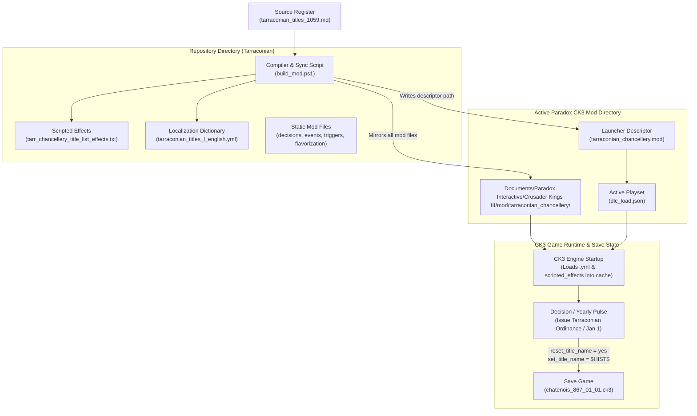

# Tarraconian Chancellery Mod: Synchronization & Build Guide

* **Project:** Tarraconian Imperial Chancellery (`tarraconian_chancellery`)
* **Target Game:** Crusader Kings III (v1.20.*)
* **Primary Script:** [build_mod.ps1](file:///C:/Users/siarg/Documents/Projects/Tarraconian/build_mod.ps1)
* **Source Register:** [tarraconian_titles_1059.md](file:///C:/Users/siarg/Documents/Projects/Tarraconian/tarraconian_titles_1059.md)
* **Companion References:**
  * [anachronistic_titles_1059.md](file:///C:/Users/siarg/Documents/Projects/Tarraconian/anachronistic_titles_1059.md) (Pre-1059 Historical Toponymic Resolutions)
  * [hre_de_jure_and_archdioceses_1059.md](file:///C:/Users/siarg/Documents/Projects/Tarraconian/hre_de_jure_and_archdioceses_1059.md) (De Jure Hierarchy & Provincial Register)
  * [tarraconian_linguistics_guide.md](file:///C:/Users/siarg/Documents/Projects/Tarraconian/tarraconian_linguistics_guide.md) (Phonology, Orthography & Sound Laws)

---

## 1. Architecture & Pipeline Overview

The Tarraconian Chancellery localization system follows a compiled, multi-tiered pipeline:



### Directory Structure & Paths

| Role | Path | Description |
| :--- | :--- | :--- |
| **Workspace Repo** | `C:\Users\siarg\Documents\Projects\Tarraconian\` | Source markdown files, scripts, and master mod repository. |
| **Workspace Mod** | `C:\Users\siarg\Documents\Projects\Tarraconian\tarraconian_chancellery\` | Git-tracked mod files. |
| **Paradox Mod Dir** | `C:\Users\siarg\Documents\Paradox Interactive\Crusader Kings III\mod\tarraconian_chancellery\` | Active mod directory read by the CK3 game engine. |
| **Launcher Descriptor** | `C:\Users\siarg\Documents\Paradox Interactive\Crusader Kings III\mod\tarraconian_chancellery.mod` | Tells the Paradox Launcher where to find the mod folder. |
| **Playset Config** | `C:\Users\siarg\Documents\Paradox Interactive\Crusader Kings III\dlc_load.json` | Stores enabled mod list for the current playset. |
| **Campaign Save** | `C:\Program Files (x86)\Steam\userdata\204281054\1158310\remote\save games\chatenois_867_01_01.ck3` | Save game containing baked title strings. |

---

## 2. Step-by-Step Synchronization Instructions

### Step 1: Update Toponyms in Documentation
When adding new titles or adjusting phonology/historical resolutions, edit [tarraconian_titles_1059.md](file:///C:/Users/siarg/Documents/Projects/Tarraconian/tarraconian_titles_1059.md):
* **Format:**
  * Section 2 table row: `| <#\> | **<Vanilla Name\>** | \`<title_key\>\` | **<Tarraconian Name\>** | ... |`
  * Section 3 kingdom header: `### 3.X Kingdom of <Name> (`k_<key>`) $\rightarrow$ **<Tarraconian Name>** [1059 Historical: <Hist Name>]`
  * Section 3 duchy bullet: `* **Duchy of <Name>** (`d_<key>`) $\rightarrow$ **<Tarraconian Name>** [1059 Historical: <Hist Name>]`
  * Section 3 county bullet: `* `c_<key>` (<Vanilla>) $\rightarrow$ **<Tarraconian Name>** [1059 Historical: <Hist Name>]`

### Step 2: Run the Build & Sync Script
Open a PowerShell prompt and execute:

```powershell
Set-Location "C:\Users\siarg\Documents\Projects\Tarraconian"
powershell -ExecutionPolicy Bypass -File .\build_mod.ps1
```

> [!IMPORTANT]
> **What `build_mod.ps1` does automatically:**
> 1. Parses all 2,346+ titles, generating [tarr_chancellery_title_list_effects.txt](file:///C:/Users/siarg/Documents/Projects/Tarraconian/tarraconian_chancellery/common/scripted_effects/tarr_chancellery_title_list_effects.txt) and [tarraconian_titles_l_english.yml](file:///C:/Users/siarg/Documents/Projects/Tarraconian/tarraconian_chancellery/localization/english/tarraconian_titles_l_english.yml) using UTF-8 with BOM.
> 2. Automatically copies all mod files (`common/`, `events/`, `localization/`, `descriptor.mod`) to `C:\Users\siarg\Documents\Paradox Interactive\Crusader Kings III\mod\tarraconian_chancellery`.
> 3. Creates/updates `tarraconian_chancellery.mod` in the Paradox mod root with the absolute path definition.

### Step 3: Verify the File Synchronization
Confirm the files in both locations match:

```powershell
Get-FileHash .\tarraconian_chancellery\localization\english\tarraconian_titles_l_english.yml, "C:\Users\siarg\Documents\Paradox Interactive\Crusader Kings III\mod\tarraconian_chancellery\localization\english\tarraconian_titles_l_english.yml"
```
Both hashes must be identical.

### Step 4: Ensure Mod is Enabled in Paradox Launcher / Playset
Check `C:\Users\siarg\Documents\Paradox Interactive\Crusader Kings III\dlc_load.json`:
```json
{"enabled_mods":["mod/tarraconian_chancellery.mod"],"disabled_dlcs":[]}
```
If using custom playsets in the Paradox Launcher, make sure **"Tarraconian Imperial Chancellery (1059)"** is toggled **ON** in your active playset.

### Step 5: Refresh Titles in Your CK3 Save Game
Because Crusader Kings III caches localization and bakes renamed title strings directly into the save file:

1. **Restart CK3** (CK3 only reads `.yml` and `scripted_effects` once on game launch).
2. **Load your save** (`chatenois_867_01_01.ck3`).
3. **Execute the refresh**:
   * **Immediate Refresh:** Open the **Decisions** tab and click **"Issue the Tarraconian Chancellery Ordinance"**. In the popup event, select:
     * **Option A (Default):** Enforce Historical Register across the Roman Empire / HRE & Tarraconian lands.
     * **Option B:** Extend Historical Register globally to all 100 De Jure Kingdoms.
     * **Option C:** Enforce Direct Toponymic Adaptations.
   * **Passive Refresh:** Unpause the game until **1 January**. The mod's `yearly_global_pulse` hook automatically runs `tarr_refresh_all_titles_effect`.

---

## 3. Critical Technical & Encoding Requirements

### The UTF-8 BOM Rule for Windows PowerShell (CP932 Prevention)
> [!WARNING]
> **Why BOM matters on Japanese / CJK Windows systems:**
> * On Windows installations with a Japanese system locale (CP932 / Windows-31J), Windows PowerShell 5.1 (`powershell.exe`) defaults to **CP932** when reading any `.ps1` script that lacks a **UTF-8 Byte Order Mark (BOM)** (`EF BB BF`).
> * If [build_mod.ps1](file:///C:/Users/siarg/Documents/Projects/Tarraconian/build_mod.ps1) is saved without a BOM, all multi-byte accented Latin characters in the script (`ô`, `î`, `û`, `ü`, `ö`, `ê`, `â`) are decoded as CP932 bytes and become **halfwidth katakana characters** (`ﾃｴ`, `ﾃｮ`, `ﾃｻ`, `ﾃｼ`, `ﾃｶ`, `ﾃｪ`, `ﾃﾂ`).
> * The mangled strings then get baked into the save file (e.g. `Dat Rﾃｴmische Keiserrﾃｮch`).

#### How to Ensure `build_mod.ps1` Retains its UTF-8 BOM
Whenever modifying [build_mod.ps1](file:///C:/Users/siarg/Documents/Projects/Tarraconian/build_mod.ps1), ensure it is saved with a UTF-8 BOM:

```powershell
$path = "C:\Users\siarg\Documents\Projects\Tarraconian\build_mod.ps1"
$content = [System.IO.File]::ReadAllText($path, [System.Text.Encoding]::UTF8)
$utf8Bom = [System.Text.UTF8Encoding]::new($true)
[System.IO.File]::WriteAllText($path, $content, $utf8Bom)
```

You can check whether the script has a BOM with:
```powershell
$bytes = [System.IO.File]::ReadAllBytes("C:\Users\siarg\Documents\Projects\Tarraconian\build_mod.ps1")
[BitConverter]::ToString($bytes[0..2])
# Expected Output: EF-BB-BF
```

### Paradox Engine Encoding Rules
* **Localization (`.yml`):** Must start with `l_english:` on line 1 and be encoded in **UTF-8 with BOM** (`EF BB BF`).
* **Scripted Effects & Triggers (`.txt`):** Encoded in **UTF-8 with BOM**.
* **Mod Descriptor (`descriptor.mod` & `tarraconian_chancellery.mod`):** Standard UTF-8 without BOM or ASCII.

### Save Game String Baking & `reset_title_name`
When CK3 executes `set_title_name = <loc_key>`, it evaluates the localization key at that exact moment and saves the resulting string into `gamestate` inside your `.ck3` save file.

If a title already has a custom name stored in the save file (such as a previous version or a mangled encoding), simply calling `set_title_name` again might fail to overwrite the custom save state. Therefore, [tarr_rename_title_effect](file:///C:/Users/siarg/Documents/Projects/Tarraconian/tarraconian_chancellery/common/scripted_effects/tarr_chancellery_core_effects.txt#L13-L36) is structured as:

```pdx
reset_title_name = yes
set_title_name = $HIST$
set_variable = { name = tarr_renamed value = yes }
```
This forces CK3 to clear the previous save-baked string before applying the fresh localization key.

---

## 4. Troubleshooting & Verification Matrix

| Symptom | Probable Cause | Corrective Action |
| :--- | :--- | :--- |
| **Halfwidth katakana (`ﾃｴ`, `ﾃｮ`, `ﾃｻ`) in titles** | `build_mod.ps1` ran without a UTF-8 BOM under CP932 PowerShell. | 1. Prepend UTF-8 BOM to `build_mod.ps1`.<br>2. Re-run `build_mod.ps1`.<br>3. Restart CK3 and take the **Chancellery Ordinance** decision in-game to re-bake titles. |
| **New titles in markdown not showing in game** | CK3 was not restarted, or ordinance was not refreshed. | 1. Completely exit and restart CK3.<br>2. Load save and take **"Issue the Tarraconian Chancellery Ordinance"** decision or advance to **Jan 1**. |
| **Titles outside HRE/Empire not renamed** | Default Option A only covers the Roman Empire / HRE and Tarraconian cultures. | Take the decision in-game and choose **Option B** (*"Extend the Historical Register to all 100 De Jure Kingdoms"*). |
| **Mod missing in Paradox Launcher** | `tarraconian_chancellery.mod` missing or bad path. | Verify `C:\Users\siarg\Documents\Paradox Interactive\Crusader Kings III\mod\tarraconian_chancellery.mod` exists and contains `path="C:/Users/siarg/Documents/Paradox Interactive/Crusader Kings III/mod/tarraconian_chancellery"`. |
| **`dlc_load.json` resets on launch** | Launcher overwritten playset. | In Paradox Launcher, go to **Playsets**, ensure **Tarraconian Imperial Chancellery (1059)** is checked, and select that playset before clicking Play. |
