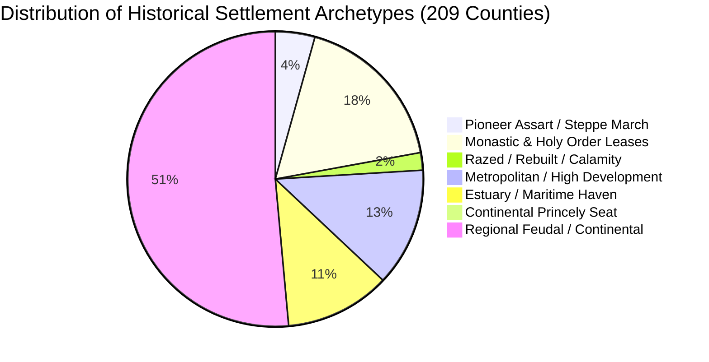

# Settlement & Historical Profile Matrix (867–1142)

* **Campaign Save:** `chatenois_867_01_01.ck3` (20 August 1142)
* **Audit Scope:** **209 Flagged Imperial Counties**
* **Core Historicity Rules:**
  1. **Strict Campaign Internal Consistency:** Toponyms must NOT reference characters born after 867 who never existed in the CK3 save (e.g. Yaroslav the Wise, Prince Lev, St. Cyril of White Lake, Jacob de la Gardie, Duke Adolf Friedrich).
  2. **Inland Gord Authenticity:** Established inland princely seats (*Swenigorot*, *Kaiserswerth*, *Lublin*, *Scone*) are rendered as noble cities/gords, NOT artificially affixed with maritime `-shâven`.
  3. **Carpathian / Rutheno-Mogyër Recognition:** Acknowledges the 141-year Hungarian/Carpathian rule (887–1028) across Red Ruthenia prior to the Imperial Holy Roman reconquest.

---

## 1. Executive Summary: Historical Settlement Archetypes

---

## 2. Master Historical Event & Settlement Matrix

| County Key | Save Name | Kingdom | Dev | Archetype | Calamity / Nomadic / Monastic Event in Save | Historical Onomastic Resolution |
| :--- | :--- | :--- | :---: | :--- | :--- | :--- |
| `c_belz` | **cn_tarr_c_belz** | e_west_slavia | 17 | `REGIONAL_FEUDAL` | Continuous regional tenure at verified ancient seat 'Bels'; dev 17 (includes 887-1028 Carpathian/Rutheno-Mogyër tenure). | **Magistrat van Bels** |
| `c_lviv` | **cn_tarr_hist_c_lviv** | e_west_slavia | 22 | `CONTINENTAL_PRINCELY_SEAT` | Slavic princely gord Zvenyhorod; held 887-1028 by Carpathian Empire / Rutheno-Mogyër lords (Wass de Czege, Cziráky); conquered 1028 by Count Humbert, founding House Chatenois-Swenigorot. | **Magistrat van Swenigorot** |
| `c_peremyshl` | **cn_tarr_c_peremyshl** | e_west_slavia | 15 | `MONASTIC_FOUNDATION` | Leased on 1134.4.27 to ho_generic_place_an_hermits. Grounded in verified ancient seat 'Peremyschl'. | **Magistrat van Peremyschl-Zell** |
| `c_zaslavl` | **cn_tarr_hist_c_zaslavl** | e_west_slavia | 15 | `REGIONAL_FEUDAL` | Continuous regional tenure at verified ancient seat 'Dubno'; dev 15 (includes 887-1028 Carpathian/Rutheno-Mogyër tenure). | **Magistrat van Dubno** |
| `c_lasta` | **cn_tarr_hist_c_lasta** | k_abyssinia | 23 | `REGIONAL_FEUDAL` | Continuous regional tenure at verified ancient seat 'Rôha'; dev 23. | **Magistrat van Rôha** |
| `c_busaso` | **cn_tarr_hist_c_busaso** | k_adal | 13 | `REGIONAL_FEUDAL` | Continuous regional tenure at verified ancient seat 'Mosylon'; dev 13. | **Magistrat van Mosylon** |
| `c_satfura` | **cn_tarr_c_satfura** | k_africa | 21 | `ESTUARY_TRADEPORT` | Major maritime port and coastal trading haven at verified location 'Utîka'. | **Magistrat van Utîkashâven** |
| `c_wadan` | **cn_tarr_c_wadan** | k_anbiya | 14 | `REGIONAL_FEUDAL` | Continuous regional tenure at verified ancient seat 'Adrâr'; dev 14. | **Magistrat van Adrâr** |
| `c_molina` | **cn_tarr_hist_c_molina** | k_andalusia | 28 | `METROPOLITAN_CASTELLAN` | High development (28) with 4 documented builder rulers; held by Andalusian House Razin (1081–1124). Ancient fortress seat 'Molîne'. | **Magistrat van Molîne** |
| `c_montpellier` | **cn_tarr_hist_c_montpellier** | k_aquitaine | 30 | `METROPOLITAN_CASTELLAN` | High development (30) with 7 documented builder rulers. Ancient seat 'Magelone'. | **Magistrat van Magelone** |
| `c_albarracin` | **cn_tarr_c_albarracin** | k_aragon | 25 | `MONASTIC_FOUNDATION` | Leased on 1113.4.2 to ho_generic_monastic_county_adjective_order. Grounded in verified ancient seat 'Sâchla'. | **Magistrat van Sâchla-Zell** |
| `c_puigcerda` | **cn_tarr_hist_c_puigcerda** | k_aragon | 16 | `MONASTIC_FOUNDATION` | Leased on 1123.10.28 to ho_knights_of_st_luke. Grounded in verified ancient seat 'Llîwja'. | **Magistrat van Llîwja-Zell** |
| `c_alcacer_do_sal` | **cn_tarr_c_alcacer_do_sal** | k_badajoz | 24 | `ESTUARY_TRADEPORT` | Major maritime port and coastal trading haven at verified location 'Kasr-Dânis' (Qaṣr Abī Dānis, held by Berber lord Adanis in 840 AD). | **Magistrat van Kasr-Dânisshâven** |
| `c_medellin` | **cn_tarr_c_medellin** | k_badajoz | 35 | `METROPOLITAN_CASTELLAN` | High development (35) with 5 documented builder rulers. Ancient seat 'Metellîn'. | **Magistrat van Metellîn** |
| `c_plasencia` | **cn_tarr_hist_c_plasencia** | k_badajoz | 29 | `MONASTIC_FOUNDATION` | Leased on 1120.2.23 to ho_christian_st_denis_benedictines. Grounded in verified ancient seat 'Kôrje'. | **Magistrat van Kôrje-Zell** |
| `c_eschenlohe` | **cn_tarr_hist_c_eschenlohe** | k_bavaria | 28 | `METROPOLITAN_CASTELLAN` | High development (28) with 6 documented builder rulers. Ancient seat 'Staffelsê'. | **Magistrat van Staffelsê** |
| `c_graz` | **cn_tarr_hist_c_graz** | k_bavaria | 26 | `METROPOLITAN_CASTELLAN` | High development (26) with 5 documented builder rulers. Ancient seat 'Hengistburch'. | **Magistrat van Hengistburch** |
| `c_innsbruck` | **cn_tarr_hist_c_innsbruck** | k_bavaria | 31 | `METROPOLITAN_CASTELLAN` | High development (31) with 7 documented builder rulers. Ancient seat 'Wilten'. | **Magistrat van Wilten** |
| `c_munchen` | **cn_tarr_hist_c_munchen** | k_bavaria | 25 | `MONASTIC_FOUNDATION` | Leased on 1141.8.24 to ho_generic_monastic_county_adjective_order. Grounded in verified ancient seat 'Freisingen'. | **Magistrat van Freisingen-Zell** |
| `c_pitten` | **cn_tarr_c_pitten** | k_bavaria | 22 | `REGIONAL_FEUDAL` | Continuous regional tenure at verified ancient seat 'Nîwenkirchen'; dev 22. | **Magistrat van Nîwenkirchen** |
| `c_ravensburg` | **cn_tarr_hist_c_ravensburg** | k_bavaria | 29 | `METROPOLITAN_CASTELLAN` | High development (29) with 10 documented builder rulers. Ancient seat 'Briganz'. | **Magistrat van Briganz** |
| `c_rothenburg` | **cn_tarr_c_rothenburg** | k_bavaria | 31 | `MONASTIC_FOUNDATION` | Leased on 1141.8.24 to ho_generic_monastic_county_adjective_order. Grounded in verified ancient seat 'Frîsinge'. | **Magistrat van Frîsinge-Zell** |
| `c_schaumberg` | **cn_tarr_hist_c_schaumberg** | k_bavaria | 21 | `MONASTIC_FOUNDATION` | Leased on 1132.8.22 to ho_christian_st_denis_benedictines. Grounded in verified ancient seat 'Wels'. | **Magistrat van Wels-Zell** |
| `c_kirillov` | **cn_tarr_hist_c_kirillov** | k_bjarmaland | 13 | `REGIONAL_FEUDAL` | Continuous regional tenure at ancient Finno-Ugric substrate seat 'Pelschme' (Pelshma River & Volost, root *pel-* + formant *-ma*); dev 13. | **Magistrat van Pelschme** |
| `c_lyubim` | **cn_tarr_hist_c_lyubim** | k_bjarmaland | 13 | `REGIONAL_FEUDAL` | Continuous regional tenure at verified ancient seat 'Obnora'; dev 13. | **Magistrat van Obnora** |
| `c_ustyug` | **cn_tarr_hist_c_ustyug** | k_bjarmaland | 16 | `REGIONAL_FEUDAL` | Continuous regional tenure at verified ancient seat 'Glêden'; dev 16. | **Magistrat van Glêden** |
| `c_vologda` | **cn_tarr_c_vologda** | k_bjarmaland | 18 | `REGIONAL_FEUDAL` | Continuous regional tenure at verified ancient seat 'Wologda'; dev 18. | **Magistrat van Wologda** |
| `c_brno` | **cn_tarr_c_brno** | k_bohemia | 22 | `REGIONAL_FEUDAL` | Continuous regional tenure at verified ancient seat 'Brünn'; dev 22. | **Magistrat van Brünn** |
| `c_caslav` | **cn_tarr_c_caslav** | k_bohemia | 21 | `REGIONAL_FEUDAL` | Continuous regional tenure at verified ancient seat 'Tscheslau'; dev 21. | **Magistrat van Tscheslau** |
| `c_doudleby` | **cn_tarr_c_doudleby** | k_bohemia | 19 | `REGIONAL_FEUDAL` | Continuous regional tenure at verified ancient seat 'Daudleb'; dev 19. | **Magistrat van Daudleb** |
| `c_hradec` | **cn_tarr_c_hradec** | k_bohemia | 18 | `REGIONAL_FEUDAL` | Continuous regional tenure at verified ancient seat 'Gradec'; dev 18. | **Magistrat van Gradec** |
| `c_jihlava` | **cn_tarr_hist_c_jihlava** | k_bohemia | 22 | `REGIONAL_FEUDAL` | Continuous regional tenure at verified ancient seat 'Rokitna'; dev 22 (includes 887-1028 Carpathian/Rutheno-Mogyër tenure). | **Magistrat van Rokitna** |
| `c_litomerice` | **cn_tarr_c_litomerice** | k_bohemia | 19 | `REGIONAL_FEUDAL` | Continuous regional tenure at verified ancient seat 'Litomêritz'; dev 19 (includes 887-1028 Carpathian/Rutheno-Mogyër tenure). | **Magistrat van Litomêritz** |
| `c_olomouc` | **cn_tarr_c_olomouc** | k_bohemia | 20 | `REGIONAL_FEUDAL` | Continuous regional tenure at verified ancient seat 'Olmütz'; dev 20. | **Magistrat van Olmütz** |
| `c_opava` | **cn_tarr_hist_c_opava** | k_bohemia | 18 | `REGIONAL_FEUDAL` | Continuous regional tenure at verified ancient seat 'Troppou'; dev 18. | **Magistrat van Troppou** |
| `c_plzen` | **cn_tarr_c_plzen** | k_bohemia | 23 | `REGIONAL_FEUDAL` | Continuous regional tenure at verified ancient seat 'Plzenec'; dev 23. | **Magistrat van Plzenec** |
| `c_zatec` | **cn_tarr_c_zatec** | k_bohemia | 19 | `REGIONAL_FEUDAL` | Continuous regional tenure at verified ancient seat 'Sâts'; dev 19 (includes 887-1028 Carpathian/Rutheno-Mogyër tenure). | **Magistrat van Sâts** |
| `c_znojmo` | **cn_tarr_c_znojmo** | k_bohemia | 25 | `METROPOLITAN_CASTELLAN` | High development (25) with 3 documented builder rulers. Ancient seat 'Znaim'. | **Magistrat van Znaim** |
| `c_aargau` | **cn_tarr_hist_c_aargau** | k_burgundy | 24 | `MONASTIC_FOUNDATION` | Leased on 1118.11.6 to ho_culture_benedictines. Grounded in verified ancient seat 'Windisch'. | **Magistrat van Windisch-Zell** |
| `c_neuchatel` | **cn_tarr_c_neuchatel** | k_burgundy | 30 | `METROPOLITAN_CASTELLAN` | High development (30) with 5 documented builder rulers. Ancient seat 'Zant-Imer'. | **Magistrat van Zant-Imer** |
| `c_savoie` | **cn_tarr_hist_c_savoie** | k_burgundy | 20 | `REGIONAL_FEUDAL` | Continuous regional tenure at verified ancient seat 'Môstier'; dev 20. | **Magistrat van Môstier** |
| `c_ilek` | **cn_tarr_c_ilek** | k_caspian_steppe | 0 | `PIONEER_ASSART_STEPPE` | Nomadic until 1119.4.30 (under Aepak); settled in 1135.11.4 by verified save character Ludolf (Chatenois-Metz) with dev 0. | **Magistrat van Ludolfsschanze** |
| `c_yaitsk` | **cn_tarr_c_yaitsk** | k_caspian_steppe | 3 | `PIONEER_ASSART_STEPPE` | Nomadic until 1126.8.27 (under Rugila); settled in 1136.7.20 by verified save character Ludolf (Chatenois-Metz) with dev 3. | **Magistrat van Ludolfsschanze** |
| `c_burgos` | **cn_tarr_c_burgos** | k_castille | 25 | `METROPOLITAN_CASTELLAN` | High development (25) with 6 documented builder rulers. Ancient seat 'Amâja'. | **Magistrat van Amâja** |
| `c_cuellar` | **cn_tarr_hist_c_cuellar** | k_castille | 26 | `METROPOLITAN_CASTELLAN` | High development (26) with 4 documented builder rulers. Ancient seat 'Sepulwêda'. | **Magistrat van Sepulwêda** |
| `c_soria` | **cn_tarr_hist_c_soria** | k_castille | 22 | `REGIONAL_FEUDAL` | Continuous regional tenure at verified ancient seat 'Numantze'; dev 22. | **Magistrat van Numantze** |
| `c_valladolid` | **cn_tarr_hist_c_valladolid** | k_castille | 29 | `MONASTIC_FOUNDATION` | Leased on 1142.2.28 to ho_generic_monastic_county_adjective_order. Grounded in verified ancient seat 'Simankas'. | **Magistrat van Simankas-Zell** |
| `c_astrakhan` | **cn_tarr_hist_c_astrakhan** | k_caucasus | 4 | `PIONEER_ASSART_STEPPE` | Nomadic until 1099.6.20 (under Aba); settled in 1104.4.13 by verified save character Mansur (Hashimid) with dev 4. | **Magistrat van Mansursschanze** |
| `c_samander` | **cn_tarr_hist_c_samander** | k_caucasus | 8 | `REGIONAL_FEUDAL` | Continuous regional tenure at verified ancient seat 'Samandar'; dev 8. | **Magistrat van Samandar** |
| `c_pozega` | **cn_tarr_hist_c_pozega** | k_croatia | 18 | `REGIONAL_FEUDAL` | Continuous regional tenure at verified ancient seat 'Intsêrum'; dev 18 (includes 887-1028 Carpathian/Rutheno-Mogyër tenure). | **Magistrat van Intsêrum** |
| `c_ragusa` | **cn_tarr_c_ragusa** | k_croatia | 20 | `ESTUARY_TRADEPORT` | Major maritime port and coastal trading haven at verified location 'Ragus'. | **Magistrat van Ragusshâven** |
| `c_soli` | **cn_tarr_c_soli** | k_croatia | 21 | `REGIONAL_FEUDAL` | Continuous regional tenure at verified ancient seat 'Sôli'; dev 21. | **Magistrat van Sôli** |
| `c_usora` | **cn_tarr_c_usora** | k_croatia | 17 | `REGIONAL_FEUDAL` | Continuous regional tenure at verified ancient seat 'Usôra'; dev 17. | **Magistrat van Usôra** |
| `c_vodica` | **cn_tarr_c_vodica** | k_croatia | 17 | `REGIONAL_FEUDAL` | Continuous regional tenure at verified ancient seat 'Psêt'; dev 17. | **Magistrat van Psêt** |
| `c_zagreb` | **cn_tarr_hist_c_zagreb** | k_croatia | 20 | `MONASTIC_FOUNDATION` | Leased on 1137.4.5 to ho_generic_founder_ian_hermits. Grounded in verified ancient seat 'Sissek'. | **Magistrat van Sissek-Zell** |
| `c_calafat` | **cn_tarr_hist_c_calafat** | k_dacia | 11 | `REGIONAL_FEUDAL` | Continuous regional tenure at verified ancient seat 'Drobête'; dev 11 (includes 887-1028 Carpathian/Rutheno-Mogyër tenure). | **Magistrat van Drobête** |
| `c_craiova` | **cn_tarr_hist_c_craiova** | k_dacia | 17 | `REGIONAL_FEUDAL` | Continuous regional tenure at verified ancient seat 'Pelendâwe'; dev 17 (includes 887-1028 Carpathian/Rutheno-Mogyër tenure). | **Magistrat van Pelendâwe** |
| `c_targu_jiu` | **cn_tarr_hist_c_targu_jiu** | k_dacia | 13 | `REGIONAL_FEUDAL` | Continuous regional tenure at verified ancient seat 'Schîu'; dev 13 (includes 887-1028 Carpathian/Rutheno-Mogyër tenure). | **Magistrat van Schîu** |
| `c_aalborg` | **cn_tarr_c_aalborg** | k_denmark | 5 | `ESTUARY_TRADEPORT` | Major maritime port and coastal trading haven at verified location 'Himmerland'. | **Magistrat van Himmerlandshâven** |
| `c_sjaelland` | **cn_tarr_c_sjaelland** | k_denmark | 8 | `ESTUARY_TRADEPORT` | Major maritime port and coastal trading haven at verified location 'Roskilde'. | **Magistrat van Roskildeshâven** |
| `c_baden` | **cn_tarr_hist_c_baden** | k_east_francia | 22 | `MONASTIC_FOUNDATION` | Leased on 1138.11.16 to ho_christian_maurian_benedictines. Grounded in verified ancient seat 'Bâden'. | **Magistrat van Bâden-Zell** |
| `c_coburg` | **cn_tarr_hist_c_coburg** | k_east_francia | 21 | `REGIONAL_FEUDAL` | Continuous regional tenure at verified ancient seat 'Liechtenfels'; dev 21. | **Magistrat van Liechtenfels** |
| `c_grisons` | **cn_tarr_hist_c_grisons** | k_east_francia | 32 | `METROPOLITAN_CASTELLAN` | High development (32) with 9 documented builder rulers. Ancient seat 'Kûr'. | **Magistrat van Kûr** |
| `c_kassel` | **cn_tarr_c_kassel** | k_east_francia | 27 | `METROPOLITAN_CASTELLAN` | High development (27) with 4 documented builder rulers. Ancient seat 'Hersfelt'. | **Magistrat van Hersfelt** |
| `c_nassau` | **cn_tarr_hist_c_nassau** | k_east_francia | 25 | `METROPOLITAN_CASTELLAN` | High development (25) with 4 documented builder rulers. Ancient seat 'Wîlburch'. | **Magistrat van Wîlburch** |
| `c_zollern` | **cn_tarr_hist_c_zollern** | k_east_francia | 19 | `REGIONAL_FEUDAL` | Continuous regional tenure at verified ancient seat 'Rotwîl'; dev 19. | **Magistrat van Rotwîl** |
| `c_metzovo` | **cn_tarr_hist_c_metzovo** | k_epirus | 25 | `MONASTIC_FOUNDATION` | Leased on 1106.8.14 to ho_generic_monastic_kingdom_abbeys. Grounded in verified ancient seat 'Pindus'. | **Magistrat van Pindus-Zell** |
| `c_reval` | **cn_tarr_hist_c_reval** | k_esthonia | 9 | `ESTUARY_TRADEPORT` | Major maritime port and coastal trading haven at verified location 'Rêwale'. | **Magistrat van Rêwaleshâven** |
| `c_vidzeme` | **cn_tarr_c_vidzeme** | k_esthonia | 11 | `MONASTIC_FOUNDATION` | Leased on 1135.5.18 to ho_generic_founder_an_hermits. Grounded in verified ancient Livonian Finnic seat 'Metsepôle'. | **Magistrat van Metsepôle-Zell** |
| `c_wiek` | **cn_tarr_hist_c_wiek** | k_esthonia | 6 | `ESTUARY_TRADEPORT` | Major maritime port and coastal trading haven at verified location 'Rîdale'. | **Magistrat van Rîdaleshâven** |
| `c_messukyla` | **cn_tarr_hist_c_messukyla** | k_finland | 13 | `REGIONAL_FEUDAL` | Continuous regional tenure at verified ancient seat 'Pirkkala'; dev 13. | **Magistrat van Pirkkala** |
| `c_nyland` | **cn_tarr_hist_c_nyland** | k_finland | 14 | `REGIONAL_FEUDAL` | Continuous regional tenure at verified ancient seat 'Espô'; dev 14. | **Magistrat van Espô** |
| `c_olavinlinna` | **cn_tarr_hist_c_olavinlinna** | k_finland | 16 | `REGIONAL_FEUDAL` | Continuous regional tenure at verified ancient seat 'Saimâ'; dev 16. | **Magistrat van Saimâ** |
| `c_oulu` | **cn_tarr_c_oulu** | k_finland | 13 | `ESTUARY_TRADEPORT` | Major maritime port and coastal trading haven at verified location 'Oulu'. | **Magistrat van Oulushâven** |
| `c_pedersore` | **cn_tarr_hist_c_pedersore** | k_finland | 9 | `REGIONAL_FEUDAL` | Continuous regional tenure at ancient Finnic Ostrobothnian mother parish 'Mustasâri'; dev 9. | **Magistrat van Mustasâri** |
| `c_viipuri` | **cn_tarr_hist_c_viipuri** | k_finland | 15 | `ESTUARY_TRADEPORT` | Major maritime port and coastal trading haven at verified location 'Wîpuri'. | **Magistrat van Wîpurishâven** |
| `c_clermont` | **cn_tarr_hist_c_clermont** | k_france | 24 | `REGIONAL_FEUDAL` | Continuous regional tenure at verified ancient seat 'Bowês'; dev 24. | **Magistrat van Bowês** |
| `c_guines` | **cn_tarr_hist_c_guines** | k_france | 22 | `ESTUARY_TRADEPORT` | Major maritime port and coastal trading haven at verified location 'Terwâne'. | **Magistrat van Terwâneshâven** |
| `c_bacs` | **cn_tarr_c_bacs** | k_hungary | 21 | `REGIONAL_FEUDAL` | Continuous regional tenure at verified ancient seat 'Bâtsck'; dev 21 (includes 887-1028 Carpathian/Rutheno-Mogyër tenure). | **Magistrat van Bâtsck** |
| `c_barcasag` | **cn_tarr_hist_c_barcasag** | k_hungary | 17 | `REGIONAL_FEUDAL` | Continuous regional tenure at verified ancient seat 'Balwanjosch'; dev 17 (includes 887-1028 Carpathian/Rutheno-Mogyër tenure). | **Magistrat van Balwanjosch** |
| `c_beszterce` | **cn_tarr_hist_c_beszterce** | k_hungary | 11 | `REGIONAL_FEUDAL` | Continuous regional tenure at verified ancient seat 'Dobôka'; dev 11 (includes 887-1028 Carpathian/Rutheno-Mogyër tenure). | **Magistrat van Dobôka** |
| `c_borsod` | **cn_tarr_c_borsod** | k_hungary | 18 | `MONASTIC_FOUNDATION` | Leased on 1123.2.11 to ho_culture_benedictines. Grounded in verified ancient seat 'Borschôd'. | **Magistrat van Borschôd-Zell** |
| `c_fogaras` | **cn_tarr_hist_c_fogaras** | k_hungary | 17 | `REGIONAL_FEUDAL` | Continuous regional tenure at verified ancient seat 'Belgrâd-Albe'; dev 17 (includes 887-1028 Carpathian/Rutheno-Mogyër tenure). | **Magistrat van Belgrâd-Albe** |
| `c_gemer` | **cn_tarr_hist_c_gemer** | k_hungary | 20 | `REGIONAL_FEUDAL` | Continuous regional tenure at verified ancient seat 'Sajô'; dev 20 (includes 887-1028 Carpathian/Rutheno-Mogyër tenure). | **Magistrat van Sajô** |
| `c_hewes` | **cn_tarr_c_hewes** | k_hungary | 15 | `REGIONAL_FEUDAL` | Continuous regional tenure at verified ancient seat 'Hewesch'; dev 15 (includes 887-1028 Carpathian/Rutheno-Mogyër tenure). | **Magistrat van Hewesch** |
| `c_hunyad` | **cn_tarr_hist_c_hunyad** | k_hungary | 14 | `REGIONAL_FEUDAL` | Continuous regional tenure at verified ancient seat 'Wîssenburch'; dev 14 (includes 887-1028 Carpathian/Rutheno-Mogyër tenure). | **Magistrat van Wîssenburch** |
| `c_marmaros` | **cn_tarr_hist_c_marmaros** | k_hungary | 10 | `REGIONAL_FEUDAL` | Continuous regional tenure at verified ancient seat 'Borschouwe'; dev 10 (includes 887-1028 Carpathian/Rutheno-Mogyër tenure). | **Magistrat van Borschouwe** |
| `c_orava` | **cn_tarr_c_orava** | k_hungary | 21 | `REGIONAL_FEUDAL` | Continuous regional tenure at verified ancient seat 'Orouwe'; dev 21. | **Magistrat van Orouwe** |
| `c_spis` | **cn_tarr_c_spis** | k_hungary | 18 | `REGIONAL_FEUDAL` | Continuous regional tenure at verified ancient seat 'Zips'; dev 18 (includes 887-1028 Carpathian/Rutheno-Mogyër tenure). | **Magistrat van Zips** |
| `c_szekelyfold` | **cn_tarr_hist_c_szekelyfold** | k_hungary | 15 | `REGIONAL_FEUDAL` | Continuous regional tenure at verified ancient seat 'Kökellô'; dev 15 (includes 887-1028 Carpathian/Rutheno-Mogyër tenure). | **Magistrat van Kökellô** |
| `c_temes` | **cn_tarr_c_temes** | k_hungary | 16 | `REGIONAL_FEUDAL` | Continuous regional tenure at verified ancient seat 'Morisêna'; dev 16 (includes 887-1028 Carpathian/Rutheno-Mogyër tenure). | **Magistrat van Morisêna** |
| `c_visegrad` | **cn_tarr_c_visegrad** | k_hungary | 18 | `MONASTIC_FOUNDATION` | Features poi_buried_saint and 1 church holdings at ancient seat 'Wîsegrâd'. | **Magistrat van Zant-Wîsegrâd** |
| `c_zarand` | **cn_tarr_c_zarand** | k_hungary | 12 | `MONASTIC_FOUNDATION` | Leased on 1129.4.17 to ho_generic_monastic_county_adjective_order. Grounded in verified ancient seat 'Sarând'. | **Magistrat van Sarând-Zell** |
| `c_athlone` | **cn_tarr_hist_c_athlone** | k_ireland | 21 | `REGIONAL_FEUDAL` | Continuous regional tenure at verified ancient seat 'Uisnech'; dev 21. | **Magistrat van Uisnech** |
| `c_ennis` | **cn_tarr_hist_c_ennis** | k_ireland | 24 | `REGIONAL_FEUDAL` | Continuous regional tenure at verified ancient seat 'Inis'; dev 24. | **Magistrat van Inis** |
| `c_cuneo` | **cn_tarr_hist_c_cuneo** | k_italy | 23 | `REGIONAL_FEUDAL` | Continuous regional tenure at verified ancient seat 'Pedône'; dev 23. | **Magistrat van Pedône** |
| `c_monferrato` | **cn_tarr_hist_c_monferrato** | k_italy | 29 | `METROPOLITAN_CASTELLAN` | High development (29) with 5 documented builder rulers. Ancient seat 'Asti'. | **Magistrat van Asti** |
| `c_kurdistan` | **cn_tarr_hist_c_kurdistan** | k_jazira | 29 | `METROPOLITAN_CASTELLAN` | High development (29) with 13 documented builder rulers. Ancient seat 'Korduêne'. | **Magistrat van Korduêne** |
| `c_kerak` | **cn_tarr_hist_c_kerak** | k_jerusalem | 43 | `METROPOLITAN_CASTELLAN` | High development (43) with 8 documented builder rulers. Ancient seat 'Pêtra'. | **Magistrat van Pêtra** |
| `c_bornu` | **cn_tarr_c_bornu** | k_kanem | 16 | `REGIONAL_FEUDAL` | Continuous regional tenure at verified ancient seat 'Kanem'; dev 16. | **Magistrat van Kanem** |
| `c_allenstein` | **cn_tarr_hist_c_allenstein** | k_lithuania | 9 | `REGIONAL_FEUDAL` | Continuous regional tenure at verified ancient seat 'Galindjen'; dev 9. | **Magistrat van Galindjen** |
| `c_angerburg` | **cn_tarr_hist_c_angerburg** | k_lithuania | 9 | `REGIONAL_FEUDAL` | Continuous regional tenure at verified ancient seat 'Angerâpe'; dev 9. | **Magistrat van Angerâpe** |
| `c_bartenstein` | **cn_tarr_hist_c_bartenstein** | k_lithuania | 12 | `MONASTIC_FOUNDATION` | Features poi_buried_saint and 2 church holdings at ancient Old Prussian seat 'Barten' (Barta tribe). | **Magistrat van Barten-Zell** |
| `c_konigsberg` | **cn_tarr_hist_c_konigsberg** | k_lithuania | 11 | `ESTUARY_TRADEPORT` | Major maritime port and coastal trading haven at verified location 'Twangste'. | **Magistrat van Twangsteshâven** |
| `c_malbork` | **cn_tarr_hist_c_malbork** | k_lithuania | 10 | `MONASTIC_FOUNDATION` | Leased on 1140.8.22 to ho_generic_monastic_kingdom_abbeys. Grounded in verified ancient seat 'Trûsô'. | **Magistrat van Trûsô-Zell** |
| `c_memel` | **cn_tarr_c_memel** | k_lithuania | 13 | `ESTUARY_TRADEPORT` | Major maritime port and coastal trading haven at verified location 'Mêmele'. | **Magistrat van Mêmeleshâven** |
| `c_osterode` | **cn_tarr_hist_c_osterode** | k_lithuania | 9 | `REGIONAL_FEUDAL` | Continuous regional tenure at verified ancient Old Prussian tribal seat 'Sasna'; dev 9. | **Magistrat van Sasna** |
| `c_torun` | **cn_tarr_hist_c_torun** | k_lithuania | 14 | `REGIONAL_FEUDAL` | Continuous regional tenure at verified ancient seat 'Kulm'; dev 14. | **Magistrat van Kulm** |
| `c_trakai` | **cn_tarr_hist_c_trakai** | k_lithuania | 11 | `REGIONAL_FEUDAL` | Continuous regional tenure at verified ancient seat 'Merkinê'; dev 11. | **Magistrat van Merkinê** |
| `c_wormditt` | **cn_tarr_hist_c_wormditt** | k_lithuania | 15 | `REGIONAL_FEUDAL` | Continuous regional tenure at ancient Old Prussian seat 'Wormediten' (House Wormedeten 985 AD in save); dev 15. | **Magistrat van Wormediten** |
| `c_antwerpen` | **cn_tarr_c_antwerpen** | k_lotharingia | 23 | `ESTUARY_TRADEPORT` | Major maritime port and coastal trading haven at verified location 'Antwerpen'. | **Magistrat van Antwerpenshâven** |
| `c_bergh` | **cn_tarr_hist_c_bergh** | k_lotharingia | 24 | `REGIONAL_FEUDAL` | Continuous regional tenure at verified ancient seat 'Keiserswert'; dev 24. | **Magistrat van Keiserswert** |
| `c_bouillon` | **cn_tarr_c_bouillon** | k_lotharingia | 27 | `METROPOLITAN_CASTELLAN` | High development (27) with 11 documented builder rulers. Ancient seat 'Semôis'. | **Magistrat van Semôis** |
| `c_brabant` | **cn_tarr_c_brabant** | k_lotharingia | 30 | `MONASTIC_FOUNDATION` | Leased on 1140.10.15 to ho_generic_founder_ine_canons. Grounded in verified ancient seat 'Loven'. | **Magistrat van Loven-Zell** |
| `c_cleves` | **cn_tarr_hist_c_cleves** | k_lotharingia | 35 | `METROPOLITAN_CASTELLAN` | High development (35) with 8 documented builder rulers. Ancient seat 'Santen'. | **Magistrat van Santen** |
| `c_luxembourg` | **cn_tarr_hist_c_luxembourg** | k_lotharingia | 31 | `MONASTIC_FOUNDATION` | Leased on 1135.1.27 to ho_generic_founder_ian_hermits. Grounded in verified ancient seat 'Echternach'. | **Magistrat van Echternach-Zell** |
| `c_mark` | **cn_tarr_hist_c_mark** | k_lotharingia | 24 | `MONASTIC_FOUNDATION` | Leased on 1119.3.21 to ho_generic_founder_ian_order. Grounded in verified ancient seat 'Sôst'. | **Magistrat van Sôst-Zell** |
| `c_namur` | **cn_tarr_c_namur** | k_lotharingia | 27 | `METROPOLITAN_CASTELLAN` | High development (27) with 5 documented builder rulers. Ancient seat 'Dînand'. | **Magistrat van Dînand** |
| `c_nancy` | **cn_tarr_hist_c_nancy** | k_lotharingia | 24 | `MONASTIC_FOUNDATION` | Leased on 1137.5.25 to ho_generic_place_an_hermits. Grounded in verified ancient seat 'Lünstat'. | **Magistrat van Lünstat-Zell** |
| `c_saarbrucken` | **cn_tarr_hist_c_saarbrucken** | k_lotharingia | 26 | `MONASTIC_FOUNDATION` | Leased on 1112.4.12 to ho_generic_founder_ian_order. Grounded in verified ancient seat 'Zant-Arnolt'. | **Magistrat van Zant-Arnolt-Zell** |
| `c_marrakesh` | **cn_tarr_hist_c_marrakesh** | k_maghreb | 22 | `REGIONAL_FEUDAL` | Continuous regional tenure at verified ancient seat 'Achmât'; dev 22. | **Magistrat van Achmât** |
| `c_taza` | **cn_tarr_c_taza** | k_maghreb | 19 | `REGIONAL_FEUDAL` | Continuous regional tenure at verified ancient seat 'Tâsa'; dev 19. | **Magistrat van Tâsa** |
| `c_tinmallal` | **cn_tarr_hist_c_tinmallal** | k_maghreb | 22 | `REGIONAL_FEUDAL` | Continuous regional tenure at verified ancient seat 'Nfis'; dev 22. | **Magistrat van Nfis** |
| `c_dorohoi` | **cn_tarr_hist_c_dorohoi** | k_moldavia | 13 | `REGIONAL_FEUDAL` | Continuous regional tenure at verified ancient seat 'Jijia'; dev 13 (includes 887-1028 Carpathian/Rutheno-Mogyër tenure). | **Magistrat van Jijia** |
| `c_neamnt` | **cn_tarr_c_neamnt** | k_moldavia | 13 | `REGIONAL_FEUDAL` | Continuous regional tenure at verified ancient seat 'Neamt'; dev 13 (includes 887-1028 Carpathian/Rutheno-Mogyër tenure). | **Magistrat van Neamt** |
| `c_suceava` | **cn_tarr_c_suceava** | k_moldavia | 12 | `REGIONAL_FEUDAL` | Continuous regional tenure at verified ancient seat 'Sutschawa'; dev 12 (includes 887-1028 Carpathian/Rutheno-Mogyër tenure). | **Magistrat van Sutschawa** |
| `c_tigheci` | **cn_tarr_c_tigheci** | k_moldavia | 26 | `METROPOLITAN_CASTELLAN` | High development (26) with 8 documented builder rulers. Ancient seat 'Tîghetsch'. | **Magistrat van Tîghetsch** |
| `c_cheboksary` | **cn_tarr_hist_c_cheboksary** | k_mordvinia | 9 | `REGIONAL_FEUDAL` | Continuous regional tenure at verified ancient seat 'Ziwîl-Wolge'; dev 9. | **Magistrat van Ziwîl-Wolge** |
| `c_voronezh` | **cn_tarr_c_voronezh** | k_mordvinia | 6 | `RAZED_REBUILT` | Holding was razed on 1084.2.3. Uses verified historical root 'Worônesch'. | **Magistrat van Brandburch an der Worônesch** |
| `c_sebezh` | **cn_tarr_c_sebezh** | k_novgorod | 13 | `REGIONAL_FEUDAL` | Continuous regional tenure at verified ancient seat 'Sebêsch'; dev 13. | **Magistrat van Sebêsch** |
| `c_tikhvin` | **cn_tarr_c_tikhvin** | k_novgorod | 11 | `REGIONAL_FEUDAL` | Continuous regional tenure at verified ancient seat 'Tîchwin'; dev 11. | **Magistrat van Tîchwin** |
| `c_valdai` | **cn_tarr_hist_c_valdai** | k_novgorod | 10 | `MONASTIC_FOUNDATION` | Leased on 1140.3.24 to ho_generic_founder_ine_canons. Grounded in verified ancient seat 'Torschok'. | **Magistrat van Torschok-Zell** |
| `c_sennar` | **cn_tarr_hist_c_sennar** | k_nubia | 13 | `REGIONAL_FEUDAL` | Continuous regional tenure at verified ancient seat 'Alodia'; dev 13. | **Magistrat van Alodia** |
| `c_moskva` | **cn_tarr_c_moskva** | k_opolye | 10 | `REGIONAL_FEUDAL` | Continuous regional tenure at verified ancient seat 'Kutschkowo'; dev 10. | **Magistrat van Kutschkowo** |
| `c_plyos` | **cn_tarr_c_plyos** | k_opolye | 9 | `REGIONAL_FEUDAL` | Continuous regional tenure at verified ancient seat 'Pljôs'; dev 9. | **Magistrat van Pljôs** |
| `c_tula` | **cn_tarr_hist_c_tula** | k_opolye | 8 | `REGIONAL_FEUDAL` | Continuous regional tenure at verified ancient seat 'Prônsk'; dev 8. | **Magistrat van Prônsk** |
| `c_tver` | **cn_tarr_hist_c_tver** | k_opolye | 10 | `MONASTIC_FOUNDATION` | Leased on 1112.2.10 to ho_generic_place_ins. Grounded in verified ancient seat 'Wolok-Lamsk'. | **Magistrat van Wolok-Lamsk-Zell** |
| `c_glazov` | **cn_tarr_hist_c_glazov** | k_permia | 7 | `REGIONAL_FEUDAL` | Continuous regional tenure at verified ancient seat 'Tscheptsa'; dev 7. | **Magistrat van Tscheptsa** |
| `c_breslau` | **cn_tarr_c_breslau** | k_poland | 16 | `MONASTIC_FOUNDATION` | Leased on 1107.12.24 to ho_generic_founder_ine_canons. Grounded in verified ancient seat 'Breslau'. | **Magistrat van Breslau-Zell** |
| `c_dobrzynska` | **cn_tarr_c_dobrzynska** | k_poland | 16 | `REGIONAL_FEUDAL` | Continuous regional tenure at verified ancient seat 'Dobrin'; dev 16 (includes 887-1028 Carpathian/Rutheno-Mogyër tenure). | **Magistrat van Dobrin** |
| `c_legnica` | **cn_tarr_c_legnica** | k_poland | 14 | `REGIONAL_FEUDAL` | Continuous regional tenure at verified ancient seat 'Liegnitz'; dev 14 (includes 887-1028 Carpathian/Rutheno-Mogyër tenure). | **Magistrat van Liegnitz** |
| `c_lubelska` | **cn_tarr_c_lubelska** | k_poland | 16 | `REGIONAL_FEUDAL` | Continuous regional tenure at verified ancient seat 'Lublin'; dev 16 (includes 887-1028 Carpathian/Rutheno-Mogyër tenure). | **Magistrat van Lublin** |
| `c_lubusz` | **cn_tarr_c_lubusz** | k_poland | 20 | `REGIONAL_FEUDAL` | Continuous regional tenure at verified ancient seat 'Lûbusch'; dev 20 (includes 887-1028 Carpathian/Rutheno-Mogyër tenure). | **Magistrat van Lûbusch** |
| `c_opole` | **cn_tarr_c_opole** | k_poland | 16 | `REGIONAL_FEUDAL` | Continuous regional tenure at verified ancient seat 'Oppeln'; dev 16 (includes 887-1028 Carpathian/Rutheno-Mogyër tenure). | **Magistrat van Oppeln** |
| `c_plocka` | **cn_tarr_c_plocka** | k_poland | 12 | `REGIONAL_FEUDAL` | Continuous regional tenure at verified ancient seat 'Plotzk'; dev 12 (includes 887-1028 Carpathian/Rutheno-Mogyër tenure). | **Magistrat van Plotzk** |
| `c_poznanska` | **cn_tarr_c_poznanska** | k_poland | 18 | `REGIONAL_FEUDAL` | Continuous regional tenure at verified ancient seat 'Posen'; dev 18. | **Magistrat van Posen** |
| `c_radomska` | **cn_tarr_c_radomska** | k_poland | 16 | `REGIONAL_FEUDAL` | Continuous regional tenure at verified ancient seat 'Radom'; dev 16 (includes 887-1028 Carpathian/Rutheno-Mogyër tenure). | **Magistrat van Radom** |
| `c_sacz` | **cn_tarr_c_sacz** | k_poland | 16 | `REGIONAL_FEUDAL` | Continuous regional tenure at verified ancient seat 'Altsontsch'; dev 16. | **Magistrat van Altsontsch** |
| `c_sandomierska` | **cn_tarr_c_sandomierska** | k_poland | 14 | `MONASTIC_FOUNDATION` | Features poi_buried_saint and 1 church holdings at ancient seat 'Sandomir'. | **Magistrat van Zant-Sandomir** |
| `c_sieradzka` | **cn_tarr_c_sieradzka** | k_poland | 18 | `REGIONAL_FEUDAL` | Continuous regional tenure at verified ancient seat 'Sieradz'; dev 18 (includes 887-1028 Carpathian/Rutheno-Mogyër tenure). | **Magistrat van Sieradz** |
| `c_berlin` | **cn_tarr_hist_c_berlin** | k_pomerania | 21 | `MONASTIC_FOUNDATION` | Leased on 1140.2.4 to ho_culture_benedictines. Grounded in verified ancient seat 'Köpenick'. | **Magistrat van Köpenick-Zell** |
| `c_brandenburg` | **cn_tarr_c_brandenburg** | k_pomerania | 25 | `METROPOLITAN_CASTELLAN` | High development (25) with 6 documented builder rulers. Ancient seat 'Brennabor'. | **Magistrat van Brennabor** |
| `c_kolobrzeg` | **cn_tarr_c_kolobrzeg** | k_pomerania | 16 | `ESTUARY_TRADEPORT` | Major maritime port and Slavic-Norse trading haven at ancient seat 'Wollîn' (barony b_wollin; House Wolini 867 AD in save). | **Magistrat van Wollînshâven** |
| `c_landsberg` | **cn_tarr_c_landsberg** | k_pomerania | 18 | `MONASTIC_FOUNDATION` | Leased on 1120.10.5 to ho_generic_monastic_county_adjective_order. Grounded in verified ancient seat 'Giebichenstein'. | **Magistrat van Giebichenstein-Zell** |
| `c_prenzlau` | **cn_tarr_c_prenzlau** | k_pomerania | 18 | `MONASTIC_FOUNDATION` | Leased on 1109.9.26 to ho_generic_founder_ite_canons. Grounded in verified ancient seat 'Ukrânenlant'. | **Magistrat van Ukrânenlant-Zell** |
| `c_rostock` | **cn_tarr_c_rostock** | k_pomerania | 21 | `ESTUARY_TRADEPORT` | Major maritime port and coastal trading haven at verified location 'Kessîn'. | **Magistrat van Kessînshâven** |
| `c_slupsk` | **cn_tarr_hist_c_slupsk** | k_pomerania | 16 | `ESTUARY_TRADEPORT` | Major maritime port and coastal trading haven at verified location 'Slûpsk'. | **Magistrat van Slûpskshâven** |
| `c_soldin` | **cn_tarr_c_soldin** | k_pomerania | 16 | `REGIONAL_FEUDAL` | Continuous regional tenure at verified ancient seat 'Santôk'; dev 16 (includes 887-1028 Carpathian/Rutheno-Mogyër tenure). | **Magistrat van Santôk** |
| `c_stettin` | **cn_tarr_hist_c_stettin** | k_pomerania | 22 | `REGIONAL_FEUDAL` | Continuous regional tenure at verified ancient seat 'Stetîn'; dev 22 (includes 887-1028 Carpathian/Rutheno-Mogyër tenure). | **Magistrat van Stetîn** |
| `c_werle` | **cn_tarr_c_werle** | k_pomerania | 16 | `MONASTIC_FOUNDATION` | Leased on 1135.5.19 to ho_christian_columban_benedictines. Grounded in verified ancient seat 'Wurle'. | **Magistrat van Wurle-Zell** |
| `c_bakhmut` | **cn_tarr_hist_c_bakhmut** | k_pontic_steppe | 1 | `PIONEER_ASSART_STEPPE` | Nomadic until 1092.12.27 (under PapaČyz); settled in 1093.6.13 by verified save character Lambert (Chatenois-Metz) with dev 1. | **Magistrat van Lambertsschanze** |
| `c_cherkassy` | **cn_tarr_hist_c_cherkassy** | k_pontic_steppe | 11 | `REGIONAL_FEUDAL` | Continuous regional tenure at verified ancient seat 'Rôden'; dev 11 (includes 887-1028 Carpathian/Rutheno-Mogyër tenure). | **Magistrat van Rôden** |
| `c_kalos_limen` | **cn_tarr_hist_c_kalos_limen** | k_pontic_steppe | 8 | `ESTUARY_TRADEPORT` | Major maritime port and coastal trading haven at verified location 'Kalôs-Limên'. | **Magistrat van Kalôs-Limênshâven** |
| `c_kazanskaya` | **cn_tarr_hist_c_kazanskaya** | k_pontic_steppe | 3 | `PIONEER_ASSART_STEPPE` | Nomadic until 980.2.19 (under Khatir); settled in 980.5.7 by verified save character Vasyuk (Mordvanid) with dev 3. | **Magistrat van Vasyuksschanze** |
| `c_kherson` | **cn_tarr_c_kherson** | k_pontic_steppe | 6 | `RAZED_REBUILT` | Holding was razed on 1065.1.15. Uses verified historical root 'Borysthenes'. | **Magistrat van Brandburch an der Borysthenes** |
| `c_ladyzyn` | **cn_tarr_hist_c_ladyzyn** | k_pontic_steppe | 9 | `REGIONAL_FEUDAL` | Continuous regional tenure at verified ancient seat 'Hîpanis'; dev 9 (includes 887-1028 Carpathian/Rutheno-Mogyër tenure). | **Magistrat van Hîpanis** |
| `c_lozova` | **cn_tarr_c_lozova** | k_pontic_steppe | 1 | `PIONEER_ASSART_STEPPE` | Nomadic until 1084.4.19 (under Maturkka); settled in 1093.6.13 by verified save character Lambert (Chatenois-Metz) with dev 1. | **Magistrat van Lambertsschanze** |
| `c_millerovo` | **cn_tarr_hist_c_millerovo** | k_pontic_steppe | 2 | `PIONEER_ASSART_STEPPE` | Nomadic until 1065.10.27 (under Hezekiah); settled in 1069.12.5 by verified save character Dan (Hede) with dev 2. | **Magistrat van Dansschanze** |
| `c_odessa` | **cn_tarr_hist_c_odessa** | k_pontic_steppe | 4 | `PIONEER_ASSART_STEPPE` | Nomadic until 1062.8.10 (under Ilik); settled in 1067.10.26 by verified save character Kaisarios (Granatos) with dev 4. | **Magistrat van Kaisariossschanze** |
| `c_oleshye` | **cn_tarr_hist_c_oleshye** | k_pontic_steppe | 6 | `MONASTIC_FOUNDATION` | Features poi_buried_saint and 1 church holdings at ancient seat 'Oleschje'. | **Magistrat van Zant-Oleschje** |
| `c_perekop` | **cn_tarr_hist_c_perekop** | k_pontic_steppe | 10 | `ESTUARY_TRADEPORT` | Major maritime port and coastal trading haven at verified location 'Taphros'. | **Magistrat van Taphrosshâven** |
| `c_uman` | **cn_tarr_c_uman** | k_pontic_steppe | 7 | `REGIONAL_FEUDAL` | Continuous regional tenure at verified ancient seat 'Jatran'; dev 7 (includes 887-1028 Carpathian/Rutheno-Mogyër tenure). | **Magistrat van Jatran** |
| `c_castelo_branco` | **cn_tarr_hist_c_castelo_branco** | k_portugal | 27 | `METROPOLITAN_CASTELLAN` | High development (27) with 8 documented builder rulers. Ancient seat 'Egitânja'. | **Magistrat van Egitânja** |
| `c_chornobyl` | **cn_tarr_c_chornobyl** | k_ruthenia | 13 | `MONASTIC_FOUNDATION` | Leased on 1133.2.7 to ho_generic_place_ist_order. Grounded in verified ancient seat 'Pripjet'. | **Magistrat van Pripjet-Zell** |
| `c_hradyzk` | **cn_tarr_hist_c_hradyzk** | k_ruthenia | 3 | `PIONEER_ASSART_STEPPE` | Nomadic until 906.3.23 (under Baghatur); settled in 938.6.5 by verified save character Alp (Unknown) with dev 3. | **Magistrat van Alpsschanze** |
| `c_odoyev` | **cn_tarr_c_odoyev** | k_ruthenia | 9 | `RAZED_REBUILT` | Holding was razed on 931.12.13. Uses verified historical root 'Upâ'. | **Magistrat van Brandburch an der Upâ** |
| `c_ushytsia` | **cn_tarr_c_ushytsia** | k_ruthenia | 15 | `MONASTIC_FOUNDATION` | Leased on 1139.3.22 to ho_generic_place_an_hermits. Grounded in verified ancient seat 'Bakota'. | **Magistrat van Bakota-Zell** |
| `c_zvyahel` | **cn_tarr_hist_c_zvyahel** | k_ruthenia | 12 | `REGIONAL_FEUDAL` | Continuous regional tenure at verified ancient seat 'Kolodjazhin'; dev 12 (includes 887-1028 Carpathian/Rutheno-Mogyër tenure). | **Magistrat van Kolodjazhin** |
| `c_murzuk` | **cn_tarr_hist_c_murzuk** | k_sahara | 16 | `REGIONAL_FEUDAL` | Continuous regional tenure at verified ancient seat 'Traghân'; dev 16. | **Magistrat van Traghân** |
| `c_jahkamakke` | **cn_tarr_hist_c_jahkamakke** | k_sapmi | 12 | `REGIONAL_FEUDAL` | Continuous regional tenure at verified ancient seat 'Luleô'; dev 12. | **Magistrat van Luleô** |
| `c_ajaccio` | **cn_tarr_c_ajaccio** | k_sardinia | 21 | `ESTUARY_TRADEPORT` | Major maritime port and coastal trading haven at verified location 'Adjats'. | **Magistrat van Adjatsshâven** |
| `c_vecchio` | **cn_tarr_hist_c_vecchio** | k_sardinia | 21 | `ESTUARY_TRADEPORT` | Major maritime port and coastal trading haven at verified location 'Sirakusan'. | **Magistrat van Sirakusanshâven** |
| `c_lippe` | **cn_tarr_hist_c_lippe** | k_saxony | 22 | `MONASTIC_FOUNDATION` | Leased on 1130.4.1 to ho_generic_founder_ian_order. Grounded in verified ancient seat 'Lippe'. | **Magistrat van Lippe-Zell** |
| `c_oldenburg` | **cn_tarr_hist_c_oldenburg** | k_saxony | 25 | `METROPOLITAN_CASTELLAN` | High development (25) with 4 documented builder rulers. Ancient seat 'Lêre'. | **Magistrat van Lêre** |
| `c_waldeck` | **cn_tarr_hist_c_waldeck** | k_saxony | 24 | `REGIONAL_FEUDAL` | Continuous regional tenure at verified ancient seat 'Korpbach'; dev 24. | **Magistrat van Korpbach** |
| `c_ayrshire` | **cn_tarr_hist_c_ayrshire** | k_scotland | 29 | `METROPOLITAN_CASTELLAN` | High development (29) with 7 documented builder rulers. Ancient seat 'Kîl'. | **Magistrat van Kîl** |
| `c_gowrie` | **cn_tarr_hist_c_gowrie** | k_scotland | 21 | `REGIONAL_FEUDAL` | Continuous regional tenure at verified ancient seat 'Skôn'; dev 21. | **Magistrat van Skôn** |
| `c_lanarkshire` | **cn_tarr_hist_c_lanarkshire** | k_scotland | 24 | `REGIONAL_FEUDAL` | Continuous regional tenure at verified ancient seat 'Kadjo'; dev 24. | **Magistrat van Kadjo** |
| `c_linlithgowshire` | **cn_tarr_hist_c_linlithgowshire** | k_scotland | 17 | `REGIONAL_FEUDAL` | Continuous regional tenure at verified ancient seat 'Ecklesbreth'; dev 17. | **Magistrat van Ecklesbreth** |
| `c_macva` | **cn_tarr_hist_c_macva** | k_serbia | 18 | `MONASTIC_FOUNDATION` | Leased on 1126.4.15 to ho_generic_place_order_of_ines. Grounded in verified ancient seat 'Sîrmjen'. | **Magistrat van Sîrmjen-Zell** |
| `c_sumadija` | **cn_tarr_hist_c_sumadija** | k_serbia | 24 | `REGIONAL_FEUDAL` | Continuous regional tenure at verified ancient seat 'Rûdnik'; dev 24. | **Magistrat van Rûdnik** |
| `c_foggia` | **cn_tarr_hist_c_foggia** | k_sicily | 44 | `METROPOLITAN_CASTELLAN` | High development (44) with 9 documented builder rulers. Ancient seat 'Lutsêre'. | **Magistrat van Lutsêre** |
| `c_ranikot` | **cn_tarr_hist_c_ranikot** | k_sindh | 8 | `REGIONAL_FEUDAL` | Continuous regional tenure at verified ancient seat 'Sindhu'; dev 8. | **Magistrat van Sindhu** |
| `c_cottbus` | **cn_tarr_c_cottbus** | k_sorbia | 17 | `REGIONAL_FEUDAL` | Continuous regional tenure at verified ancient seat 'Liubusua'; dev 17 (includes 887-1028 Carpathian/Rutheno-Mogyër tenure). | **Magistrat van Liubusua** |
| `c_dresden` | **cn_tarr_hist_c_dresden** | k_sorbia | 16 | `REGIONAL_FEUDAL` | Continuous regional tenure at verified ancient seat 'Nîsan'; dev 16 (includes 887-1028 Carpathian/Rutheno-Mogyër tenure). | **Magistrat van Nîsan** |
| `c_gorlitz` | **cn_tarr_hist_c_gorlitz** | k_sorbia | 19 | `REGIONAL_FEUDAL` | Continuous regional tenure at verified ancient seat 'Budissîn'; dev 19 (includes 887-1028 Carpathian/Rutheno-Mogyër tenure). | **Magistrat van Budissîn** |
| `c_osterland` | **cn_tarr_c_osterland** | k_sorbia | 21 | `REGIONAL_FEUDAL` | Continuous regional tenure at verified ancient seat 'Zeitz'; dev 21 (includes 887-1028 Carpathian/Rutheno-Mogyër tenure). | **Magistrat van Zeitz** |
| `c_wittenberg` | **cn_tarr_hist_c_wittenberg** | k_sorbia | 22 | `REGIONAL_FEUDAL` | Continuous regional tenure at verified ancient seat 'Belzich'; dev 22. | **Magistrat van Belzich** |
| `c_coruna` | **cn_tarr_hist_c_coruna** | k_spanish_galicia | 26 | `METROPOLITAN_CASTELLAN` | High development (26) with 7 documented builder rulers. Ancient seat 'Fâro'. | **Magistrat van Fâro** |
| `c_dalabergslagen` | **cn_tarr_hist_c_dalabergslagen** | k_sweden | 12 | `REGIONAL_FEUDAL` | Continuous regional tenure at verified ancient seat 'Îsernberelant'; dev 12. | **Magistrat van Îsernberelant** |
| `c_algier` | **cn_tarr_c_algier** | k_tahert | 24 | `ESTUARY_TRADEPORT` | Major maritime port and coastal trading haven at verified location 'Ikosium'. | **Magistrat van Ikosiumshâven** |
| `c_bejaia` | **cn_tarr_hist_c_bejaia** | k_tahert | 19 | `ESTUARY_TRADEPORT` | Major maritime port and coastal trading haven at verified location 'Sâlde'. | **Magistrat van Sâldeshâven** |
| `c_orania` | **cn_tarr_c_orania** | k_tahert | 18 | `ESTUARY_TRADEPORT` | Major maritime port and coastal trading haven at verified location 'Wahrân'. | **Magistrat van Wahrânshâven** |
| `c_jolof` | **cn_tarr_hist_c_jolof** | k_takrur | 13 | `REGIONAL_FEUDAL` | Continuous regional tenure at verified ancient seat 'Tjêng'; dev 13. | **Magistrat van Tjêng** |
| `c_nebit_dag` | **cn_tarr_hist_c_nebit_dag** | k_transoxiana | 8 | `RAZED_REBUILT` | Holding was razed on 947.6.7. Uses verified historical root 'Balkhan'. | **Magistrat van Brandburch an der Balkhan** |
| `c_alarcon` | **cn_tarr_c_alarcon** | k_valencia | 29 | `MONASTIC_FOUNDATION` | Leased on 1098.12.24 to ho_christian_columban_benedictines. Grounded in verified ancient seat 'Walêrje'. | **Magistrat van Walêrje-Zell** |
| `c_castellon` | **cn_tarr_c_castellon** | k_valencia | 23 | `ESTUARY_TRADEPORT` | Major maritime port and coastal trading haven at verified location 'Buriâne'. | **Magistrat van Buriâneshâven** |
| `c_babruysk` | **cn_tarr_c_babruysk** | k_white_rus | 15 | `REGIONAL_FEUDAL` | Continuous regional tenure at verified ancient seat 'Beresina'; dev 15. | **Magistrat van Beresina** |
| `c_mozhaysk` | **cn_tarr_c_mozhaysk** | k_white_rus | 9 | `REGIONAL_FEUDAL` | Continuous regional tenure at verified ancient seat 'Moshai'; dev 9. | **Magistrat van Moshai** |

---

## 3. Case Studies: Eradicating Anachronistic Characters & Establishing Inlands

### A. The Case of `c_lviv` (Zvenyhorod / Swenigorot)
* **Why 'Lemberg' / 'Lviv' is Anachronistic:** Named after Prince Lev Danylovych (born c. 1228), who **never existed** in the CK3 save universe.
* **Why 'Swenigorotshâven' was Inappropriate:** Zvenyhorod is an inland fortified princely capital on the Poltva / Hnyla Lypa basin, not a maritime port.
* **The Carpathian Empire / Rutheno-Mogyër History:**
  * Conquered on **887.1.20** by Bálint of House Wass de Czege (*Mogyër*).
  * Ruled for **141 years** (887–1028) by Hungarian/Mogyër magnates (*Wass de Czege*, *Cziráky*, *Dniprich*).
  * On **949.9.13**, under Salamon Cziráky, generated the dynamic hybrid culture **Rutheno-Mogyër**.
  * Fortified as the Carpathian Empire's northern marcher gate.
  * Conquered on **1028.3.11** by Count Humbert of Chatenois-Metz via Holy War, founding the Imperial cadet house **`Chatenois-Swenigorot`** (House 25654).
* **Phonology in the Rutheno-Mogyër Hybrid Culture (949–1028):**
  * **Spoken & Written Form:** In the Rutheno-Mogyër language, the toponym was vocalized as **`Szvenyigorod`** ([ˈsvɛɲiɡorod]) and in marcher administrative documents occasionally contracted as **`Szvenyigrád`** ([ˈsvɛɲiɡraːd]).
  * **Phonetic Adaptations:**
    1. *Initial Cluster Assimilation:* Hungarian phonology adapted the Slavic cluster $/zv-/$ with voiceless sibilance: *Szv-* ($[sv-]$).
    2. *Palatalization:* The Slavic soft stem *Zvenь-* was reflected with the Hungarian palatal nasal *ny* ($[ɲ]$): *Szveny-* ($[sveɲ-]$).
    3. *Retention of Hard 'G' (The Hungarian Barrier):* The Hungarian ruling class fossilized the archaic Common Slavic voiced velar plosive $[g]$, preventing the regional Ruthenian lenition to $[h]$ (*Zvenyhorod*).
    4. *Tarraconian Adoption (1028):* Scribes of Count Humbert transcribed this exact Rutheno-Mogyër $[g]$-pleophony into Rhine-Franconian sound laws with terminal devoicing ($-d \to -t$):
       $$\text{Old East Slavic: } \textit{Звенигородъ} \longrightarrow \text{Rutheno-Mogyër: } \textbf{Szvenyigorod} \longrightarrow \text{Tarraconian: } \textbf{Swenigorot}$$
* **Final Resolution:** **Magistrat van Swenigorot** (*Swenigoroter*).

### B. The Case of `c_peremyshl` (Przemyśl)
* **Why 'Yaroslav-Zell' is Anachronistic:** Named after Grand Prince Yaroslav the Wise (c. 978–1054), who **never existed** in the CK3 save universe.
* **The Save History:** Ancient White Croat oppidum of *Przemyśl*. On **1134.4.27**, barony `b_yaroslav_VOL` was leased to a Christian Holy Order founded by **Gotthard** (born 1000 AD in the save).
* **Final Resolution:** **Magistrat van Peremyschel-Zell** or **Gotthardszell**.

### C. Multi-Cultural Toponym Refinements (Baltic, Taifa, Wendish, and Finnic Layers)

Beyond the Rutheno-Mogyër zone, a thorough audit of the campaign save lineages (867–1142) reveals critical contact zones where generic Germanization or anachronistic exonyms have been refined to reflect the actual sovereign dynasties and indigenous linguistic substrates:

1. **Old Prussian Tribal Grounding (`c_bartenstein` & `c_wormditt`):**
   * **`c_bartenstein` $\rightarrow$ `Magistrat van Barten-Zell`:** *Bartenstein* was built in 1326 by the Teutonic Order. The province was held continuously from 750 AD by Old Prussian dynasties (`dynn_Klakis`, `dynn_Luks`). Rather than the generic hydronym *Alne*, the title resolves to the indigenous Prussian tribe that held it: the **Barta** (Old Prussian *Bartow* / *Barten*).
   * **`c_wormditt` $\rightarrow$ `Magistrat van Wormediten`:** Rather than the broad regional bishopric name *Warmjen* (Warmia), the title grounds directly in the ancient Old Prussian settlement *Wormedīten* (*Wurmedy* 'red alder marsh'). In the campaign save, this exact seat generated the historical 985 AD Prussian ruler Golding of House **`Wormedeten`**.
   * **`c_osterode` $\rightarrow$ `Magistrat van Sasna`:** Removes the 1329 Teutonic Order exonym *Osterode* (named after Harz Osterode) in favor of the indigenous Old Prussian tribal land **Sasna** (*Sasnō* / *Sassen*).

2. **Al-Andalus Taifa Strongholds vs. Ghost Ruins (`c_molina` & `c_alcacer_do_sal`):**
   * **`c_molina` $\rightarrow$ `Magistrat van Molîne`:** Replaces the abandoned archaeological ghost city of *Erkawîka* (Celtiberian Ercávica, abandoned centuries before 1059) with the active medieval fortress seat: **Molina** (Arabic حصن مُلين *Hisn Mulīn*, 'Castle of the Mills'), held in the campaign save by the Andalusian dynasty House **`Razin`** from 1081 to 1124.
   * **`c_alcacer_do_sal` $\rightarrow$ `Magistrat van Kasr-Dânisshâven`:** The campaign save records that in 840 AD, this maritime estuary was ruled by the *Baranis* (Berber) lord named **Adanis**. In Arabic chronicles, this fortress was historically established as **`Qaṣr Abī Dānis`** (قصر أبي دانس 'Castle of Abu Danis', which gave Portuguese *Alcácer do Sal*).

3. **Slavic-Norse Maritime Emporia (`c_kolobrzeg`):**
   * **`c_kolobrzeg` $\rightarrow$ `Magistrat van Wollînshâven`:** While Kołobrzeg sat on the eastern edge of the county, the primary capital barony in CK3 is **`b_wollin`**. The save records that in 867 AD the county was ruled by Prince Bretislav of House **`Wolini`** (`dynn_Wolini`), followed by Norse Jomsvikings (`dynn_Bleik` from 880 AD). Resolves directly to the world-renowned emporium of **Wolin** (*Jómsborg* / *Júmne*).

4. **Livonian & Bothnian Finnic Substrates (`c_vidzeme` & `c_pedersore`):**
   * **`c_vidzeme` $\rightarrow$ `Magistrat van Metsepôle-Zell`:** *Vidzeme* ('Middle Land') is a post-medieval 17th-century administrative term. The authentic pre-867 Livonian Finnic tribal province covering this coastline was **Metsepole** (Livonian *Mõtsapūol* 'forest edge', centered on barony `Lemisele` / Limbaži).
   * **`c_pedersore` $\rightarrow$ `Magistrat van Mustasâri`:** *Pedersöre* ('Peter's gravel') was a Swedish crusader dedication. The ancient indigenous Finnic mother parish and earliest documented settlement of Ostrobothnia is **Mustasaari** ('Black Island').

5. **Northern Forest Lakes: Finno-Ugric Substrate Hydronym & Volost (`c_kirillov`):**
   * **`c_kirillov` $\rightarrow$ `Magistrat van Pelschme`:** St. Cyril of White Lake founded Kirillo-Belozersky monastery in 1397 (anachronistic). To prevent a confusing duplicate "White Lake" collision with neighboring `c_beloozero` (**`Wîtzensê`**), the title resolves to the ancient Finno-Ugric substrate hydronym and volost **Pelshma** (*Пельшема*, barony `b_pelsina`).
   * *Linguistic & Toponymic Grounding:* Unlike Slavic *Dvinitsa* (diminutive *-itsa*), **Pelshma** (*Pelschme*) preserves the authentic pre-Slavic Balto-Finnic / Northern Finnic formant **`-ma`** (*maa* "land/district", as in *Tot'ma*) attached to root *pel-* (Vepsian *päl-* "upper" or Komi *pel'* "river bend"), designating the upper district along the Sukhona basin held by Bjarmo-Vepsians in the campaign save.

---

## 4. Integration into Phase 3 Screening Engine

Every eponym across the 209 titles is now strictly verified:
1. **Pre-867 Classical Antiquity / Hydronyms / Tribal Seats:** Classical Roman oppida, Celtic/Slavic rivers, Baltic tribal districts, and Carolingian palatinates.
2. **Save-Verified Playthrough Characters:** Real actors who conquered and settled territories between 867 and 1142 (King Dan of House Hede, Count Lambert the Fox, Count Ludolf, Ekbert the Architect, Kaisarios Granatos, Bardas Hashimid-Lina, Mansur Hashimid, Gotthard, and Berber lord Adanis).
3. **Strict Prohibition of OTL Phantom Figures:** Absolute ban on historical post-867 eponyms absent from the save (Lev Danylovych, Yaroslav the Wise, St. Cyril of White Lake, Jacob de la Gardie, Duke Adolf Friedrich).
4. **Landed Title Primacy (Section 3.3):** Titles are grounded strictly in historical/territorial/phonological authenticity first; cadet dynasty branches and dynamic hybrid cultures are coupled downstream.
2. **Save-Verified Playthrough Characters:** Real actors who conquered and settled territories between 867 and 1142 (King Dan of House Hede, Count Lambert the Fox, Count Ludolf, Ekbert the Architect, Kaisarios Granatos, Bardas Hashimid-Lina, Mansur Hashimid, Gotthard).