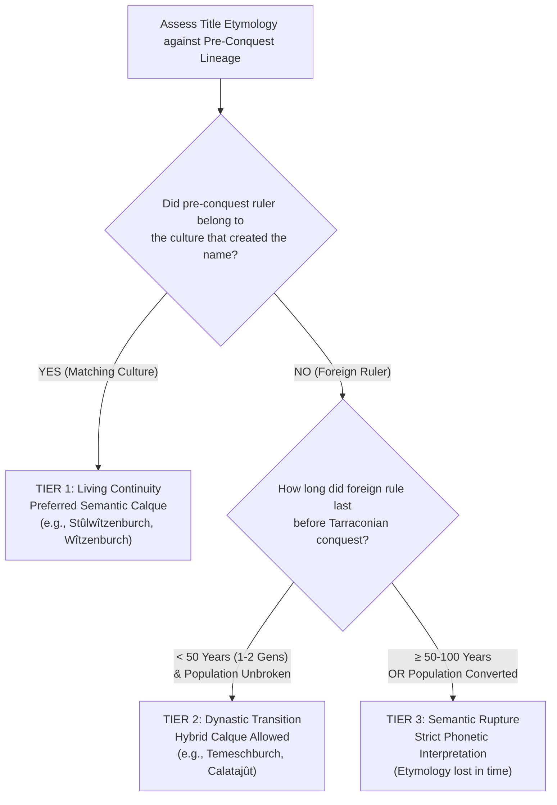

# Tarraconian Chancellery Guide to Semantic Calques for Descriptive Titles

* **Companion References:**
  * [README.md](README.md) (Master Project Overview, Protocols & Expansion Playbook)
  * [tarraconian_linguistics_guide.md](tarraconian_linguistics_guide.md) (Phonology, Sound Laws, Orthography & IPA)
  * [tarraconian_titles_1059.md](tarraconian_titles_1059.md) (Comprehensive Empire Gazetteer)
  * [hre_de_jure_and_archdioceses_1059.md](hre_de_jure_and_archdioceses_1059.md) (De Jure Hierarchy & Historical Attestation)

---

## 1. Executive Summary & Chancellery Rationale

As **The Roman Empire** (*Dat Rômische Keiserrîch*) expanded across Western, Central, Southern, and Eastern Europe, the Mediterranean, the Steppes, and the Near East, the **Tarraconian Chancellery** faced a classic imperial administrative dilemma: how to name and register provinces whose vernacular names derived from Hungarian, Slavic, Arabic, Greek, Romance, Celtic, and Turkic roots.

Historically, the Holy Roman Empire, the Kingdom of Hungary, and later the Habsburg crown solved this through **systematic semantic calquing** (*Lehnübersetzung*):
1. **Descriptive, topographic, and functional toponyms** (fortresses, church dedications, river crossings, market days, mineral deposits, and colors) were **translated root-for-root** into High German (*Székesfehérvár* $\rightarrow$ *Stuhlweißenburg*; *Csütörtökhely* $\rightarrow$ *Donnersmarkt*; *Felsőőr* $\rightarrow$ *Oberwart*; *Novgorod* $\rightarrow$ *Neugard / Nîenstat*; *Belgorod* $\rightarrow$ *Weißenburg*).
2. **Opaque eponyms and ancient tribal centres** (personal names, tribal founders, or pre-Indo-European stems like *Bács*, *Bodrog*, *Arad*, *Paris*, *Toledo*, *Damaskos*) were **preserved phonetically** and adapted to imperial phonotactics.

This document establishes the **Tarraconian Master Morpheme Matrix** and provides a comprehensive regional gazetteer of potential semantic calques that can be applied to titles in [tarraconian_titles_1059.md](tarraconian_titles_1059.md).

---

## 2. Phonological Rules for Tarraconian Calques

All calqued elements must strictly adhere to the phonology and orthography defined in [tarraconian_linguistics_guide.md](tarraconian_linguistics_guide.md):

1. **West Central German (Moselle/Rhine Franconian) Base:**
   * **Shifted *t* $\rightarrow$ *z/tz/ss*:** Initial `z-` `[ts]` (*Zant-*, *Zips*), medial/final `-tz-` / `-tz` (*Lîgnitz*, *Wîtzen-*).
   * **Preserved Unshifted Clusters:** Early Middle High German `sw-`, `sl-`, `sm-`, `sn-` are preserved without modern German *sch-* (*Swartz-*, *Snell-*, *Slûp-*, *Smîde-*).
   * **Unshifted *p-* and *d-*:** Retains initial `p-` (*Palz*, *Pûl*) and initial `d-` where Upper German has *t-* (*Dat*, *Dorf*, *Dâl*).
2. **Absolute Auslautverhärtung (Final Devoicing):**
   * Final `-b` $\rightarrow$ **`-p`** (*Halep*, *Gârp*).
   * Final `-d` $\rightarrow$ **`-t`** (*Lant*, *Stat*, *Wart*, *Veit*, *Rôt*).
   * Final `-g` and post-vocalic *-k* $\rightarrow$ **`-ch`** `[x ~ ç]` (*Burch*, *Berch*, *March*, *Brüch*).
   * Final voiced affricate `*-dsch` $\rightarrow$ **`-tsch`** `[tʃ]`.
3. **Vowel Quantity & Circumflexation:**
   * Long vowels are systematically written with circumflexes: **`â, ê, î, ô, û`** (*Wîz-*, *Rôt-*, *Grôz-*, *Grûne-*, *Nîe-*, *Klôster-*). Capitalized letters strictly retain their circumflexes (**Ôver-**, **Ûjwâr**).
4. **The Catalan Substrate Element:**
   * Romance structural loanwords are legitimate alternatives to pure Germanic generics: **`Castel`** `[kas.ˈtɛl]` alongside **`-burch`**, **`March`** `[marx]`, **`Veguerîe`** `[vɛ.ɣə.ˈriː.ə]` alongside **`Magistrat`**, and saintly prefix **`Zant-`** `[tsant]` alongside **`Hilig-`**.

---

## 3. The Master Morpheme Translation Matrix

> [!NOTE]
> **Empirical Inquest of the Restored Roman Empire (`1154.12.27`):**
> A comprehensive census of all **1,972 directly administered counties** across the Empire and their historical sovereign trajectories reveals **238 distinct ruler cultures** between 867 and 1154. 
> Grouped by linguistic and scribal tradition, the primary pre-Tarraconian administrations whose toponyms enter the Imperial Chancellery comprise:
> 1. **Romance, Frankish & Latin:** 2,572 pre-Tarraconian holders *(Italian, Lombard, Cisalpine, Roman, Sicilian; French, Occitan, Frankish; Andalusian, Castilian, Catalan, Galician)*
> 2. **Arabic & Berber:** 2,313 holders *(Bedouin, Levantine, Egyptian, Yemeni, Maghrebi; Butr, Baranis)*
> 3. **Turkic, Oghur & Mongolic:** 2,187 holders *(Avar, Khazar, Pecheneg, Bolghar, Turkish, Cuman, Karluk, Khitan, Mongol)*
> 4. **Central & North Germanic:** 2,036 holders *(Bavarian, Franconian, Dutch, Frisian, Saxon; Norse, Norwegian, Swedish, Danish; Anglo-Saxon)*
> 5. **Iranian, Scythian & Sogdian:** 1,667 holders *(Persian, Tajik, Sogdian, Khwarezmian, Daylamite, Kurdish, Baloch, Alan, Saka)*
> 6. **Byzantine & Caucasian:** 1,604 holders *(Greek, Pontic, Cappadocian, Cypriot, Cretan; Armenian, Georgian)*
> 7. **Slavic (West, South, East):** 1,562 holders *(Polish, Czech, Polabian; Bulgarian, Serbian, Croatian; Russian, Ruthenian, Volhynian)*
> 8. **Finno-Ugric & Uralic:** 1,288 holders *(Magyar/Mogyër; Finnish, Karelian, Vepsian, Estonian, Sami; Mordvin, Mari, Komi, Khanty)*
> 9. **Sinospheric & East Asian:** 1,102 holders *(Japanese/Yamato; Khitan; Jurchen, Mohe; Han; Korean/Silla/Samhan/Balhae)*
> 10. **Celtic (Goidelic & Brythonic):** 1,071 holders *(Irish, Gaelic; Welsh, Breton, Cornish, Cumbrian)*
> 11. **East African, Ethiopic & Cushitic:** 957 holders *(Nubian, Daju; Ethiopian/Amhara, Ge'ez; Somali, Afar, Beja)*
> 12. **Indo-Aryan:** 429 holders *(Sindhi, Gujarati, Hindustani, Kashmiri, Punjabi)*
> 13. **Tibetan:** 276 holders *(Bodpa, Zhangzhung, Lhomon, Sumpa)*
> 14. **Baltic:** 258 holders *(Lithuanian, Prussian, Latgalian)*

Below is the imperial dictionary of recurring toponymic roots across these audited language families and their standardized Tarraconian calqued counterparts:

### 3.1 Fortifications, Enclosures & Civic Strongholds
| Meaning | Hungarian | Slavic | Arabic | Greek | Celtic | Romance | Tarraconian Target |
| :--- | :--- | :--- | :--- | :--- | :--- | :--- | :--- |
| **Castle / Fortress** | `-vár` | `grad / gorod / hrad` | `Qal'a` (قلعة), `Hisn` (حصن) | `-kastron` (κάστρον) | `Dun / Dùn`, `Caer` | `Château / Castel` | **`-burch`** `[bʊrx]` / **`Castel`** |
| **Walled City / Town** | `-város` | `grad / mesto` | `Medina` (مدينة) | `-polis` (πόλις) | `Tre- / Caer` | `Cité / Città` | **`-stat`** `[stat]` / **`-pel`** |
| **Tower / Redoubt** | `-torony` | `veža / bashnya` | `Burj` (برج) | `-pyrgos` (πύργος) | `Tŵr` | `Tour / Torre` | **`-torn`** `[tɔrn]` |
| **Stone / Rock / Cliff** | `-kő`, `-szikla` | `kamen / skala / stena` | `Sakhr` (صخر), `Hajar` (حجر) | `Petra` (πέτρα) | `Craig / Carrack` | `Roche / Pietra` | **`-stein`** `[ʃtɛɪn]` / **`-fels`** `[fɛls]` |
| **Earthwork / Ditch** | `-sánc`, `-árok` | `val / opok / rov` | `Khandaq` (خندق) | `Taphros` (τάφρος) | `Rath` | `Fosse / Vallum` | **`-grâben`** `[ˈɡraː.bən]` / **`-wal`** |

### 3.2 Churches, Sanctuaries & Monasteries
| Meaning | Hungarian | Slavic | Arabic / Semitic | Greek | Celtic | Romance | Tarraconian Target |
| :--- | :--- | :--- | :--- | :--- | :--- | :--- | :--- |
| **Church** | `-egyház` | `crkva / cerkiew / kostol` | `Kanisa` (كنيسة) | `Ekklesia` (ἐκκλησία) | `Cill / Kil-`, `Llan` | `Église / Chiesa` | **`-kirchen`** `[ˈkɪr.çən]` |
| **Holy / Sacred / Saint** | `szent-` | `sveti / święty` | `Quds / Muqaddas` | `Hagio-` (ἅγιος) | `Noomh` | `Saint- / San-` | **`Hilig-`** `[ˈhɪ.lɪç]` / **`Zant-`** |
| **Monastery / Abbey** | `-monostor` | `monastyr / klášter` | `Dayr` (دير) | `Mone` (μονή) | `Manach` | `Moutier / Badia` | **`-klôster`** `[ˈkloː.stər]` / **`-munster`** |
| **Our Lady / Blessed Virgin** | `Boldogasszony` | `Bogorodica` | `Sayyidatuna` (سيدتنا) | `Theotokos` (Θεοτόκος) | `Muire` | `Notre-Dame / Madonna` | **`Vrouwen-`** `[ˈvrɔʊ.wən]` |
| **The Cross** | `Kereszt-` | `Križ / Krzyż` | `Salib` (صليب) | `Stavros` (σταυρός) | `Crois` | `Croix / Croce` | **`-krûz`** `[kruːts]` |

### 3.3 Hydronymic Generics & Crossings
| Meaning | Hungarian | Slavic | Arabic | Greek | Celtic | Romance | Tarraconian Target |
| :--- | :--- | :--- | :--- | :--- | :--- | :--- | :--- |
| **Ford / Crossing** | `-rév`, `-gázló` | `brod` | `Makhada` (مخاضة) | `Poros` (πόρος) | `Ath- / Rhyd` | `Gué / Guado` | **`-vurt`** `[vʊrt]` |
| **Bridge / Viaduct** | `-híd` | `most` | `Qantara` (قنطرة) | `Gephyra` (γέφυρα) | `Pont` | `Pont / Ponte` | **`-brücke`** `[ˈbrʏ.kə]` |
| **Brook / Rapid Stream** | `-patak` | `potok / bystrica` | `Nahr / Jadwal` | `Rhyax` (ῥύαξ) | `Allt / Burn` | `Ruisseau / Rivo` | **`-bache`** `[ˈba.xə]` / **`-snellbach`** |
| **River / Large Water** | `-víz`, `-folyó` | `reka / rzeka / voda` | `Nahr` (نهر), `Wadi` (وادي) | `Potamos` (ποταμός) | `Afon / Abhainn` | `Fleuve / Fiume` | **`-wazzer`** `[ˈwa.tsər]` / **`-flôz`** |
| **Lake / Inland Sea** | `-tó` | `jezero / ozero` | `Buhayra` (بحيرة) | `Limne` (λίμνη) | `Loch / Llyn` | `Lac / Lago` | **`-sê`** `[zeː]` |
| **Island / River Holme** | `-sziget` | `otok / ostrov` | `Jazira` (جزيرة) | `Nesos` (νῆσος) | `Inis / Ynys` | `Île / Isola` | **`-insel`** `[ˈɪn.zəl]` / **`-werth`** |
| **Well / Spring / Source** | `-kút`, `-forrás` | `studňa / izvor / zdrój` | `'Ayn` (عين), `Bir` (بئر) | `Krene` (κρήνη) | `Tobar / Ffynnon` | `Fontaine / Pozzo` | **`-brunn`** `[brʊn]` / **`-putze`** |
| **River Mouth / Confluence** | `-torkolat` | `ušće / sovlasi` | `Masabb` (مصب) | `Ekbole` (ἐκβολή) | `Aber- / Inver-` | `Embouchure` | **`-munde`** `[ˈmʊn.də]` |

### 3.4 Oronyms, Topography & Landscape
| Meaning | Hungarian | Slavic | Arabic / Turkic | Greek | Celtic | Romance | Tarraconian Target |
| :--- | :--- | :--- | :--- | :--- | :--- | :--- | :--- |
| **Mountain / Peak** | `-hegy` | `gora / hora / vrkh` | `Jabal` (جبل) / `Dagh` | `Oros` (ὄρος) | `Ben / Pen / Sliabh` | `Mont / Monte` | **`-berch`** `[bɛrç]` |
| **Hill / Mound / Knoll** | `-halom`, `-domb` | `chlm / brdo / mogila` | `Tall` (تل) / `Tepe` | `Bounos` (βουνός) | `Bryn / Cnoc` | `Colline / Puy` | **`-bühil`** `[ˈbyː.hɪl]` / **`-hügil`** |
| **Valley / Dale** | `-völgy` | `dol / dolina` | `Wadi` (وادي) / `Derem` | `Koile` (κοίλη) | `Glyn / Gleann` | `Val / Vallée` | **`-dal`** `[dal]` |
| **Gorge / Pass / Defile** | `-szoros`, `-kapu` | `tesnina / klisura` | `Bab` (باب) / `Darband` | `Klisoura` (κλεισούρα) | `Bwlch` | `Gorge / Cluse` | **`-klûse`** `[ˈkluː.zə]` / **`-tôr`** |
| **Forest / Woods** | `-erdő`, `-berek` | `les / bor / dubrava` | `Ghaba` (غابة) / `Orman` | `Drymos` (δρυμός) | `Coill / Ros` | `Forêt / Bois` | **`-walt`** `[walt]` / **`-hêde`** |
| **Field / Meadow / Plain** | `-mező`, `-rét` | `pole / polje / lúka` | `Marj` (مرج), `Sahl` (سهل) | `Pedion` (πεδίον) | `Maes / Machair` | `Champs / Prato` | **`-veit`** `[vɛɪt]` / **`-ouwe`** |
| **Clearing / Assart** | `-irtás` | `porečje / paseka / laz` | `Rawda` (روضة) | `Akra` | `Llannerch` | `Essart / Clairière` | **`-rîte`** `[ˈriː.tə]` / **`-slach`** |

### 3.5 Colors, Cardinal Directions & Qualities
| Meaning | Hungarian | Slavic | Arabic | Greek | Celtic | Romance | Tarraconian Target |
| :--- | :--- | :--- | :--- | :--- | :--- | :--- | :--- |
| **White / Pure** | `fehér-` | `bel- / bialy-` | `Abyad` (أبيض) / `Aq` | `Leukos` (λευκός) | `Gwen- / Finn-` | `Blanc / Alba` | **`Wîz-`** `[wiːts]`, **`Wîtzen-`** |
| **Black / Dark** | `fekete-` | `čern- / czarny-` | `Aswad` (أسود) / `Qara` | `Melas` (μέλας) | `Du- / Dubh-` | `Noir / Nero` | **`Swartz-`** `[swarts]` |
| **Red / Beautiful** | `vörös- / piros-` | `krasn- / červen-` | `Ahmar` (أحمر) / `Qyzyl` | `Erythros` (ἐρυθρός) | `Coch / Rua` | `Rouge / Rosso` | **`Rôt-`** `[roːt]`, **`Rôten-`** |
| **Green / Verdant** | `zöld-` | `zelen-` | `Akhdar` (أخضر) / `Yashil` | `Chloros` (χλωρός) | `Glas` | `Vert / Verde` | **`Grûne-`** `[ˈɡryː.nə]` |
| **Gold / Golden** | `arany-` | `zlat-` | `Dhahab` (ذهب) / `Altyn` | `Chrysos` (χρυσός) | `Oir` | `Or / Doré` | **`Golt-`** `[ɡɔlt]`, **`Güld-`** |
| **Blue / Azure** | `kék-` | `sinyi- / plav-` | `Azraq` (أزرق) / `Gök` | `Kyaneos` (κυάνεος) | `Gorm` | `Bleu / Azzurro` | **`Blou-`** `[blɔʊ]` |
| **Old vs. New** | `ó-` vs. `új-` | `star-` vs. `nov-` | `Qadim` vs. `Jadid` | `Palaio-` vs. `Neo-` | `Hen-` vs. `Newydd-` | `Vieux` vs. `Neuf` | **`Alt-`** `[alt]` vs. **`Nî- / Nîe-`** |
| **Upper vs. Lower** | `felső-` vs. `alsó-` | `gorn-` vs. `doln-` | `'Ulya` vs. `Sufla` | `Ano-` vs. `Kato-` | `Uch-` vs. `Is-` | `Haut-` vs. `Bas-` | **`Ôver-`** `[ˈoː.vər]` vs. **`Nider-`** |
| **Great vs. Little** | `nagy-` vs. `kis-` | `velik-` vs. `maly-` | `Kabir` vs. `Saghir` | `Mega-` vs. `Mikro-` | `Môr` vs. `Beg` | `Grand` vs. `Petit` | **`Grôz-`** `[ɡroːts]` vs. **`Klein- / Lützel-`** |

### 3.6 Economic, Mineral & Administrative Morphemes
| Meaning | Hungarian | Slavic | Arabic | Greek | Romance | Tarraconian Target |
| :--- | :--- | :--- | :--- | :--- | :--- | :--- |
| **Salt / Salines** | `só-` | `sol- / solice` | `Milh / Malaha` | `Halas` (ἅλας) | `Salins / Salgemma` | **`Salz-`** `[zalts]`, **`Salzen-`** |
| **Iron / Works** | `vas-` | `železo / ruda` | `Hadid` (حديد) | `Sideros` (σίδηρος) | `Fer / Ferro` | **`Îsen-`** `[ˈiː.zən]` |
| **Market / Trade** | `vásár / piac` | `torg / trg` | `Suq` (سوق) | `Agora` (ἀγορά) | `Marché / Mercato` | **`-marct`** `[marxt]` |
| **Frontier Guard / Ward** | `őr-` | `straža / varta` | `Ribat / Thaghr` | `Phylake` (φυλακή) | `Garde / Vedetta` | **`-wart`** `[wart]`, **`-march`** |

### 3.7 Territorial, Country & Realm Formants (`-lant`)
| Meaning | Tibetan | Persian | Hungarian | Slavic | Celtic | Arabic | Romance | Tarraconian Target |
| :--- | :--- | :--- | :--- | :--- | :--- | :--- | :--- | :--- |
| **Land / Country / Realm** | `-yul` (ཡུལ) | `-stan` (ـستان) | `-föld`, `-ország`, `-vidék` | `zemlja / -ina / -ska` | `Tír / Bro / Gwlad` | `Ard` (أرض), `Bilad` (بلاد) | `Pays / Terra` | **`-lant`** `[lant]` / **`Têrre`** |

> [!NOTE]
> **The Tibetan `yul` (ཡུལ) Calquing Rule:**
> In Classical Tibetan, *yul* is the standard term for "land, country, homeland, realm, district" (translating Sanskrit *deśa* and *viṣaya*). It functions as an exact morphological equivalent to Germanic **`-lant`** and Persian **`-stan`**. In the imperial chancellery, titles formed with Tibetan `-yul` (previously transcribed phonetically as `*-Jül`) are systematically calqued to **`-lant`**:
> * Ethnonymic + *yul* $\rightarrow$ **`Baltiyul`** $\rightarrow$ **Baltilant** (cf. *Baltistan*).
> * Directional + *yul* $\rightarrow$ **`Lhoyul`** (*lho* = south) $\rightarrow$ **Sûtlant** (The Southland).
> * Elevation + *yul* $\rightarrow$ **`Maryül`** (*mar* = down/low) $\rightarrow$ **Niderlant** / **Marlant** (The Lowland).

### 3.8 The Sinospheric Logographic Matrix (China, Korea, Vietnam, Japan)

In regions where **Chinese characters** (*Hànzì*, *Hanja*, *Kanji*, *Chữ Hán*) govern administrative toponymy, toponyms are inherently logographic and semantically transparent rather than purely phonetic strings.

> [!IMPORTANT]
> **Historical Precedent for Sinospheric Calquing:**
> 1. **Inner Asian Imperial Precedent (Mongols & Manchus):** Both the Yuan and Qing imperial chancelleries systematically translated Chinese geographic names into Mongolian and Manchu rather than transcribing Chinese sounds (*Sahaliyan Ula* for 黑龍江 *Heilongjiang*; *Golmin Šanggiyan Alin* for 長白山 *Changbaishan*; *Shira Mörön* for 黃河 *Huanghe*; *Khanbaliq* for 大都 *Dadu*).
> 2. **Jesuit & Western Diplomatic Precedent:** Early European cartographers (notably Martino Martini in his 1655 *Novus Atlas Sinensis*) routinely translated Chinese characters into Latin semantic compounds (*Fluvius Flavus* for Yellow River, *Curia Septentrionalis* for Beijing, *Auster Nubifer* for Yunnan, *Occidens Montium* for Shanxi).
> 3. **Intra-Sinospheric Precedent:** Korea (King Gyeongdeok's 757 AD reforms) and Japan (813 AD *Kōnin* decree) actively converted native topographic names into Chinese characters through semantic calques (e.g., native Korean *Mihach* "Water-castle" $\rightarrow$ *Suwon* 水原 "Water-source").

#### A. Master Sinospheric Character Conversion Table
| Semantic Class | Chinese Character | Sino-Korean | Sino-Vietnamese | Sino-Japanese (On/Kun) | Meaning | Tarraconian Target Morpheme |
| :--- | :--- | :--- | :--- | :--- | :--- | :--- |
| **Administrative Classifiers** | **州** (*Zhōu*) | *Ju* | *Châu* | *Shū* | Province / Circuit / Prefecture | **`-gouwe`** `[ˈɡɔʊ.wə]` (*Gau*) |
| | **城** (*Chéng*) | *Seong* | *Thành* | *Jō / Shiro* | Walled Fortress / Citadel | **`-burch`** `[bʊrx]` / **`Castel`** |
| | **關** (*Guān*) | *Gwan* | *Quan* | *Kan / Seki* | Mountain Pass / Frontier Gate | **`-klûse`** `[ˈkluː.zə]` / **`-tôr`** |
| | **京** (*Jīng*) | *Gyeong* | *Kinh* | *Kyō / Kei* | Imperial Capital City | **`-hôfstat`** `[ˈhoːf.stat]` / **`-stat`** |
| | **島 / 海島** (*Dǎo*) | *Do* | *Đảo* | *Tō / Shima* | Island / Sea Island | **`-insel`** `[ˈɪn.zəl]` / **`-werth`** |
| | **門 / 口** (*Mén / Kǒu*) | *Mun / Gu* | *Môn / Khẩu* | *Mon / Kō / Kuchi* | Gate / River Mouth / Harbor | **`-tôr`** `[toːr]` / **`-munde`** |
| **Cardinal & Relative Positions** | **東** (*Dōng*) / **西** (*Xī*) | *Dong / Seo* | *Đông / Tây* | *Tō / Higashi* ; *Sei / Nishi* | East / West | **`Ôst-`** `[oːst]` / **`West-`** `[wɛst]` |
| | **南** (*Nán*) / **北** (*Běi*) | *Nam / Buk* | *Nam / Bắc* | *Nan / Minami* ; *Hoku / Kita* | South / North | **`Sût-`** `[zuːt]` / **`Nord-`** `[nɔrt]` |
| | **中** (*Zhōng*) | *Jung* | *Trung* | *Chū / Naka* | Middle / Central | **`Midden-`** `[ˈmɪ.dən]` |
| | **上** (*Shàng*) / **下** (*Xià*) | *Sang / Ha* | *Thượng / Hạ* | *Jō / Ue* ; *Ka / Shita* | Upper / Lower | **`Ôver-`** `[ˈoː.vər]` / **`Nider-`** `[ˈnɪ.dər]` |
| | **內** (*Nèi*) / **外** (*Wài*) | *Nae / Woe* | *Nội / Ngoại* | *Nai / Uchi* ; *Gai / Soto* | Inner (Inside) / Outer (Beyond) | **`Binnen-`** `[ˈbɪ.nən]` / **`Ûzen-`** `[ˈuː.zən]` |
| **Physical Topography** | **山** (*Shān*) / **嶺** (*Lǐng*) | *San / Ryeong* | *Sơn / Lĩnh* | *San / Yama* ; *Rei / Mine* | Mountain / Ridge / Alpine Pass | **`-berch`** `[bɛrç]` / **`-rücke`** |
| | **河** (*Hé*) / **江** (*Jiāng*) | *Ha / Gang* | *Hà / Giang* | *Ka / Kawa* ; *Kō / E* | Northern River / Southern River | **`-flôz`** `[floːts]` / **`-wazzer`** |
| | **川** (*Chuān*) / **水** (*Shuǐ*) | *Cheon / Su* | *Xuyên / Thủy* | *Sen / Kawa* ; *Sui / Mizu* | Stream / Freshwater Flow | **`-bache`** `[ˈba.xə]` / **`-wazzer`** |
| | **湖** (*Hú*) / **海** (*Hǎi*) | *Ho / Hae* | *Hồ / Hải* | *Ko / Mizuumi* ; *Kai / Umi* | Lake / Sea / Maritime Waters | **`-sê`** `[zeː]` / **`-mêr`** `[meːr]` |
| | **原** (*Yuán*) / **壤** (*Rǎng*) | *Won / Yang* | *Nguyên / Nhưỡng* | *Gen / Hara* ; *Jō* | Water Source / Lowland Plain | **`-brunn`** `[brʊn]` / **`-veit`** `[vɛɪt]` |
| | **雲** (*Yún*) | *Un* | *Vân* | *Un / Kumo* | Cloud / Mist | **`Wolchen-`** `[ˈwɔl.xən]` |
| **Imperial & Virtuous Qualities** | **安** (*Ān*) / **定** (*Dìng*) | *An / Jeong* | *An / Định* | *An / Yasu* ; *Tei / Sadame* | Pacified / Secure / Settled | **`Frid-`** `[friːt]` / **`-frid`** |
| | **寧** (*Níng*) / **平** (*Píng*) | *Nyeong / Pyeong* | *Ninh / Bình* | *Nei / Yasushi* ; *Hei / Taira* | Tranquil / Level / Peaceful | **`Rûwe-`** `[ˈruː.wə]` / **`Ebene-`** |
| | **鎮** (*Zhèn*) / **防** (*Fáng*) | *Jin / Bang* | *Trấn / Phòng* | *Chin / Shizume* ; *Bō / Fusegu* | Military Garrison / Coastal Defense | **`-wart`** `[wart]` / **`-march`** |
| | **福** (*Fú*) / **慶** (*Qìng*) | *Bok / Gyeong* | *Phúc / Khánh* | *Fuku* ; *Kei / Yorokobi* | Blessed / Good Fortune / Rejoicing | **`Sêlich-`** `[ˈzeː.lɪç]` / **`Fröude-`** |
| | **廣** (*Guǎng*) / **長** (*Cháng*) | *Gwang / Chang* | *Quảng / Trường* | *Kō / Hiro* ; *Chō / Naga* | Vast / Broad / Long / Eternal | **`Weit-`** `[wɛɪt]` / **`Lang-`** `[laŋ]` |

> [!CAUTION]
> **The Phonetic Loan (*Jiajie / Ateji*) Exception:**
> Do NOT force semantic calques onto ancient pre-Han indigenous names where Chinese characters were used purely as phonetic transcription alphabets:
> * **Silla (新羅):** Characters mean "New Silk Net", but transcribe native Korean *Seorabeol* (Capital). Keep phonetically as **`Sille`**.
> * **Baekje (百濟):** Characters mean "Hundred Crossings", but transcribe an ancient Buyeo tribal name. Keep phonetically as **`Baekdsche`**.
> * **Yamato (大和):** Characters mean "Great Harmony", but transcribe an indigenous Japonic toponym. Keep phonetically as **`Jamatô`**.

### 3.9 The Steppe, Turanian & Iranian Matrix (Turkic, Oghur, Persian & Sogdian)
Across the Pontic-Caspian Steppe, Turan, Khorasan, and Persia (where over 3,800 pre-Tarraconian rulers governed imperial territories), toponyms are heavily dominated by pastoral, hydronymic, and fortress descriptors:

| Semantic Class | Turkic / Oghur / Mongolic | Persian / Sogdian | Meaning | Tarraconian Target Morpheme |
| :--- | :--- | :--- | :--- | :--- |
| **Fortifications & Cities** | `Qala / Qal'a`, `Kermen` | `Diz / Dez`, `Hisar` | Fortress / Castle | **`-burch`** `[bʊrx]` |
| | `Balıq`, `Kent` | `Shahr`, `Kand / Kent` | Walled Town / City | **`-stat`** `[stat]` |
| | `Ordu / Orda` | `Arg`, `Kakh` | Princely Residence / Citadel | **`-hôf`** `[hoːf]` / **`Castel`** |
| | `Qorghan / Kurgan`, `Oba` | `Tapeh` | Fortified Mound / Barrow | **`-bühil`** `[ˈbyː.hɪl]` / **`-burch`** |
| | `Qapi`, `Bel` | `Darband`, `Gardan` | Frontier Gate / Mountain Pass | **`-klûse`** `[ˈkluː.zə]` / **`-tôr`** |
| **Hydronyms & Waters** | `Su / Suu` | `Ab / Aw` | Fresh Water / River | **`-wazzer`** `[ˈwa.tsər]` |
| | `Chay / Çay` | `Rud` | Flowing Stream / River | **`-bache`** `[ˈba.xə]` / **`-flôz`** |
| | `Darya` | `Darya`, `Rudxaneh` | Great River / Broad Flow | **`-flôz`** `[floːts]` |
| | `Köl / Göl`, `Nuurch` | `Daryacheh`, `Hawz` | Lake / Inland Water | **`-sê`** `[zeː]` |
| | `Bulaq`, `Quduq` | `Chashmeh`, `Chah` | Spring / Artesian Well | **`-brunn`** `[brʊn]` / **`-putze`** |
| | `Aral` | `Jazireh` | River Island / Delta | **`-werth`** `[wɛrt]` / **`-insel`** |
| **Oronyms & Terrain** | `Dagh / Tagh`, `Uul` | `Kuh / Koh` | Mountain / High Peak | **`-berch`** `[bɛrç]` |
| | `Tepe / Depe` | `Posht`, `Poshteh` | Hill / Ridge / Crest | **`-bühil`** `[ˈbyː.hɪl]` / **`-rücke`** |
| | `Dala / Tala` | `Dasht`, `Hamun` | Open Steppe / Grass Plain | **`-veit`** `[vɛɪt]` / **`-ouwe`** |
| | `Qum` | `Kavir`, `Rigistan` | Sand Desert / Salt Waste | **`-sant`** `[zant]` / **`-wüeste`** |
| | `Art`, `Kotal` | `Tang`, `Darreh` | Defile / Mountain Gorge | **`-enge`** `[ˈɛŋ.ə]` / **`-dal`** |
| **Colors & Qualities** | `Aq`, `Tsagaan` | `Sefid` | White / West / Noble | **`Wîz-`** `[wiːts]`, **`Wîtzen-`** |
| | `Qara`, `Har` | `Siyah` | Black / North / Great | **`Swartz-`** `[swarts]` |
| | `Qyzyl`, `Ulaan` | `Sorkh` | Red / South / Clay | **`Rôt-`** `[roːt]`, **`Rôten-`** |
| | `Sary`, `Shira` | `Zard` | Yellow / Golden Sand | **`Golt-`** `[ɡɔlt]`, **`Gelb-`** |
| | `Kök / Gök`, `Höh` | `Kabud`, `Asemuni` | Blue / Sky / Celestial | **`Blou-`** `[blɔʊ]` |
| | `Ulu / Uly` | `Bozorg`, `Kalan` | Great / Grand | **`Grôz-`** `[ɡroːts]` |
| | `Eski` / `Yangi` | `Kohan` / `Now` | Old / New | **`Alt-`** `[alt]` / **`Nîe-`** `[ˈniː.ə]` |

### 3.10 The Boreal & North Atlantic Matrix (Norse, Finno-Ugric & Baltic)
In the Scandinavian, North Atlantic, Baltic, and Volga-Kama marches (over 2,300 historical holders across Norse, Finnic, and Baltic traditions), toponyms emphasize coastal navigation, waterways, and taiga terrain:

| Semantic Class | Old Norse / Scandinavian | Balto-Finnic / Volgaic | Baltic (Prussian / Lithuanian) | Meaning | Tarraconian Target Morpheme |
| :--- | :--- | :--- | :--- | :--- | :--- |
| **Forts & Settlements** | `-borg`, `-virki` | `-linna` | `-pilis`, `-piliakalnis` | Castle / Rampart / Hillfort | **`-burch`** `[bʊrx]` / **`-werc`** |
| | `-by`, `-staðir` | `-kylä` | `-kaimas`, `-miestas` | Settlement / Stead / Town | **`-stat`** `[stat]` / **`-dorf`** |
| | `-tún` | `-kartano` | `-dvaras` | Enclosure / Farmstead / Court | **`-zûn`** `[tsuːn]` / **`-hov`** |
| **Coasts & Waters** | `-vík`, `-vågen` | `-lahti` | `-įlanka` | Bay / Cove / Inlet | **`-wîch`** `[wiːç]` / **`-bucht`** |
| | `-nes`, `-oddr` | `-niemi` | `-ragas` | Cape / Headland / Spit | **`-necke`** `[ˈnɛ.kə]` / **`-nes`** |
| | `-ey`, `-hólmr` | `-saari` | `-sala` | Island / River Holme | **`-insel`** `[ˈɪn.zəl]` / **`-ouwe`** |
| | `-sund` | `-salmi` | `-sąsiauris` | Sound / Strait / Channel | **`-sunt`** `[zʊnt]` |
| | `-á`, `-elfr` | `-joki` | `-upė` | River / Stream | **`-flôz`** `[floːts]` / **`-bache`** |
| | `-vatn`, `-sjór` | `-järvi` | `-ežeras` | Lake / Inland Water | **`-sê`** `[zeː]` / **`-wazzer`** |
| | `-foss` | `-koski` | `-krioklys` | Waterfall / River Rapids | **`-val`** `[val]` / **`-snellbach`** |
| **Terrain & Woods** | `-fjall / -fell` | `-vaara`, `-vuori` | `-kalnas` | Mountain / Arctic Fell | **`-berch`** `[bɛrç]` |
| | `-hóll`, `-hváll` | `-mäki` | `-kalva` | Hill / Knoll / Mound | **`-bühil`** `[ˈbyː.hɪl]` |
| | `-dalr` | `-laakso` | `-slėnis` | Valley / Dale | **`-dal`** `[dal]` |
| | `-mörk`, `-viðr` | `-korpi`, `-metsä` | `-giria`, `-šilas` | Deep Forest / Taiga Woods | **`-walt`** `[walt]` / **`-hêde`** |
| **Colors & Qualities** | `Hvít-` | `Valko-` | `Baltas-` | White | **`Wîz-`** `[wiːts]` |
| | `Svart-` | `Musta-` | `Juodas-` | Black / Dark | **`Swartz-`** `[swarts]` |
| | `Rauð-` | `Puna-` | `Raudonas-` | Red | **`Rôt-`** `[roːt]` |
| | `Stór-` / `Lítill` | `Suuri-` / `Pieni-` | `Didis-` / `Mažas-` | Great / Little | **`Grôz-`** `[ɡroːts]` / **`Klein-`** |

### 3.11 The Red Sea & Horn of Africa Matrix (Ethiopic, Nubian & Cushitic)
In the Nile Valley, Ethiopian highlands, and Horn of Africa (nearly 1,000 historical pre-Tarraconian holders across Ge'ez, Nubian, and Somali traditions), toponyms are defined by Christian highland geography, volcanic mesas, and water sources:

| Semantic Class | Ge'ez / Amharic | Somali / Cushitic | Meaning | Tarraconian Target Morpheme |
| :--- | :--- | :--- | :--- | :--- |
| **Highland Strongholds** | `Amba` (አምባ) | `Buur` | Flat-Topped Mountain Mesa / Rock Fortress | **`-felsburch`** `[ˈfɛls.bʊrx]` |
| | `Debre` (ደብር) | `Galis` | Sacred Mountain / Monastery Hill | **`-munsterberch`** `[ˈmʊn.stər.bɛrç]` |
| | `Ghebbi` (ግቢ) | `Deg`, `Qalcadd` | Royal Compound / Enclosed Camp | **`-burch`** `[bʊrx]` / **`-hov`** |
| **Waters & Oases** | `Bahir` (ባሕር) | `Bahr`, `Bad` | Lake / Sea / Maritime Basin | **`-sê`** `[zeː]` / **`-mêr`** |
| | `Wenz` (ወንዝ) | `Wabi`, `Tog` | Flowing River / Seasonal Wadi | **`-flôz`** `[floːts]` / **`-bache`** |
| | `Minch` (ምንጭ) | `Ceel` | Natural Spring / Desert Waterhole | **`-brunn`** `[brʊn]` / **`-putze`** |
| **Topography & Coast** | `Ras` (ራስ) | `Raas` | Cape / Promontory / Headland | **`-houbt`** `[hɔʊpt]` / **`-necke`** |
| | `Gorgora` (ጎርጎራ) | `Jazeera` | Rocky Peninsula / Shore Spit | **`-felsnecke`** `[ˈfɛls.nɛ.kə]` |
| | `Meda` (ሜዳ) | `Bannaan` | High Plateau / Grassy Plain | **`-veit`** `[vɛɪt]` / **`-ebene`** |
| **Sanctuaries** | `Bet` (ቤት) | `Masjid` | House / Sanctuary / Shrine | **`-hûs`** `[huːs]` / **`-kirchen`** |

### 3.12 The Indus & South Asian Frontier Matrix (Indo-Aryan)
Along the eastern marches of Khorasan and Turan, where the Roman Empire borders Sindh, Punjab, and Kashmir (over 420 historical Indo-Aryan holders), Sanskrit-derived administrative and geographic formants can be calqued:

| Semantic Class | Sanskrit / Hindi / Sindhi | Meaning | Tarraconian Target Morpheme |
| :--- | :--- | :--- | :--- |
| **Forts & Cities** | `-garh` (गढ़), `-kot` (कोट) | Fort / Stronghold / Citadel | **`-burch`** `[bʊrx]` |
| | `-pur` / `-pura` (पुर), `-nagar` (नगर) | Walled City / Civic Center | **`-stat`** `[stat]` |
| | `-pattanam` (पत्तनम्) | Seaport / Maritime Harbor City | **`-haven`** `[ˈhaː.vən]` / **`-stat`** |
| **Waters & Crossings** | `-ghat` (घाट) | River Steps / Ford / Mountain Pass | **`-vurt`** `[vʊrt]` / **`-klûse`** |
| | `-nadi` (नदी), `-ganga` (गङ्गा) | River / Stream | **`-flôz`** `[floːts]` / **`-bache`** |
| | `-sar` / `-sagar` (सागर) | Lake / Reservoir / Ocean | **`-sê`** `[zeː]` / **`-mêr`** |
| | `-kund` (कुण्ड) | Sacred Spring / Pool / Reservoir | **`-brunn`** `[brʊn]` |
| **Oronyms & Realm** | `-giri` (गिरि), `-parvat` (पर्वत) | Mountain / Sacred Peak | **`-berch`** `[bɛrç]` |
| | `-tila` (टीला) | Hill / Elevated Mound | **`-bühil`** `[ˈbyː.hɪl]` |
| | `-desh` (देश), `-stan` (स्थान) | Land / Country / Realm | **`-lant`** `[lant]` |

---

## 4. Regional Title Calquing Gazetteer

The following tables demonstrate how specific titles across the Empire in [tarraconian_titles_1059.md](tarraconian_titles_1059.md) can incorporate semantic calques alongside (or as primary replacements for) purely phonetic adaptations.

### 4.1 Carpathian Basin, Upper Hungary & Banat (`k_hungary`)

| In-Game Key | Current / Vanilla Title | Proposed Semantic Calque | Etymological Breakdown & Historical Justification |
| :--- | :--- | :--- | :--- |
| `c_szekesfehervar` | **Stûlwîtzenburch** | **Magistrat van Stûlwîtzenburch** | Already established primary calque (*szék* = throne/chair $\rightarrow$ *Stuhl*; *fehér* = white $\rightarrow$ *weiß*; *vár* = castle $\rightarrow$ *Burg*). |
| `c_vas` | Dudleb / Vasvár | **Magistrat van Îsenburch** *(or **Teindorf**)* | Calque of Hungarian *Vasvár* ("Iron Castle", German *Eisenburg*) from the comital seat on the Rába. |
| `c_csongrad` | Csongrád | **Magistrat van Swartzenburch** *(or **Tschongrât**)* | Slavic substrate *Črnograd* ("Black Gord/Castle"), calqued root-for-root into Tarraconian. |
| `c_abauj` | Abaúj | **Magistrat van Abanîeburch** *(or **Ûjwâr**)* | Named after King Samuel Aba's fortress at *Abaújvár* ("Aba's New Castle"). |
| `c_spis` | Szepesség / Spiš | **Magistrat van der Zips** *(or **Tschingouwe**)* | Historical German *Zips*; pre-1059 Gord at *Čingov* on the Hornád can alternatively be calqued as *Tschingouwe*. |
| `c_marmaros` | Marmaros / Solotvyno | **Magistrat van Salzstat-am-Teiß** *(or **Marmarôsch**)* | Pre-1059 salt-mining centre *Solotvyno* (Slavic *sol* = salt) on the Upper Tisza. |
| `c_bekes` | Békés | **Magistrat van Fridstat** *(or **Bêkêsch**)* | From Hungarian *békés* ("peaceful / peace-guard") or Ispán Beke; calqued as *Fridstat / Fridburch*. |
| `c_temes` | Temes | **Magistrat van Temeschburch** *(or **Têmisch**)* | Hybrid formation combining hydronym *Temes* with generic calque *-burch* (German *Temeschburg / Temeswar*). |

### 4.2 West & South Slavic Realms (`k_poland`, `k_bohemia`, `k_croatia`, `k_serbia`)

| In-Game Key | Current / Vanilla Title | Proposed Semantic Calque | Etymological Breakdown & Historical Justification |
| :--- | :--- | :--- | :--- |
| `c_cetatea_alba` | Cetatea Albă / Bilhorod | **Magistrat van Wîtzenburch-am-Nister** | Already established primary calque (*Cetatea Albă / Belgorod* = "White Castle on the Dniester"). |
| `c_vyshhorod` | Vyshhorod | **Magistrat van Hôchburch** *(or **Wischigorot**)* | Slavic *vyše* ("higher / above") + *gorod* ("citadel/gord"). |
| `c_novgorod` | Novgorod | **Magistrat van Nîenburch-am-Wolchouwe** | Slavic *novy* ("new") + *gorod* ("city/gord"), qualified by the Volkhov river (*Wolchouwe*). |
| `c_beloozero` | Beloozero | **Magistrat van Wîtzensê** *(or **Belosêr**)* | Slavic *bely* ("white") + *ozero* ("lake"). |
| `c_zelengora` | Zelengora | **Magistrat van Grûnenberch** *(or **Selengôre**)* | South Slavic *zelena* ("green") + *gora* ("mountain"). |
| `c_zlatibor` | Zlatibor | **Magistrat van Goltwalt** *(or **Slatibôr**)* | South Slavic *zlati* ("golden") + *bor* ("pine forest"). |
| `c_soli` | Soli (Tuzla) | **Magistrat van Saltzvelt** *(or **Sôli**)* | Slavic plural *soli* ("salt pans / salt mines"), later Ottoman *Tuzla*. |
| `c_podrinje` | Podrinje | **Magistrat van Drînedal** *(or **Bî-der-Drîne**)* | Prepositional hydronym *Po-* ("along / beside") + *Drina* river. |
| `c_pomorje` | Pomorje (Zeta coast) | **Magistrat van Sêmarch** *(or **Bî-dem-Mêre**)* | Slavic *Po-morje* ("along the sea / littoral"). |
| `c_mostar` | Zachlumia / Mostar | **Magistrat van Brückenstat** *(or **Chelme**)* | Slavic *mostar* ("bridge-keeper"), referring to the crossing of the Neretva. |
| `c_crna_gora` | Duklja / Montenegro | **Magistrat van Swartzberch** *(or **Dôklje**)* | Literal calque of *Crna Gora* ("Black Mountain"). |

### 4.3 East Slavic Lands (`k_ruthenia`, `k_white_rus`, `k_galicia-volhynia`, `k_opolye`)

| In-Game Key | Current / Vanilla Title | Proposed Semantic Calque | Etymological Breakdown & Historical Justification |
| :--- | :--- | :--- | :--- |
| `k_white_rus` | Kingdom of Polotia | **Kûnincrich van Wîtzrûssen** *(1059 Hist: **Polôtzich**)* | Established alternate kingdom title calquing *Belaya Rus'* ("White Russia"), with historical resolution **Polôtzich** (Principality of Polotsk). |
| `c_lviv` | Lemberg / Zvenyhorod | **Magistrat van Klingeburch** *(or **Lüwenburch**)* | Pre-1256 seat *Zvenyhorod* derives from Slavic *zveneti* ("to ring/resound/chime"), calquing to *Klingeburch*. |
| `c_babruysk` | Babruysk | **Magistrat van Bîverbach** *(or **Babrûitzich**)* | Hydronym of the *Babruyka* ("Beaver Brook") from Slavic *bobr* ("beaver"). |
| `c_volodymyr` | Volodymyr (Volhynia) | **Magistrat van Simne-an-der-Lûge** *(or **Lûge**)* | Pre-867 Dulebe earthwork fortress *Zimne* ("winter quarter") on the Luga River. |
| `c_pereyaslavl` | Pereyaslav | **Magistrat van Rûmfurt** *(or **Pereslouwe**)* | Slavic *pereyati slavu* ("take the glory/renown") at the Trubizh ford. |
| `c_opolye` | Opolye (Vladimir) | **Magistrat van Veldlant** *(or **Opôlje**)* | Slavic *opole* ("open fertile field/clearing amidst the deep forest"). |

### 4.4 Iberia & Southern Gaul (`k_andalusia`, `k_badajoz`, `k_valencia`, `k_castille`)

| In-Game Key | Current / Vanilla Title | Proposed Semantic Calque | Etymological Breakdown & Historical Justification |
| :--- | :--- | :--- | :--- |
| `c_calatayud` | Calatayud | **Magistrat van Eijûbsburch** *(or **Calatajût**)* | Arabic *Qal'at Ayyub* ("Job's Castle / Ayyub's Citadel"). |
| `c_albarracin` | Albarracín | **Magistrat van Râsinburch** *(or **Albarrasîn**)* | Berber dynasty *Banu Razin* + fortress *Hisn*. |
| `c_algeciras` | Algeciras | **Magistrat van Grûninsel** *(or **Algesîre**)* | Arabic *Al-Jazira al-Khadra* ("The Green Island"). |
| `c_guadalquivir` | Seville / Guadalquivir | **Magistrat van Grôzwazzer** *(or **Sevîlje**)* | Arabic *Wādī al-Kabīr* ("Great River / Big Valley"). |
| `c_alcantara` | Alcántara | **Magistrat van Dat Brücke** *(or **Alcantâre**)* | Arabic *Al-Qantara* ("The Roman Viaduct/Bridge"). |
| `c_pontevedra` | Pontevedra | **Magistrat van Altbrücke** *(or **Pontevêdre**)* | Latin *Pons Vetus* ("Old Bridge"). |
| `c_castelnaudary` | Castelnaudary | **Magistrat van Nîecastel** *(or **Castelnoudarî**)* | Occitan *Castèlnòu d'Arri* ("New Castle of Arrius"). |
| `c_forcalquier` | Forcalquier | **Magistrat van Kalkovens** *(or **Forkalkêr**)* | Latin *Furnus Calcarius* ("Lime Kilns / Lime Ovens", cf. *Ofen*). |

### 4.5 The Levant, Near East & Egypt (`k_jerusalem`, `k_syria`, `k_egypt`, `k_arabia`)

| In-Game Key | Current / Vanilla Title | Proposed Semantic Calque | Etymological Breakdown & Historical Justification |
| :--- | :--- | :--- | :--- |
| `c_jerusalem` | Jerusalem / Al-Quds | **Magistrat van Hiligstat** *(or **Jerûsalem**)* | Arabic *Al-Quds* ("The Holy Sanctuary"). |
| `c_kerak` | Kerak / Petra | **Magistrat van Felsenstat** *(or **Pêtre / Krach**)* | Greek *Petra* / Semitic *Sela* ("The Rock City"). |
| `c_negev` | Negev / Ha-Arava | **Magistrat van der Dalsencke** *(or **Arabâ**)* | Semitic *Ha-'Aravah* ("The Sunken Rift Valley / Wilderness"). |
| `c_dead_sea` | Bahr Lut / Dead Sea | **Magistrat van dem Dôden Sê** | Arabic *Bahr al-Mayyit* / Hebrew *Yam Ha-Mavet* ("The Dead Sea"). |
| `c_krak_des_chevaliers` | Hisn al-Akrad | **Magistrat van Ritterburch** *(or **Kurdenburch**)* | Arabic *Hisn al-Akrad* ("Kurds' Fortress") $\rightarrow$ Crusader *Krak des Chevaliers*. |
| `c_baalbek` | Baalbek / Heliopolis | **Magistrat van Sunnenstat** *(or **Bâlbech**)* | Classical *Heliopolis* ("City of the Sun-God Baal"). |
| `c_beersheba` | Beersheba | **Magistrat van Sivenbrunn** *(or **Bêrsêba**)* | Hebrew *Be'er Sheva* ("Well of the Seven / Well of the Oath"). |
| `c_cairo` | Cairo / Al-Qahira | **Magistrat van Sêgestat** *(or **Al-Kâhire**)* | Arabic *Al-Qāhirah* ("The Victorious / The Vanquisher"). |

### 4.6 Greece, Anatolia & Balkans (`k_hellas`, `k_thessalonika`, `k_epirus`, `k_nikaea`, `k_dacia`)

| In-Game Key | Current / Vanilla Title | Proposed Semantic Calque | Etymological Breakdown & Historical Justification |
| :--- | :--- | :--- | :--- |
| `c_kallipolis` | Gallipoli / Kallipolis | **Magistrat van Schönstat** *(or **Kallîpel**)* | Greek *Kalli-polis* ("Beautiful City"). |
| `c_chrysopolis` | Chrysopolis (Scutari) | **Magistrat van Goltstat** *(or **Chrysôpel**)* | Greek *Chryso-polis* ("Golden City"). |
| `c_chalkis` | Chalkis (Euboea) | **Magistrat van Koperstat** *(or **Chalkîs**)* | Greek *Chalkos* ("Copper/Bronze City"). |
| `c_leontokastron` | Leontokastron | **Magistrat van Leuwenburch** | Greek *Leonto-kastron* ("Lion's Castle"). |
| `c_perekop` | Perekop / Taphros | **Magistrat van dem Grâben** *(or **Tâfros**)* | Slavic *Perekop* / Greek *Taphros* ("The Dug Trench / Isthmus Ditch"). |
| `c_neamnt` | Neamț | **Magistrat van Dütschenstein** *(or **Nêmetz**)* | Slavic *Němьcь* ("Germans / Saxon miners") + fortress rock *Piatra Neamț*. |
| `c_iron_gates` | Severin / Iron Gates | **Magistrat van dem Îsentôr** *(or **Severîn**)* | Hungarian *Vaskapu* / Romanian *Porțile de Fier* ("Iron Gates of the Danube"). |

### 4.7 British Isles & Celtic Fringe (`k_scotland`, `k_ireland`, `k_wales`)

| In-Game Key | Current / Vanilla Title | Proposed Semantic Calque | Etymological Breakdown & Historical Justification |
| :--- | :--- | :--- | :--- |
| `c_denbighshire` | Perfeddwlad | **Magistrat van Middenlant** *(or **Pervetwlat**)* | Already established calque of Welsh *Perfeddwlad* ("Middle Country"). |
| `c_dublin` | Dublin / Baile Átha Cliath | **Magistrat van Swartzpûl** *(or **Dublîn**)* | Old Irish *Dubh Linn* ("Black Pool / Dark Pond"). |
| `c_kildare` | Kildare | **Magistrat van Eichenkirchen** *(or **Kildâre**)* | Old Irish *Cill Dara* ("Church of the Oak Grove"). |
| `c_kilmore` | Kilmore | **Magistrat van Grôzkirchen** *(or **Kilmôr**)* | Old Irish *Cill Mhór* ("Great Church"). |
| `c_aberdeen` | Aberdeen | **Magistrat van Dônmunde** *(or **Aberdîn**)* | Gaelic/Brythonic *Aber-Don* ("Mouth of the Don River"). |
| `c_inverness` | Inverness | **Magistrat van Nessmunde** *(or **Invernês**)* | Gaelic *Inbhir Nis* ("Mouth of the River Ness"). |

### 4.8 The Tibetan Plateau & Himalayan Marches (`k_maryul`, `k_lhomon`, `k_kham`)

| In-Game Key | Current / Vanilla Title | Proposed Semantic Calque | Etymological Breakdown & Historical Justification |
| :--- | :--- | :--- | :--- |
| `k_maryul` | Maryül | **Kûnincrich van Niderlant** *(or **Marlant** / **Tibetisch-Niderlant**)* | Tibetan *mar* ("low, downward") + *yul* ("land") $\rightarrow$ "The Lowland / Lower Country" (Ladakh relative to the high Changtang plateau). |
| `d_baltiyul` | Baltiyül | **Gubernat van Baltilant** *(or **Balti-Lant**)* | Tibetan *sBal-ti* (ethnonym) + *yul* ("land") $\rightarrow$ "Balti-land" (cf. Persian *Baltistan*). |
| `d_lhoyul` | Lhoyul | **Gubernat van Sûtlant** *(or **Lho-Lant**)* | Tibetan *lho* ("south") + *yul* ("land") $\rightarrow$ "The Southland" (bordering Bhutan/Arunachal). |
| `d_dzayul` | Dzayül | **Gubernat van Dzalant** *(or **Dza-Lant**)* | Tibetan *rDza* (Dza River basin / clay gorge) + *yul* ("land"). |
| `d_boyul` | Boyül | **Gubernat van Powolant** *(or **Bo-Lant**)* | Tibetan *sPo* (the ancient kingdom of Powo / Bomê) + *yul* ("land"). |
| `c_pelyul` | Pelyül | **Magistrat van Pellant** *(or **Wonnlant**)* | Tibetan *dpal* ("glory, auspiciousness, majesty") + *yul* ("land"). |
| `k_lhomon` | Lhomon | **Kûnincrich van Sût-Monenlant** *(or **Lhomon**)* | Tibetan *lho* ("south") + *mon* ("Mon peoples/lands"). |

### 4.9 The Sinosphere & East Asian Marches (China, Korea, Vietnam, Japan)

| In-Game Key / Region | Current / Vanilla Title | Proposed Semantic Calque | Etymological Breakdown & Historical Justification |
| :--- | :--- | :--- | :--- |
| `k_guannei` | Guannei (關內) | **Kûnincrich van Binnenklûsen** *(or **Guannei**)* | 關 (*Guān*, "frontier mountain pass") + 內 (*Nèi*, "inner/inside") $\rightarrow$ "The Realm Inside the Passes". |
| `d_amur` / Amur Basin | Heilongjiang (黑龍江) | **Gubernat van dem Swartzen Drachenflôz** | 黑 (*Black*) + 龍 (*Dragon*) + 江 (*River*) $\rightarrow$ exact equivalent of Manchu *Sahaliyan Ula*. |
| `d_shandong` / `d_shanxi` | Shandong (山東) & Shanxi (山西) | **Gubernat van Ôstberch** & **Westberch** | 山 (*Mountain*, the Taihang Range) + 東/西 (*East/West*) $\rightarrow$ cf. Jesuit *Oriens / Occidens Montium*. |
| `d_hebei` / `d_henan` | Hebei (河北) & Henan (河南) | **Gubernat van Ôverflôz** & **Niderflôz** | 河 (*River*, the Yellow River) + 北/南 (*North/South*) $\rightarrow$ cf. Jesuit *Septentrio / Meridies Fluvii*. |
| `d_hubei` / `d_hunan` | Hubei (湖北) & Hunan (湖南) | **Gubernat van Nord-dem-Sê** & **Sût-dem-Sê** | 湖 (*Lake*, Dongting Lake) + 北/南 (*North/South*) $\rightarrow$ "North / South of the Lake". |
| `c_hainan` | Hainan (海南) | **Magistrat van der Sûtsê-Insel** *(or **Hainân**)* | 海 (*Sea*) + 南 (*South*) + 島 (*Island*) $\rightarrow$ "Island South of the Sea". |
| `d_yunnan` | Yunnan (雲南) | **Gubernat van Wolchenlant** *(or **Wolchensût**)* | 雲 (*Clouds*, the Yun Mountains) + 南 (*South*) $\rightarrow$ cf. Jesuit *Auster Nubifer* ("South of the Clouds"). |
| `d_anxi` / `c_anxi` | Anxi (安西) | **Gubernat van Westfrid** *(or **Fridwest**)* | 安 (*Peace / Pacified*) + 西 (*West*) $\rightarrow$ the historical Tang Protectorate to "Pacify the West". |
| `d_zhenxi` | Zhenxi (鎮西) | **Gubernat van Westwart** *(or **Garnisôn-West**)* | 鎮 (*Garrison / Border Post*) + 西 (*West*) $\rightarrow$ "The Western March/Garrison". |
| `c_pyongyang` | Pyeongyang (平壤) | **Magistrat van Ebeneveit** *(or **Pjeongjang**)* | 平 (*Level / Flat*) + 壤 (*Fertile Earth / Plain*) $\rightarrow$ Korean toponym calqued as *Ebeneveit*. |
| `c_busan` | Busan (釜山) | **Magistrat van Kesselberch** *(or **Busân**)* | 釜 (*Cauldron / Iron Pot*) + 山 (*Mountain*) $\rightarrow$ named after the pot-shaped peak overlooking the bay. |
| `c_incheon` | Incheon (仁川) | **Magistrat van dem Miltflôz** *(or **Gûtebache**)* | 仁 (*Benevolence / Virtue*) + 川 (*Stream / River*) $\rightarrow$ "The Benevolent River". |
| `c_jeju` | Jeju (濟州) | **Magistrat van der Övergouwe** *(or **Vêr-Insel**)* | 濟 (*Ferry / Crossing Waters*) + 州 (*Prefecture/Island*) $\rightarrow$ "The Crossing/Ferry Island". |
| `c_gangwon` | Gangwon (江原) | **Magistrat van Flôzbrunn** | 江 (*River*) + 原 (*Source / Springhead*) $\rightarrow$ headwaters of the Han and Nakdong rivers. |
| `c_gyeongju` | Gyeongju (慶州) | **Magistrat van Fröudengouwe** *(or **Gjongdschu**)* | 慶 (*Celebration / Rejoicing*) + 州 (*Province*) $\rightarrow$ auspicious administrative naming. |
| `c_hanoi` | Hà Nội (河內) | **Magistrat van Binnenflôz** *(or **Hanôi**)* | 河 (*River*, Red River) + 內 (*Inside / Encircled*) $\rightarrow$ "Settlement Inside the River Bight". |
| `c_haiphong` | Hải Phòng (海防) | **Magistrat van der Sêwart** | 海 (*Sea / Coast*) + 防 (*Defense / Guard*) $\rightarrow$ historical naval fortress defending Tonkin. |
| `c_tokyo` | Tōkyō / Dongjing (東京) | **Magistrat van der Ôst-Hôfstat** | 東 (*East*) + 京 (*Capital*) $\rightarrow$ "The Eastern Capital". |
| `c_nagasaki` | Nagasaki (長崎) | **Magistrat van Langengecke** *(or **Langnes**)* | 長 (*Long*) + 崎 (*Cape / Peninsula / Spit*) $\rightarrow$ descriptive promontory toponym. |

### 4.10 The Pontic-Caspian Steppe, Turan & Persia (`k_cuman`, `k_khazaria`, `k_transoxiana`, `k_persia`, `k_khorasan`)

| In-Game Key / Region | Current / Vanilla Title | Proposed Semantic Calque | Etymological Breakdown & Historical Justification |
| :--- | :--- | :--- | :--- |
| `c_sarykamysh` | Sarykamysh | **Magistrat van dem Gelwen Riete** *(or **Gelbriet**)* | Turkic *Sary* ("yellow") + *Qamysh* ("reed bed / cane lake"). |
| `c_kyzylkum` | Kyzylkum | **Magistrat van dem Rôtsant** *(or **Rôtsant-March**)* | Turkic *Qyzyl* ("red") + *Qum* ("sand desert") $\rightarrow$ cf. *Qaraqum* $\rightarrow$ **Swartzsant**. |
| `c_karakul` | Karakul | **Magistrat van dem Swartzensê** | Turkic *Qara* ("black") + *Köl* ("lake"). |
| `c_aktau` / `c_aksu` | Aksu / Aktau | **Magistrat van dem Wîzenflôz** / **Wîzberch** | Turkic *Aq* ("white") + *Su* ("water/stream") or *Tagh* ("mountain"). |
| `c_eskishahr` | Eskishehr / Eski Yurt | **Magistrat van Altstat** *(or **Althof**)* | Turkic *Eski* ("old") + *Shahr* ("city") or *Yurt* ("homeland/residence"). |
| `c_yangikent` | Yangikent | **Magistrat van Nîestat** *(or **Nîebalich**)* | Turkic *Yangi* ("new") + *Kent* ("city") $\rightarrow$ capital of the Oghuz Yabgu State. |
| `c_sefidrud` | Sefidrud | **Magistrat van dem Wîzenflôz** | Persian *Sefid* ("white") + *Rud* ("river") flowing into the Caspian. |
| `c_rudbar` | Rudbar | **Magistrat van der Flôzouwe** | Persian *Rud* ("river") + *-bar* ("shore / alluvial bank"). |
| `c_kuhistan` | Kuhistan | **Magistrat van dem Berchlant** *(or **Kûhislant**)* | Persian *Kuh* ("mountain") + *-stan* ("land/region"). |

### 4.11 Scandinavia, the North Atlantic & Bjarmaland (`k_norway`, `k_sweden`, `k_denmark`, `k_permia`, `k_sapmi`)

| In-Game Key / Region | Current / Vanilla Title | Proposed Semantic Calque | Etymological Breakdown & Historical Justification |
| :--- | :--- | :--- | :--- |
| `c_hvitarsida` | Hvítársíða | **Magistrat van dem Wîzflôz** | Old Norse *Hvít* ("white") + *á* ("river") + *síða* ("flank/shore"). |
| `c_svartafell` | Svartafell | **Magistrat van dem Swartzberch** | Old Norse *Svartr* ("black") + *fell* ("mountain peak"). |
| `c_reydarfjordur` | Reyðarfjörður | **Magistrat van der Rôtbucht** *(or **Rôtvurt**)* | Old Norse *Rauðr* ("red") + *fjörðr* ("firth/bay"). |
| `c_mustasaari` | Korsholm / Mustasaari | **Magistrat van der Swartzinsel** *(or **Krûzhov**)* | Finnish *Musta* ("black") + *saari* ("island") / Swedish *Korsholm* ("Cross island"). |
| `c_valkeakoski` | Valkeakoski | **Magistrat van dem Wîzenstrûz** *(or **Wîzensnellbach**)* | Finnish *Valkea* ("white") + *koski* ("rapids/cataract"). |
| `c_kemijarvi` | Kemijärvi | **Magistrat van dem Grôzensê** | Finnic *Kemi* ("great water / broad river") + *järvi* ("lake"). |
| `c_oulu` | Oulujoki | **Magistrat van Flôzmunde** *(or **Ulflôz**)* | Finnic *Oulu* ("flood/spill") + *joki* ("river"). |

### 4.12 The Baltic & Volga-Kama Marches (`k_lithuania`, `k_volga_bulgaria`, `k_mordvinia`)

| In-Game Key / Region | Current / Vanilla Title | Proposed Semantic Calque | Etymological Breakdown & Historical Justification |
| :--- | :--- | :--- | :--- |
| `c_juodkrante` | Juodkrantė | **Magistrat van der Swartzenouwe** *(or **Swartzküste**)* | Baltic/Lithuanian *Juodas* ("black") + *krantas* ("shore/bank"). |
| `c_baltija` | Baltija | **Magistrat van dem Wîzenstat** | Baltic *Baltas* ("white"). |
| `c_sarytau` | Saratov (Sary Tau) | **Magistrat van dem Goltberch** *(or **Gelbberch**)* | Turkic/Tatar *Sary* ("yellow/golden") + *Tagh* ("mountain"). |
| `c_akbulak` | Akbulak | **Magistrat van dem Wîzenbrunn** | Turkic *Aq* ("white") + *Bulaq* ("springhead/oasis"). |

### 4.13 Nubia, Ethiopia & the Horn of Africa (`k_nubia`, `k_abyssinia`, `k_somalia`, `k_alodia`)

| In-Game Key / Region | Current / Vanilla Title | Proposed Semantic Calque | Etymological Breakdown & Historical Justification |
| :--- | :--- | :--- | :--- |
| `c_ambasel` | Amba Sel | **Magistrat van der Felsburch** | Ge'ez *Amba* ("mountain mesa fortress") + *Sel*. |
| `c_debre_birhan` | Debre Birhan | **Magistrat van dem Liechtberch** | Ge'ez *Debre* ("monastery mountain") + *Birhan* ("divine light"). |
| `c_debre_tabor` | Debre Tabor | **Magistrat van dem Tâborberch** | Ge'ez *Debre* ("monastery mountain") + Mount Tabor. |
| `c_bahir_dar` | Bahir Dar | **Magistrat van der Sêouwe** *(or **Sêhaven**)* | Ge'ez/Amharic *Bahir* ("lake/sea", Lake Tana) + *Dar* ("shore/bank"). |
| `c_ceelbur` | El Buur / Ceelbuur | **Magistrat van dem Berchbrunn** | Somali *Ceel* ("well/watering hole") + *Buur* ("mountain/rock hill"). |
| `c_ras_asir` | Cape Guardafui / Ras Asir | **Magistrat van dem Ôsthoubt** *(or **Ôstnecke**)* | Ge'ez/Arabic *Ras* ("headland/cape") + *Asir* ("eastern tip of Africa"). |

### 4.14 The Indus Valley & Sindhi Frontiers (`k_sindh`, `k_punjab`, `k_kashmir`)

| In-Game Key / Region | Current / Vanilla Title | Proposed Semantic Calque | Etymological Breakdown & Historical Justification |
| :--- | :--- | :--- | :--- |
| `c_ranikot` | Ranikot | **Magistrat van der Kûnincsburch** *(or **Vrouwenburch**)* | Sindhi/Sanskrit *Rani* ("queen") + *Kot* ("fortress/wall"). |
| `c_neelam` | Neelam Valley | **Magistrat van dem Saffîrdal** | Sanskrit *Neelam* ("blue sapphire") + river valley. |
| `c_manasbal` | Manasbal Lake | **Magistrat van dem Geistsê** | Sanskrit *Manas* ("mind/sacred intellect") + *Bala* ("lake waters"). |
| `c_kot_diji` | Kot Diji | **Magistrat van der Hôhburch** | Sindhi *Kot* ("fortress") + ancient Indus mound. |

---

## 5. Administrative Continuity & Calquing Appropriateness Protocols

To prevent anachronistic "armchair etymology" and ensure that toponymic decisions reflect realistic medieval chancellery practices, the Chancellery applies two screening procedures before approving a semantic calque for [tarraconian_titles_1059.md](tarraconian_titles_1059.md):

### 5.1 Procedure 1: Sinospheric Administrative & Script Continuity Protocol
The logographic semantic calques defined in **§ 3.8** rely entirely on the premise that the imperial scribes received cadastres, tax registers, and administrative records written in **Chinese characters** (*Hánzì / Hanja / Kanji / Chữ Hán*).

* **The Rule:** Only apply Sinospheric logographic calques to titles in provinces that maintained **unbroken, continuous administrative usage of Chinese characters** up to the moment of Tarraconian annexation.
* **The Peripheral Failure Case (e.g., Vietnam & Southeast Asian Overruns):**
  * In historical East Asia, northern Vietnam (*Đại Việt / Giao Chỉ*) operated within the Sinosphere using *Chữ Hán*. 
  * However, if in the campaign save game Vietnam or peripheral frontier marches were overrun and held by non-Sinographic powers (e.g., Champa, Khmer Empire, Pagan/Burmese, or Tai realms), the administrative apparatus shifted away from Han characters to **Indic/Brahmic scripts** (Old Cham, Old Khmer) and Sanskrit/Pali Buddhist-Hindu royal terminology.
  * When Tarraconian magistrates subsequently annex such a province, the local land registers and archives delivered to the *Gubernator* are written in Cham, Khmer, or Mon-Burmese scripts—**not** in Chinese characters.
  * In such cases of broken script continuity, logographic calquing is **strictly illicit**. The toponym must be received and adapted under the intermediary power's phonetic conventions or renamed through local physical inquest.
* **Audit Step:** In `titles_data.json` and save sovereign histories, verify whether the reigning realm prior to Tarraconian conquest belonged to a recognized Sinographic culture (Chinese, Korean, Japanese, or uninterrupted Vietnamese). If ruled by non-Sinographic Southeast Asian or Steppe nomad polities lacking Han bureaucracy, prefer phonetic interpretation.

### 5.2 Procedure 2: Sovereign Cultural Lineage & Etymological Transparency Protocol
In historical onomastics, descriptive toponyms undergo **lexicalization / desemanticization** (de-motivation):
1. **Living Meaning:** While ruled by speakers of the naming culture, a toponym is an active descriptive phrase (*"The White Fortress"*, *"Job's Castle"*, *"The Green Mountain"*).
2. **Cultural Rupture:** Once conquered by a foreign culture that does not speak or write the naming language, the name becomes an **opaque phonetic token**—a proper noun whose literal meaning is forgotten by the local court.
3. **Annexation by a Third Power:** When the Tarraconian Empire arrives generations later, it negotiates with an administration that *itself has no knowledge of what the name originally meant*. Scribes cannot translate what is no longer semantically alive.

To distinguish between living etymologies suitable for calquing and etymologies lost in time, the Chancellery evaluates the **ruling culture lineage** and **county population culture** prior to conquest:

#### The Three Continuity Tiers:
| Continuity Tier | Condition in CK3 Sovereign History | Chancellery Outcome in `tarraconian_titles_1059.md` | Historical Precedent |
| :--- | :--- | :--- | :--- |
| **Tier 1: High Living Continuity** | • Province was conquered directly from a ruler belonging to the etymological culture group, **OR** • The county population (*county_culture*) remained unbroken in that culture group. | **Preferred Semantic Calque** The meaning was actively understood in oral reports and local chancelleries (*Stûlwîtzenburch*, *Wîtzenburch*, *Îsenburch*). | Austrian bailiffs translating living Hungarian border warden titles (*Felsőőr* $\rightarrow$ *Oberwart*). |
| **Tier 2: Transitional Dynastic Rule** | • Ruler was foreign, but foreign reign lasted $< 50$ years (1–2 generations), **AND** local county culture had not yet converted. | **Hybrid Calque Allowed** The indigenous scribal class still functions under the foreign lord; both forms are recorded (*Temeschburch*, *Abanîeburch*). | Anglo-Saxon clerks preserving native toponyms under early Norman lords in the *Domesday Book*. |
| **Tier 3: Complete Semantic Rupture** | • Province was held by an alien culture for $\ge 50–100$ years, **AND/OR** • The local population converted away from the etymological culture before Tarraconian conquest. | **Strict Phonetic Nativization** The etymology is "lost in time." Tarraconian scribes transcribe the phonetic form current in the displaced chancellery. | Spanish Reconquista treating *Calatayud* and *Guadalquivir* as immutable phonetic tokens rather than translating them. |

---

## 6. Implementation Guidelines for `tarraconian_titles_1059.md`

When modifying or expanding titles in [tarraconian_titles_1059.md](tarraconian_titles_1059.md), follow this standard notation:

1. **Established Imperial Exonyms Stay Primary:**
   * Where a German/Tarraconian calque has deep medieval attestation, it remains the **primary name**:
     * `* c_szekesfehervar ([HRE] Székesfehérvár) -> Magistrat van Stûlwîtzenburch`
     * `* c_cetatea_alba (Cetatea Albă) -> Magistrat van Wîtzenburch-am-Nister`
     * `* c_sopron ([HRE] Sopron) -> Magistrat van Ödenburch`
2. **Presenting Semantic Calques as Rich Secondary Alternates:**
   * Where the primary entry uses a phonetic nativization, provide the calque in parenthetical italics with its etymological gloss:
     * `* c_csongrad (Csongrad) -> Magistrat van Tschongrât *(or calqued Swartzenburch from Slavic *Črnograd* "Black Castle")*`
     * `* c_vas ([HRE] Dudleb) -> Magistrat van Îsenburch *(calque of *Vasvár* "Iron Castle", or Teindorf / Dudlêben)*`
     * `* c_calatayud (Calatayud) -> Magistrat van Calatajût *(or calqued Eijûbsburch from Arabic *Qal'at Ayyub* "Job's Castle")*`
3. **Restraint with Opaque Eponyms:**
   * Never force an artificial semantic calque onto a personal name or obscure ancient hydronym (*Bács*, *Bodrog*, *Arad*, *Csanád*, *Temes*, *Mainz*, *Trier*, *Paris*). Keep those strictly phonetic per the standard sound shift laws (*Batsch*, *Bodroch*, *Arât*, *Tschanât*, *Mênz*). Calques are reserved for **semantically transparent descriptive roots**.
