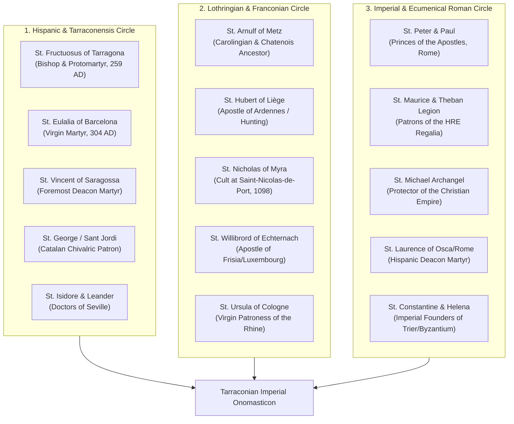
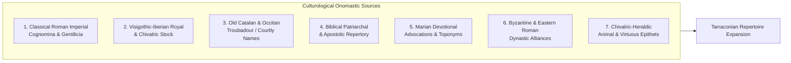

# Tarraconian Onomasticon & Personal Name Register (1154 Imperial Chancellery Standard)

> **Document Type:** Master Onomastic Register & Linguistic Concordance  
> **Culture:** Tarraconian (*Tarracono-Lothringian*, `ID 316` — 915 counties in 1154)  
> **Ethos & Heritage:** Courtly (`ethos_courtly`) | Central Germanic (`heritage_central_germanic`) | High German (`language_high_german`)  
> **Parentage:** Lothringian (`ID 249`, Franconian High German) + Catalan (`ID 82`, Old Catalan / Occitano-Romance)  
> **Imperial State:** The Roman Empire (*Dat Rômische Keiserrîch*, `h_roman_empire`)  
> **Active Localization Mod File:** `tarraconian_chancellery/localization/replace/english/tarraconian_character_names_l_english.yml`  

---

## 1. Sociolinguistic & Phonotactic Onomastic Framework

### 1.1 The "Reverse Frankish" Onomastic Synthesis
Formed on **31 August 989** through the hybridization of **Lothringian** (a bureaucratic Franconian culture speaking High German) and **Catalan** (a courtly Occitano-Romance culture of the Spanish March / *Hispania Tarraconensis*), **Tarraconian** onomastics represents a historical "reverse Frankish" scenario:
* Rather than abandoning their Germanic tongue for Romance, the imperial elite of House **Chatenois-Metz** retained **11th/12th-century Rhine-Moselle Franconian High German** (`name_list_franconian`), while filtering their personal names through **Catalan courtly phonology**, **Iberian orthography**, and **Hispano-Roman imperial prestige**.
* Following the restoration of **The Roman Empire** (*Dat Rômische Keiserrîch*) under **Kaiser Adémar "the Great"** and **Augustus Wernhard "the Bear"**, the onomastic repertoire expanded to integrate the apostolic, patriarchal, and imperial traditions of Rome, Constantinople, and the Mediterranean.

### 1.2 Core Phonotactic Laws Governing Personal Name Adaptation
Personal names in Tarraconian adhere strictly to the phonological and orthographic sound laws codified in the *Tarraconian Linguistic & Sound-Change Guide*:

1. **The Stress-to-Weight Condition & Vowel Lengthening (`â, ê, î, ô, û`):**
   Stressed syllables in open position are bimoraic ($\sigma_{\text{stressed}} \ge \mu\mu$) and take circumflexes (**Âdam**, **Âdolf**, **Bâldewîn**, **Frîderîch**, **Brûno**, **Hûgo**, **Lôthâr**, **Rôdolf**, **Ôtto**, **Êberhart**). Capital letters systematically retain circumflexes (**Â, Ê, Î, Ô, Û**). Stressed long vowels *î* `[iː]` and *û* `[uː]` have not diphthongized to *ei/au* as in New High German (**Sîcfrît**, **Frîderîch**, **Brûno**, **Kûno**).

2. **The Rhine-Moselle Franconian Consonant Profile:**
   * **Unshifted `p-` and `d-`:** Preserves unshifted initial `p-` (**Palz**, **Pôppo**, **Pêter**) and `d-` (**Dîtrîch**, **Dîtmar**, **Drôgo**) where Upper German shifted to *pf-* and *t-*.
   * **Shifted Affricates (`z-` initial vs. `-tz-` medial/final):** Initial `[ts]` is strictly written **`z-`**; medial and final `[ts]` is strictly written **`-tz-`** / **`-tz`** (**Frantz**, **Wentzel**, **Guntzelîn**, **Cônrât**). Modern transliteration `*ts-` is strictly illicit.
   * **Postvocalic `-k` -> `-ch`:** Shifted velar fricative appears systematically in the Germanic suffix **`-rîch`** `[riːç]` (**Alarîch**, **Alberîch**, **Amalrîch**, **Dîtrîch**, **Frîderîch**, **Heimrîch**, **Emmerîch**, **Theodorîch**, **Ulrîch**, **Wîgerîch**).
   * **Preservation of Early MHG `sw-, sl-, sm-, sn-`:** Sibilant clusters before sonorants do not undergo the New High German *sch-* merge.

3. **Universal Auslautverhärtung (Final Devoicing):**
   Across all etymological strata, word-final obstruents are strictly devoiced:
   * Word-final `-d` devoices to **`-t`**: *-hard / -ard* $\rightarrow$ **`-hart`** (**Adalhart**, **Bernhart**, **Gotthart**, **Meinhart**, **Reinhart**, **Sieghart**, **Wernhart**); *-bald / -pold* $\rightarrow$ **`-polt` / `-balt`** (**Dîtpolt**, **Liutpolt**, **Archembalt**); *-rad* $\rightarrow$ **`-rât / -rat`** (**Cônrât**, **Meinrat**); *-fried* $\rightarrow$ **`-frît`** (**Sîcfrît**, **Gotfrît**, **Êrenfrît**); *-brand* $\rightarrow$ **`-brant`** (**Liutbrant**); *-hold* $\rightarrow$ **`-holt`** (**Bertholt**, **Reinolt**); Biblical stems (**Dâvît**).
   * Word-final `-g` devoices to velar/palatal **`-ch`** `[x ~ ç]`: **Lôdewîch** / **Lûdewîch** (Ludwig), **Hartwîch** (Hartwig), **Hêdwîch** (Hedwig), **Heilwîch** (Heylwig), **Hildeburch** (Hildeburg), **Walpurch** (Walpurga).
   * Word-final `-b` devoices to **`-p`**: **Jâkop** (Jakob).

4. **Old Catalan & Occitan Courtly Admixture:**
   * Oxytone right-prominence on Romance/Catalan personal names ending in consonants: **Adémar** `[a.de.ˈmar]` (attested imperial name), **Berengâr** `[bə.rɛn.ˈɡaːr]`, **Arnolt** (Catalan *Arnau*), **Guilhem** / **Wilhelm**.
   * Suffixes and palatals: Catalan `ny` $\rightarrow$ **`nj`** `[ɲ]`, `tg/j` $\rightarrow$ **`dsch`** `[dʒ]` initially/medially (**Dschôrdi** for Sant Jordi), voiceless **`tsch`** finally.

5. **Feminine Morphology & Final Vowel Reduction:**
   * Latin/Romance unstressed final `-a` systematically reduces to High German schwa **`-e`** `[ə]` (**Âdele**, **Barbere**, **Clâre**, **Dôrôthêe**, **Emme**, **Frîde**, **Helge**, **Îde**, **Inge**, **Jûtte**, **Marîe**, **Ôde**, **Ûte**, **Ûrsele**).
   * Germanic compound feminine stems undergo regular devoicing and lenition: *-gard* $\rightarrow$ **`-gart`** (**Hildegart**, **Irmengart**, **Liutgart**); *-trud* $\rightarrow$ **`-drût` / `-trût`** (**Gerdrût**, **Engeldrût**, **Ingeldrût**, **Îsendrût**, **Wîltrût**); *-hild* $\rightarrow$ **`-hilt`** (**Brûnhilt**, **Gunthilt**, **Chriemhilt**, **Wulfhilt**); *-burg* $\rightarrow$ **`-burch`** (**Hildeburch**, **Walpurch**); *-gund* $\rightarrow$ **`-gunt`** (**Kûnigunt**); *-heid* $\rightarrow$ **`-heit`** (**Âdelheit**).

---

## 2. Master Register of Currently Registered Personal Names (239 Names)

The 239 names currently registered under `name_list_franconian` in vanilla Crusader Kings III have been revised below through Tarraconian phonotactics and orthography. Each entry provides the vanilla key, standard name, revised Tarraconian form, IPA transcription, and etymological / phonological derivation.

### 2.1 Male Personal Names (160 Names)

| # | CK3 Key | Vanilla Name | Tarraconian Chancellery Name | IPA Transcription | Etymological Derivation & Phonological Laws |
| :---: | :--- | :--- | :--- | :--- | :--- |
| 1 | `Adalbero` | **Adalbero** | **Âdalbêro** | `[ˈaː.dal.beː.ro]` | OHG adal ('noble') + bero ('bear'). Stressed open vowels lengthened with circumflex Â- and -ê-. |
| 2 | `Adalbert` | **Adalbert** | **Âdalbert** | `[ˈaː.dal.bɛrt]` | OHG adal ('noble') + berht ('bright'). Open initial Â- lengthened; Rhine Franconian unshifted -b-. |
| 3 | `Adalgod` | **Adalgod** | **Âdalgot** | `[ˈaː.dal.ɡɔt]` | OHG adal ('noble') + Gaut ('Geat/Goth'). Final -d devoices to -t via Auslautverhärtung. |
| 4 | `Adalhard` | **Adalhard** | **Âdalhart** | `[ˈaː.dal.hart]` | OHG adal ('noble') + hard ('hard/brave'). Auslautverhärtung -d -> -t. |
| 5 | `Adam` | **Adam** | **Âdam** | `[ˈaː.dam]` | Biblical Hebrew ('earth/man'). Stressed open vowel lengthened to Â-. |
| 6 | `Ademar` | **Ademar** | **Adémar** | `[a.de.ˈmar]` | Old Catalan/Occitan Ademar (OHG Audamar 'wealth-famous'). Imperial house name; oxytone stress, attested with acute in imperial annals. |
| 7 | `Adolf` | **Adolf** | **Âdolf** | `[ˈaː.dɔlf]` | OHG adal ('noble') + wolf ('wolf'). Stressed initial open Â- lengthened. |
| 8 | `Alarich` | **Alarich** | **Alarîch** | `[a.la.ˈriːç]` | Gothic/OHG All-rich ('ruler of all'). Final -ric shifted to -rîch with long î. |
| 9 | `Alberich` | **Alberich** | **Alberîch** | `[ˈal.bə.riːç]` | OHG alb ('elf') + rīhhi ('ruler'). Post-vocalic -k shifted to -ch; long -îch. |
| 10 | `Albrecht` | **Albrecht** | **Âlbrecht** | `[ˈaːl.brɛçt]` | Contracted variant of Adalbert. Stressed open Â- lengthened. |
| 11 | `Amadeus` | **Amadeus** | **Amadêe** | `[a.ma.ˈdeː.ə]` | Latin Amadeus ('love God'). Romance/Latin final -us reduced to Tarraconian schwa -êe per Rule 2. |
| 12 | `Amalrich` | **Amalrich** | **Amalrîch** | `[a.mal.ˈriːç]` | Gothic/Amal royal stem + rīhhi ('mighty ruler'). Suffix -rîch with long î. |
| 13 | `Andreas` | **Andreas** | **Andrêas** | `[an.ˈdreː.as]` | Greek Andreas ('manly'). Penultimate vowel lengthened to -ê- under stress. |
| 14 | `Anno` | **Anno** | **Ânno** | `[ˈaː.no]` | Short hypocoristic of Arn- / Arnold. Stressed open Â- lengthened. |
| 15 | `Anselm` | **Anselm** | **Anshelm** | `[ˈans.hɛlm]` | OHG Ans ('god') + helm ('helmet'). Standard Franconian compound. |
| 16 | `Ansgar` | **Ansgar** | **Ansgâr** | `[ˈans.ɡaːr]` | OHG Ans ('god') + gēr ('spear'). Stressed heavy suffix -gâr. |
| 17 | `Archembald` | **Archembald** | **Archembalt** | `[ar.çəm.ˈbalt]` | OHG ercan ('genuine/precious') + bald ('bold'). Auslautverhärtung -d -> -t. |
| 18 | `Arnold` | **Arnold** | **Arnolt** | `[ˈar.nɔlt]` | OHG arn ('eagle') + wald ('ruler'). Auslautverhärtung -d -> -t; corresponds to Catalan Arnau. |
| 19 | `Arnulf` | **Arnulf** | **Arnolf** | `[ˈar.nɔlf]` | OHG arn ('eagle') + wolf ('wolf'). Dynastic saint of Metz; Franconian/Romance vowel rounding -olf. |
| 20 | `Augustin` | **Augustin** | **Augustîn** | `[ɔʊ.ɡʊs.ˈtiːn]` | Latin Augustinus ('venerable'). Stressed final long -în per Rule 2/6. |
| 21 | `Baldarich` | **Baldarich** | **Bâldarîch** | `[ˈbaːl.da.riːç]` | OHG bald ('bold') + rīhhi ('ruler'). Open Â- and -rîch. |
| 22 | `Baldewin` | **Baldewin** | **Bâldewîn** | `[ˈbaːl.də.wiːn]` | OHG bald ('bold') + wīn ('friend'). Preserved long -wîn (Baudouin/Baldwin). |
| 23 | `Baldomar` | **Baldomar** | **Bâldomâr** | `[ˈbaːl.dɔ.maːr]` | OHG bald ('bold') + māri ('famous'). Double circumflex on stressed bimoraic roots. |
| 24 | `Baldur` | **Baldur** | **Bâldur** | `[ˈbaːl.dʊr]` | Old Norse/Germanic Baldr ('lord/prince'). Initial Â- lengthened. |
| 25 | `Berard` | **Berard** | **Bêrart** | `[ˈbeː.rart]` | Romance/Franconian Bernhard hypocoristic. Auslautverhärtung -d -> -t. |
| 26 | `Berengar` | **Berengar** | **Berengâr** | `[bə.rɛn.ˈɡaːr]` | Catalan/Occitan Berenguer (OHG Beringar). Heavy final stress -gâr. |
| 27 | `Bernhard` | **Bernhard** | **Bernhart** | `[ˈbɛrn.hart]` | OHG bern ('bear') + hard ('brave'). Auslautverhärtung -d -> -t; Catalan Bernat. |
| 28 | `Berthold` | **Berthold** | **Bertholt** | `[ˈbɛr.tɔlt]` | OHG berht ('bright') + wald ('rule'). Auslautverhärtung -d -> -t. |
| 29 | `Bruno` | **Bruno** | **Brûno** | `[ˈbruː.no]` | OHG brūn ('brown/shining'). Preserved MHG unshifted long û. |
| 30 | `Burchard` | **Burchard** | **Burchart** | `[ˈbʊrx.art]` | OHG burg ('fortress') + hard ('strong'). Shifted post-vocalic -ch- and Auslautverhärtung -t. |
| 31 | `Christopher` | **Christopher** | **Chrîstof** | `[ˈkriː.stɔf]` | Greek Christophoros ('Christ-bearer'). Apocopated final syllable per Rule 2; initial Ch-. |
| 32 | `Dieter` | **Dieter** | **Dîter** | `[ˈdiː.tər]` | Hypocoristic of Dietrich. Preserved unshifted Franconian D-; long î. |
| 33 | `Dietmar` | **Dietmar** | **Dîtmar** | `[ˈdiːt.mar]` | OHG thiot ('people') + māri ('famous'). Preserved D-; long î. |
| 34 | `Dietpold` | **Dietpold** | **Dîtpolt** | `[ˈdiːt.pɔlt]` | OHG thiot ('people') + bald ('bold'). Franconian D-; Auslautverhärtung -t. |
| 35 | `Dietrich` | **Dietrich** | **Dîtrîch** | `[ˈdiː.trɪç]` | OHG thiot ('people') + rīhhi ('ruler'). Classical Franconian D- and -rîch. |
| 36 | `Dietwin` | **Dietwin** | **Dîtwîn** | `[ˈdiːt.wiːn]` | OHG thiot ('people') + wīn ('friend'). Preserved D- and long -wîn. |
| 37 | `Drogo` | **Drogo** | **Drôgo** | `[ˈdroː.ɣo]` | Old Franconian name of Carolingian princes; lenition of medial -g- [ɣ]; long Ô-. |
| 38 | `Eberhard` | **Eberhard** | **Êberhart** | `[ˈeː.bər.hart]` | OHG ebur ('boar') + hard ('brave'). Stressed initial open Ê-; Auslautverhärtung -t. |
| 39 | `Eginolf` | **Eginolf** | **Êginolf** | `[ˈeː.ɡɪ.nɔlf]` | OHG egin ('blade/edge') + wolf ('wolf'). Initial Ê- lengthened; rounded -olf. |
| 40 | `Ehrenfried` | **Ehrenfried** | **Êrenfrît** | `[ˈeː.rən.friːt]` | OHG ēra ('honor') + fridu ('peace'). Initial Ê-; long unshifted -frît. |
| 41 | `Ekbert` | **Ekbert** | **Ekbert** | `[ˈɛk.bɛrt]` | OHG egga ('edge') + berht ('bright'). Preserved cluster -kb-. |
| 42 | `Ekkehard` | **Ekkehard** | **Ekkehart** | `[ˈɛ.kə.hart]` | OHG egga ('edge') + hard ('brave'). Auslautverhärtung -d -> -t. |
| 43 | `Emelrich` | **Emelrich** | **Emelrîch** | `[ˈɛ.məl.riːç]` | OHG amal ('work/vigor') + rīhhi ('ruler'). Post-vocalic shifted -rîch. |
| 44 | `Emich` | **Emich** | **Êmîch** | `[ˈeː.miːç]` | Franconian hypocoristic of Emmerich. Vowels lengthened under bimoraic constraint. |
| 45 | `Emmerich` | **Emmerich** | **Emmerîch** | `[ˈɛ.mə.riːç]` | OHG Amalrich ('ruler of work'). Shifted suffix -rîch. |
| 46 | `Emund` | **Emund** | **Êmunt** | `[ˈeː.mʊnt]` | OHG ewa ('law/eternity') + mund ('protection'). Auslautverhärtung -d -> -t. |
| 47 | `Engelbert` | **Engelbert** | **Engelbert** | `[ˈɛŋ.əl.bɛrt]` | OHG Angil ('Angle/angel') + berht ('bright'). Standard Franconian form. |
| 48 | `Erich` | **Erich** | **Êrîch** | `[ˈeː.riːç]` | Old Norse Eiríkr / OHG Era-rīhhi ('sole ruler'). Initial Ê-; long -rîch. |
| 49 | `Ernst` | **Ernst** | **Ernst** | `[ˈɛrnst]` | OHG ernust ('vigor/earnestness'). Preserved heavy coda -rnst. |
| 50 | `Ezzo` | **Ezzo** | **Etzo** | `[ˈɛ.tso]` | Franconian hypocoristic (count palatine of Lotharingia). Medial affricate -tz- per Rule 2.2/5. |
| 51 | `Farabert` | **Farabert** | **Fârabert** | `[ˈfaː.ra.bɛrt]` | OHG fara ('lineage/travel') + berht ('bright'). Initial open Fâ-. |
| 52 | `Ferdinand` | **Ferdinand** | **Ferdinant** | `[ˈfɛr.dɪ.nant]` | Visigothic Frithunanth ('peace-daring'). Auslautverhärtung -d -> -t; variant Fredenant. |
| 53 | `Filibert` | **Filibert** | **Fîlibert** | `[ˈfiː.lɪ.bɛrt]` | OHG filu ('much') + berht ('bright'). Open initial Fî- lengthened. |
| 54 | `Folkhard` | **Folkhard** | **Folkhart** | `[ˈfɔlk.hart]` | OHG folk ('people') + hard ('brave'). Auslautverhärtung -d -> -t. |
| 55 | `Folkmar` | **Folkmar** | **Folkmâr** | `[ˈfɔlk.maːr]` | OHG folk ('people') + māri ('famous'). Heavy suffix -mâr. |
| 56 | `Folmar` | **Folmar** | **Folmâr** | `[ˈfɔl.maːr]` | Contracted variant of Folkmar (counts of Blieskastel/Metz). |
| 57 | `Franz` | **Franz** | **Frantz** | `[frants]` | OHG/Romance Franciscus ('Frankish/free'). Affricate strictly written -tz per Rule 2.2. |
| 58 | `Friedrich` | **Friedrich** | **Frîderîch** | `[ˈfriː.də.riːç]` | OHG fridu ('peace') + rīhhi ('ruler'). Preserved MHG unshifted long î; -rîch. |
| 59 | `GU_nther` | **Günther** | **Günther** | `[ˈɡʏn.tər]` | OHG gund ('battle') + heri ('army'). Umlauted close front rounded ü; interdental th -> t. |
| 60 | `Gautselin` | **Gautselin** | **Gautzelîn** | `[ɡɔʊ.tsə.ˈliːn]` | Old Catalan/Occitan Gaucelm / OHG Gautila. Medial affricate -tz-; long suffix -în. |
| 61 | `Gebhard` | **Gebhard** | **Gebhart** | `[ˈɡɛp.hart]` | OHG geba ('gift') + hard ('brave'). Auslautverhärtung -d -> -t. |
| 62 | `Georg` | **Georg** | **Dschôrdi** | `[ˈdʒɔːr.di]` | Patron knight of Catalonia (Sant Jordi); Chancellery form Dschôrdi or German Jôrch / Georg [ˈɡeː.ɔrx]. |
| 63 | `Gerhard` | **Gerhard** | **Gerhart** | `[ˈɡɛr.hart]` | OHG gēr ('spear') + hard ('brave'). Auslautverhärtung -d -> -t; Catalan Guerau. |
| 64 | `Gerlach` | **Gerlach** | **Gêrlach** | `[ˈɡeːr.lax]` | OHG gēr ('spear') + leih ('play/dance'). Long initial Gêr-. |
| 65 | `Giselbert` | **Giselbert** | **Gîselbert** | `[ˈɡiː.zəl.bɛrt]` | OHG gīsal ('pledge/hostage') + berht ('bright'). Duke of Lotharingia; long Gî-. |
| 66 | `Gottfried` | **Gottfried** | **Gotfrît** | `[ˈɡɔt.friːt]` | OHG got ('God') + fridu ('peace'). Cluster simplification and Auslautverhärtung -frît; Catalan Jofre. |
| 67 | `Gotthard` | **Gotthard** | **Gotthart** | `[ˈɡɔt.hart]` | OHG got ('God') + hard ('brave'). Auslautverhärtung -d -> -t. |
| 68 | `Gottschalk` | **Gottschalk** | **Gotschalc** | `[ˈɡɔt.ʃalk]` | OHG got ('God') + scale ('servant'). Classical Franconian orthography. |
| 69 | `Gotzelo` | **Gotzelo** | **Gôtzelo** | `[ˈɡoː.tsə.lo]` | Lothringian ducal hypocoristic of Gottfried. Medial affricate -tz-; long Ô-. |
| 70 | `Guntram` | **Guntram** | **Guntram** | `[ˈɡʊn.tram]` | OHG gund ('battle') + hraban ('raven'). Attested Chatenois dynastic name; closed syllable. |
| 71 | `Gunzelin` | **Gunzelin** | **Guntzelîn** | `[ˈɡʊn.tsə.liːn]` | Hypocoristic of Gunther/Guntram. Medial affricate -tz-; suffix -în. |
| 72 | `Hans` | **Hans** | **Hâns** | `[haːns]` | Hypocoristic of Johannes. Vowel lengthened before -ns coda. |
| 73 | `Hardwin` | **Hardwin** | **Hardwîn** | `[ˈhart.wiːn]` | OHG hard ('brave') + wīn ('friend'). Preserved long -wîn. |
| 74 | `Hartmann` | **Hartmann** | **Hartmann** | `[ˈhart.man]` | OHG hard ('brave') + man ('man'). Preserved geminate -nn. |
| 75 | `Hartwig` | **Hartwig** | **Hartwîch** | `[ˈhart.wiːç]` | OHG hard ('brave') + wīg ('battle'). Final -g devoices to -ch via Auslautverhärtung. |
| 76 | `Hatto` | **Hatto** | **Hâtto** | `[ˈhaː.to]` | Franconian hypocoristic of Hadu- ('battle'). Open initial Hâ-. |
| 77 | `Heinrich` | **Heinrich** | **Heimrîch** | `[ˈhɛɪm.riːç]` | OHG heim ('home') + rīhhi ('ruler'). Rhine-Moselle Franconian Heimrîch / Hênrîch; -rîch. |
| 78 | `Helferich` | **Helferich** | **Helferîch** | `[ˈhɛl.fə.riːç]` | OHG helfa ('help') + rīhhi ('ruler'). Post-vocalic shifted -rîch. |
| 79 | `Heribert` | **Heribert** | **Hêrîbert** | `[ˈheː.riː.bɛrt]` | OHG heri ('army') + berht ('bright'). Open vowels lengthened Hêrî-. |
| 80 | `Hermann` | **Hermann** | **Hermann** | `[ˈhɛr.man]` | OHG heri ('army') + man ('man'). Standard Germanic compound. |
| 81 | `Herold` | **Herold** | **Hêrolt** | `[ˈheː.rɔlt]` | OHG heri ('army') + wald ('ruler'). Auslautverhärtung -d -> -t. |
| 82 | `Hesso` | **Hesso** | **Hêsso** | `[ˈheː.so]` | Franconian/Hessian hypocoristic. Long vowel before geminate. |
| 83 | `Hoger` | **Hoger** | **Hôger** | `[ˈhoː.ɣər]` | OHG hōh ('high') + gēr ('spear'). Lenited medial -g- [ɣ]; long Hô-. |
| 84 | `Hugo` | **Hugo** | **Hûgo** | `[ˈhuː.ɣo]` | OHG hugu ('mind/spirit'). Preserved long û; lenited medial -g- [ɣ]; Catalan Hug. |
| 85 | `Humbert` | **Humbert** | **Humbert** | `[ˈhʊm.bɛrt]` | OHG hūn ('bear cub/giant') + berht ('bright'). Standard Franconian form. |
| 86 | `Hupold` | **Hupold** | **Hûpolt** | `[ˈhuː.pɔlt]` | OHG hugu ('mind') + bald ('bold'). Auslautverhärtung -d -> -t; long Hû-. |
| 87 | `Iwo` | **Iwo** | **Îwo** | `[ˈiː.wo]` | Celtic/Germanic Ivo (īwaz 'yew/bow'). Preserved long Î-. |
| 88 | `JU_rgen` | **Jürgen** | **Jürgen** | `[ˈjʏr.ɣən]` | Low German/Franconian variant of Georg. Medial lenited -g- [ɣ]. |
| 89 | `Jakob` | **Jakob** | **Jâkop** | `[ˈjaː.kɔp]` | Hebrew Ya'aqov ('supplanter'). Auslautverhärtung -b -> -p; long Jâ-. |
| 90 | `Johann` | **Johann** | **Johann** | `[ˈjoː.han]` | Hebrew Yohanan ('God is gracious'). Imperial chancellery form Johann / Jôhân. |
| 91 | `Karl` | **Karl** | **Kârl** | `[kaːrl]` | OHG karl ('free man'). Lengthened before liquid coda cluster -rl. |
| 92 | `Karlmann` | **Karlmann** | **Kârlmann** | `[ˈkaːrl.man]` | Carolingian royal compound Karl + mann. |
| 93 | `Kaspar` | **Kaspar** | **Kaspâr** | `[kas.ˈpaːr]` | Persian Gaspar ('treasurer'). Heavy final stress -pâr. |
| 94 | `Konrad` | **Konrad** | **Cônrât** | `[ˈkoːn.raːt]` | OHG kuoni ('bold') + rāt ('counsel'). Imperial Latin-Franconian Cônrât / Konrat; -d -> -t. |
| 95 | `Kuno` | **Kuno** | **Kûno** | `[ˈkuː.no]` | Hypocoristic of Konrad. Preserved long û. |
| 96 | `Lambert` | **Lambert** | **Lampert** | `[ˈlam.pərt]` | OHG land ('land') + berht ('bright'). Patron of Maastricht/Liège; Franconian unshifted -p-. |
| 97 | `Landolf` | **Landolf** | **Landolf** | `[ˈlan.dɔlf]` | OHG land ('land') + wolf ('wolf'). Standard Franconian compound. |
| 98 | `Leopold` | **Leopold** | **Lîpolt** | `[ˈliː.pɔlt]` | OHG liut ('people') + bald ('bold'). Franconian contracted Lîpolt / Lîopold; -t. |
| 99 | `Liudolf` | **Liudolf** | **Liudolf** | `[ˈliʊ.dɔlf]` | OHG liut ('people') + wolf ('wolf'). Saxon/Franconian royal stem. |
| 100 | `Liutbert` | **Liutbert** | **Liutbert** | `[ˈliʊt.bɛrt]` | OHG liut ('people') + berht ('bright'). Preserved diphthong iu. |
| 101 | `Liutbrand` | **Liutbrand** | **Liutbrant** | `[ˈliʊt.brant]` | OHG liut ('people') + brand ('sword'). Auslautverhärtung -d -> -t. |
| 102 | `Liutpold` | **Liutpold** | **Liutpolt** | `[ˈliʊt.pɔlt]` | OHG liut ('people') + bald ('bold'). Attested Chatenois name; Auslautverhärtung -t. |
| 103 | `Lothar` | **Lothar** | **Lôthâr** | `[ˈloː.taːr]` | OHG hluod ('fame') + heri ('army'). Eponym of Lotharingia; double circumflex Lôthâr. |
| 104 | `Ludolf` | **Ludolf** | **Lûdolf** | `[ˈluː.dɔlf]` | Variant of Liudolf with monophthongized long û. |
| 105 | `Ludwig` | **Ludwig** | **Lôdewîch** | `[ˈloː.də.wiːç]` | OHG hluod ('fame') + wīg ('battle'). Auslautverhärtung -g -> -ch; Rhine-Franconian Lôdewîch / Lûdewîch. |
| 106 | `Lutbert` | **Lutbert** | **Lûtprecht** | `[ˈluːt.prɛçt]` | OHG liut ('people') + berht ('bright'). Upper Franconian unshifted -p-. |
| 107 | `Magnus` | **Magnus** | **Magnus** | `[ˈmaɡ.nʊs]` | Latin Magnus ('great'). Imperial court title adopted as given name. |
| 108 | `Manegold` | **Manegold** | **Manegolt** | `[ˈma.nə.ɡɔlt]` | OHG manag ('many') + wald ('rule'). Auslautverhärtung -d -> -t. |
| 109 | `Manfred` | **Manfred** | **Manfrît** | `[ˈman.friːt]` | OHG manag ('many') + fridu ('peace'). Auslautverhärtung -d -> -t; long -frît. |
| 110 | `Markward` | **Markward** | **Markwart** | `[ˈmark.wart]` | OHG marka ('border/march') + ward ('guardian'). Auslautverhärtung -d -> -t. |
| 111 | `Martin` | **Martin** | **Martîn** | `[mar.ˈtiːn]` | Latin Martinus ('of Mars'). Patron of the Franks; stressed final long -în. |
| 112 | `Matthias` | **Matthias** | **Matthîas** | `[ma.ˈtiː.as]` | Hebrew Mattityahu ('gift of God'). Penultimate vowel lengthened. |
| 113 | `Meginhard` | **Meginhard** | **Meginhart** | `[ˈmeː.ɡɪn.hart]` | OHG magan ('strength') + hard ('brave'). Auslautverhärtung -d -> -t. |
| 114 | `Meginher` | **Meginher** | **Mêginher** | `[ˈmeː.ɡɪn.hɛr]` | OHG magan ('strength') + heri ('army'). Long initial Mê-. |
| 115 | `Meinhard` | **Meinhard** | **Meinhart** | `[ˈmɛɪn.hart]` | Contracted variant of Meginhard. Auslautverhärtung -d -> -t. |
| 116 | `Michael` | **Michael** | **Mîchaêl** | `[ˈmiː.xa.eːl]` | Hebrew Mikha'el ('who is like God?'). Archangel, patron of the Empire; -ch-. |
| 117 | `Milo` | **Milo** | **Mîlo** | `[ˈmiː.lo]` | Old Frankish/Romance hypocoristic. Preserved long Î-. |
| 118 | `Nikolaus` | **Nikolaus** | **Nîkôlôs** | `[niː.koː.ˈloːs]` | Greek Nikolaos ('victory of the people'). Patron of Lotharingia; long vowels Nîkôlôs / Niklâs. |
| 119 | `Norbert` | **Norbert** | **Norbert** | `[ˈnɔr.bɛrt]` | OHG nord ('north') + berht ('bright'). Founder of Premonstratensians (Xanten/Lorraine). |
| 120 | `Otbert` | **Otbert** | **Ôtpert** | `[ˈoːt.pɛrt]` | OHG ōd ('wealth') + berht ('bright'). Open initial Ô-; unshifted -p-. |
| 121 | `Otto` | **Otto** | **Ôtto** | `[ˈoː.to]` | OHG ōd ('wealth'). Imperial Saxon/Franconian name; open initial Ô- lengthened. |
| 122 | `Peter` | **Peter** | **Pêter** | `[ˈpeː.tər]` | Greek Petros ('rock'). Prince of the Apostles; Franconian unshifted P-; long Pê- (Catalan Pere). |
| 123 | `Philipp` | **Philipp** | **Phîlîpp** | `[ˈfiː.liːp]` | Greek Philippos ('horse lover'). Royal Capetian/Imperial name; long vowels Phîlîpp. |
| 124 | `Poppo` | **Poppo** | **Pôppo** | `[ˈpoː.po]` | Franconian/Babenberg hypocoristic. Rhine Franconian unshifted P-; long Pô-. |
| 125 | `Radbot` | **Radbot** | **Râtbôt** | `[ˈraːt.boːt]` | OHG rāt ('counsel') + bodo ('messenger'). Auslautverhärtung -d -> -t; long vowels Râtbôt. |
| 126 | `Reginar` | **Reginar** | **Rêginâr** | `[ˈreː.ɡɪ.naːr]` | OHG ragin ('counsel') + heri ('army'). Ancestral dynasty of Lotharingia (House of Reginar). |
| 127 | `Reinhard` | **Reinhard** | **Reinhart** | `[ˈrɛɪn.hart]` | OHG ragin ('counsel') + hard ('brave'). Auslautverhärtung -d -> -t. |
| 128 | `Reinhold` | **Reinhold** | **Reinolt** | `[ˈrɛɪ.nɔlt]` | OHG ragin ('counsel') + wald ('ruler'). Auslautverhärtung -d -> -t. |
| 129 | `Rudolf` | **Rudolf** | **Rôdolf** | `[ˈroː.dɔlf]` | OHG hruod ('fame') + wolf ('wolf'). West Franconian Rôdolf / Rûdolf. |
| 130 | `Ruprecht` | **Ruprecht** | **Rôprecht** | `[ˈroː.prɛçt]` | OHG hruod ('fame') + berht ('bright'). Palatine Franconian Rôprecht. |
| 131 | `Rutger` | **Rutger** | **Rôtger** | `[ˈroːt.ɡər]` | OHG hruod ('fame') + gēr ('spear'). Preserved dental stop -t-; long Rôt-. |
| 132 | `Siegfried` | **Siegfried** | **Sîcfrît** | `[ˈziːk.friːt]` | OHG sigu ('victory') + fridu ('peace'). Unshifted MHG long î; devoiced -c- and -frît. |
| 133 | `Sieghard` | **Sieghard** | **Sîchart** | `[ˈziːk.hart]` | OHG sigu ('victory') + hard ('brave'). Attested Chatenois dynastic name; Auslautverhärtung -t. |
| 134 | `Siegmund` | **Siegmund** | **Sîchmunt** | `[ˈziːk.mʊnt]` | OHG sigu ('victory') + mund ('protection'). Auslautverhärtung -d -> -t. |
| 135 | `Sigismund` | **Sigismund** | **Sîgismunt** | `[ˈziː.ɡɪs.mʊnt]` | Burgundian/Imperial saint name; Auslautverhärtung -d -> -t. |
| 136 | `Simon` | **Simon** | **Sîmôn** | `[ziː.ˈmoːn]` | Hebrew Shim'on ('he has heard'). Stressed long vowels Sîmôn. |
| 137 | `Stefan` | **Stefan** | **Steffan** | `[ˈʃtɛ.fan]` | Greek Stephanos ('crown'). Protomartyr; Franconian geminate ff; Catalan Esteve. |
| 138 | `Tagino` | **Tagino** | **Tâgîn** | `[ˈtaː.ɣiːn]` | OHG tag ('day'). Lengthened open Tâ-; suffix -în. |
| 139 | `Thachulf` | **Thachulf** | **Dacholf** | `[ˈda.xɔlf]` | OHG daha ('clay/tough') + wolf ('wolf'). Franconian unshifted D-; -ch-. |
| 140 | `Thankulf` | **Thankulf** | **Dankolf** | `[ˈdaŋ.kɔlf]` | OHG thank ('thought/gratitude') + wolf ('wolf'). Franconian D-; rounded -olf. |
| 141 | `Theodorich` | **Theodorich** | **Theodorîch** | `[te.o.do.ˈriːç]` | Greek/Gothic Ostrogothic royal name; long -rîch. |
| 142 | `Thietmar` | **Thietmar** | **Dîtmar** | `[ˈdiːt.mar]` | OHG thiot ('people') + māri ('famous'). Classical Franconian Dîtmar with long î. |
| 143 | `Thomas` | **Thomas** | **Thômâs** | `[toː.ˈmaːs]` | Aramaic Te'oma ('twin'). Stressed double circumflex Thômâs. |
| 144 | `Udalrich` | **Udalrich** | **Udalrîch** | `[ˈuː.dal.riːç]` | OHG uodal ('heritage') + rīhhi ('ruler'). Long U- and -rîch. |
| 145 | `Ulrich` | **Ulrich** | **Ulrîch** | `[ˈʊl.riːç]` | Contracted variant of Udalrich. Shifted suffix -rîch. |
| 146 | `Viktor` | **Viktor** | **Vîktôr** | `[vɪk.ˈtoːr]` | Latin Victor ('conqueror'). Romance loan with labiodental V- [v]; long -tôr. |
| 147 | `Waldemar` | **Waldemar** | **Wâldemâr** | `[ˈwaːl.də.maːr]` | Slavic Vladimir / Germanic Waldemar ('fame-ruler'). Double circumflex Wâldemâr. |
| 148 | `Walram` | **Walram** | **Walram** | `[ˈwal.ram]` | OHG walah ('foreigner/Romance') + hraban ('raven'). Counts of Arlon/Limburg. |
| 149 | `Walter` | **Walter** | **Walter** | `[ˈwal.tər]` | Standard spelling variant of Walther. |
| 150 | `Walther` | **Walther** | **Walther** | `[ˈwal.tər]` | OHG wald ('rule') + heri ('army'). High German epic hero (Walther von Aquitanien). |
| 151 | `Welf` | **Welf** | **Welf** | `[wɛlf]` | Germanic Welf ('whelp/wolf cub'). Dynastic royal stem. |
| 152 | `Wenzel` | **Wenzel** | **Wentzel** | `[ˈvɛn.tsəl]` | Slavic Václav / MHG Wenzel. Affricate strictly written -tz- per Rule 2.2. |
| 153 | `Werner` | **Werner** | **Werner** | `[ˈwɛr.nər]` | OHG warin ('guard') + heri ('army'). Standard Franconian form. |
| 154 | `Wernhard` | **Wernhard** | **Wernhard** | `[ˈwɛrn.hart]` | OHG warin ('guard') + hard ('brave'). Name of Augustus Wernhard 'the Bear'; -d -> -t in speech, written -hard in imperial charter. |
| 155 | `Wido` | **Wido** | **Wîdo** | `[ˈwiː.do]` | OHG witu ('wood/forest'). French Guy / Italian Guido; long Wî-. |
| 156 | `Wigerich` | **Wigerich** | **Wîgerîch** | `[ˈwiː.ɣə.riːç]` | OHG wīg ('battle') + rīhhi ('ruler'). Count palatine of Lotharingia; long Wî- and -rîch. |
| 157 | `Wilbert` | **Wilbert** | **Wilbert** | `[ˈwɪl.bɛrt]` | OHG willio ('will') + berht ('bright'). Standard Franconian form. |
| 158 | `Wilhelm` | **Wilhelm** | **Wilhelm** | `[ˈwɪl.hɛlm]` | OHG willio ('will') + helm ('helmet'). Corresponds to Catalan Guilhem. |
| 159 | `Wolfgang` | **Wolfgang** | **Wolfgang** | `[ˈwɔlf.ɡaŋ]` | OHG wolf ('wolf') + gang ('stride/path'). Saint bishop of Regensburg. |
| 160 | `Wolfram` | **Wolfram** | **Wolfram** | `[ˈwɔlf.ram]` | OHG wolf ('wolf') + hraban ('raven'). Chivalric epic poet name. |

### 2.2 Female Personal Names (79 Names)

| # | CK3 Key | Vanilla Name | Tarraconian Chancellery Name | IPA Transcription | Etymological Derivation & Phonological Laws |
| :---: | :--- | :--- | :--- | :--- | :--- |
| 1 | `Adela` | **Adela** | **Âdele** | `[ˈaː.də.lə]` | OHG adal ('noble'). Stressed open Â- lengthened; final -a reduced to High German schwa -e. |
| 2 | `Adelheid` | **Adelheid** | **Âdelheit** | `[ˈaː.dəl.hɛɪt]` | OHG adal ('noble') + heit ('kind/state'). Auslautverhärtung -d -> -t; corresponds to French/Catalan Adélaïde / Azalaïs. |
| 3 | `Adelinde` | **Adelinde** | **Âdelînde** | `[ˈaː.də.liːn.də]` | OHG adal ('noble') + lindi ('gentle/serpent'). Stressed long -lînde. |
| 4 | `Agathe` | **Agathe** | **Âgathe** | `[ˈaː.ɡa.tə]` | Greek Agathe ('good'). Open initial Â- lengthened. |
| 5 | `Agnes` | **Agnes** | **Agnês** | `[aŋ.ˈneːs]` | Greek Hagne ('pure'). Stressed oxytone -ês; Occitan/Catalan Anjês [a.ˈɲeːs]. |
| 6 | `Alberade` | **Alberade** | **Alberâde** | `[ˈal.bə.raː.də]` | OHG alb ('elf') + rāt ('counsel'). Stressed open -râde lengthened. |
| 7 | `Amalberga` | **Amalberga** | **Amalberge** | `[a.mal.ˈbɛr.ɡə]` | Gothic/Amal stem + berg ('protection'). Final -a reduced to schwa -e. |
| 8 | `Amalie` | **Amalie** | **Âmâlie** | `[a.ˈmaː.liə]` | Gothic Amal ('work/vigor'). Open -mâ- lengthened under stress. |
| 9 | `Barbara` | **Barbara** | **Barbere** | `[ˈbar.bə.rə]` | Greek Barbara ('foreign'). Final unstressed -a reduced to schwa -e per Rule 2. |
| 10 | `Beatrix` | **Beatrix** | **Bêatrîx** | `[beː.a.ˈtriːks]` | Latin Beatrix ('she who blesses'). Stressed long -trîx; Catalan Bêatrîs. |
| 11 | `Benedicta` | **Benedicta** | **Bênêdîcte** | `[beː.nə.ˈdiːk.tə]` | Latin Benedicta ('blessed'). Stressed long -dîc-; final -e. |
| 12 | `Berchte` | **Berchte** | **Berchte** | `[ˈbɛrx.tə]` | OHG berht ('bright'). Pre-Christian light goddess / Franconian name; -ch-. |
| 13 | `Berta` | **Berta** | **Berte** | `[ˈbɛr.tə]` | OHG berht ('bright'). Carolingian queen name; final -a reduced to schwa -e. |
| 14 | `Brunhilde` | **Brunhilde** | **Brûnhilt** | `[ˈbruːn.hɪlt]` | OHG brūna ('armor/brown') + hiltia ('battle'). Preserved long û; Auslautverhärtung -d -> -t. |
| 15 | `Cecilie` | **Cecilie** | **Cêcîlie** | `[tseː.ˈtsiː.liə]` | Latin Caecilia ('blind'). Initial affricate C- [ts]; long -cî-. |
| 16 | `Christine` | **Christine** | **Chrîstîne** | `[kriː.ˈstiː.nə]` | Greek Christiane ('follower of Christ'). Initial Ch- [k]; long vowels Chrîstîne. |
| 17 | `Cothilda` | **Cothilda** | **Chôthilt** | `[ˈkoːt.hɪlt]` | Frankish royal Chrodechildis ('famous battle'). Long Chô-; Auslautverhärtung -t. |
| 18 | `Dorothea` | **Dorothea** | **Dôrôthêe** | `[doː.roː.ˈteː.ə]` | Greek Dorothea ('gift of God'). Final -ea reduced to -êe per Rule 2/102. |
| 19 | `Elisabeth` | **Elisabeth** | **Elîsabet** | `[eː.ˈliː.za.bɛt]` | Hebrew Elisheva ('God is my oath'). Penultimate long -lî-; final -t. |
| 20 | `Emma` | **Emma** | **Emme** | `[ˈɛ.mə]` | OHG Ermen ('whole/universal'). Final -a reduced to schwa -e per Rule 2. |
| 21 | `Engeltraud` | **Engeltraud** | **Engeldrût** | `[ˈɛŋ.əl.druːt]` | OHG angil ('angel') + trūd ('strength/beloved'). Lenited -drût with long û. |
| 22 | `Ermengard` | **Ermengard** | **Ermengart** | `[ˈɛr.mən.ɡart]` | OHG ermen ('universal') + gard ('enclosure/protection'). Auslautverhärtung -d -> -t; Catalan Ermengarda. |
| 23 | `Eufemia` | **Eufemia** | **Eufêmîe** | `[ɔʊ.feː.ˈmiː.ə]` | Greek Euphemia ('auspicious speech'). Suffix -eia/-ia -> -êmîe per Rule 2. |
| 24 | `Frida` | **Frida** | **Frîde** | `[ˈfriː.də]` | OHG fridu ('peace'). Preserved MHG long î; final schwa -e. |
| 25 | `Friedrica` | **Friedrica** | **Frîderîche** | `[friː.də.ˈriː.çə]` | Feminine of Friedrich. Shifted suffix -rîche with long î. |
| 26 | `Gerberga` | **Gerberga** | **Gerberge** | `[ˈɡɛr.bɛr.ɡə]` | OHG gēr ('spear') + berg ('protection'). Carolingian/Ottonian queen name; final -e. |
| 27 | `Gerhild` | **Gerhild** | **Gerhilt** | `[ˈɡɛr.hɪlt]` | OHG gēr ('spear') + hiltia ('battle'). Auslautverhärtung -d -> -t. |
| 28 | `Gertrude` | **Gertrude** | **Gerdrût** | `[ˈɡɛr.druːt]` | OHG gēr ('spear') + trūd ('strength'). Franconian lenition to -drût with long unshifted û. |
| 29 | `Gisela` | **Gisela** | **Gîsele** | `[ˈɡiː.zə.lə]` | OHG gīsal ('pledge'). Open initial Gî- lengthened; final -e. |
| 30 | `Gudrun` | **Gudrun** | **Gudrûn** | `[ˈɡʊd.ruːn]` | Old Norse/Germanic Guðrún ('battle-rune'). Stressed heavy suffix -rûn. |
| 31 | `Gunhilda` | **Gunhilda** | **Gunthilt** | `[ˈɡʊnt.hɪlt]` | OHG gund ('battle') + hiltia ('battle'). Auslautverhärtung -d -> -t; apocope. |
| 32 | `Hedwig` | **Hedwig** | **Hêdwîch** | `[ˈheːd.wiːç]` | OHG hadu ('battle') + wīg ('fight'). Stressed Hêd-; final -g devoices to -ch. |
| 33 | `Heike` | **Heike** | **Heike** | `[ˈhɛɪ.kə]` | Low Franconian hypocoristic of Heinrich. Falling diphthong ei. |
| 34 | `Heilwiva` | **Heilwiva** | **Heilwîve** | `[ˈhɛɪl.wiː.və]` | OHG heilig ('holy') + wīb ('woman'). Preserved long -wîve. |
| 35 | `Helene` | **Helene** | **Hêlêne** | `[heː.ˈleː.nə]` | Greek Helene ('torch/light'). Stressed long -lê-; mother of Constantine. |
| 36 | `Helga` | **Helga** | **Helge** | `[ˈhɛl.ɡə]` | Old Norse Heilagr ('holy'). Final -a reduced to schwa -e. |
| 37 | `Hemma` | **Hemma** | **Hemme** | `[ˈhɛ.mə]` | Franconian royal queen name (wife of Louis the German). Final -e. |
| 38 | `Henrike` | **Henrike** | **Heimrîche** | `[hɛɪm.ˈriː.çə]` | Feminine of Heinrich. Franconian Heimrîche with shifted -rîche. |
| 39 | `Heylwig` | **Heylwig** | **Heilwîch** | `[ˈhɛɪl.wiːç]` | OHG heilig ('holy') + wīg ('battle'). Final -g devoices to -ch. |
| 40 | `Hildeburg` | **Hildeburg** | **Hildeburch** | `[ˈhɪl.də.bʊrx]` | OHG hiltia ('battle') + burg ('stronghold'). Final -g shifts to velar fricative -ch per Rule 1.3. |
| 41 | `Hildegard` | **Hildegard** | **Hildegart** | `[ˈhɪl.də.ɡart]` | OHG hiltia ('battle') + gard ('protection'). Auslautverhärtung -d -> -t; Saint Hildegard. |
| 42 | `Ida` | **Ida** | **Îde** | `[ˈiː.də]` | OHG īda ('work/industrious'). Preserved long Î-; final -e. |
| 43 | `Ilsa` | **Ilsa** | **Îlse** | `[ˈiːl.zə]` | Hypocoristic of Elisabeth. Lengthened Î- before -ls- cluster; final -e. |
| 44 | `Inga` | **Inga** | **Inge** | `[ˈɪŋ.ɡə]` | Germanic Yngvi (divine ancestor). Final -a reduced to schwa -e. |
| 45 | `Ingeltrude` | **Ingeltrude** | **Ingeldrût** | `[ˈɪŋ.əl.druːt]` | OHG Ingel + trūd ('strength'). Franconian lenition to -drût with long û. |
| 46 | `Irmele` | **Irmele** | **Irmele** | `[ˈɪr.mə.lə]` | Franconian diminutive of Irmgard/Irmina. Standard schwa ending. |
| 47 | `Irmeltrud` | **Irmeltrud** | **Irmeldrût** | `[ˈɪr.məl.druːt]` | OHG ermen ('universal') + trūd ('strength'). Lenition to -drût with long û. |
| 48 | `Irmgard` | **Irmgard** | **Irmengart** | `[ˈɪr.mən.ɡart]` | OHG ermen ('universal') + gard ('protection'). Auslautverhärtung -d -> -t. |
| 49 | `Isentrude` | **Isentrude** | **Îsendrût** | `[ˈiː.zən.druːt]` | OHG īsan ('iron') + trūd ('strength'). Long Î- and -drût. |
| 50 | `Jutta` | **Jutta** | **Jûtte** | `[ˈjyː.tə]` | Hypocoristic of Judith. Stressed open Jû- lengthened; final -e. |
| 51 | `Karlotte` | **Karlotte** | **Kârlotte** | `[kaːr.ˈlɔ.tə]` | Romance diminutive of Karl. Stressed Kârl-. |
| 52 | `Katharina` | **Katharina** | **Katrîne** | `[ka.ˈtriː.nə]` | Greek Aikaterine ('pure'). High medieval standard Katrîne with long -rîne. |
| 53 | `Klara` | **Klara** | **Clâre** | `[ˈklaː.rə]` | Latin Clara ('bright/clear'). Open Clâ- lengthened; final -a reduced to schwa -e. |
| 54 | `Klementia` | **Klementia** | **Clêmêntie** | `[kleː.ˈmeːn.tiə]` | Latin Clementia ('mercy/clemency'). Stressed -mên- with circumflex. |
| 55 | `Konstanze` | **Konstanze** | **Constântze** | `[kɔn.ˈstaːn.tsə]` | Latin Constantia ('constancy'). Affricate written -tz- per Rule 2.2; long -stân-. |
| 56 | `Kriemhild` | **Kriemhild** | **Chriemhilt** | `[ˈkriəm.hɪlt]` | OHG Grīm-hilt ('masked battle'). Initial Ch-; Auslautverhärtung -t. |
| 57 | `Kunigunde` | **Kunigunde** | **Kûnigunt** | `[ˈkyː.nɪ.ɡʊnt]` | OHG kuoni ('bold') + gund ('battle'). Imperial empress-saint; long Kû-; -d -> -t. |
| 58 | `Luitgard` | **Luitgard** | **Liutgart** | `[ˈliʊt.ɡart]` | OHG liut ('people') + gard ('protection'). Auslautverhärtung -d -> -t. |
| 59 | `Margarete` | **Margarete** | **Margarethe** | `[mar.ɡa.ˈreː.tə]` | Greek Margarites ('pearl'). Stressed -re- lengthened; variant Margarîte. |
| 60 | `Maria` | **Maria** | **Marîe** | `[ma.ˈriː.ə]` | Hebrew Miryam ('rebellion/beloved'). Mother of God; final -ia -> -îe per Rule 2. |
| 61 | `Mechthild` | **Mechthild** | **Mechthilt** | `[ˈmɛç.tɪlt]` | OHG maht ('power') + hiltia ('battle'). Auslautverhärtung -d -> -t. |
| 62 | `Oda` | **Oda** | **Ôde** | `[ˈoː.də]` | OHG ōd ('wealth'). Stressed open Ô- lengthened; final -e. |
| 63 | `Osterhild` | **Osterhild** | **Ôsterhilt** | `[ˈoː.stər.hɪlt]` | OHG ōstar ('east/dawn') + hiltia ('battle'). Stressed Ôster-; -t. |
| 64 | `Richara` | **Richara** | **Rîchare** | `[ˈriː.xa.rə]` | OHG rīhhi ('powerful/noble') + heri ('army'). Long Rîch-; final -e. |
| 65 | `Richenza` | **Richenza** | **Rîchentze** | `[ˈriː.çən.tsə]` | OHG rīhhi ('mighty'). Affricate strictly written -tz- per Rule 2.2; long Rîch-. |
| 66 | `Richwara` | **Richwara** | **Rîchware** | `[ˈriːx.wa.rə]` | OHG rīhhi ('noble') + war ('guardian'). Long Rîch-; final -e. |
| 67 | `Romilda` | **Romilda** | **Rômhilt** | `[ˈroːm.hɪlt]` | OHG hruom ('fame') + hiltia ('battle'). Stressed Rôm-; Auslautverhärtung -t. |
| 68 | `Serhilda` | **Serhilda** | **Sêrhilt** | `[ˈseːr.hɪlt]` | OHG sarwo ('armor') + hiltia ('battle'). Stressed Sêr-; Auslautverhärtung -t. |
| 69 | `Sofie` | **Sofie** | **Sôphîe** | `[soː.ˈfiː.ə]` | Greek Sophia ('wisdom'). Stressed double long Sôphîe. |
| 70 | `Sybille` | **Sybille** | **Sybîlle** | `[zy.ˈbiː.lə]` | Greek Sibylla ('prophetess'). Stressed long -bîlle. |
| 71 | `Trude` | **Trude** | **Drûte** | `[ˈdruː.tə]` | Hypocoristic of Gertrude/Irmtrud. Franconian D-; long û; final -e. |
| 72 | `Ulrike` | **Ulrike** | **Ulrîche** | `[ʊl.ˈriː.çə]` | Feminine of Ulrich. Shifted suffix -rîche with long î. |
| 73 | `Ursula` | **Ursula** | **Ûrsele** | `[ˈyːr.zə.lə]` | Latin Ursula ('little she-bear'). Patron of Cologne; stressed long Û-; final -e. |
| 74 | `Ute` | **Ute** | **Ûte** | `[ˈuː.tə]` | OHG uodal ('heritage'). Heroine of the Nibelungenlied; long Û-; final -e. |
| 75 | `Walpurga` | **Walpurga** | **Walpurch** | `[ˈwal.pʊrx]` | OHG wald ('rule') + burg ('protection'). Final -g shifts to velar fricative -ch per Rule 1.3. |
| 76 | `Wilhelmina` | **Wilhelmina** | **Wilhelmîne** | `[wɪl.hɛl.ˈmiː.nə]` | Feminine of Wilhelm. Suffix -îne with long î; final -e. |
| 77 | `Wiltrud` | **Wiltrud** | **Wîltrût** | `[ˈwiːl.truːt]` | OHG willio ('will') + trūd ('strength'). Double long Wîltrût; -d -> -t. |
| 78 | `Winfrida` | **Winfrida** | **Winfrîde** | `[wɪn.ˈfriː.də]` | OHG wini ('friend') + fridu ('peace'). Long -frîde; final -e. |
| 79 | `Wulfhilde` | **Wulfhilde** | **Wulfhilt** | `[ˈwʊlf.hɪlt]` | OHG wolf ('wolf') + hiltia ('battle'). Auslautverhärtung -d -> -t. |

---

## 3. Christian Saints as Given Names in Tarraconian Tradition

Because Tarraconian culture originated from the fusion of an Austrasian-Lothringian dynasty with the courtly Catalan Spanish March, and subsequently restored the universal Roman Empire, its hagiographical onomasticon draws from three distinct, interconnected patronal circles:



### 3.1 The Hispanic & Tarraconensis Circle (The Substrate Homeland)
The province of *Hispania Tarraconensis* possesses one of the oldest martyrological traditions in Western Christendom:
* **Fructuosus of Tarragona** (*Sant Fructuós* / *San Fructuoso*): Bishop of Tarragona, burned alive in the amphitheater of Tarraco in 259 AD with deacons **Augurius** (*Auguri*) and **Eulogius** (*Eulogi*). Their passion (*Passio Fructuosi*) is the earliest authentic Christian martyrdom text in Iberia.
* **Eulalia of Barcelona** (*Santa Eulàlia*): Patroness of Barcelona, crucified on an X-shaped saltire cross in 304 AD. Her name was exceptionally popular among Catalan and Languedocian noblewomen.
* **Vincent of Saragossa** (*Sant Vicenç* / *San Vicente*): The foremost deacon martyr of the Western Church (martyred 304 AD under Dacian). His cult was celebrated across Gaul (giving his name to *Saint-Germain-des-Prés* in Paris) and the Rhine.
* **George** (*Sant Jordi*): Roman soldier-tribune of Cappadocia. Adopted as the premier chivalric patron saint of Catalonia (commemorating the miraculous 1096 Battle of Alcoraz), patron of the military orders, and knightly exemplar.
* **Felix of Girona** (*Sant Feliu*): African missionary deacon martyred at Girona (304 AD).
* **Narcissus of Girona** (*Sant Narcís*): Bishop of Girona who, according to early medieval legend, also served as apostle and bishop of Augsburg in Germania, establishing an ancient liturgical link between Catalonia and the German Empire!
* **Cucuphas** (*Sant Cugat*): North African preacher martyred at *Castrum Octavianum* (now Sant Cugat del Vallès, site of the great Carolingian Benedictine abbey).
* **Engratia of Saragossa** (*Santa Engracia*): Virgin martyr celebrated by Prudentius in his *Peristephanon*.
* **Valerius of Saragossa** (*San Valero* / *Sant Valeri*): Bishop of Saragossa who ordained St. Vincent; titular patron of Saragossa.
* **Braulio of Saragossa** (*San Braulio*): 7th-century bishop, scholar, and disciple of Isidore of Seville who presided over the Councils of Toledo.
* **Isidore of Seville** (*San Isidoro*): Doctor of the Church, author of the *Etymologiae*, patron of scholars and imperial administrators.
* **Leander of Seville** (*San Leandro*): Elder brother of Isidore, instrumental in converting Visigothic King Reccared from Arianism to Catholicism at the Third Council of Toledo (589 AD).
* **Hermenegild** (*San Hermenegildo*): Visigothic Catholic prince, imprisoned and beheaded in Tarragona on Easter 385 AD for refusing Arian communion; patron of royal converts.
* **Ildefonsus of Toledo** (*San Ildefonso*): Visigothic archbishop and theologian of the Virgin Mary.
* **Leocadia of Toledo** (*Santa Leocadia*): Virgin martyr and chief patroness of Toledo.
* **Justa & Rufina** (*Santas Justa y Rufina*): Sister potters martyred in Seville under Diocletian.
* **Prudentius** (*Aurelius Prudentius Clemens*): Born in Calahorra/Tarraconensis, the foremost Christian Latin poet of Late Antiquity whose hymns were sung throughout the Mozarabic and Western rites.

### 3.2 The Lothringian & Rhineland-Franconian Circle (The Dynastic Ancestry)
The dynastic roots of House Chatenois-Metz in Upper Lorraine and the Moselle valley tie Tarraconian culture to the Frankish and Austrasian saints:
* **Arnulf of Metz** (*Saint Arnoul*): Bishop of Metz (582–640 AD), patron ancestor of the Carolingians and titular saint of Metz. His name was borne by emperors, dukes of Lorraine, and counts of Flanders.
* **Chrodegang of Metz** (*Saint Chrodegang*): 8th-century bishop of Metz, chancellor of Charles Martel, architect of Roman liturgical harmonization in the Frankish Empire, and author of the canonical rule.
* **Goeric of Metz** (*Saint Goëric*): Successor of Arnulf as bishop of Metz, buried at the Abbey of Saint-Symphorien.
* **Clement of Metz** (*Saint Clément*): First apostle and bishop of Metz, famed in Lothringian folklore for vanquishing the serpent Graoully.
* **Lambert of Maastricht/Liège**: Bishop of Tongeren-Maastricht, martyred at Liège in 705 AD; patron saint of the prince-bishopric of Liège and the Meuse valley.
* **Hubert of Liège** (*Saint Hubert*): Apostle of the Ardennes, first bishop of Liège, and patron saint of hunters, nobility, and metalworkers.
* **Servatius of Maastricht** (*Sint Servaas*): 4th-century bishop of Tongeren, diplomat at the Roman imperial court, and patron saint of Maastricht.
* **Willibrord of Echternach**: Northumbrian Apostle of the Frisians, founder of Echternach Abbey in Luxembourg (the intellectual powerhouse of Lotharingia).
* **Kilian of Würzburg**: Irish missionary bishop and Apostle of Franconia, martyred in 689 AD.
* **Boniface of Mainz**: Apostle to the Germans, archbishop of Mainz, reformer of the Frankish church, and martyr at Dokkum.
* **Ursula of Cologne**: Romano-British princess martyred at Cologne with her 11,000 companions; among the most venerated female saints of the Rhine.
* **Gereon of Cologne**: Officer of the Theban Legion martyred at Cologne.
* **Cunibert of Cologne**: 7th-century bishop of Cologne and regent of Austrasia.
* **Gangolf**: 8th-century Burgundian/Austrasian knight and martyr, patron of military chivalry.
* **Remigius of Reims**: Bishop of Reims who baptized Clovis I in 496 AD, establishing the Frankish Catholic monarchy.
* **Maternus of Cologne/Trier**: 4th-century bishop of Cologne and Trier, close confidant of Emperor Constantine.
* **Eucharius & Maximin of Trier**: Early apostolic bishops of Trier, capital of Roman Gaul.
* **Irmina of Oeren**: Abbess near Trier, co-founder of Echternach Abbey with Willibrord.
* **Begga of Landen**: Daughter of Pepin of Landen, founder of the abbey at Andenne, ancestral matriarch of the Carolingian-Lothringian royal line.
* **Glodesind of Metz**: 6th-century noblewoman and foundress of the Abbey of Sainte-Glossinde in Metz.
* **Waldetrude of Mons**: 7th-century Frankish noblewoman and patroness of Hainaut.

### 3.3 Universal Roman Imperial & Ecumenical Circle (The Restored Roman Empire)
Following the unification of the Western Holy Roman Empire and Eastern Byzantine Empire into *Dat Rômische Keiserrîch*, imperial courtly naming drew directly from the universal apostolic and martyr pantheon:
* **Peter & Paul** (*Petrus & Paulus*): Princes of the Apostles and dual patron protectors of the Roman Empire and Apostolic See.
* **John** (*Johannes*): The Beloved Disciple and Evangelist.
* **Stephen** (*Stephanus*): Protomartyr, deacon of Jerusalem, patron of imperial coronations.
* **Laurence** (*Laurentius*): Roman archdeacon martyr (martyred on the gridiron, 258 AD). Strikingly, early tradition holds that Laurence was a native of **Huesca (*Osca*) in Tarraconensis**, embodying the direct bridge between Tarraconian Iberia and Rome!
* **Maurice** (*Mauritius*): Commander of the Christian Theban Legion, chief patron saint of the Holy Roman Empire, the Imperial Regalia (*Reichsschwert* and *Heilige Lanze*), and the emperor's military household.
* **Michael Archangel** (*Mîchaêl*): Commander of the Heavenly Host, supreme protector of the Christian Roman Empire and Christian armies.
* **Martin of Tours** (*Martinus*): Roman tribune of Hungarian/Pannonian origin who became monk-bishop of Tours; premier protector of the Frankish monarchy.
* **Nicholas of Myra** (*Nicolaus*): 4th-century bishop of Myra in Lycia. In **1098**, a miraculous relic of Saint Nicholas was brought directly to **Port** near Nancy in Upper Lorraine (subsequently renamed **Saint-Nicolas-de-Port**), making Nicholas the paramount patron saint of Lotharingia, navigators, and maritime merchants!
* **Sebastian** (*Sebastianus*): Roman praetorian tribune martyr, protector against pestilence.
* **Constantine the Great & Helena Augusta**: The first Christian Roman Emperor and his mother, who discovered the True Cross. Helena resided at Trier (*Augusta Treverorum*), donating her palace to form Trier Cathedral.
* **Catherine of Alexandria**: Virgin philosopher martyr, patroness of scholars, jurists, and chancellery scribes.
* **Barbara of Nicomedia**: Patroness of architects, siege engineers, and fortress defense.
* **Agnes & Cecilia of Rome**: Virgin martyrs of the Roman patriciate, venerated across the imperial chapels.
* **Lucy of Syracuse**: Sicilian virgin martyr, patroness of light and vision.
* **Margaret of Antioch**: Patroness of childbirth and pregnancy.
* **Anastasia of Sirmium**: Roman/Byzantine martyr commemorated in the second Mass of Christmas at the Church of Sant'Anastasia al Palatino in Rome.

### 3.4 Concordance Table: Christian Saints as Tarraconian Given Names

| Saint Name | Sphere | Gender | Tarraconian Name | IPA | Feast Day | Liturgical & Historical Context |
| :--- | :--- | :---: | :--- | :--- | :---: | :--- |
| **Fructuosus of Tarragona** | Hispanic | M | **Fructuôs** | `[frʊk.tu.ˈoːs]` | 21 Jan | Bishop of Tarragona, burned in Tarraco amphitheater (259 AD); premier patron of Tarragona. |
| **Augurius of Tarragona** | Hispanic | M | **Augûri** | `[ɔʊ.ˈɡuː.ri]` | 21 Jan | Deacon martyred alongside Bishop Fructuosus in Tarragona. |
| **Eulogius of Tarragona** | Hispanic | M | **Eulôgi** | `[ɔʊ.ˈloː.ɣi]` | 21 Jan | Deacon martyred alongside Fructuosus in Tarragona. |
| **Eulalia of Barcelona** | Hispanic | F | **Eulâlie** | `[ɔʊ.ˈlaː.liə]` | 12 Feb | Patroness of Barcelona, virgin martyr of 304 AD; widely given in Catalan nobility. |
| **Vincent of Saragossa** | Hispanic | M | **Vintzent / Vincenz** | `[ˈvɪn.tsənt]` | 22 Jan | Foremost deacon martyr of Hispania (304 AD); cult celebrated across Paris, Gaul, and Rhine. |
| **George / Sant Jordi** | Hispanic | M | **Dschôrdi / Jordi** | `[ˈdʒɔːr.di]` | 23 Apr | Roman soldier martyr; chivalric patron saint of Catalonia, knights, and military orders. |
| **Felix of Girona** | Hispanic | M | **Fêlîx / Feliu** | `[ˈfeː.liːks]` | 1 Aug | Deacon martyr of Girona (304 AD); patron of Girona cathedral. |
| **Narcissus of Girona** | Hispanic | M | **Nartzîs** | `[nar.ˈtsiːs]` | 29 Oct | Bishop of Girona and apostle of Augsburg in Bavaria; fly miracle of Girona. |
| **Cucuphas of Barcelona** | Hispanic | M | **Cûcufât / Kûgât** | `[kuː.ku.ˈfaːt]` | 25 Jul | African missionary martyred near Barcelona; site of the great Carolingian Benedictine abbey. |
| **Engratia of Saragossa** | Hispanic | F | **Engrâtie** | `[ɛn.ˈɡraː.tiə]` | 16 Apr | Virgin martyr of Caesaraugusta celebrated in Prudentius' hymns. |
| **Valerius of Saragossa** | Hispanic | M | **Valêri** | `[va.ˈleː.ri]` | 29 Jan | Bishop of Saragossa who ordained St. Vincent; patron of Saragossa. |
| **Braulio of Saragossa** | Hispanic | M | **Brâuli** | `[ˈbraːʊ.li]` | 26 Mar | 7th-century bishop, scholar, correspondent of Isidore of Seville. |
| **Isidore of Seville** | Hispanic | M | **Îsidôr** | `[ˈiː.zi.doːr]` | 4 Apr | Doctor of the Church, author of Etymologiae; patron of scholarship and administration. |
| **Leander of Seville** | Hispanic | M | **Leânt** | `[le.ˈaːnt]` | 13 Mar | Elder brother of Isidore, converted Visigothic King Reccared at Toledo (589 AD). |
| **Hermenegild** | Hispanic | M | **Ermengilt** | `[ˈɛr.mən.ɡɪlt]` | 13 Apr | Visigothic Catholic royal prince, martyred in Tarragona (385 AD) by King Leovigild. |
| **Ildefonsus of Toledo** | Hispanic | M | **Îldefuns** | `[ˈɪl.də.fʊns]` | 23 Jan | Archbishop of Toledo, theologian of the Virgin Mary; patron of Toledo. |
| **Leocadia of Toledo** | Hispanic | F | **Leôkâdie** | `[le.oː.ˈkaː.diə]` | 9 Dec | Patroness of Toledo, virgin martyr under Diocletian. |
| **Justa of Seville** | Hispanic | F | **Juste** | `[ˈjʊs.tə]` | 19 Jul | Sister potter martyred in Seville (287 AD). |
| **Rufina of Seville** | Hispanic | F | **Rûfîne** | `[ruː.ˈfiː.nə]` | 19 Jul | Sister potter martyred with Justa in Seville. |
| **Prudentius** | Hispanic | M | **Prûdentz** | `[ˈpruː.dɛnts]` | N/A | Foremost Christian Latin poet of Late Antiquity, native of Calahorra/Tarraconensis. |
| **Arnulf of Metz** | Lothringian | M | **Arnolf / Arnulf** | `[ˈar.nɔlf]` | 18 Jul | Bishop of Metz (582–640 AD), patron ancestor of House Chatenois and Carolingians. |
| **Chrodegang of Metz** | Lothringian | M | **Chrôdegang** | `[ˈkroː.də.ɡaŋ]` | 6 Mar | Bishop of Metz, chancellor of Charles Martel, architect of Roman liturgical reform. |
| **Goeric of Metz** | Lothringian | M | **Gôerîch** | `[ˈɡoː.ə.riːç]` | 19 Sep | Successor to Arnulf as bishop of Metz; abbey of Saint-Symphorien. |
| **Clement of Metz** | Lothringian | M | **Klêmens / Clêment** | `[ˈkleː.mɛns]` | 23 Nov | First apostle and bishop of Metz; slayer of the Graoully dragon. |
| **Lambert of Liège** | Lothringian | M | **Lampert / Lambert** | `[ˈlam.pərt]` | 17 Sep | Bishop of Tongeren-Maastricht, martyred at Liège (705 AD); patron of Liège bishopric. |
| **Hubert of Liège** | Lothringian | M | **Hûprecht / Hûbert** | `[ˈhuː.prɛçt]` | 3 Nov | Apostle of the Ardennes, first bishop of Liège; patron of huntsmen and nobility. |
| **Servatius of Maastricht** | Lothringian | M | **Servâtz** | `[zɛr.ˈvaːts]` | 13 May | 4th-century bishop of Tongeren, Roman imperial diplomat; patron of Maastricht. |
| **Willibrord of Echternach** | Lothringian | M | **Willibrort** | `[ˈwɪ.li.brɔrt]` | 7 Nov | Apostle of Frisia, founder of Echternach Abbey in Luxembourg (Lotharingia). |
| **Kilian of Würzburg** | Franconian | M | **Kîljan** | `[ˈkiːl.jan]` | 8 Jul | Apostle of Franconia, missionary bishop martyred at Würzburg (689 AD). |
| **Boniface of Mainz** | Franconian | M | **Bônifâtz** | `[boː.nɪ.ˈfaːts]` | 5 Jun | Apostle of Germany, archbishop of Mainz; reformer of Frankish church. |
| **Ursula of Cologne** | Rhenish | F | **Ûrsele** | `[ˈyːr.zə.lə]` | 21 Oct | Romano-British princess martyred at Cologne with 11,000 virgins; Rhine patroness. |
| **Gereon of Cologne** | Rhenish | M | **Gêrêon** | `[ɡeː.reː.ˈɔn]` | 10 Oct | Officer of the Theban Legion martyred at Cologne. |
| **Cunibert of Cologne** | Rhenish | M | **Kûnîbert** | `[ˈkyː.niː.bɛrt]` | 12 Nov | 7th-century bishop of Cologne and regent of Austrasia. |
| **Gangolf** | Franconian | M | **Gangolf** | `[ˈɡaŋ.ɡɔlf]` | 11 May | 8th-century Burgundian/Austrasian knight and martyr; patron of chivalry. |
| **Remigius of Reims** | Frankish | M | **Rêmîgi / Rêmisch** | `[reː.ˈmiː.ɣi]` | 1 Oct | Bishop of Reims who baptized Clovis I (496 AD); apostle of the Franks. |
| **Maternus of Trier** | Lothringian | M | **Mâtern** | `[ˈmaː.tərn]` | 14 Sep | 4th-century bishop of Cologne and Trier, advisor to Constantine the Great. |
| **Eucharius of Trier** | Lothringian | M | **Euchâri** | `[ɔʊ.ˈkaː.ri]` | 8 Dec | First bishop of Augusta Treverorum (Trier), capital of Roman Gaul. |
| **Maximin of Trier** | Lothringian | M | **Maximîn** | `[mak.si.ˈmiːn]` | 29 May | Bishop of Trier, defender of Athanasius of Alexandria during his exile in Trier. |
| **Irmina of Oeren** | Lothringian | F | **Irmîne** | `[ɪr.ˈmiː.nə]` | 24 Dec | Abbess near Trier, co-founder of Echternach Abbey with Willibrord. |
| **Begga of Landen** | Lothringian | F | **Begge** | `[ˈbɛ.ɡə]` | 17 Dec | Daughter of Pepin of Landen, founder of Andenne Abbey; Carolingian ancestor. |
| **Glodesind of Metz** | Lothringian | F | **Glôdesînde** | `[ɡloː.də.ˈziːn.də]` | 25 Jul | 6th-century noblewoman and foundress of Sainte-Glossinde Abbey in Metz. |
| **Waldetrude of Mons** | Lothringian | F | **Waldrût** | `[ˈwal.druːt]` | 9 Apr | 7th-century noblewoman, patroness of Mons and County of Hainaut. |
| **Peter** | Universal Roman | M | **Pêter** | `[ˈpeː.tər]` | 29 Jun | Prince of the Apostles, bishop of Rome; Franconian unshifted P-, Catalan Pere. |
| **Paul** | Universal Roman | M | **Pôl / Poul** | `[poːl]` | 29 Jun | Apostle to the Gentiles; stressed long vowel Pôl. |
| **John the Evangelist** | Universal Roman | M | **Johann / Jôhân** | `[ˈjoː.han]` | 27 Dec | Beloved Disciple, apostle and evangelist. |
| **Stephen Protomartyr** | Universal Roman | M | **Steffan** | `[ˈʃtɛ.fan]` | 26 Dec | First Christian martyr; patron of imperial coronations. |
| **Laurence** | Universal Roman | M | **Laurenz** | `[ˈlɔʊ.rɛnts]` | 10 Aug | Roman archdeacon martyr on the gridiron (258 AD); native of Osca in Tarraconensis! |
| **Maurice** | Imperial Roman | M | **Môrîtz** | `[ˈmoː.rɪts]` | 22 Sep | Leader of Theban Legion; chief patron of Holy Roman Empire & Imperial Regalia. |
| **Michael Archangel** | Imperial Roman | M | **Mîchaêl / Mîchel** | `[ˈmiː.xa.eːl]` | 29 Sep | Commander of the Heavenly Host; patron protector of the Christian Empire. |
| **Martin of Tours** | Universal Roman | M | **Martîn** | `[mar.ˈtiːn]` | 11 Nov | Roman tribune of Pannonia, bishop of Tours; patron of Frankish realm. |
| **Nicholas of Myra** | Imperial Roman | M | **Nîkôlôs / Niklâs** | `[niː.koː.ˈloːs]` | 6 Dec | Bishop of Myra; 1098 relic translated to Saint-Nicolas-de-Port (Nancy/Lorraine). |
| **Sebastian** | Universal Roman | M | **Bastiân / Sebastiân** | `[bas.ˈtjaːn]` | 20 Jan | Roman praetorian soldier martyr; protector against plague. |
| **Constantine the Great** | Imperial Roman | M | **Costantîn** | `[kɔs.tan.ˈtiːn]` | 21 May | First Christian Roman Emperor; resided at Trier and founded Constantinople. |
| **Helena Augusta** | Imperial Roman | F | **Hêlêne** | `[heː.ˈleː.nə]` | 18 Aug | Empress mother, discoverer of True Cross; donated her imperial palace to Trier Cathedral. |
| **Catherine of Alexandria** | Universal Roman | F | **Katrîne** | `[ka.ˈtriː.nə]` | 25 Nov | Virgin philosopher martyr; patroness of scholars, jurists, and chancellery scribes. |
| **Barbara of Nicomedia** | Universal Roman | F | **Barbere** | `[ˈbar.bə.rə]` | 4 Dec | Patroness of architects, stonemasons, engineers, and fortress defense. |
| **Agnes of Rome** | Universal Roman | F | **Agnês / Anjês** | `[aŋ.ˈneːs]` | 21 Jan | Roman virgin martyr of patrician rank; highly venerated across imperial courts. |
| **Cecilia of Rome** | Universal Roman | F | **Cêcîlie** | `[tseː.ˈtsiː.liə]` | 22 Nov | Roman virgin martyr; patroness of sacred church music. |
| **Lucy of Syracuse** | Universal Roman | F | **Lûtzîe** | `[luː.ˈtsiː.ə]` | 13 Dec | Sicilian virgin martyr (304 AD); patroness of sight and spiritual light. |
| **Margaret of Antioch** | Universal Roman | F | **Margarethe / Margarîte** | `[mar.ɡa.ˈreː.tə]` | 20 Jul | Virgin martyr of Antioch; patroness of pregnant noblewomen and childbirth. |
| **Anastasia of Sirmium** | Imperial Roman | F | **Anasthâsîe** | `[a.nas.taː.ˈziː.ə]` | 25 Dec | Sirmium/Roman martyr celebrated in Christmas dawn Mass at the Palatine in Rome. |

---

## 4. Culturological Sources for Tarraconian Onomastic Expansion

From an onomastic and culturological standpoint, the repertoire of Tarraconian personal names can be expanded across **seven distinct historical and cultural reservoirs**:



### 4.1 Classical Roman Imperial & Republican Cognomina/Gentilicia (The Augustan & Trajanic Revival)
* **Historical Rationale:** Tarraconensis was the most deeply Romanized territory of the Western provinces, producing Rome's greatest emperors: **Trajan** (*Marcus Ulpius Traianus*) and **Hadrian** (*Publius Aelius Hadrianus*) were born in Italica (Baetica/Hispania), and **Theodosius the Great** hailed from Cauca in Tarraconensis. In Gaul/Germania, **Trier** (*Augusta Treverorum*) was the Western Roman imperial residence of Constantius Chlorus and Constantine. When House Chatenois restored *Dat Rômische Keiserrîch* (`h_roman_empire`), their chancellery consciously revived classical Roman cognomina, adapting them through High German and Romance phonotactics.
* **Key Repertoire:**
  * **Traiân** `[tra.ˈjaːn]` (Traianus — Optimus Princeps, the conqueror of Dacia and Mesopotamia)
  * **Hadriân** `[ha.dri.ˈaːn]` (Hadrianus — the imperial architect and consolidator)
  * **Theodôsi** `[te.o.ˈdoː.zi]` (Theodosius — last ruler of the united Eastern and Western empires)
  * **Aurêli** `[ɔʊ.ˈreː.li]` (Marcus Aurelius / Aurelius Prudentius — philosopher emperor)
  * **Flâvi** `[ˈflaː.vi]` (Flavius — imperial nomen of the Constantinian and Justinian dynasties)
  * **Marc** `[mark]` (Marcus — praenomen of emperors and warriors)
  * **Maxîm** `[mak.ˈsiːm]` (Maximus — 'the greatest', cognomen of generals and emperors)
  * **Valêri** `[va.ˈleː.ri]` (Valerius — classical imperial nomen)
  * **Antônîn** `[an.toː.ˈniːn]` (Antoninus — Antoninus Pius)
  * **Jûliân** `[juː.li.ˈaːn]` (Julianus — of the Julian gens)
  * **Sevêr** `[sə.ˈveːr]` (Severus — Septimius Severus)
  * **Tiberî** `[ti.bə.ˈriː]` (Tiberius — Roman emperor)
  * **Clôdi / Claudi** `[ˈkloː.di ~ ˈklɔʊ.di]` (Claudius — ancient patrician gens)
  * **Lucân** `[lu.ˈkaːn]` (Lucanus — Hispanic epic poet of the *Pharsalia*)
  * **Cornêli** `[kɔr.ˈneː.li]` (Cornelius — ancient republican clan)

### 4.2 Visigothic-Iberian Royal & Chivalric Stock (The Gothic Substrate of the March)
* **Historical Rationale:** The Spanish March was known for centuries in Carolingian and papal records as **Gothia** (*Gothica Marcha*). The local nobility of Barcelona, Girona, and Urgell preserved the *Liber Iudiciorum* (Visigothic Code) well into the 11th and 12th centuries. Visigothic names represent a sister branch of East Germanic, sharing the exact same root morphemes as Franconian (*frithu-, gund-, hard-, ric-, wald-*) while carrying immense prestige in the Iberian theater.
* **Key Repertoire:**
  * **Rôdrîch / Rûdrîch** `[ˈroː.driːç ~ ˈruː.driːç]` (Rodrigo / Rodericus — 'fame-ruler', last Visigothic king of Toledo)
  * **Adalfuns / Alfuns** `[a.dal.ˈfʊns ~ ˈal.fʊns]` (Alfonso / Afonso — 'noble and eager')
  * **Fredenant / Ferdinant** `[ˈfreː.də.nant ~ ˈfɛr.dɪ.nant]` (Fernando / Ferdinand — 'peace-daring')
  * **Gundesalf / Gonzâlo** `[ˈɡʊn.də.zalf ~ ɡɔn.ˈtsaː.lo]` (Gonzalo / Gundisalvus — 'battle genius')
  * **Râdmir / Ramîr** `[ˈraːd.miːr ~ ra.ˈmiːr]` (Ramiro — 'famous counsel')
  * **Bêremunt** `[ˈbeː.rə.mʊnt]` (Bermudo / Veremundus — 'bear-protection')
  * **Sanzo / Santsch** `[ˈzan.tso ~ zantʃ]` (Sancho / Sanctius — 'consecrated')
  * **Pelâgi** `[pə.ˈlaː.ɣi]` (Pelayo / Pelagius — founder of Christian Asturian resistance)
  * **Suâri** `[su.ˈaː.ri]` (Suero / Suarius — 'guardian/swineherd')
  * **Sîsenant** `[ˈziː.zə.nant]` (Sisenando — 7th-century Visigothic king)
  * **Wâmbe** `[ˈwam.bə]` (Wamba — heroic 7th-century Visigothic king who suppressed the Septimanian rebellion)
  * **Vêla / Wêla** `[ˈveː.la ~ ˈweː.la]` (Vela — Basque-Gothic border count)

### 4.3 Old Catalan & Occitan Courtly / Troubadour Onomasticon (The Courtly Hybrid Parent)
* **Historical Rationale:** Because Tarraconian possesses the **Courtly** ethos (`ethos_courtly`) directly inherited from its Catalan parent (`ID 82`), the courtly names of the House of Barcelona, the Counts of Urgell, Cerdanya, Empúries, and the Occitan counts of Toulouse and Carcassonne constitute a central pillar of noble identity.
* **Key Repertoire:**
  * **Male:**
    * **Raimunt / Rêmunt** `[ˈraɪ.mʊnt ~ ˈreː.mʊnt]` (Catalan *Ramon*, Occitan *Raimon* — counts of Barcelona)
    * **Guilhem** `[ˈɡi.ʎɛm]` (Catalan *Guillem*, Occitan *Guilhem* — courtly variant of Wilhelm)
    * **Berengâr** `[bə.rɛn.ˈɡaːr]` (Catalan *Berenguer* — counts of Barcelona)
    * **Bernhart** `[ˈbɛrn.hart]` (Catalan *Bernat* — counts of Besalú)
    * **Arnolt / Arnau** `[ˈar.nɔlt ~ ar.ˈnɔʊ]` (Catalan *Arnau* — counts of Pallars)
    * **Pontz / Ponz** `[pɔnts]` (Catalan *Ponç* — counts of Empúries)
    * **Hûg** `[huːk]` (Catalan *Hug* — counts of Empúries)
    * **Gautselm** `[ɡɔʊ.ˈtsɛlm]` (Catalan *Gaucelm* — troubadour name)
    * **Godfred / Jofre** `[ˈɡɔt.frɛt ~ ˈdʒɔ.frə]` (Catalan *Jofre* — seneschals of Barcelona)
    * **Ermengald / Ermengôl** `[ˈɛr.mən.ɡalt ~ ɛr.mən.ˈɡoːl]` (Catalan *Ermengol* — counts of Urgell)
    * **Dalmâtz** `[dal.ˈmaːts]` (Catalan *Dalmau* — viscounts of Rocabertí)
    * **Gêrout / Guerou** `[ˈɡeː.rɔʊt ~ ɡə.ˈrɔʊ]` (Catalan *Guerau* — counts of Cabrera/Urgell)
    * **Jocerant** `[ˈdʒɔ.tsə.rant]` (Occitan *Jocerand* — knightly crusader name)
  * **Female:**
    * **Ermessende / Ermensint** `[ɛr.mə.ˈzɛn.də ~ ˈɛr.mən.zɪnt]` (Catalan *Ermessenda* of Carcassonne — legendary countess of Barcelona)
    * **Almôdis** `[al.ˈmoː.dɪs]` (Catalan *Almodis* of la Marche — countess of Barcelona)
    * **Guillelme / Guilla** `[ɡi.ˈʎɛl.mə ~ ˈɡi.ʎa]` (Catalan *Guillema / Guilla* — noble courtly name)
    * **Arsende** `[ar.ˈzɛn.də]` (Catalan *Arsenda* — countess of Pallars)
    * **Doltze / Dultze** `[ˈdɔl.tsə ~ ˈdʊl.tsə]` (Catalan *Dolça*, Latin *Dulcia* — countess of Provence and Barcelona)
    * **Santze / Santsche** `[ˈzan.tsə ~ ˈzan.tʃə]` (Catalan *Sança* — royal infanta name)
    * **Estêfanîe** `[ɛs.teː.fa.ˈniː.ə]` (Catalan *Estefania* — countess of Urgell)
    * **Violant** `[vjo.ˈlant]` (Catalan *Violant*, Latin *Iolanthe* — royal queen name)
    * **Azalaïs / Adellêde** `[a.za.la.ˈiːs ~ a.dəl.ˈleː.də]` (Occitan *Azalaïs* — courtly troubadour patroness)

### 4.4 Biblical Patriarchal & Apostolic Repertory (Old Testament Imperial Kingship)
* **Historical Rationale:** Medieval imperial chancelleries modeled royal authority directly on the Davidic and Solomonic kingship of the Old Testament. Charlemagne adopted the court pseudonym *David*, and imperial protonotaries frequently bestowed prophetic and apostolic names to emphasize divine right and wisdom:
* **Key Repertoire:**
  * **Dâvît** `[ˈdaː.viːt]` (David — the royal psalmist and conqueror)
  * **Salômôn** `[za.loː.ˈmoːn]` (Solomon — the archetype of judicial wisdom)
  * **Dâniêl** `[daː.ni.ˈeːl]` (Daniel — interpreter of imperial dreams and visions)
  * **Eliâs** `[eː.li.ˈaːs]` (Elijah — prophet of divine fire)
  * **Jôsêp** `[ˈjoː.zeːp]` (Joseph — viceroy of Egypt and master administrator)
  * **Samuêl** `[za.mu.ˈeːl]` (Samuel — prophet and anointer of kings)
  * **Jôachîm** `[joː.a.ˈxiːm]` (Joachim — father of the Virgin Mary)
  * **Âbraham** `[ˈaː.bra.ham]` (Abraham — patriarch of nations)
  * **Gâbriêl** `[ɡaː.bri.ˈeːl]` (Gabriel — archangel of the Annunciation)
  * **Rafaêl** `[ra.fa.ˈeːl]` (Raphael — archangel of divine healing)

### 4.5 Marian Devotional Advocations & Toponymic Epithets (The Hispanic Cult of the Virgin)
* **Historical Rationale:** The most distinctive feature of Hispanic and Catalan onomastics is the practice of naming daughters after regional sanctuaries and titles of the Blessed Virgin Mary. In Tarraconian culture, this southern devotion fused seamlessly with the great Marian pilgrimage basilicas of the Rhineland (Aachen Marienmünster, Speyer Cathedral, Cologne, and Trier):
* **Key Repertoire:**
  * **Marîe-van-dem-Berge / Montserrât** `[ma.ˈriː.ə van dəm ˈbɛr.ɣə ~ mɔn.zə.ˈraːt]` (Our Lady of Montserrat — patroness of Catalonia, the jagged holy mountain)
  * **Marîe-van-der-Pîlâre / Pîlâr** `[ma.ˈriː.ə van dər piː.ˈlaː.rə ~ piː.ˈlaːr]` (Our Lady of the Pillar in Saragossa — the oldest Marian apparition in Christendom)
  * **Marîe-der-Sûnnen / Assumpziôn** `[ma.ˈriː.ə dər ˈzyː.nən ~ a.zʊmp.tsi.ˈoːn]` (The Assumption of Our Lady — patronal feast of Tarragona Cathedral!)
  * **Stelle / Stelle-Marîs** `[ˈʃtɛ.lə ~ ˈʃtɛ.lə maː.ˈriːs]` (Star of the Sea — patroness of Mediterranean merchants and fishermen)
  * **Grâtie / Engrâtie** `[ˈɡraː.tiə ~ ɛn.ˈɡraː.tiə]` (Grace / Full of Grace)
  * **Nûrîe** `[ˈnuː.riə]` (Our Lady of Núria — ancient Pyrenean Marian sanctuary in Ripoll)
  * **Mercêt** `[mɛr.ˈtseːt]` (Our Lady of Mercy — protectress of captives and sailors)
  * **Candelârie** `[kan.də.ˈlaː.riə]` (Candlemas / Presentation of Christ in the Temple)

### 4.6 Byzantine & Eastern Imperial Matrimonial Onomasticon (The Restored Roman Hegemony)
* **Historical Rationale:** Following the restoration of *Dat Rômische Keiserrîch* under Kaiser Adémar and Augustus Wernhard, the court at Aachen/Metz and Rome absorbed the Greek chancellery traditions of Constantinople. Diplomatic marriages with Porphyrogenita princesses of the Komnenoi, Doukai, and Monomachoi dynasties introduced eastern imperial names into the Western ruling elite:
* **Key Repertoire:**
  * **Male:**
    * **Alêxi** `[a.ˈlɛk.si]` (Alexios — Komnenian emperor)
    * **Manuêl** `[ma.nu.ˈeːl]` (Manuel — Byzantine emperor and diplomat)
    * **Andrônîk** `[an.droː.ˈniːk]` (Andronikos — imperial general)
    * **Theodôr** `[te.o.ˈdoːr]` (Theodoros — 'gift of God', Laskaris emperors)
    * **Leôn** `[le.ˈoːn]` (Leo — imperial lion)
    * **Romanôs** `[roː.ma.ˈnoːs]` (Romanos — emperor of the Romans)
    * **Basîli / Wasîli** `[ba.ˈziː.li ~ va.ˈziː.li]` (Basileios — the Bulgar-slayer)
  * **Female:**
    * **Eirêne / Îrêne** `[ɛɪ.ˈreː.nə ~ iː.ˈreː.nə]` (Irene — Byzantine empress of peace)
    * **Theophanû / Theôphane** `[te.o.fa.ˈnuː ~ te.ˈoː.fa.nə]` (Theophano — Byzantine princess who married Otto II, ruling the Western Empire!)
    * **Eudôkîe** `[ɔʊ.doː.ˈkiː.ə]` (Eudokia — imperial empress)
    * **Zôê** `[ˈzoː.e]` (Zoe — Porphyrogenita empress)
    * **Ânne** `[ˈaː.nə]` (Anna — Anna Komnene, imperial historian and princess)

### 4.7 Chivalric-Heraldic Animal & Virtuous Epithets (The Imperial Bestiary)
* **Historical Rationale:** In High Medieval knightly culture, heraldic animals and warlike virtues were frequently bestowed as baptismal names or agnomens. In the active campaign save, this is epitomized by the reigning Augustus himself: **Wernhard "the Bear"** (`ID 67256089`), where *Wernhard* combines *warin* ('guard') and *hard* ('brave bear'):
* **Key Repertoire:**
  * **Wernhard / Wernhart** `[ˈwɛrn.hart]` ('Bear-strong' — Augustus Wernhard)
  * **Lêo / Löwe** `[ˈleː.o ~ ˈløː.wə]` ('The Lion' — symbol of imperial sovereignty)
  * **Wolf / Wulf** `[wɔlf ~ wʊlf]` ('The Wolf' — martial tenacity)
  * **Falke** `[ˈfal.kə]` ('The Falcon' — noble hawking and speed)
  * **Êber** `[ˈeː.bər]` ('The Wild Boar' — fierce warrior courage)
  * **Hartmunt** `[ˈhart.mʊnt]` ('Hardy mind / steadfast spirit')
  * **Frîdemunt** `[ˈfriː.də.mʊnt]` ('Guardian of peace')

---

## 5. Expanded Repertoire Catalogue (Proposed New Additions)

To expand the Tarraconian onomasticon beyond the 239 vanilla Franconian keys, the following high-priority given names are recommended for integration into mod culture definitions (`name_list_tarraconian` or expanded `name_list_franconian`):

### 5.1 High-Priority Male Name Additions (50 New Names)

| Category | Name | IPA | Historical & Cultural Basis |
| :--- | :--- | :--- | :--- |
| Hispanic Saint | **Fructuôs** | `[frʊk.tu.ˈoːs]` | Bishop of Tarragona, patron of Tarraco amphitheater. |
| Hispanic Saint | **Augûri** | `[ɔʊ.ˈɡuː.ri]` | Deacon martyr of Tarragona (259 AD). |
| Hispanic Saint | **Eulôgi** | `[ɔʊ.ˈloː.ɣi]` | Deacon martyr of Tarragona (259 AD). |
| Hispanic Saint | **Vintzent** | `[ˈvɪn.tsənt]` | Deacon martyr of Saragossa, premier martyr of Hispania. |
| Hispanic Saint | **Dschôrdi** | `[ˈdʒɔːr.di]` | Sant Jordi / St. George, patron knight of Catalonia. |
| Hispanic Saint | **Feliu** | `[fə.ˈliʊ]` | Sant Feliu / Felix of Girona, deacon martyr. |
| Hispanic Saint | **Nartzîs** | `[nar.ˈtsiːs]` | Sant Narcís / Narcissus of Girona & Augsburg. |
| Hispanic Saint | **Kûgât** | `[kuː.ˈɡaːt]` | Sant Cugat / Cucuphas of Barcelona. |
| Hispanic Saint | **Valêri** | `[va.ˈleː.ri]` | San Valero, bishop of Saragossa. |
| Hispanic Saint | **Brâuli** | `[ˈbraːʊ.li]` | San Braulio, bishop of Saragossa & scholar. |
| Hispanic Saint | **Îsidôr** | `[ˈiː.zi.doːr]` | San Isidoro of Seville, Doctor of the Church. |
| Hispanic Saint | **Leânt** | `[le.ˈaːnt]` | San Leandro of Seville, converter of Visigoths. |
| Hispanic Saint | **Ermengilt** | `[ˈɛr.mən.ɡɪlt]` | San Hermenegildo, Catholic prince martyred in Tarragona. |
| Hispanic Saint | **Îldefuns** | `[ˈɪl.də.fʊns]` | San Ildefonso, archbishop of Toledo. |
| Hispanic Saint | **Prûdentz** | `[ˈpruː.dɛnts]` | Aurelius Prudentius, Christian Latin poet of Tarraconensis. |
| Lothringian Saint | **Chrôdegang** | `[ˈkroː.də.ɡaŋ]` | Bishop of Metz, liturgical reformer of Frankish empire. |
| Lothringian Saint | **Gôerîch** | `[ˈɡoː.ə.riːç]` | Bishop of Metz, successor to Arnulf. |
| Lothringian Saint | **Klêmens** | `[ˈkleː.mɛns]` | First apostle and bishop of Metz; dragon slayer. |
| Lothringian Saint | **Hûprecht** | `[ˈhuː.prɛçt]` | St. Hubert of Liège, apostle of Ardennes & hunters. |
| Lothringian Saint | **Servâtz** | `[zɛr.ˈvaːts]` | Sint Servaas, bishop of Tongeren/Maastricht. |
| Lothringian Saint | **Willibrort** | `[ˈwɪ.li.brɔrt]` | Apostle of Frisia, founder of Echternach (Luxembourg). |
| Franconian Saint | **Kîljan** | `[ˈkiːl.jan]` | St. Kilian of Würzburg, Apostle of Franconia. |
| Franconian Saint | **Bônifâtz** | `[boː.nɪ.ˈfaːts]` | St. Boniface of Mainz, Apostle of Germany. |
| Rhenish Saint | **Gêrêon** | `[ɡeː.reː.ˈɔn]` | St. Gereon of Cologne, Theban Legion martyr. |
| Imperial Saint | **Môrîtz** | `[ˈmoː.rɪts]` | St. Maurice, leader of Theban Legion & HRE patron. |
| Imperial Saint | **Laurenz** | `[ˈlɔʊ.rɛnts]` | St. Laurence of Osca/Rome, archdeacon martyr. |
| Imperial Saint | **Costantîn** | `[kɔs.tan.ˈtiːn]` | Constantine the Great, founder of Christian empire. |
| Roman Classical | **Traiân** | `[tra.ˈjaːn]` | Emperor Trajan, Optimus Princeps of Hispania. |
| Roman Classical | **Hadriân** | `[ha.dri.ˈaːn]` | Emperor Hadrian, builder and scholar of Hispania. |
| Roman Classical | **Theodôsi** | `[te.o.ˈdoː.zi]` | Emperor Theodosius the Great of Cauca (Tarraconensis). |
| Roman Classical | **Aurêli** | `[ɔʊ.ˈreː.li]` | Marcus Aurelius / Aurelius Prudentius. |
| Roman Classical | **Flâvi** | `[ˈflaː.vi]` | Flavius, Constantinian imperial nomen. |
| Roman Classical | **Maxîm** | `[mak.ˈsiːm]` | Magnus Maximus / Quintus Fabius Maximus. |
| Visigothic | **Rôdrîch** | `[ˈroː.driːç]` | Rodrigo / Rodericus, last Visigothic king. |
| Visigothic | **Alfuns** | `[ˈal.fʊns]` | Alfonso / Afonso, noble and battle-ready. |
| Visigothic | **Gonzâlo** | `[ɡɔn.ˈtsaː.lo]` | Gonzalo / Gundisalvus, battle genius. |
| Visigothic | **Ramîr** | `[ra.ˈmiːr]` | Ramiro / Radmir, famous counsel. |
| Visigothic | **Bêremunt** | `[ˈbeː.rə.mʊnt]` | Bermudo / Veremundus, bear-protection. |
| Visigothic | **Sanzo** | `[ˈzan.tso]` | Sancho / Sanctius, consecrated. |
| Visigothic | **Pelâgi** | `[pə.ˈlaː.ɣi]` | Pelayo / Pelagius, hero of Covadonga. |
| Catalan Courtly | **Raimunt** | `[ˈraɪ.mʊnt]` | Ramon, premier counts of Barcelona. |
| Catalan Courtly | **Guilhem** | `[ˈɡi.ʎɛm]` | Guillem, courtly Occitano-Catalan Wilhelm. |
| Catalan Courtly | **Ermengôl** | `[ɛr.mən.ˈɡoːl]` | Ermengol, counts of Urgell. |
| Catalan Courtly | **Dalmâtz** | `[dal.ˈmaːts]` | Dalmau, noble Catalan baronial name. |
| Catalan Courtly | **Gêrout** | `[ˈɡeː.rɔʊt]` | Guerau, counts of Cabrera & Urgell. |
| Biblical | **Dâvît** | `[ˈdaː.viːt]` | King David, psalmist and imperial model. |
| Biblical | **Salômôn** | `[za.loː.ˈmoːn]` | King Solomon, imperial wisdom. |
| Biblical | **Dâniêl** | `[daː.ni.ˈeːl]` | Prophet Daniel, interpreter of empires. |
| Byzantine | **Alêxi** | `[a.ˈlɛk.si]` | Alexios Komnenos, restored Byzantine emperor. |
| Byzantine | **Manuêl** | `[ma.nu.ˈeːl]` | Manuel Komnenos, imperial diplomat and warrior. |

### 5.2 High-Priority Female Name Additions (35 New Names)

| Category | Name | IPA | Historical & Cultural Basis |
| :--- | :--- | :--- | :--- |
| Hispanic Saint | **Eulâlie** | `[ɔʊ.ˈlaː.liə]` | Santa Eulàlia, virgin martyr and patroness of Barcelona. |
| Hispanic Saint | **Engrâtie** | `[ɛn.ˈɡraː.tiə]` | Santa Engracia of Saragossa, celebrated by Prudentius. |
| Hispanic Saint | **Leôkâdie** | `[le.oː.ˈkaː.diə]` | Santa Leocadia, patroness of Toledo. |
| Hispanic Saint | **Juste** | `[ˈjʊs.tə]` | Santa Justa of Seville, virgin potter martyr. |
| Hispanic Saint | **Rûfîne** | `[ruː.ˈfiː.nə]` | Santa Rufina of Seville, virgin potter martyr. |
| Marian Devotion | **Montserrât** | `[mɔn.zə.ˈraːt]` | Our Lady of Montserrat, holy saw-mountain of Catalonia. |
| Marian Devotion | **Pîlâr** | `[piː.ˈlaːr]` | Our Lady of the Pillar in Saragossa, oldest Marian shrine. |
| Marian Devotion | **Assumpziôn** | `[a.zʊmp.tsi.ˈoːn]` | The Assumption of Our Lady, patronal feast of Tarragona. |
| Marian Devotion | **Stelle-Marîs** | `[ˈʃtɛ.lə maː.ˈriːs]` | Star of the Sea, protectress of Mediterranean mariners. |
| Marian Devotion | **Nûrîe** | `[ˈnuː.riə]` | Our Lady of Núria, Pyrenean Marian sanctuary in Ripoll. |
| Marian Devotion | **Mercêt** | `[mɛr.ˈtseːt]` | Our Lady of Mercy, protectress of captives and fleet. |
| Lothringian Saint | **Irmîne** | `[ɪr.ˈmiː.nə]` | St. Irmina of Oeren, co-founder of Echternach Abbey. |
| Lothringian Saint | **Begge** | `[ˈbɛ.ɡə]` | St. Begga of Landen, Carolingian matriarch of Andenne. |
| Lothringian Saint | **Glôdesînde** | `[ɡloː.də.ˈziːn.də]` | St. Glodesind, 6th-century abbess of Sainte-Glossinde in Metz. |
| Lothringian Saint | **Waldrût** | `[ˈwal.druːt]` | St. Waldetrude of Mons, patroness of Hainaut. |
| Imperial Saint | **Hêlêne** | `[heː.ˈleː.nə]` | Empress Helena Augusta, discoverer of True Cross, Trier palace. |
| Imperial Saint | **Katrîne** | `[ka.ˈtriː.nə]` | St. Catherine of Alexandria, patroness of imperial chancellery. |
| Imperial Saint | **Lûtzîe** | `[luː.ˈtsiː.ə]` | St. Lucy of Syracuse, patroness of light and vision. |
| Imperial Saint | **Anasthâsîe** | `[a.nas.taː.ˈziː.ə]` | St. Anastasia of Sirmium, celebrated at Christmas Palatine Mass. |
| Catalan Courtly | **Ermessende** | `[ɛr.mə.ˈzɛn.də]` | Ermessenda of Carcassonne, legendary countess of Barcelona. |
| Catalan Courtly | **Almôdis** | `[al.ˈmoː.dɪs]` | Almodis of la Marche, countess of Barcelona. |
| Catalan Courtly | **Guillelme** | `[ɡi.ˈʎɛl.mə]` | Guillema / Guilla, noble courtly name of Barcelona. |
| Catalan Courtly | **Arsende** | `[ar.ˈzɛn.də]` | Arsenda, countess of Pallars and Urgell. |
| Catalan Courtly | **Doltze** | `[ˈdɔl.tsə]` | Dolça / Dulcia, countess of Provence and Barcelona. |
| Catalan Courtly | **Santze** | `[ˈzan.tsə]` | Sança, royal infanta of Aragon and Navarre. |
| Catalan Courtly | **Estêfanîe** | `[ɛs.teː.fa.ˈniː.ə]` | Estefania, countess of Urgell. |
| Catalan Courtly | **Violant** | `[vjo.ˈlant]` | Violant / Iolanthe, royal queen consort name. |
| Catalan Courtly | **Azalaïs** | `[a.za.la.ˈiːs]` | Azalaïs, courtly Occitan troubadour muse. |
| Visigothic | **Geldovîre** | `[ɡɛl.dɔ.ˈwiː.rə]` | Geldovira / Elvira, Visigothic royal infanta name. |
| Visigothic | **Therêse** | `[te.ˈreː.zə]` | Teresa, royal infanta name of León and Castile. |
| Byzantine | **Eirêne** | `[ɛɪ.ˈreː.nə]` | Irene, Byzantine empress of peace. |
| Byzantine | **Theophanû** | `[te.o.fa.ˈnuː]` | Theophano, Byzantine princess and Western empress. |
| Byzantine | **Eudôkîe** | `[ɔʊ.doː.ˈkiː.ə]` | Eudokia, imperial Byzantine empress. |
| Byzantine | **Zôê** | `[ˈzoː.e]` | Zoe Porphyrogenita, imperial empress. |
| Byzantine | **Ânne** | `[ˈaː.nə]` | Anna Komnene, imperial historian and princess. |

---

## 6. Implementation & Localization Mod Synchronization Guide

### 6.1 Localization Engine Architecture in Crusader Kings III
In Crusader Kings III, character first names defined in save games, history files, and culture name lists (`name_list_franconian`) are mapped to the localization dictionary via keys in `localization/english/names/character_names_l_english.yml`.

To override vanilla character names in an active campaign without altering vanilla base game files, the Paradox Clausewitz engine provides the **replace/** folder mechanism:
* Any `.yml` localization file placed in `localization/replace/english/` automatically overrides base game keys.
* The file `tarraconian_chancellery/localization/replace/english/tarraconian_character_names_l_english.yml` contains all 239 registered keys, mapping them to their official Tarraconian Chancellery forms with correct circumflex vowels (`â, ê, î, ô, û`), Rhine-Franconian unshifted consonants, and Auslautverhärtung.

### 6.2 Encoding & Format Requirements
All localization `.yml` files in the Tarraconian mod must strictly adhere to the project's compilation standards:
1. **UTF-8 with BOM (`\xef\xbb\xbf`):** Mandatory for Paradox game engine string parsing.
2. **CRLF Line Endings (`\r\n`):** Consistently enforced across all Windows and cross-platform tools.
3. **Key Syntax:** ` key:0 "Localized String"` (with leading space and `:0` version index).

### 6.3 Mod Build & Synchronization Instructions
To synchronize the updated personal name localization into the active Paradox Interactive mod folder:

```powershell
Set-Location "<repository-root>"
powershell -ExecutionPolicy Bypass -File .\scripts\build_mod.ps1
```

To verify all mod assets and ensure zero orphan triggers, execute:
```powershell
python scripts\verify_mod_assets.py
```
