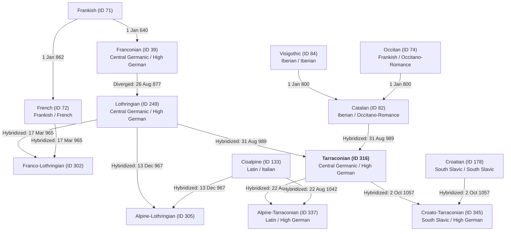

# The Tarraconian Culture: History, Structure & Linguistic Profile

**Campaign Save:** `chatenois_867_01_01.ck3` (Game Version `1.20.1.2`)  
**Current Campaign Date:** 13 May 1059  
**Ruling House & Culture Head:** Kaiser Guntram of the Holy Roman Empire (House *Chatenois-Metz*)

---

## 1. Origins & Cultural Genealogy

Tarraconian (internally designated with the collective noun **Tarracono-Lothringian** and prefix **Tarracono-**) is a High Medieval hybrid culture born from the meeting of the **Central Germanic** imperial aristocracy of Lotharingia and the **Ibero-Romance** maritime society of Catalonia.

### Key Milestones in the Cultural Lineage
1. **The Lothringian Divergence (26 August 877):** Ten years into the 867 campaign, **Lothringian** (`ID 249`) diverged from **Franconian** (`ID 39`). It retained Central Germanic heritage, the High German language, and the Franconian name list, while adopting a **Bureaucratic** ethos and the traditions of *Hereditary Hierarchy*, *Astute Diplomats*, *Castle Keepers*, and *Reverence for Veterans*.
2. **First-Generation Lothringian Hybrids (960s):** As Lothringian rulers expanded across Western and Southern Europe, sister hybrids emerged, notably **Franco-Lothringian** (`ID 302`, 17 March 965, which later spawned **Basco-Franco-Lothringian** in 1041) and **Alpine-Lothringian** (`ID 305`, 13 December 967).
3. **The Birth of Tarraconian (31 August 989):** Following expansion into the Spanish March / *Hispania Tarraconensis*, **Lothringian** (`ID 249`) hybridized with **Catalan** (`ID 82`), forming **Tarraconian** (`ID 316`).
4. **Second-Generation Tarraconian Offshoots (1040s–1050s):** As Tarraconian vassals spread across Italy and the Balkans, two daughter hybrids formed while retaining the **High German** language and **Courtly** ethos:
   * **Alpine-Tarraconian** (`ID 337`, 22 August 1042): Hybrid of **Tarraconian** + **Cisalpine**, adopting *Latin* heritage, *Republican Legacy*, and *Mountain Homes*, and blending the Franconian and Cisalpine name lists.
   * **Croato-Tarraconian** (`ID 345`, 2 October 1057): Hybrid of **Tarraconian** + **Croatian**, adopting *South Slavic* heritage, *Highland Warriors*, and *Hill Dwellers*.

---

## 2. Cultural Pillars, Traditions & Aesthetics

### Core Pillars
| Attribute | In-Game Value | Source Parent |
| :--- | :--- | :--- |
| **Internal ID** | `316` | — |
| **Display Name** | `Tarraconian` | Custom / Regional (*Tarragona / Tarraconensis*) |
| **Collective Noun / Prefix** | `Tarracono-Lothringian` / `Tarracono` | Lothringian + Tarraconian |
| **Ethos** | **Courtly** (`ethos_courtly`) | **Catalan** (replaced Lothringian's *Bureaucratic*) |
| **Heritage** | **Central Germanic** (`heritage_central_germanic`) | **Lothringian** |
| **Language** | **High German** (`language_high_german`) | **Lothringian** |
| **Name List** | **Franconian** (`name_list_franconian`) | **Lothringian** |
| **Martial Custom** | **Male Only** (`martial_custom_male_only`) | Both |
| **Head Determination** | **Domain** (`head_determination_domain`) | Both |

### Traditions
Tarraconian synthesized the feudal-diplomatic core of Lotharingia with the coastal commercial traditions of Catalonia:
* **From Lothringian:**
  * **Hereditary Hierarchy** (`tradition_hereditary_hierarchy`)
  * **Astute Diplomats** (`tradition_astute_diplomats`)
  * **Castle Keepers** (`tradition_castle_keepers`)
* **From Catalan:**
  * **Maritime Mercantilism** (`tradition_maritime_mercantilism`)
  * **Dexterous Fishermen** (`tradition_fishermen`)
* **Recent Cultural Reformation:**
  * Originally held **Visigothic Codes** (`tradition_visigothic_codes`, from Catalan), which was reformed and replaced by **Industrious** (`tradition_hard_working`), completed around **6 May 1031**.

### Visual & Material Culture
Tarraconian's graphical configuration reflects a Germanic imperial elite settled in Mediterranean Iberia:
* **Architecture:** **Iberian** (`iberian_building_gfx`)
* **Clothing:** **Holy Roman Empire & Western** (`dde_hre_clothing_gfx`, `western_clothing_gfx`)
* **Military Units:** **Western** (`western_unit_gfx`)
* **Coats of Arms:** **Germanic & Western** (`german_group_coa_gfx`, `western_coa_gfx`)
* **Dynastic House Frame:** `house_frame_25`
* **Institutions & Artifacts:** The culture has given rise to the **Tarraconian Benedictines** holy order and a rich material tradition of utilitarian wrought-iron *Tarraconian Swords*, gold-plated *Tarraconian Lamellar* and *Laminar Armor*, electrum-lined *Tarraconian Mail*, bronze-and-jet *Tarraconian Crowns*, ornate *Tarraconian Croziers*, and electrum-and-emerald *Tarraconian Regalia*.

---

## 3. Technological & Era Progression

Tarraconian entered the world already at the forefront of medieval technology and rapidly advanced into the High Medieval era:
* **Tribal Era:** Unlocked (`800` / pre-existing)
* **Early Medieval Era:** Reached upon formation in **989** (`0x03DD`)
* **High Medieval Era:** Reached in **991** (`0x03DF`)
* **Current Culture Head:** **Kaiser Guntram** (`ID 150395`) of the Holy Roman Empire
* **Active Research:**
  * **Current Fascination:** *Development 02 / Windmills* (`innovation_development_02`)
  * **Base Progress Focus:** *Battlements* (`innovation_battlements`)
* **Notable Unlocked Innovations:**
  * **Complete Early Medieval Suite:** *Burhs*, *Mangonel*, *House Soldiers*, *Horseshoes*, *Arched Saddle*, *Hereditary Rule*, *Manorialism*, *Royal Prerogative*, *Chronicle Writing*, *Armillary Sphere*, *Bailiffs*.
  * **Regional & Cultural Innovations:** Possesses both Iberian and Germanic regional innovations, including **Caballeros** (`innovation_caballeros`), **Reconquista** (`innovation_reconquista`), **Stem Duchies** (`innovation_stem_duchies`), and **Ghilman** (`innovation_ghilman`).

---

## 4. Continental Expansion & Promotion Timeline (1048–1059)

Under the administrative governance of the Holy Roman Empire (where counties and duchies are organized as **Magistracies** led by **Governors** and **Magistrates**), vassals have been actively promoting Tarraconian (and its Alpine-Tarraconian sister culture) across Continental Europe.

The cultural acceptance logs in the save file record the following wave of provincial promotions between **1048 and 1058**:

| Date | Target Province / Title | Displaced Local Culture | Promoted Culture |
| :--- | :--- | :--- | :--- |
| **4 Dec 1048** | Magistracy of **Bács** (Hungary) | Mogyër | Tarraconian |
| **15 Dec 1048** | Magistracy of **Primkenau** (Silesia) | Böhmisch | Tarraconian |
| **21 Feb 1049** | Magistracy of **Werle** (Pomerania) | Norse | Tarraconian |
| **3 Mar 1050** | Magistracy of **Foggia** (Apulia) | Sicilian | Alpine-Tarraconian |
| **5 May 1050** | Magistracy of **Ajaccio** (Corsica) | Sardinian | Tarraconian |
| **27 Jan 1051** | Magistracy of **Baranya** (Pannonia) | Croatian | Tarraconian |
| **10 Mar 1051** | Magistracy of **Lemberg** (Galicia-Volhynia) | Rutheno-Mogyër | Tarraconian |
| **2 Jul 1051** | Magistracy of **Béarn** (Gascony) | Basque | Tarraconian |
| **1 Nov 1051** | Magistracy of **Dudleb** (Bohemia/Austria) | Slovien | Tarraconian |
| **3 Feb 1052** | Magistracy of **Spiš** (Slovakia) | Slovien | Tarraconian |
| **1 Jul 1052** | Magistracy of **Angoulême** (Aquitaine) | Occitan | Tarraconian |
| **16 Aug 1052** | Magistracy of **Visegrád** (Hungary) | Mogyër | Tarraconian |
| **23 Aug 1052** | Magistracy of **Huesca** (Aragon) | Basque | Tarraconian |
| **19 Apr 1053** | Magistracy of **Amiens** (Picardy) | French | Tarraconian |
| **5 Jul 1053** | Magistracy of **Kärnten** (Carinthia) | Carantanian | Tarraconian |
| **6 Jul 1054** | Magistracy of **Sancerre** (Berry) | French | Tarraconian |
| **28 Aug 1054** | Magistracy of **Lanciano** (Abruzzo) | Lombard | Tarraconian |
| **5 Oct 1054** | Magistracy of **Usora** (Bosnia) | Serbian | Tarraconian |
| **26 Mar 1055** | Magistracy of **Lucca** (Tuscany) | Italian | Alpine-Tarraconian |
| **11 May 1055** | Magistracy of **Anjou** (France) | French | Tarraconian |
| **12 Jun 1055** | Magistracy of **Donji Kraji** (Bosnia) | Bosnian | Tarraconian |
| **25 Jul 1055** | Magistracy of **Gdańsk** (Pomerelia) | Pommeranian | Tarraconian |
| **14 Aug 1055** | Magistracy of **Orava** (Slovakia) | Slovien | Tarraconian |
| **1 Oct 1055** | Magistracy of **Mainz** (Franconia) | Franconian | Tarraconian |
| **22 Dec 1055** | Prince-Bishopric of **Münster** (Westphalia) | Saxon | Tarraconian |
| **29 Apr 1056** | Magistracy of **Alençon** (Normandy) | French | Tarraconian |
| **27 Jun 1056** | Magistracy of **Arborea** (Sardinia) | Sardinian | Tarraconian |
| **22 Dec 1056** | Magistracy of **Cherven** (Red Ruthenia) | Rutheno-Mogyër | Alpine-Tarraconian |
| **28 Mar 1057** | Magistracy of **Lusignan** (Poitou) | Occitan | Tarraconian |
| **25 Apr 1057** | Magistracy of **Praha** (Bohemia) | Böhmisch | Tarraconian |
| **30 May 1057** | Magistracy of **Bastia** (Corsica) | Sardinian | Tarraconian |
| **2 Aug 1057** | Magistracy of **Liegnitz** (Silesia) | Polish | Tarraconian |
| **26 Jan 1058** | Magistracy of **Calatayud** (Aragon) | Qalat Ayyub | Tarraconian |
| **21 Apr 1058** | Magistracy of **Opava** (Moravia/Silesia) | Slovien | Tarraconian |
| **10 Jun 1058** | Magistracy of **Armagnac** (Gascony) | Basque | Tarraconian |
| **20 Oct 1058** | Magistracy of **Ravenna** (Romagna) | Cisalpine | Tarraconian |

### Military & Diplomatic Footprint
Beyond peaceful promotion, Tarraconian armies have clashed across the map, recording cultural war events against **Karelian** (1022), **Pontic** (1044, 1046, 1051, 1053), **Mogyër** (1048), **Armeno-Greek** (1049, 1059), **Anglo-Saxon** (1049), **Moroccan** (1049), **Beja** (1051), **Andalusian** (1051), **Greek** (1053), **Mazovian** (1053), **Frontenhausian** (1058), **Polish** (1058), **Saxon** (1058), and **Russo-Lithuanian** (1059).

---

## 5. Linguistic & Historical Framework for Tarraconian Title Naming

Because your ultimate goal is to reconstruct how European titles and realms would sound in **Tarraconian**, the save data gives us a clear sociolinguistic blueprint:

1. **The Superstrate (High German / Moselle-Rhine Franconian):**
   * Tarraconian's spoken and administrative language is **High German** (`language_high_german`), specifically rooted in the **Lothringian / Rhine-Moselle Franconian** dialect of House *Chatenois-Metz* (`name_list_franconian`).
   * Morphologically and phonologically, official titles, compound nouns, and Germanic place names will follow late Old High German / early Middle High German (ca. 1000–1060 AD) with Central Franconian features.
2. **The Substrate & Prestige Lexicon (Old Catalan / Ibero-Romance & Latin):**
   * Formed in *Tarraconensis* in 989 with a **Courtly** ethos (`ethos_courtly`), *Maritime Mercantilism*, and *Iberian architecture*, Tarraconian absorbed a deep **Old Catalan / Occitano-Romance** and **Hispano-Latin** administrative, courtly, and geographic vocabulary.
   * Just as historical Norman French blended Norse terms into Gallo-Romance (or Middle English blended Anglo-Norman into Germanic), **Tarraconian High German** would naturally:
     * Retain or adapt Romance/Latin roots for administrative, courtly, and maritime ranks (e.g., blending High German *Ambet / Mark / Graf / Pfalz* with Catalan/Latin *Magistrat / Vegueria / Cort / Almirall*).
     * Filter non-Germanic European toponyms (French, Iberian, Italian, Slavic, Magyar) either through **Old Catalan phonetic intermediaries** (palatalization, apocope of final unstressed vowels, `-ch` / `-ll` / `-ny` spellings) or **Middle High German exonymic adaptation** (umlaut, `-burg` / `-mark` / `-gau` suffixation, and High German consonant shifts).
