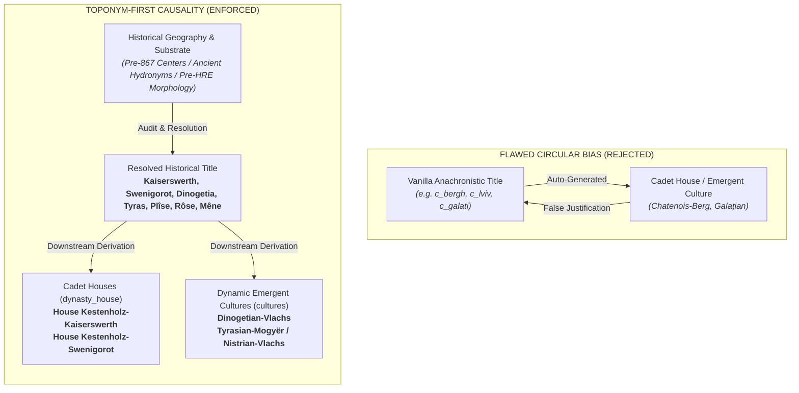
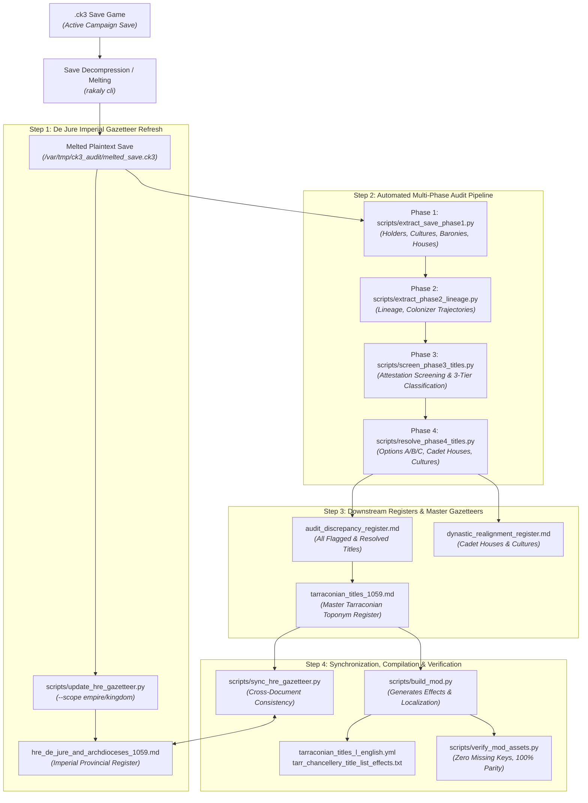

# Comprehensive Master Audit Plan: Historical Accuracy & In-Game Progression of Landed Titles

* **Project:** Tarraconian Chancellery Mod & Imperial Documentation
* **Campaign Divergence Start:** 1 January 867 AD (Fixed Alternate-History Horizon)
* **Active Campaign Save:** Parameterized (`<active_save_game>.ck3` — e.g. `chatenois_867_01_01.ck3` or `/var/tmp/ck3_audit/melted_save.ck3`)
* **Campaign Timeline:** 867 AD $\rightarrow$ Active Save Milestone (e.g. 1142, 1160, 1180, 1200+)
* **Master Documentation & Registers:**
  * [README.md](file:///home/siarzhuk/code/personal/tarraconian_hre/README.md) — Central Repository Documentation & Expansion Playbook
  * [hre_de_jure_and_archdioceses_1059.md](file:///home/siarzhuk/code/personal/tarraconian_hre/hre_de_jure_and_archdioceses_1059.md) — Imperial De Jure Hierarchy & Provincial Register
  * [tarraconian_titles_1059.md](file:///home/siarzhuk/code/personal/tarraconian_hre/tarraconian_titles_1059.md) — Master Tarraconian Toponym Register
  * [tarraconian_descriptive_title_calques.md](file:///home/siarzhuk/code/personal/tarraconian_hre/tarraconian_descriptive_title_calques.md) — Semantic Calque Dictionary & Appropriateness Protocols
  * [audit_discrepancy_register.md](file:///home/siarzhuk/code/personal/tarraconian_hre/audit_discrepancy_register.md) — Historical Discrepancy & Title Resolution Register
  * [dynastic_realignment_register.md](file:///home/siarzhuk/code/personal/tarraconian_hre/dynastic_realignment_register.md) — Master Dynastic & Cadet Branch Realignment Register
  * [mod_synchronization_guide.md](file:///home/siarzhuk/code/personal/tarraconian_hre/mod_synchronization_guide.md) — Mod Build & In-Game Integration Guide
  * [tarraconian_linguistics_guide.md](file:///home/siarzhuk/code/personal/tarraconian_hre/tarraconian_linguistics_guide.md) — Phonology, Orthography & Sound Laws
  * `archive/anachronistic_titles_1059.md` — Legacy Pre-Audit Anachronism Notes (Archived & Superseded)

---

## 1. Problem Statement & Motivation

The landed title registers and linguistic adaptations in Crusader Kings III suffer from two persistent structural biases that recur whenever the borders of the **Roman Empire** (`h_roman_empire` / `e_hre`) expand into new frontiers:

1. **The Static Vanilla CK3 Map Bias:**
   Crusader Kings III spans 867 to 1453 across a single landed title map (`00_landed_titles.txt`). Consequently, numerous title keys represent late-medieval or early-modern settlements rather than authentic 9th-century physical geography:
   * **Late Medieval Colonial Settlements & *Ostsiedlung* Exonyms:** Baltic crusade foundations (*Marienburg*, *Königsberg*, *Allenstein*, *Reval*, *Wormditt*), Swedish crusade names in Finland (*Nyland*, *Pedersöre*).
   * **Early Modern & Modern Colonial Outposts:** Genoese/Portuguese Atlantic and Mediterranean ports (*Madeira*, *Porto-Vecchio*), Russian imperial line fortresses and Soviet industrial settlements in the Pontic steppe, Volga, Urals, and Siberia (*Bakhmut*, *Millerovo*, *Yekaterinburg*, *Chelyabinsk*, *Salavat*, *Kumertau*, *Votkinsk*).
   * **Dynastic High Medieval Castles:** German *Höhenburgen* established in the 11th–13th centuries (*Habsburg*, *Hohenzollern*, *Wirtemberg*, *Mark*, *Berg*, *Nassau*).
   * **Crusader Castella & Colonial Exonyms in Outremer:** 12th-century Frankish fortresses (*Montréal / Shawbak*, *Belvoir / Kawkab*, *Toron / Tibnin*, *Crac des Chevaliers*).
   * **Post-Byzantine & Ottoman Administrative Overwrites:** Turkish administrative exonyms over Classical Roman and Hellenistic poleis in Anatolia, the Levant, Egypt, and the Balkans.

2. **The "OTL Calendar Gap" vs. the 867 AD Alternate-History Horizon:**
   Vanilla title assignments and real-world reference works assess titles against **real-world (OTL) chronological dates** rather than the **1 January 867 alternate-history divergence point**.
   * Titles or replacements cannot be accepted merely because they existed in real history before an arbitrary calendar date (e.g. 1059, 1122, or 1142) if their historical foundation was tied to real-world dynasties, crusades, or conquests that never took place in this campaign save (e.g., *Montréal* built by King Baldwin I of Jerusalem in 1115; *Yaroslavl* founded c. 1010 by Yaroslav the Wise; *Cairo / al-Qāhira* founded by Fatimids in 969).
   * Conversely, when an imperial campaign province progresses directly from an ancient or indigenous 867 culture into the **Tarraconian Roman Empire**, it must not retain colonial exonyms from foreign empires (e.g., German, Swedish, Ottoman, or Tsarist Russian) that never exercised dominion over that territory in the save.

---

## 2. Audit Objectives & Scope

This master audit plan provides an enduring, automated, and repeatable methodology designed to govern both the **existing imperial core** and **all future territorial expansions**:

1. **Dynamic Expansion Scope:**
   * **Baseline Imperial Core:** All existing de jure kingdoms, duchies, and counties registered in [hre_de_jure_and_archdioceses_1059.md](file:///home/siarzhuk/code/personal/tarraconian_hre/hre_de_jure_and_archdioceses_1059.md).
   * **Expansion Frontier (Incremental Mode):** Whenever new kingdoms or duchies are annexed, vassalized, or de jure drifted into the Roman Empire (`h_roman_empire` / `e_hre`), the pipeline audits the newly annexed provinces without disturbing previously stabilized core titles.
   * **Full Recalibration Mode:** When advancing major campaign eras (e.g. 1142 $\rightarrow$ 1180 $\rightarrow$ 1220), the entire imperial perimeter can be re-evaluated against the latest save state.
2. **Save Game Lineage Reconciliation:** Trace the actual in-game conquest timeline, holder dynasties, cultural shifts, and religious conversions from 867 to the active save date using the automated extraction tools.
3. **Establish Toponym-First Primacy for Landed Titles:** Enforce the principle that landed titles represent historical physical geography, antiquity centres, and Roman administrative divisions. Anachronistic titles cannot be justified, grandfathered, or canonized by in-game cadet houses or dynamic emergent cultures.
4. **Dynastic Causality Inversion:** Revise cadet house names *from* the resolved historical titles of their seats (`House Kestenholz-<ResolvedSeat>` for the ruling dynasty, and `House <Founder>-<ResolvedSeat>` for vassal houses), systematically maintaining [dynastic_realignment_register.md](file:///home/siarzhuk/code/personal/tarraconian_hre/dynastic_realignment_register.md).
5. **Harmonize Emergent Dynamic Cultures:** Re-anchor emergent dynamic cultures (hybrid and divergent cultures) *from* the historically resolved toponym of their ethnogenesis seat (`<ResolvedStem>-Vlachs`, `<ResolvedStem>-Mogyër`, etc.).
6. **Automated Synchronization & Verification:** Maintain continuous synchrony between markdown registers and mod files, verifying 100% key and adjective parity with zero orphan triggers.

---

## 3. Classification Taxonomy & Evaluation Criteria

Every title within the audit scope is evaluated against a streamlined **Three-Tier Classification System**, strictly prioritizing antiquity, pre-imperial linguistic morphology, and the Toponym-First Principle:

| Tier | Category | Definition & Scope | Evaluation Rule & Linguistic Progression |
| :---: | :--- | :--- | :--- |
| **Tier 1** | **Pre-867 Historical / Antiquity** | Toponym, civitas, urban center, or administrative division attested prior to the 867 start date (Classical Roman, Greek, Celtic, Germanic, Slavic, Baltic, Early Medieval). | **Check the history, adapt chronologically to changing cultures as appropriate.**<br>Trace the historical settlement progression through successive cultural horizons up to Imperial integration.<br>*Universal Rule:* Adapt the final name phonologically to Tarraconian. |
| **Tier 2** | **Founded After 867 on Hydronymic, Geographic, or Tribal Stems** | Settlements or administrative titles established after 867 AD whose root name derives directly from an ancient hydronym (river/lake), oronym (mountain), natural geographic landmark, or indigenous tribal territory. | **Check the history, and use an appropriate language for the province name's morphology *before* it became part of the (Holy) Roman Empire.**<br>Strip post-867 colonial, feudal, or foreign administrative suffixes (e.g. Slavic town suffix `-sk`/`-ysk`, German *Ostsiedlung* `-burg`/`-stein` in Baltic lands, Ottoman or Tsarist markers), restoring the authentic pre-HRE regional morphology.<br>*Universal Rule:* Adapt the final name phonologically to Tarraconian. |
| **Tier 3** | **Other Settlements Founded After 867 (Default)** | All other settlements founded after 867 AD lacking an ancient hydronymic, geographic, or tribal root. This includes dynastic high-medieval castles (*Höhenburgen*), personal eponymous foundations (*<Prince>slavl*, *<King>sberg*), descriptive colonial outposts (*Novogrod*, *Marienburg*), and unverified titles lacking pre-867 attestation under the Burden of Proof on Antiquity. | **Pick another name according to Options A, B, or C, changing it appropriately to its linguistic history.**<br>• **Option A (Sub-Barony):** An authentic pre-867 settlement or archaeological gord within the county.<br>• **Option B (Hydronym/Geography):** Ancient pre-867 river, lake, or landform (Section 3.1).<br>• **Option C (Campaign Founder):** Personality/trait-driven eponymous foundation (Section 3.2).<br>*Universal Rule:* Adapt the final name phonologically to Tarraconian. |

> [!IMPORTANT]
> **Universal Phonological Adaptation Rule:**
> For all tiers (**Tier 1, Tier 2, and Tier 3**), the finalized historical stem or substrate root must be adapted phonologically into Tarraconian (the Rhine-Moselle Franconian dialect of the restored Roman Empire) using established sound correspondence laws (e.g., *Plisa* $\rightarrow$ *Plîse*, *Rūsa* $\rightarrow$ *Rôse*, *Mėna* $\rightarrow$ *Mêne*, *Zvenyhorod* $\rightarrow$ *Swenigorot*, *Dinogetia* $\rightarrow$ *Dinogetie*, *Dauphiné/Viennois* $\rightarrow$ *Wienergouwe*).

---

### 3.1 Hydronym Selection & Regional Expansion Hierarchy Rule

When selecting or evaluating hydronymic stems (both in **Tier 2** pre-HRE morphology audits and **Tier 3 Option B** resolutions), the audit resolves candidate names according to a strict linguistic hierarchy reflecting the campaign's socio-political progression:

1. **Germanic Names (Primary Priority):**
   * Pre-867 Frankish, High German, Gothic, or Saxon hydronyms corresponding directly to the ruling House Kestenholz's Franconian/Lothringian origins (`heritage_central_germanic`) and imperial spoken tongue (`language_high_german`).
   * *Examples:* *Danawi / Donouwe* (Danube), *Albis / Elbe*, *Rîn* (Rhine), *Mosa / Mâs* (Meuse), *Wîhsla* (Vistula), *Dünâ* (Western Dvina).
2. **Latin / Classical Antiquity Names (Imperial Equal Priority):**
   * Ancient Classical Roman, Greek, or Late Antique Latin hydronyms reflecting the chancellery and administrative continuity of the restored **Roman Empire** (`h_roman_empire` / *Dat Rômische Keiserrîch*).
   * *Examples:* *Danubius* (Danube), *Borysthenes* (Dnieper), *Tyras* (Dniester), *Tanais* (Don), *Rha* (Volga), *Hierasus* (Siret), *Astaboras* (Atbara), *Ister* (Lower Danube), *Euphrates / Tigris*, *Orontes*, *Nilus*.
3. **Language of Direct Contact / Intermediary Gateway:**
   * Where neither an established Germanic nor Latin root exists, use the name in the language of the culture **through which imperial settlers, legions, or chancellery scribes first encountered the body of water**:
     * **Carpathian, Dniester & Moldavian Waters:** Encountered via **Mogyër / Hungarian** and **Byzantine Greek** frontier corridors (e.g. Hungarian *Szucsáva* $\rightarrow$ *Suceava*; *Prut* via Greek/Slavic; *Siret* via Latin *Hierasus* / Mogyër *Szeret*).
     * **Pontic Steppe, Don, Volga & Urals:** Encountered via **Pecheneg, Cuman / Kipchak, Khazar**, or **East Slavic** borderlands (e.g. *Jaîk / Yaik* from Turkic/Cuman; *Inhul* from Kipchak *Yeni-Göl*; *Samara* / *Medveditsa*).
     * **Iberian, Maghreb & Saharan Waters:** Encountered via **Old Catalan, Mozarabic**, or **Andalusi Arabic / Berber** contacts (e.g. *Ebre / Ebro*, *Guadiana / Wādī Āna*, *Oued N'fis*, *Wādī Drāa*).
     * **Baltic & Fennoscandian Waters:** Encountered via **Old Prussian, Yatvingian, Curonian, Scalovian, Old Saxon**, or **Norse** pathways (e.g. *Nemunas / Mēmele* via Scalovian/Curonian; *Plesė / Plisa* via Yatvingian; *Mėna* via Baltic substrate; *Kymijoki*).
     * **Near Eastern & Mesopotamian Waters:** Encountered via **Syriac / Aramaic, Byzantine Greek**, or **Classical Arabic** borderlands (e.g. *Khabur*, *Yarmouk*, *Barada*).
4. **East Asian / Sinosphere Logographic Toponyms (Harmonized Calque Paradigm):**
   * Where Sinospheric administrative titles founded after 867 AD (e.g., Khitan Liao commanderies, Bohai/Jurchen frontier posts) are composed of ideographic Chinese characters (`汉字` / *Hànzì*) expressing auspicious semantic concepts rather than feudal eponymous lords, the titles are resolved by dual harmonization:
     * **(a) Physical Substrate Anchoring (Option B):** Territorial jurisdiction is anchored to the authentic pre-867 physical hydronym, mountain range, or indigenous river basin (e.g., *Yitong River / Songhua Basin*, *Daling River*, *Shira Muren*, *Mudan River*, *Xiao Pass*).
     * **(b) Semantic Calquing:** The semantic meaning of the logographic characters is directly calqued into Tarraconian (e.g., `长春` 'Eternal Spring' $\rightarrow$ *Langlenten*, `大定` 'Great Settlement' $\rightarrow$ *Grôzfest*, `安边` 'Pacified March' $\rightarrow$ *Fridmarch*). This completely avoids the causal paradox of European eponymous foundations while preserving authentic Sinitic statecraft semantics.
5. **Deprecated / Disqualified:**
   * Modern or late post-867 colonial names from nations that never mediated contact in the save (e.g., Early Modern Tsarist Russian administrative names, Ottoman Turkish replacements for Byzantine waters, or 13th-century Teutonic *Ostsiedlung* exonyms in provinces converted directly to Tarraconian).

---

### 3.2 Option C: Character Personality & Trait-Driven Eponymous Foundation Engine

When a newly conquered, elevated, or colonized county falls into **Tier 3 (Other Settlements Founded After 867)** and lacks both a documented pre-867 urban center (Option A) and a natural hydronymic designation (Option B), the title may be resolved as an **in-game campaign foundation** (Option C).

The audit inspects the **first conquering sovereign, founding count, or cadet branch patriarch** recorded in the active save (`holder` history chain). The founder's **personality traits, virtues/sins, and prestige levels** dictate whether and how the title is named:

| Psychological Archetype | In-Game Traits & Triggers | Propensity to Eponymous Naming | Resulting Toponymic Formula & Examples |
| :--- | :--- | :---: | :--- |
| **The Eponymous Megalomaniac** | `arrogant`, `ambitious`, `greedy`, high prestige / exalted fame, `fickle` | **VERY HIGH (Self-Eponymous)** | Directly names the fortress, town, or magistracy after **themselves**.<br>• *Franconian/Germanic:* `<Name>burch`, `<Name>stat`, `<Name>hûsen`, `<Name>stein` (e.g., *Adémarsburch*, *Wernhardstat*, *Gêrhartstein*).<br>• *Imperial Latin/Greco-Roman:* `<Name>opolis`, *Castrum <Name>i*, *Villa <Name>i* (e.g., *Ademaropolis*, *Castrum Wernhardi*). |
| **The Dynastic Patriarch** | `family_first`, `hereditary_hierarchy`, cadet branch founder, high diplomacy | **HIGH (Dynastic Eponymous)** | Names the seat after their **cadet house or dynasty** rather than their personal given name.<br>• *Formulas:* `<House>burch`, `<House>-in-<Region>` (e.g., *Kestenholzburch*, *Metz-an-der-Theiss*). |
| **The Pious / Ascetic** | `zealous`, `humble`, `theologian`, `celibate`, `monk`, high piety | **ZERO (Anti-Eponymous)** | Rejects personal vanity; dedicates the foundation to **God, the Virgin Mary, or their patron saint**.<br>• *Formulas:* `Zant-<Saint>`, `Marienstat`, `Heiligencruce`, `Goteshûsen` (e.g., *Zant-Arnolt*, *Marienburch*, *Zant-Wernhard* after St. Bernard). |
| **The Classical Antiquarian** | `scholar`, `philosopher`, `antiquarian`, Restorer of the Roman Empire | **LOW (Classical Revivalist)** | Disdains modern personal names; invents or revives an archaizing **Latin/Greek Imperial title**.<br>• *Formulas:* *Augusta Nova*, *Traianopolis*, *Forum Caesaris*, *Neapolis*. |
| **The Pragmatic March-Warden** | `paranoid`, `craven`, `brave`, `strategist`, `diligent`, `architect` | **ZERO (Functional / Defensive)** | Names the settlement purely after its **tactical terrain or military purpose**.<br>• *Formulas:* `<Landform>wart`, `<Feature>veste`, `Schirmburch`, `Passwacht` (e.g., *Klammwart*, *Morastveste*, *Eckburch*). |

---

### 3.3 The Toponym-First Principle & Downstream Causality Inversion Rule



The fundamental flaw in casual audits is allowing game-mechanical artifacts (auto-generated cadet branches and emergent cultures) to "canonize" anachronistic titles. In Crusader Kings III:
* Cadet branches (`dynasty_house`) are automatically titled after their founding count's primary seat.
* Dynamic divergent and hybrid cultures (`cultures`) are automatically titled after the county or duchy in which the divergence or hybridization occurs.

Under the **Toponym-First Principle**, causality is strictly reversed:
1. **Landed Title Primacy:** Every landed title must stand on its own historical grounding. Titles previously excused as "in-game canon" are stripped of false exemption and audited against **Tiers 1, 2, and 3**.
2. **Cadet House Renaming:** Noble houses and cadet branches do *not* validate titles; rather, houses derive their names *from* the historically resolved titles (`House Kestenholz-<ResolvedSeat>`).
3. **Dynamic Emergent Culture Renaming:** Emergent cultures do *not* validate titles; rather, cultures derive their localized names and ethnogenesis markers *from* the historically resolved toponym of their geographical seat (`<ResolvedStem>-Vlachs`, `<ResolvedStem>-Mogyër`, etc.).

---

## 4. End-to-End Operational Workflow & Execution Pipeline

The automated pipeline connects the raw save game to the compiled mod files and documentation registers:



### Detailed Phase Breakdown

#### Step 0: Save Ingestion & Auto-Melting
* Binary CK3 save files are melted to plaintext using `rakaly`. The pipeline scripts (`update_hre_gazetteer.py` and `extract_save_phase1.py`) handle melting automatically if the raw save is newer than the cache.

#### Step 1: Imperial De Jure Gazetteer Refresh (`scripts/update_hre_gazetteer.py`)
* Recursively traverses top-level lieges in the save to detect all counties whose liege is `h_roman_empire` (or `e_hre` / `e_roman_empire`).
* Updates imperial control ratios (`— *X/Y in HRE*`) for all duchies, updates county status markers (`**[HRE]**` vs `[Non-HRE]`), and appends newly incorporated kingdoms.
* Preserves pre-existing kingdom numbering, custom historical notes, anachronism tags, and Tarraconian naming annotations.

#### Step 2: Phase 1 Data Extraction (`scripts/extract_save_phase1.py`)
* Extracts county-level structures: current holder, holder history chain (`history { ... }`), culture, faith, built baronies (`b_*`), dynamic names, and province buildings.
* Extracts dynastic hierarchies (`dynasties` and `dynasty_house`): house IDs, founders, living members, custom localized names.
* Extracts emergent cultures (`cultures`): parent cultures, heritage, ethos, divergence/hybrid roots.
* Extracts character personality profiles (`living` and `dead_unpruned`) for Option C evaluation.

#### Step 3: Phase 2 Lineage & Sovereign Trajectory Analysis (`scripts/extract_phase2_lineage.py`)
* Evaluates historical controllers from 867 AD up to the active save date.
* Identifies historical colonizer footprints (e.g. Teutonic Order, Swedish Crown, Rurikid Rus', Ottoman Turks, Umayyads/Almoravids).
* Contrasts the county's in-game cultural progression against the nominal culture of vanilla map titles.

#### Step 4: Phase 3 Automated Screening & Classification (`scripts/screen_phase3_titles.py`)
* Screens titles against `historical_attestation_db.py` and flags tell-tale colonial stems (`-burg`, `-stein`, `-sk`, `-grad`, `-stanitsa`, `Crac des...`, etc.).
* Classifies each imperial title into:
  * **Tier 1:** Attested $\le 867$ AD.
  * **Tier 2:** Post-867 foundation on ancient hydronymic, geographic, or tribal stem.
  * **Tier 3:** Post-867 foundation requiring replacement (Options A, B, or C).

#### Step 5: Phase 4 Title Resolution & Downstream Realignment (`scripts/resolve_phase4_titles.py`)
* Resolves Tier 2 titles by restoring pre-HRE native morphology (stripping colonial suffixes) and applying Tarraconian sound laws.
* Resolves Tier 3 titles by evaluating sub-baronies (Option A), pre-867 hydronyms (Option B), or founder personality archetypes (Option C).
* Inverts causality for cadet houses: couples `dynasty_house` entries to resolved historical seats and writes [dynastic_realignment_register.md](file:///home/siarzhuk/code/personal/tarraconian_hre/dynastic_realignment_register.md).
* Inverts causality for dynamic emergent cultures: realigns ethnonyms and records them in the realignment register.
* Updates [audit_discrepancy_register.md](file:///home/siarzhuk/code/personal/tarraconian_hre/audit_discrepancy_register.md).

#### Step 6: Master Gazetteer Synchronization (`scripts/sync_hre_gazetteer.py`)
* Transcribes verified resolutions into [tarraconian_titles_1059.md](file:///home/siarzhuk/code/personal/tarraconian_hre/tarraconian_titles_1059.md).
* Runs `sync_hre_gazetteer.py` to ensure complete bilateral consistency between `hre_de_jure_and_archdioceses_1059.md` and `tarraconian_titles_1059.md`.

#### Step 7: Mod Recompilation & Asset Verification (`scripts/build_mod.py` & `scripts/verify_mod_assets.py`)
* Recompiles `tarr_chancellery_title_list_effects.txt` and `tarraconian_titles_l_english.yml`.
* Executes `verify_mod_assets.py` to assert zero missing localization keys, zero missing adjectives, zero orphan triggers, and 100% gazetteer-to-effects parity.

---

## 5. Tooling & Script Reference Manual

The audit infrastructure resides in `scripts/` and can be executed natively in Linux/Windows or within the isolated Docker audit environment (`run_*_docker.sh`):

### Summary of Pipeline Tools

| Script | Docker Runner | Primary Function & Outputs |
| :--- | :--- | :--- |
| **`update_hre_gazetteer.py`** | `run_update_gazetteer_docker.sh` | Updates [hre_de_jure_and_archdioceses_1059.md](file:///home/siarzhuk/code/personal/tarraconian_hre/hre_de_jure_and_archdioceses_1059.md) from the save, computing HRE control ratios and integrating newly annexed kingdoms. |
| **`extract_save_phase1.py`** | `run_extraction_docker.sh` | Extracts county holders, cultures, baronies, dynasty houses, and characters from melted save to `/var/tmp/ck3_audit/phase1/`. |
| **`extract_phase2_lineage.py`** | `run_phase2_docker.sh` | Analyzes 867–save date sovereign timelines and colonizer presence, outputting to `/var/tmp/ck3_audit/phase2/`. |
| **`screen_phase3_titles.py`** | `run_phase3_docker.sh` | Screens titles against antiquity database; classifies titles into Tiers 1, 2, and 3; outputs to `/var/tmp/ck3_audit/phase3/`. |
| **`resolve_phase4_titles.py`** | `run_phase4_docker.sh` | Generates historical resolutions (Options A/B/C), updates [audit_discrepancy_register.md](file:///home/siarzhuk/code/personal/tarraconian_hre/audit_discrepancy_register.md), and realigns cadet houses / cultures in [dynastic_realignment_register.md](file:///home/siarzhuk/code/personal/tarraconian_hre/dynastic_realignment_register.md). |
| **`sync_hre_gazetteer.py`** | Direct Python | Validates that all canonical toponyms in `hre_de_jure_and_archdioceses_1059.md` match `tarraconian_titles_1059.md`. |
| **`build_mod.py`** / **`.ps1`** | Direct Python / PowerShell | Compiles `tarr_chancellery_title_list_effects.txt` and `tarraconian_titles_l_english.yml` directly from `tarraconian_titles_1059.md`. |
| **`verify_mod_assets.py`** | Direct Python | Rigorous validator ensuring 100% key parity, complete adjective generation, and zero orphan triggers. |

---

## 6. Expansion Audit Deliverables & Acceptance Criteria

Every expansion cycle or major campaign milestone must satisfy these acceptance criteria before being marked complete:

1. **Updated Imperial De Jure Gazetteer:** [hre_de_jure_and_archdioceses_1059.md](file:///home/siarzhuk/code/personal/tarraconian_hre/hre_de_jure_and_archdioceses_1059.md) reflects the active borders, control ratios, and newly annexed territories.
2. **Updated Audit Discrepancy Register:** [audit_discrepancy_register.md](file:///home/siarzhuk/code/personal/tarraconian_hre/audit_discrepancy_register.md) contains all newly flagged imperial titles categorized by Tier 2 and Tier 3, each paired with verified pre-867 historical justification.
3. **Updated Dynastic Realignment Register:** [dynastic_realignment_register.md](file:///home/siarzhuk/code/personal/tarraconian_hre/dynastic_realignment_register.md) accounts for all newly formed cadet houses and emergent cultures, mapping them to historically resolved toponyms under the Toponym-First Principle.
4. **Master Toponym Register Synchrony:** [tarraconian_titles_1059.md](file:///home/siarzhuk/code/personal/tarraconian_hre/tarraconian_titles_1059.md) includes all newly incorporated titles with canonical Tarraconian Chancellery forms and adjectives.
5. **Zero Mod Defect Verification:** Running `scripts/verify_mod_assets.py` returns `0` errors with:
   * 100% localization key coverage for all effects triggers.
   * 100% title adjective coverage.
   * Zero orphan effects triggers.
   * 100% synchrony between `hre_de_jure_and_archdioceses_1059.md` and `tarraconian_titles_1059.md`.

---

## 7. Future Expansion Operational Playbook (Quick Reference)

> [!NOTE]
> The primary, centralized operational playbook is maintained in **[README.md § 4](file:///home/siarzhuk/code/personal/tarraconian_hre/README.md#4-expansion-operational-playbook-step-by-step-guide)** alongside the project's master architecture and continuity protocols. The quick reference below is preserved for pipeline audit reference.

Follow this step-by-step checklist whenever the campaign timeline advances or the Roman Empire annexes new lands:

### Step 1: Ingest the New Save Game
Ensure the new `.ck3` save file is accessible:
```bash
# Example save path in WSL / Linux host:
export ACTIVE_SAVE="/mnt/windows/Users/siarg/Documents/Paradox Interactive/Crusader Kings III/save games/chatenois_867_01_01.ck3"
```

### Step 2: Refresh the Imperial De Jure Gazetteer
Run the gazetteer updater to detect new conquests and update control counts:
```bash
python3 scripts/update_hre_gazetteer.py --scope empire --save-file "$ACTIVE_SAVE"
# Or inside Docker:
./scripts/run_update_gazetteer_docker.sh --scope empire
```

### Step 3: Run the Multi-Phase Extraction & Screening Pipeline
Extract save data, analyze lineages, and screen for colonial anachronisms:
```bash
# Phase 1: Save data extraction
python3 scripts/extract_save_phase1.py --save-game "$ACTIVE_SAVE"

# Phase 2: Historical lineage & sovereign trajectories
python3 scripts/extract_phase2_lineage.py

# Phase 3: Antiquity screening & 3-tier classification
python3 scripts/screen_phase3_titles.py

# Phase 4: Resolution & downstream dynastic realignment
python3 scripts/resolve_phase4_titles.py
```

### Step 4: Review Resolutions & Apply Toponym-First Realignment
1. Review newly flagged titles in [audit_discrepancy_register.md](file:///home/siarzhuk/code/personal/tarraconian_hre/audit_discrepancy_register.md).
2. Validate that Tier 2 titles have pre-HRE native morphology restored.
3. Validate that Tier 3 titles have authentic pre-867 sub-baronies (Option A), ancient hydronyms (Option B), or founder personality foundations (Option C).
4. Review newly generated cadet houses and dynamic cultures in [dynastic_realignment_register.md](file:///home/siarzhuk/code/personal/tarraconian_hre/dynastic_realignment_register.md).

### Step 5: Update Master Gazetteers & Harmonize
1. Update [tarraconian_titles_1059.md](file:///home/siarzhuk/code/personal/tarraconian_hre/tarraconian_titles_1059.md) with newly resolved titles and adjectives.
2. Synchronize gazetteers:
   ```bash
   python3 scripts/sync_hre_gazetteer.py
   ```

### Step 6: Recompile Mod Assets & Run Verification
Recompile mod scripted effects and localization dictionaries, then verify asset integrity:
```bash
# Rebuild mod scripts and localization
python3 scripts/build_mod.py

# Verify mod assets (must return 0 errors)
python3 scripts/verify_mod_assets.py
```

### Step 7: Commit & Deploy
Stage all modified registers and mod files, verify diffs, and commit:
```bash
git add hre_de_jure_and_archdioceses_1059.md \
        tarraconian_titles_1059.md \
        audit_discrepancy_register.md \
        dynastic_realignment_register.md \
        tarraconian_chancellery/
git commit -m "Imperial expansion: Incorporate newly annexed territories into master registers"
```
