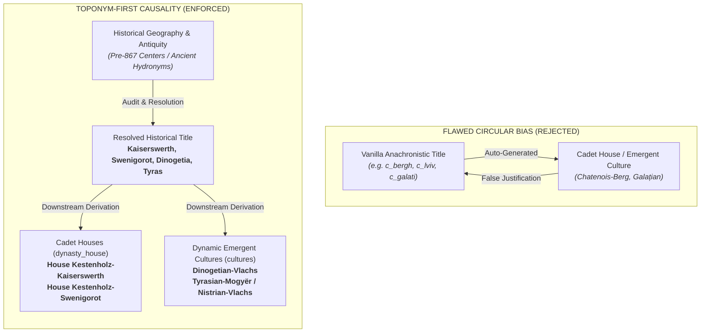
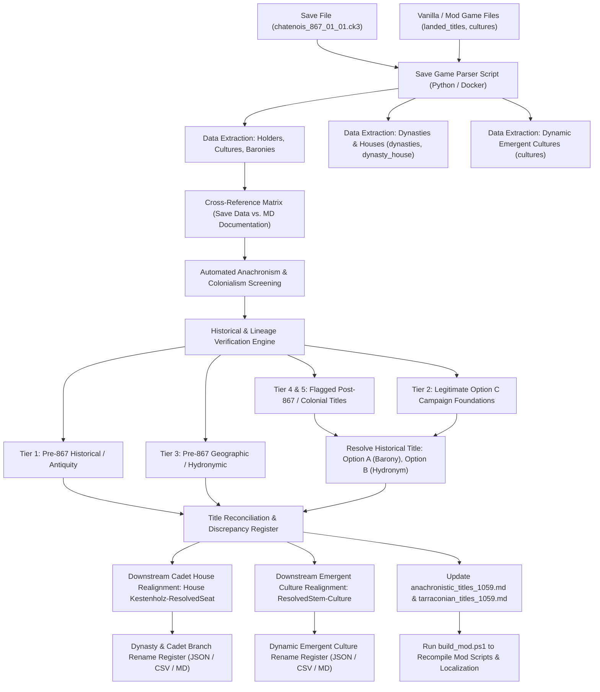

# Comprehensive Audit Plan: Historical Accuracy & In-Game Progression of Landed Titles

* **Project:** Tarraconian Chancellery Mod & Imperial Documentation
* **Campaign Save:** `C:\Program Files (x86)\Steam\userdata\204281054\1158310\remote\save games\chatenois_867_01_01.ck3`
* **Campaign Timeline:** 1 January 867 (Divergence Start) $\rightarrow$ 20 August 1142 (Current Save State)
* **Target Documentation:**
  * [anachronistic_titles_1059.md](file:///C:/Users/siarg/Documents/Projects/Tarraconian/anachronistic_titles_1059.md)
  * [hre_de_jure_and_archdioceses_1059.md](file:///C:/Users/siarg/Documents/Projects/Tarraconian/hre_de_jure_and_archdioceses_1059.md)
  * [tarraconian_titles_1059.md](file:///C:/Users/siarg/Documents/Projects/Tarraconian/tarraconian_titles_1059.md)
  * [build_mod.ps1](file:///C:/Users/siarg/Documents/Projects/Tarraconian/build_mod.ps1)

---

## 1. Problem Statement & Motivation

The current title registers and linguistic adaptations in the documentation suffer from two key structural biases:

1. **The Static Vanilla CK3 Map Bias:**
   Crusader Kings III spans 867 to 1453 on a single landed title map (`00_landed_titles.txt`). Consequently, numerous title keys represent:
   * **Late Medieval Colonial Settlements & *Ostsiedlung* Exonyms:** e.g., Baltic crusade foundations (*Marienburg*, *Königsberg*, *Allenstein*, *Reval*, *Wormditt*), Swedish crusade names in Finland (*Nyland*, *Pedersöre*).
   * **Early Modern & Modern Colonial Outposts:** e.g., Genoese/Portuguese Atlantic and Mediterranean ports (*Madeira*, *Porto-Vecchio*), Russian imperial line fortresses and Soviet industrial settlements in the Pontic steppe, Volga, and Urals (*Bakhmut*, *Millerovo*, *Yekaterinburg*, *Chelyabinsk*, *Salavat*, *Kumertau*, *Votkinsk*).
   * **Dynastic High Medieval Castles:** e.g., German *Höhenburgen* established in the 11th–13th centuries (*Habsburg*, *Hohenzollern*, *Wirtemberg*, *Mark*, *Berg*, *Nassau*).

2. **The "OTL 867–1142 Calendar Gap":**
   The previous audits in `anachronistic_titles_1059.md` assessed titles against **real-world (OTL) chronological dates** (1059, 1122, 1142) rather than the **867 AD alternate-history divergence point**.
   * Titles or replacements were accepted because they existed in real history before 1142, even if their foundation was tied to real-world historical dynasties or crusader conquests that never occurred in this campaign (e.g., *Montréal / Shawbak* built by King Baldwin I of Jerusalem in 1115; *Yaroslavl* founded c. 1010 by Yaroslav the Wise; *Cairo / al-Qāhira* founded by Fatimids in 969).
   * Conversely, titles where a province in the save progressed directly from an ancient or local 867 culture into the **Tarraconian Roman Empire** sometimes retain colonial exonyms from foreign empires (e.g., German, Swedish, Ottoman, or Tatar) that never ruled the province in this timeline.

---

## 2. Audit Objectives & Scope

1. **Identify and catalog all title anachronisms** across the 100 De Jure Kingdoms (451 Duchies, 1,703 Counties) in the Roman Empire's sphere.
2. **Reconcile titles with actual save game progression:** Trace the in-game conquest, holder dynasties, and cultural shifts from 867 to 1142 using `chatenois_867_01_01.ck3`.
3. **Establish Toponym-First Primacy for Landed Titles:** Enforce the principle that landed titles represent historical physical geography, antiquity centres, and Roman administrative divisions. Anachronistic titles cannot be justified, grandfathered, or canonized by in-game cadet houses or dynamic emergent cultures.
4. **Reconcile the Imperial Dynasty Name with Tarraconian Historical Linguistics:** Adjust the ruling dynasty name *Chatenois* (`dynn_Chatenois`, ID 1582) to its authentic High German / Lorraine equivalent (**House Kestenholz** / *Dat Hûs van Kestenholz*, deriving from Latin *Castinetum*), systematically updating cadet house formulas (`Chatenois-<Seat>` → `Kestenholz-<Seat>`).
5. **Invert Causality for Noble Houses and Cadet Branches:** Revise cadet house names *from* the revised historical titles of their seats (`House Kestenholz-<ResolvedSeat>`), compiling an actionable rename register for all affected player and vassal houses.
6. **Harmonize Emergent Dynamic Cultures with Historical Toponyms:** Revise dynamic emergent cultures (e.g. *Galațian-Vlachs*, *Bugeacian-Mogyër*, *Wolkensteiner*, *Putyvlian*) *from* the historically resolved toponyms of their ethnogenesis provinces (e.g. *Dinogetian-Vlachs* from ancient *Dinogetia*; *Tyrasian-Mogyër* from classical *Tyras* / *Nistru*).
7. **Produce an actionable update** for `anachronistic_titles_1059.md` and rebuild the mod localization and scripted effects via `build_mod.ps1`.

---

## 3. Classification Taxonomy & Evaluation Criteria

Every title will be evaluated against five distinct classification tiers, strictly prioritizing historical accuracy and antiquity:

| Tier | Category | Description | Evaluation Rule |
| :---: | :--- | :--- | :--- |
| **Tier 1** | **Pre-867 Historical / Antiquity** | Toponym, urban center, or administrative division attested prior to the 867 start date (Classical Roman, Greek, Celtic, Germanic, Slavic, Early Medieval). | **VALID**: Retain or adapt phonologically into Tarraconian. |
| **Tier 2** | **Legitimate Campaign Eponymous Foundations (Option C)** | Settlements or counties established/elevated during the campaign (867–1142) that lack documented pre-867 urban centers (Option A) and lack ancient hydronyms (Option B), whose names are derived from the historical founder/patriarch's traits via the **Trait-Driven Eponymous Engine** (Section 3.2). | **CANONICAL (CAMPAIGN)**: Grounded in authentic character history. **Strict Restriction:** A title CANNOT be placed in Tier 2 merely because an in-game cadet branch was auto-named after a vanilla CK3 title, or because a dynamic culture diverged there. |
| **Tier 3** | **Pre-867 Geographic / Hydronymic** | The settlement is post-867 or colonial, but the name derives directly from an ancient hydronym (river), oronym (mountain), or tribal territory existing prior to 867. | **VALID**: Retain root name as a geographic regional designation, applying the **Hydronym Hierarchy Rule** (Section 3.1). |
| **Tier 4** | **Post-867 OTL Foundation / Dynastic Castle** | Named after a real-world post-867 individual, crusade, monastic order, or high-medieval dynastic castle absent from the save timeline. | **ANACHRONISTIC (FLAGGED)**: Must be replaced by an authentic pre-867 centre or sub-barony (`b_*`) within the province (Option A) or ancient hydronym (Option B). |
| **Tier 5** | **Foreign Colonial Exonym Mismatch** | Title uses an exonym of a historical colonizer (e.g., German *Ostsiedlung*, Swedish, Turkish, Tsarist Russian) that never controlled the province in the save. | **MISMATCH (FLAGGED)**: Revert to the indigenous pre-867 stem or derive directly from Tarraconian / Imperial Latin sound laws applied to the indigenous root. |

### 3.1 Hydronym Selection & Cultural Hierarchy Rule

When a river, lake, or maritime reach has multiple historical names across different cultures, the audit resolves candidate names according to a strict linguistic hierarchy reflecting the campaign's socio-political progression:

1. **Germanic Names (Primary Priority):**
   * Pre-867 Frankish, High German, Gothic, or Saxon hydronyms corresponding directly to the ruling House Chatenois's Franconian/Lothringian origins (`heritage_central_germanic`) and imperial spoken tongue (`language_high_german`).
   * *Examples:* *Danawi / Donouwe* (Danube), *Albis / Elbe*, *Rîn* (Rhine), *Mosa / Mâs* (Meuse), *Wîhsla* (Vistula), *Dünâ* (Western Dvina).
2. **Latin / Classical Antiquity Names (Imperial Equal Priority):**
   * Ancient Classical Roman, Greek, or Late Antique Latin hydronyms reflecting the chancellery and administrative continuity of the restored **Roman Empire** (`h_roman_empire` / *Dat Rômische Keiserrîch*).
   * *Examples:* *Danubius* (Danube), *Borysthenes* (Dnieper), *Tyras* (Dniester), *Tanais* (Don), *Rha* (Volga), *Hierasus* (Siret), *Astaboras* (Atbara), *Ister* (Lower Danube).
3. **Language of Direct Contact / Intermediary Gateway:**
   * Where neither an established Germanic nor Latin root exists, use the name in the language of the culture **through which French, Lotharingian, or Tarraconian settlers and armies first encountered the body of water** in their historical/campaign expansion:
     * **Carpathian, Dniester & Moldavian Waters:** Encountered via **Mogyër / Hungarian** and **Byzantine Greek** frontier corridors (e.g. Hungarian *Szucsáva* → *Suceava*; *Prut* via Greek/Slavic; *Siret* via Latin *Hierasus* / Mogyër *Szeret*).
     * **Pontic Steppe, Don & Volga Waters:** Encountered via **Pecheneg, Cuman / Kipchak, Khazar**, or **East Slavic** borderlands (e.g. *Jaîk / Yaik* from Turkic/Cuman; *Inhul* from Kipchak *Yeni-Göl*; *Samara* / *Medveditsa*).
     * **Iberian & North African Waters:** Encountered via **Old Catalan, Mozarabic**, or **Andalusi Arabic** contacts (e.g. *Ebre / Ebro*, *Guadiana / Wādī Āna*, *Oued N'fis*).
     * **Baltic & Northern Waters:** Encountered via **Old Saxon, Frisian**, or **Norse** maritime pathways (e.g. *Nemunas / Mēmele* via Scalovian/Curonian; *Kymijoki*).
4. **Deprecated / Disqualified:**
   * Modern or late post-867 colonial names from nations that never mediated contact in the save (e.g., Early Modern Tsarist Russian administrative names, Ottoman Turkish replacements for Byzantine waters, or 13th-century Teutonic *Ostsiedlung* exonyms in provinces converted directly to Tarraconian).

---

### 3.2 Option C: Character Personality & Trait-Driven Eponymous Foundation Engine

When a newly conquered, elevated, or colonized county lacks both a documented pre-867 urban center (Option A) and a natural hydronymic designation (Option B), the title may be resolved as an **in-game campaign foundation** (Option C).

Rather than assigning arbitrary names, the audit inspects the **first conquering sovereign, founding count, or cadet branch patriarch** recorded in `chatenois_867_01_01.ck3` (`holder` history chain). The founder's **personality traits, virtues/sins, and prestige levels** dictate whether and how the title is named:

| Psychological Archetype | In-Game Traits & Triggers | Propensity to Eponymous Naming | Resulting Toponymic Formula & Examples |
| :--- | :--- | :---: | :--- |
| **The Eponymous Megalomaniac** | `arrogant`, `ambitious`, `greedy`, high prestige / exalted fame, `fickle` | **VERY HIGH (Self-Eponymous)** | Directly names the fortress, town, or magistracy after **themselves**. • *Franconian/Germanic:* `<Name>burch`, `<Name>stat`, `<Name>hûsen`, `<Name>stein` (e.g., *Adémarsburch*, *Wernhardstat*, *Gêrhartstein*). • *Imperial Latin/Greco-Roman:* `<Name>opolis`, *Castrum <Name>i*, *Villa <Name>i* (e.g., *Ademaropolis*, *Castrum Wernhardi*). |
| **The Dynastic Patriarch** | `family_first`, `hereditary_hierarchy`, cadet branch founder, high diplomacy | **HIGH (Dynastic Eponymous)** | Names the seat after their **cadet house or dynasty** rather than their personal given name. • *Formulas:* `<House>burch`, `<House>-in-<Region>` (e.g., *Chatenoisburch*, *Metz-an-der-Theiss*). |
| **The Pious / Ascetic** | `zealous`, `humble`, `theologian`, `celibate`, `monk`, high piety | **ZERO (Anti-Eponymous)** | Rejects personal vanity; dedicates the foundation to **God, the Virgin Mary, or their patron saint**. • *Formulas:* `Zant-<Saint>`, `Marienstat`, `Heiligencruce`, `Goteshûsen` (e.g., *Zant-Arnolt*, *Marienburch*, *Zant-Wernhard* after St. Bernard). |
| **The Classical Antiquarian** | `scholar`, `philosopher`, `antiquarian`, Restorer of the Roman Empire | **LOW (Classical Revivalist)** | Disdains modern personal names; invents or revives an archaizing **Latin/Greek Imperial title**. • *Formulas:* *Augusta Nova*, *Traianopolis*, *Forum Caesaris*, *Neapolis*. |
| **The Pragmatic March-Warden** | `paranoid`, `craven`, `brave`, `strategist`, `diligent`, `architect` | **ZERO (Functional / Defensive)** | Names the settlement purely after its **tactical terrain or military purpose**. • *Formulas:* `<Landform>wart`, `<Feature>veste`, `Schirmburch`, `Passwacht` (e.g., *Klammwart*, *Morastveste*, *Eckburch*). |

---

### 3.3 The Toponym-First Principle & Downstream Causality Inversion Rule

The fundamental flaw in previous audits was allowing game-mechanical artifacts (auto-generated cadet branches and emergent cultures) to "canonize" anachronistic titles. In Crusader Kings III:
* Cadet branches (`dynasty_house`) are automatically titled after their founding count's primary seat.
* Dynamic divergent and hybrid cultures (`cultures`) are automatically titled after the county or duchy in which the divergence or hybridization occurs.

Under the **Toponym-First Principle**, causality is strictly reversed:
1. **Landed Title Primacy:** Every landed title must stand on its own historical grounding. Titles previously excused as "Tier 2 Canon" (e.g., `c_bergh`, `c_luxembourg`, `c_zagreb`, `c_galati`, `c_bugeac`, `c_dorohoi`, `c_iasi`, `c_barlad`, `c_cetatea_alba`, `c_chilia`, `c_lapusna`, `c_aalborg`, `c_bouillon`, `c_namur`, `c_metzovo`) are stripped of their false exemption and audited against Tiers 1, 3, 4, and 5.
2. **Cadet House Renaming:** Noble houses and cadet branches do *not* validate titles; rather, houses derive their names *from* the historically resolved titles (`House Kestenholz-<ResolvedSeat>`).
3. **Dynamic Emergent Culture Renaming:** Emergent cultures do *not* validate titles; rather, cultures derive their localized names and ethnogenesis markers *from* the historically resolved toponym of their geographical seat (`<ResolvedStem>-Vlachs`, `<ResolvedStem>-Mogyër`, etc.).

---

---

## 4. Methodological Phases & Execution Workflow

### Phase 1: Save Game & Game File Extraction

1. **Parse `chatenois_867_01_01.ck3`:**
   * Bypass the 24-byte `SAV0...` header and stream-extract the internal `gamestate` file.
   * Extract county-level parameters:
     * Title key (`c_*`, `d_*`, `k_*`).
     * Current holder (`holder`) and holder history chain (`history { ... }`).
     * Province culture (`culture = <ID>`) and faith (`faith = <ID>`).
     * Built baronies (`b_*`) and province buildings.
     * Any dynamic custom names (`name = "..."`).
   * Extract dynasty and house structures:
     * `dynasties = { ... }`: Dynasty ID, key/name (`name`), culture, and prefix.
     * `dynasty_house = { ... }`: House ID, parent dynasty ID, key/name (`name`), custom localized name (`localized_name`), motto, and founder character ID (`founder`).
   * Extract historical characters (`living` and `dead_unpruned`):
     * Character ID, given name (`first_name`), dynasty/house, traits (`traits`), prestige/fame, piety, and nickname/cognomen (enabling character personality profile analysis for Option C).
   * Extract culture tables to resolve culture names, heritage, ethos, and parentage (identifying hybrid and divergent cultures and their geographical divergence roots).

2. **Parse Landed Title Structure:**
   * Extract complete hierarchy from `00_landed_titles.txt` to map every county (`c_*`) to its constituent baronies (`b_*`) and de jure duchies/kingdoms.

### Phase 2: Title Lineage, Sovereign Trajectories & Toponym-First Classification

1. **Determine Historical Sovereign Trajectory:**
   * For each county, map who controlled the province between 867 and 1142.
   * Identify whether the county was ever held by historic colonizers (e.g., German Teutonic Order, Holy Roman emperors prior to Chatenois expansion, Swedish crowns, Kievan Rurikids, Seljuk Turks, Umayyads/Almoravids).
2. **Cultural Footprint Comparison:**
   * Contrast the county's in-game culture history against the nominal culture of its vanilla/documented name.
   * Example: If a Baltic province went from Old Prussian/Curonian straight to Tarraconian in 1050 without ever seeing the Teutonic Order, a German Order name like *Marienburg* or *Bartenstein* has zero historical continuity with the save.
3. **Strict Toponym-First Screening (Abolition of False Tier 2 Exemptions):**
   * Counties are evaluated strictly on their own historical merits. Presence of an in-game cadet branch (`is_cadet_seat`) or dynamic culture (`is_hybrid_ground`) no longer grants exemption:
     * Titles with attested pre-867 urban centres or divisions are assigned to **Tier 1 (Antiquity)**.
     * Titles derived from pre-867 rivers, mountains, or waters are assigned to **Tier 3 (Hydronymic)**.
     * Titles founded after 867 or high-medieval castles are assigned to **Tier 4 (Post-867 Foundation)**.
     * Titles with colonizer exonyms where the colonizer never ruled are assigned to **Tier 5 (Colonial Mismatch)**.

### Phase 3: Automated Screening & Etymological Cross-Referencing

1. **Automated Lexicon Screening:**
   * Flag titles with tell-tale colonial, post-867 suffixes and stems:
     * German *Ostsiedlung* / colonial: `-burg` (post-867 foundations), `-stein`, `-walde`, `-werder`, `-rode`, `Neu-`, `Königs-`.
     * Swedish Crusade: `-ö`, `-borg` (post-1150), `-by` (in non-Norse native regions).
     * Russian Imperial / Cossack: `-sk`, `-ka`, `-grad`, `-stanitsa`, `Novo-`, `Bogorodi-`, `Yekaterin-`, `Aleksandr-`.
     * Crusader: *Crac des...*, *Castel...*, *Mont...* (in Outremer/Levant).
2. **Cross-Check with Current MD Files:**
   * Re-screen previously exempted titles against `anachronistic_titles_1059.md`. Check if the title was previously accepted purely due to the OTL calendar gap (founded between 867 and 1059/1122) or false Tier 2 in-game canon.
   * Flag all post-867 foundations for resolution in Phase 4.

### Phase 4: Resolution, Reconciliation, Dynasty & Culture Downstream Pipeline

1. **Title Resolution Framework:**
   * **Option A (Sub-Barony Resolution):** Inspect all baronies (`b_*`) within the county to find an authentic pre-867 or classical settlement (e.g., `b_truso` for `c_malbork`, `b_kaiserswerth` for `c_bergh`, `b_echternach` for `c_luxembourg`).
   * **Option B (Pre-867 Hydronym / Toponym Resolution):** Fall back to ancient rivers, mountains, or forests, strictly applying the **Hydronym Hierarchy Rule** (Section 3.1: Germanic name → Latin/Classical name → Language of direct imperial/cultural contact → Disqualifying non-contact colonial exonyms). Examples: *Tyras / Nistru*, *Borysthenes / Dnêper*, *Astaboras / Atbara*, *Jaîk / Ural*, *Erg Iguidi*.
   * **Option C (In-Game Campaign Honorific / Personality-Driven Resolution):** Apply the **Trait-Driven Eponymous Engine** (Section 3.2). Inspect the character traits of the conquering or founding lord in `gamestate.bin`:
     * If the ruler has **high-vanity traits** (`arrogant`, `ambitious`, `greedy`, exalted fame), name the foundation directly after them (e.g. *Adémarsburch*, *Wernhardstat*, *Castrum Adomari*).
     * If the ruler has **pious/humble traits** (`zealous`, `humble`, `theologian`), name the foundation after a patron saint or religious dedication (e.g. *Zant-Arnolt*, *Marienburch*).
     * If the ruler is a **scholar/antiquarian** (`scholar`, `philosopher`), bestow a revived Classical Latin or imperial title (e.g. *Augusta Nova*, *Traianopolis*).
     * If the ruler is a **pragmatic march-warden** (`diligent`, `architect`, `craven`, `paranoid`), name it functionally after terrain fortifications (e.g. *Passwacht*, *Schirmburch*).

2. **Downstream Cadet Branch Realignment Pipeline:**
   * Interrogate every entry in `dynasty_house` of the ruling dynasty and imperial vassals:
     * Houses matching `Chatenois-<Seat>` or `von <Seat>` are coupled directly to the resolved title of their founding county seat.
     * The ruling dynasty root shifts from French *Chatenois* to Rhine-Moselle Franconian **House Kestenholz** (*Dat Hûs van Kestenholz*).
     * The toponymic suffix is updated to the resolved historical seat:
       * `Chatenois-Berg` → **House Kestenholz-Kaiserswerth** (House `26581`, seat `c_bergh` resolved to Carolingian palatinate *Kaiserswerth*).
       * `Chatenois-Lemberg` → **House Kestenholz-Swenigorot** (House `16796257`, seat `c_lviv` resolved to 10th-century centre *Zvenyhorod* / *Swenigorot*).
       * `Chatenois-Koschmin` → **House Kestenholz-Kalisz** (House `33575971`, seat `c_koszmin` resolved to ancient *Kalisz*).
       * `Chatenois-Hirschberg` → **House Kestenholz-Warmbrunn** (House `33578351`, seat `c_hirschberg` resolved to *Warmbrunn*).
       * `Chatenois-Kammersberg` → **House Kestenholz-Murau** (House `33578330`, seat `c_kammersberg` resolved to *Murau*).
       * `Chatenois-Peiting` → **House Kestenholz-Schongau** (House `33578315`, seat `c_peiting` resolved to *Schongau*).
   * Format results into the **Dynasty & Cadet Branch Rename Register**.

3. **Downstream Dynamic Emergent Culture Realignment Pipeline:**
   * Interrogate all divergent and hybrid cultures in `cultures`:
     * Identify cultures whose nominal stem derives from a CK3 map title (e.g., *Galațian*, *Bugeacian*, *Bugeacian-Mogyër*, *Wolkensteiner*, *Jutribocian*, *South Kazanskayan*).
     * Re-anchor their ethnonyms to the historically resolved toponym of their ethnogenesis province:
       * **Galațian** (Culture `275`, diverged in `c_galati`) → **Dinogetian-Vlachs** (from resolved Roman/Byzantine fortress *Dinogetia*).
       * **Bugeacian** (Culture `288`, diverged in `c_bugeac`) → **Tyrasian-Vlachs** (from resolved Classical hydronym *Tyras* / *Nistru*).
       * **Bugeacian-Mogyër** (Culture `293`, hybrid in `c_bugeac`) → **Tyrasian-Mogyër** (from resolved Classical hydronym *Tyras* / *Nistru*).
       * **Wolkensteiner** (Culture `286`, diverged in `c_wolkenstein`) → **Zschopauer** (from resolved pre-867 river *Zschopau* / *Miriquidi*).
       * **Jutribocian** (Culture `260`, diverged in `c_juterbog`) → **Nicipsian** (from resolved pre-867 Slavic pagus *Nicici*).
       * **South Kazanskayan** (Culture `358`, post-medieval Cossack station) → **Tanaite-Turkic** / **Don-Oghur** (from resolved ancient hydronym *Tanais* / *Don*).
       * **Ungwârer** (Culture `367`, hybrid in `c_ungvar`) → **Ungwârer** (validated pre-867 hydronym *Ung* + German *-wârer*).
       * **Frontenhausian** (Culture `279`, diverged in `c_frontenhausen`) → **Frontenhausian** (validated pre-867 center *Frantenhusa* 788 AD).
   * Format results into the **Dynamic Emergent Culture Rename Register**.

### Phase 5: Documentation & Mod Integration

1. **Update Markdown References:**
   * Update [anachronistic_titles_1059.md](file:///C:/Users/siarg/Documents/Projects/Tarraconian/anachronistic_titles_1059.md) to explicitly document:
     * Real-world foundation date vs. In-game 867 divergence status.
     * In-game holder/cultural history from `gamestate`.
     * Justification for the chosen resolution.
   * Update [tarraconian_titles_1059.md](file:///C:/Users/siarg/Documents/Projects/Tarraconian/tarraconian_titles_1059.md) with updated Tarraconian Chancellery forms and adjectives.
2. **Rebuild Mod Assets:**
   * Run [build_mod.ps1](file:///C:/Users/siarg/Documents/Projects/Tarraconian/build_mod.ps1) to regenerate:
     * `tarr_chancellery_title_list_effects.txt` (scripted rename triggers).
     * `tarraconian_titles_l_english.yml` (English/Tarraconian localization dictionary).

---

## 5. Tooling & Script Specifications

A dedicated scratch script will be created to execute the audit:

* **Script Path:** `<artifact_dir>/scratch/audit_title_and_dynasty_accuracy.py` or `.ps1`
* **Inputs:**
  * `chatenois_867_01_01.ck3` (Binary/Zip save stream).
  * `tarraconian_titles_1059.md` (Current documentation entries).
  * `anachronistic_titles_1059.md` (Current resolution matrix).
* **Outputs:**
  * `audit_discrepancy_report.csv` / `.json`: Machine-readable comparison table of all 1,703 counties with flags for:
    * `is_colonial`
    * `post_867_foundation`
    * `ingame_culture_match`
    * `recommended_pre867_name`
    * `sub_barony_candidates`
  * `dynasties_to_rename.csv` / `.md`: Structured register of all anachronism-derived dynasties and houses containing:
    * `house_id` / `dynasty_id`
    * `current_name`
    * `anachronistic_title_origin`
    * `living_members_count`
    * `current_head_character_id`
    * `proposed_renamed_house_name`
  * `dynamic_cultures_to_rename.csv` / `.md`: Structured register of all dynamic emergent cultures derived from anachronistic toponyms, mapping them to their revised historical ethnonyms.

---

## 6. Deliverables & Acceptance Criteria

1. **Audit Plan Document:** This document ([title_historical_accuracy_audit_plan.md](file:///C:/Users/siarg/Documents/Projects/Tarraconian/title_historical_accuracy_audit_plan.md)).
2. **Title Discrepancy Register:** A structured analysis highlighting:
   * Confirmed colonial names present in current documentation.
   * False-positive "valid" titles from previous audits that postdate 867.
   * Proposed pre-867 and in-game-accurate replacements.
3. **Dynasty & Cadet Branch Rename Register:** A dedicated list of all player and vassal houses whose names derive from anachronistic titles, complete with house IDs and suggested historical rename targets.
4. **Dynamic Emergent Culture Rename Register:** A dedicated list of all divergent/hybrid cultures whose names derive from anachronistic titles, complete with culture IDs and suggested historical rename targets.
5. **Reconciled Mod Files:** Updated markdown files and regenerated mod files verifying zero breaking title key errors.
