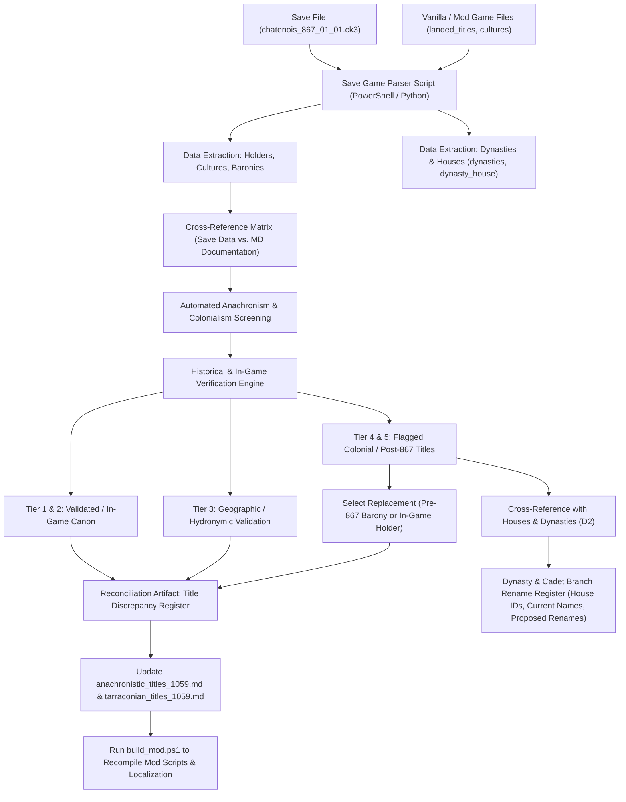

# Comprehensive Audit Plan: Historical Accuracy & In-Game Progression of Landed Titles

* **Project:** Tarraconian Chancellery Mod & Imperial Documentation
* **Campaign Save:** `C:\Program Files (x86)\Steam\userdata\204281054\1158310\remote\save games\chatenois_867_01_01.ck3`
* **Campaign Timeline:** 1 January 867 (Divergence Start) $\rightarrow$ 20 August 1142 (Current Save State)
* **Target Documentation:**
  * [anachronistic_titles_1059.md](file:///C:/Users/siarg/Documents/Projects/Tarraconian/anachronistic_titles_1059.md)
  * [hre_de_jure_and_archdioceses_1059.md](file:///C:/Users/siarg/Documents/Projects/Tarraconian/hre_de_jure_and_archdioceses_1059.md)
  * [tarraconian_titles_1059.md](file:///C:/Users/siarg/Documents/Projects/Tarraconian/tarraconian_titles_1059.md)
  * [build_mod.ps1](file:///C:/Users/siarg/Documents/Projects/Tarraconian/build_mod.ps1)

---

## 1. Problem Statement & Motivation

The current title registers and linguistic adaptations in the documentation suffer from two key structural biases:

1. **The Static Vanilla CK3 Map Bias:**
   Crusader Kings III spans 867 to 1453 on a single landed title map (`00_landed_titles.txt`). Consequently, numerous title keys represent:
   * **Late Medieval Colonial Settlements & *Ostsiedlung* Exonyms:** e.g., Baltic crusade foundations (*Marienburg*, *Königsberg*, *Allenstein*, *Reval*, *Wormditt*), Swedish crusade names in Finland (*Nyland*, *Pedersöre*).
   * **Early Modern & Modern Colonial Outposts:** e.g., Genoese/Portuguese Atlantic and Mediterranean ports (*Madeira*, *Porto-Vecchio*), Russian imperial line fortresses and Soviet industrial settlements in the Pontic steppe, Volga, and Urals (*Bakhmut*, *Millerovo*, *Yekaterinburg*, *Chelyabinsk*, *Salavat*, *Kumertau*, *Votkinsk*).
   * **Dynastic High Medieval Castles:** e.g., German *Höhenburgen* established in the 11th–13th centuries (*Habsburg*, *Hohenzollern*, *Wirtemberg*, *Mark*, *Berg*, *Nassau*).

2. **The "OTL 867–1142 Calendar Gap":**
   The previous audits in `anachronistic_titles_1059.md` assessed titles against **real-world (OTL) chronological dates** (1059, 1122, 1142) rather than the **867 AD alternate-history divergence point**.
   * Titles or replacements were accepted because they existed in real history before 1142, even if their foundation was tied to real-world historical dynasties or crusader conquests that never occurred in this campaign (e.g., *Montréal / Shawbak* built by King Baldwin I of Jerusalem in 1115; *Yaroslavl* founded c. 1010 by Yaroslav the Wise; *Cairo / al-Qāhira* founded by Fatimids in 969).
   * Conversely, titles where a province in the save progressed directly from an ancient or local 867 culture into the **Tarraconian Roman Empire** sometimes retain colonial exonyms from foreign empires (e.g., German, Swedish, Ottoman, or Tatar) that never ruled the province in this timeline.

---

## 2. Audit Objectives & Scope

1. **Identify and catalog all title anachronisms** across the 100 De Jure Kingdoms (451 Duchies, 1,703 Counties) in the Roman Empire's sphere.
2. **Reconcile titles with actual save game progression:** Trace the in-game conquest, holder dynasties, and cultural shifts from 867 to 1142 using `chatenois_867_01_01.ck3`.
3. **Extract anachronistic dynasty & cadet branch names:** Interrogate all dynasties (`dynasties`) and cadet branches (`dynasty_house`) in the save whose names derive from anachronistic or colonial title roots, compiling an actionable rename register for the player.
4. **Reconcile the Imperial Dynasty Name with Tarraconian Historical Linguistics:** Adjust the ruling dynasty name *Chatenois* (`dynn_Chatenois`, ID 1582) to its authentic High German / Lorraine equivalent (**House Kestenholz** / *Dat Hûs van Kestenholz*, deriving from Latin *Castinetum*), systematically updating cadet house formulas (`Chatenois-<Seat>` $\rightarrow$ `Kestenholz-<Seat>`).
5. **Respect organically emergent in-game lore:** Ensure titles and cultures that evolved dynamically in-game (such as *Galațian-Vlachs*, *Bugeacian-Mogyër*, *Ungwârer*, *Croato-Tarraconian*) are evaluated against campaign canon.
6. **Produce an actionable update** for `anachronistic_titles_1059.md` and rebuild the mod localization and scripted effects via `build_mod.ps1`.

---

## 3. Classification Taxonomy & Evaluation Criteria

Every title will be evaluated against five distinct classification tiers:

| Tier | Category | Description | Evaluation Rule |
| :---: | :--- | :--- | :--- |
| **Tier 1** | **Pre-867 Historical / Antiquity** | Toponym, settlement, or regional division attested prior to the 867 start date (Classical Roman, Greek, Celtic, Germanic, Slavic, Early Medieval). | **VALID**: Retain or adapt phonologically into Tarraconian. |
| **Tier 2** | **In-Game Alternate History Canon** | Title name derived from in-game dynasties, custom cadet branches, in-game dynamic cultures, or in-save dynamic title renames. | **CANONICAL**: Retain as organic campaign progression (e.g., *Lemberg* from *House Chatenois-Lemberg*, *Galați* from *Galațian* culture), using the **Trait-Driven Eponymous Engine** (Section 3.2). |
| **Tier 3** | **Pre-867 Geographic / Hydronymic** | The settlement is post-867 or colonial, but the name derives directly from an ancient hydronym (river), oronym (mountain), or tribal territory existing prior to 867. | **VALID**: Retain root name as a geographic regional designation, applying the **Hydronym Hierarchy Rule** (Section 3.1). |
| **Tier 4** | **Post-867 OTL Eponymous / Colonial Foundation** | Named after a real-world post-867 individual, crusade, or monastic order absent from the save timeline. | **ANACHRONISTIC (FLAGGED)**: Must be replaced by an authentic pre-867 centre or sub-barony (`b_*`) within the province. |
| **Tier 5** | **Foreign Colonial Exonym Mismatch** | Title uses an exonym of a historical colonizer (e.g., German *Ostsiedlung*, Swedish, Turkish, Tsarist Russian) that never controlled the province in the save. | **MISMATCH (FLAGGED)**: Revert to the indigenous pre-867 stem or derive directly from Tarraconian / Imperial Latin sound laws applied to the indigenous root. |

### 3.2 Option C: Character Personality & Trait-Driven Eponymous Foundation Engine

When a newly conquered, elevated, or colonized county lacks both a documented pre-867 urban center (Option A) and a natural hydronymic designation (Option B), the title may be resolved as an **in-game campaign foundation** (Option C).

Rather than assigning arbitrary names, the audit inspects the **first conquering sovereign, founding count, or cadet branch patriarch** recorded in `chatenois_867_01_01.ck3` (`holder` history chain). The founder's **personality traits, virtues/sins, and prestige levels** dictate whether and how the title is named:

| Psychological Archetype | In-Game Traits & Triggers | Propensity to Eponymous Naming | Resulting Toponymic Formula & Examples |
| :--- | :--- | :---: | :--- |
| **The Eponymous Megalomaniac** | `arrogant`, `ambitious`, `greedy`, high prestige / exalted fame, `fickle` | **VERY HIGH (Self-Eponymous)** | Directly names the fortress, town, or magistracy after **themselves**. • *Franconian/Germanic:* `<Name>burch`, `<Name>stat`, `<Name>hûsen`, `<Name>stein` (e.g., *Adémarsburch*, *Wernhardstat*, *Gêrhartstein*). • *Imperial Latin/Greco-Roman:* `<Name>opolis`, *Castrum <Name>i*, *Villa <Name>i* (e.g., *Ademaropolis*, *Castrum Wernhardi*). |
| **The Dynastic Patriarch** | `family_first`, `hereditary_hierarchy`, cadet branch founder, high diplomacy | **HIGH (Dynastic Eponymous)** | Names the seat after their **cadet house or dynasty** rather than their personal given name. • *Formulas:* `<House>burch`, `<House>-in-<Region>` (e.g., *Chatenoisburch*, *Metz-an-der-Theiss*). |
| **The Pious / Ascetic** | `zealous`, `humble`, `theologian`, `celibate`, `monk`, high piety | **ZERO (Anti-Eponymous)** | Rejects personal vanity; dedicates the foundation to **God, the Virgin Mary, or their patron saint**. • *Formulas:* `Zant-<Saint>`, `Marienstat`, `Heiligencruce`, `Goteshûsen` (e.g., *Zant-Arnolt*, *Marienburch*, *Zant-Wernhard* after St. Bernard). |
| **The Classical Antiquarian** | `scholar`, `philosopher`, `antiquarian`, Restorer of the Roman Empire | **LOW (Classical Revivalist)** | Disdains modern personal names; invents or revives an archaizing **Latin/Greek Imperial title**. • *Formulas:* *Augusta Nova*, *Traianopolis*, *Forum Caesaris*, *Neapolis*. |
| **The Pragmatic March-Warden** | `paranoid`, `craven`, `brave`, `strategist`, `diligent`, `architect` | **ZERO (Functional / Defensive)** | Names the settlement purely after its **tactical terrain or military purpose**. • *Formulas:* `<Landform>wart`, `<Feature>veste`, `Schirmburch`, `Passwacht` (e.g., *Klammwart*, *Morastveste*, *Eckburch*). |

---

### 3.1 Hydronym Selection & Cultural Hierarchy Rule

When a river, lake, or maritime reach has multiple historical names across different cultures, the audit resolves candidate names according to a strict linguistic hierarchy reflecting the campaign's socio-political progression:

1. **Germanic Names (Primary Priority):**
   * Pre-867 Frankish, High German, Gothic, or Saxon hydronyms corresponding directly to the ruling House Chatenois's Franconian/Lothringian origins (`heritage_central_germanic`) and imperial spoken tongue (`language_high_german`).
   * *Examples:* *Danawi / Donouwe* (Danube), *Albis / Elbe*, *Rîn* (Rhine), *Mosa / Mâs* (Meuse), *Wîhsla* (Vistula), *Dünâ* (Western Dvina).
2. **Latin / Classical Antiquity Names (Imperial Equal Priority):**
   * Ancient Classical Roman, Greek, or Late Antique Latin hydronyms reflecting the chancellery and administrative continuity of the restored **Roman Empire** (`h_roman_empire` / *Dat Rômische Keiserrîch*).
   * *Examples:* *Danubius* (Danube), *Borysthenes* (Dnieper), *Tyras* (Dniester), *Tanais* (Don), *Rha* (Volga), *Hierasus* (Siret), *Astaboras* (Atbara), *Ister* (Lower Danube).
3. **Language of Direct Contact / Intermediary Gateway:**
   * Where neither an established Germanic nor Latin root exists, use the name in the language of the culture **through which French, Lotharingian, or Tarraconian settlers and armies first encountered the body of water** in their historical/campaign expansion:
     * **Carpathian, Dniester & Moldavian Waters:** Encountered via **Mogyër / Hungarian** and **Byzantine Greek** frontier corridors (e.g. Hungarian *Szucsáva* $\rightarrow$ *Suceava*; *Prut* via Greek/Slavic; *Siret* via Latin *Hierasus* / Mogyër *Szeret*).
     * **Pontic Steppe, Don & Volga Waters:** Encountered via **Pecheneg, Cuman / Kipchak, Khazar**, or **East Slavic** borderlands (e.g. *Jaîk / Yaik* from Turkic/Cuman; *Inhul* from Kipchak *Yeni-Göl*; *Samara* / *Medveditsa*).
     * **Iberian & North African Waters:** Encountered via **Old Catalan, Mozarabic**, or **Andalusi Arabic** contacts (e.g. *Ebre / Ebro*, *Guadiana / Wādī Āna*, *Oued N'fis*).
     * **Baltic & Northern Waters:** Encountered via **Old Saxon, Frisian**, or **Norse** maritime pathways (e.g. *Nemunas / Mēmele* via Scalovian/Curonian; *Kymijoki*).
4. **Deprecated / Disqualified:**
   * Modern or late post-867 colonial names from nations that never mediated contact in the save (e.g., Early Modern Tsarist Russian administrative names, Ottoman Turkish replacements for Byzantine waters, or 13th-century Teutonic *Ostsiedlung* exonyms in provinces converted directly to Tarraconian).

---

## 4. Methodological Phases & Execution Workflow

### Phase 1: Save Game & Game File Extraction

1. **Parse `chatenois_867_01_01.ck3`:**
   * Bypass the 24-byte `SAV0...` header and stream-extract the internal `gamestate` file.
   * Extract county-level parameters:
     * Title key (`c_*`, `d_*`, `k_*`).
     * Current holder (`holder`) and holder history chain (`history { ... }`).
     * Province culture (`culture = <ID>`) and faith (`faith = <ID>`).
     * Built baronies (`b_*`) and province buildings.
     * Any dynamic custom names (`name = "..."`).
   * Extract dynasty and house structures:
     * `dynasties = { ... }`: Dynasty ID, key/name (`name`), culture, and prefix.
     * `dynasty_house = { ... }`: House ID, parent dynasty ID, key/name (`name`), custom localized name (`localized_name`), motto, and founder character ID (`founder`).
   * Extract historical characters (`living` and `dead_unpruned`):
     * Character ID, given name (`first_name`), dynasty/house, traits (`traits`), prestige/fame, piety, and nickname/cognomen (enabling character personality profile analysis for Option C).
   * Extract culture tables to resolve culture names, heritage, ethos, and parentage (e.g., identifying hybrid and divergent cultures).

2. **Parse Landed Title Structure:**
   * Extract complete hierarchy from `00_landed_titles.txt` to map every county (`c_*`) to its constituent baronies (`b_*`) and de jure duchies/kingdoms.

### Phase 2: Title Lineage & In-Game Progression Mapping

1. **Determine Historical Sovereign Trajectory:**
   * For each county, map who controlled the province between 867 and 1142.
   * Identify whether the county was ever held by historic colonizers (e.g., German Teutonic Order, Holy Roman emperors prior to Chatenois expansion, Swedish crowns, Kievan Rurikids, Seljuk Turks, Umayyads/Almoravids).
2. **Cultural Footprint Comparison:**
   * Contrast the county's in-game culture history against the nominal culture of its vanilla/documented name.
   * Example: If a Baltic province went from Old Prussian/Curonian straight to Tarraconian in 1050 without ever seeing the Teutonic Order, a German Order name like *Marienburg* or *Bartenstein* has zero historical continuity with the save.

### Phase 3: Automated Screening & Etymological Cross-Referencing

1. **Automated Lexicon Screening:**
   * Flag titles with tell-tale colonial, post-867 suffixes and stems:
     * German *Ostsiedlung* / colonial: `-burg` (post-867 foundations), `-stein`, `-walde`, `-werder`, `-rode`, `Neu-`, `Königs-`.
     * Swedish Crusade: `-ö`, `-borg` (post-1150), `-by` (in non-Norse native regions).
     * Russian Imperial / Cossack: `-sk`, `-ka`, `-grad`, `-stanitsa`, `Novo-`, `Bogorodi-`, `Yekaterin-`, `Aleksandr-`.
     * Crusader: *Crac des...*, *Castel...*, *Mont...* (in Outremer/Levant).
2. **Cross-Check with Current MD Files:**
   * Compare flagged titles against `anachronistic_titles_1059.md`. Check if the title is currently classified as `Valid in 1059` purely due to a real-world date falling between 867 and 1059.
   * Check if the documented replacement in Option A itself relies on post-867 real-world actors.

### Phase 4: Resolution, Reconciliation & Dynasty Extraction Pipeline

1. **Title Resolution Framework:**
   * **Option A (Sub-Barony Resolution):** Inspect all baronies (`b_*`) within the county to find an authentic pre-867 or classical settlement (e.g., `b_truso` for `c_malbork`).
   * **Option B (Pre-867 Hydronym / Toponym Resolution):** Fall back to ancient rivers, mountains, or forests, strictly applying the **Hydronym Hierarchy Rule** (Section 3.1: Germanic name $\rightarrow$ Latin/Classical name $\rightarrow$ Language of direct imperial/cultural contact $\rightarrow$ Disqualifying non-contact colonial exonyms). Examples: *Borysthenes / Dnêper*, *Tyras / Nistru*, *Astaboras / Atbara*, *Jaîk / Ural*, *Erg Iguidi*.
   * **Option C (In-Game Campaign Honorific / Personality-Driven Resolution):** Apply the **Trait-Driven Eponymous Engine** (Section 3.2). Inspect the character traits of the conquering or founding lord in `gamestate.bin`:
     * If the ruler has **high-vanity traits** (`arrogant`, `ambitious`, `greedy`, exalted fame), name the foundation directly after them (e.g. *Adémarsburch*, *Wernhardstat*, *Castrum Adomari*).
     * If the ruler has **pious/humble traits** (`zealous`, `humble`, `theologian`), name the foundation after a patron saint or religious dedication (e.g. *Zant-Arnolt*, *Marienburch*).
     * If the ruler is a **scholar/antiquarian** (`scholar`, `philosopher`), bestow a revived Classical Latin or imperial title (e.g. *Augusta Nova*, *Traianopolis*).
     * If the ruler is a **pragmatic march-warden** (`diligent`, `architect`, `craven`, `paranoid`), name it functionally after terrain fortifications (e.g. *Passwacht*, *Schirmburch*).

2. **Extraction of Anachronistic Dynasties & Cadet Branches:**
   * Interrogate every entry in `dynasties` and `dynasty_house` against:
     * The compiled list of **anachronistic / colonial title stems** (e.g. *Habsburg*, *Lemberg*, *München*, *Zollern*, *Berg*, *Mark*, *Nassau*, *Allenstein*, *Marienburg*, *Roslavl*, *Bakhmut*, etc.).
     * Dynastic patterns matching `<Dynasty>-<AnachronisticTitle>` (e.g., cadet branches of the ruling dynasty such as **House Chatenois-Lemberg**, `x_nf_5888`).
     * Noble houses generated by CK3 using toponymic affixes (`von <Title>`, `de <Title>`, `van <Title>`, `d'<Title>`, `of <Title>`) linked to anachronistic seats.
   * For each matched house/dynasty, record:
     * **House ID** & **Dynasty ID** (e.g., `house:x_nf_5888`).
     * **Current In-Game Name** (e.g., *Chatenois-Lemberg*).
     * **Founding / Capital Title** (e.g., `c_lviv` / *Lemberg*).
     * **Current Living Head & Members** (character IDs).
     * **Proposed Historical / In-Game Replacement Name** based on the title's resolved pre-867 centre (e.g., *Chatenois-Zvenyhorod* or *Chatenois-Swenigorot*).
   * Format the results into an actionable **Dynasty Rename Register** for direct player reference (in-game customization or save/mod patch).

3. **Linguistic Adaptation of the Ruling Dynasty (House Chatenois $\rightarrow$ House Kestenholz):**
   * **Etymological Origin:** The dynasty name *Châtenois* (`dynn_Chatenois`, ID `1582`) is Gallo-Romance / Old French (*Chastenois*), derived from Medieval Latin **Castinetum** (*castanea* 'chestnut' + *-etum* collective orchard suffix, meaning 'chestnut grove' or 'chestnut forest').
   * **Authentic Germanic Equivalent:** In historical Lorraine and Alsace, localities named *Châtenois* (such as Châtenois in Bas-Rhin and Châtenois in Vosges) were consistently and historically designated in German as **Kestenholz** (Middle High German *kestene* / *kesten* 'chestnut' + *holz* 'wood / forest').
   * **Tarraconian Chancellery Sound Laws:** Because Tarraconian is a High German imperial tongue of Rhine-Moselle Franconian origin (`language_high_german`, `heritage_central_germanic`), the French form *Chatenois* is anachronistic for the supreme imperial dynasty. Under Tarraconian orthography and phonology:
     * Unshifted initial `k-` is retained (*Kesten-*).
     * Middle High German affricate `-z` `[ts]` is preserved (*-holz*).
     * The ruling dynasty is designated **House Kestenholz** (*Dat Hûs van Kestenholz*).
   * **Two-Step Cadet Branch Revision Pipeline & Title-Historicity Coupling:**
     * **Step 1 (Dynasty Stem Normalization — Phase 1 Baseline):** Replaces the Gallo-Romance stem *Chatenois* with the authentic Rhine-Moselle Franconian imperial stem **Kestenholz** (*Dat Hûs van Kestenholz*).
     * **Step 2 (Toponymic Suffix Realignment — Phases 2–4 Coupling):** Because many cadet house names derive from in-game county seats that are themselves Tier 4 anachronisms (e.g., post-867 dynastic castles) or Tier 5 colonial exonyms, the proposed names are provisional baselines. In Phases 2–4, each cadet branch's toponymic suffix will be revised once the historicity of the underlying seat and its official Tarraconian Chancellery translation are finalized:
       * *Resolved Pre-867 Centre:* *Chatenois-Lemberg* $\rightarrow$ **Kestenholz-Swenigorot** (House `16796257`, combining the dynasty root shift with the resolved 10th-century centre *Zvenyhorod* / *Swenigorot*).
       * *Anachronistic Höhenburgen & Ostsiedlung Seats:* Houses named after post-867 foundations (e.g., *Chatenois-Hirschberg*, *Chatenois-Kammersberg*, *Chatenois-Koschmin*, *Chatenois-Peiting*) will update their toponymic suffix to match the verified pre-867 centre or hydronym resolved for the county.
       * *Tarraconian Phonological Adaptation:* Authentic pre-867 seats (e.g., *Metz*, *Ravenna*, *Bremen*, *Saumur*) will receive their finalized Tarraconian Chancellery forms (*Kestenholz-Metz*, *Kestenholz-Raben*, *Kestenholz-Bremen*).
   * Document the full 50-house register and baseline mapping in [chatenois_dynasty_analysis.md](chatenois_dynasty_analysis.md).

### Phase 5: Documentation & Mod Integration

1. **Update Markdown References:**
   * Update [anachronistic_titles_1059.md](file:///C:/Users/siarg/Documents/Projects/Tarraconian/anachronistic_titles_1059.md) to explicitly document:
     * Real-world foundation date vs. In-game 867 divergence status.
     * In-game holder/cultural history from `gamestate`.
     * Justification for the chosen resolution.
   * Update [tarraconian_titles_1059.md](file:///C:/Users/siarg/Documents/Projects/Tarraconian/tarraconian_titles_1059.md) with updated Tarraconian Chancellery forms and adjectives.
2. **Rebuild Mod Assets:**
   * Run [build_mod.ps1](file:///C:/Users/siarg/Documents/Projects/Tarraconian/build_mod.ps1) to regenerate:
     * `tarr_chancellery_title_list_effects.txt` (scripted rename triggers).
     * `tarraconian_titles_l_english.yml` (English/Tarraconian localization dictionary).

---

## 5. Tooling & Script Specifications

A dedicated scratch script will be created to execute the audit:

* **Script Path:** `<artifact_dir>/scratch/audit_title_and_dynasty_accuracy.py` or `.ps1`
* **Inputs:**
  * `chatenois_867_01_01.ck3` (Binary/Zip save stream).
  * `tarraconian_titles_1059.md` (Current documentation entries).
  * `anachronistic_titles_1059.md` (Current resolution matrix).
* **Outputs:**
  * `audit_discrepancy_report.csv` / `.json`: Machine-readable comparison table of all 1,703 counties with flags for:
    * `is_colonial`
    * `post_867_foundation`
    * `ingame_culture_match`
    * `recommended_pre867_name`
    * `sub_barony_candidates`
  * `dynasties_to_rename.csv` / `.md`: Structured register of all anachronism-derived dynasties and houses containing:
    * `house_id` / `dynasty_id`
    * `current_name`
    * `anachronistic_title_origin`
    * `living_members_count`
    * `current_head_character_id`
    * `proposed_renamed_house_name`

---

## 6. Deliverables & Acceptance Criteria

1. **Audit Plan Document:** This document ([title_historical_accuracy_audit_plan.md](file:///C:/Users/siarg/Documents/Projects/Tarraconian/title_historical_accuracy_audit_plan.md)).
2. **Title Discrepancy Register:** A structured analysis highlighting:
   * Confirmed colonial names present in current documentation.
   * False-positive "valid" titles from previous audits that postdate 867.
   * Proposed pre-867 and in-game-accurate replacements.
3. **Dynasty & Cadet Branch Rename Register:** A dedicated list of all player and vassal houses whose names derive from anachronistic titles, complete with house IDs and suggested historical rename targets.
4. **Reconciled Mod Files:** Updated markdown files and regenerated mod files verifying zero breaking title key errors.
